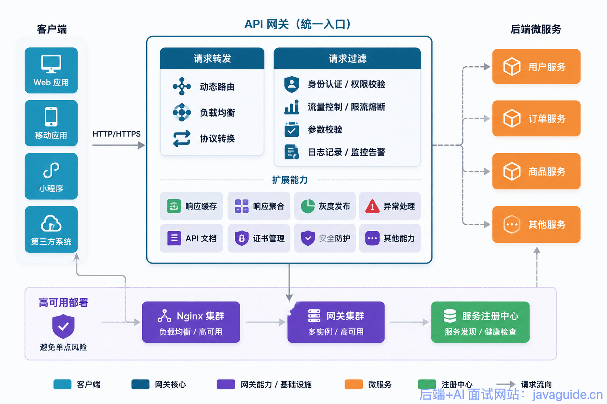
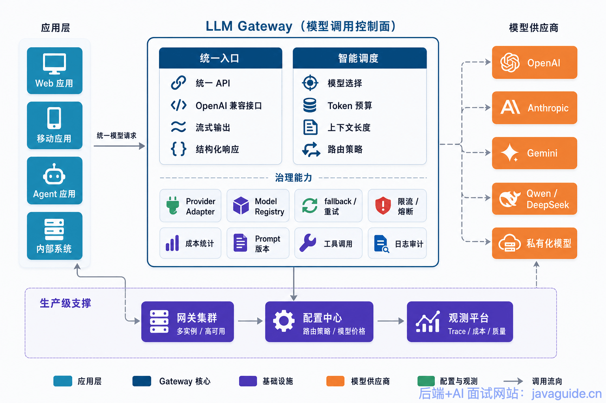
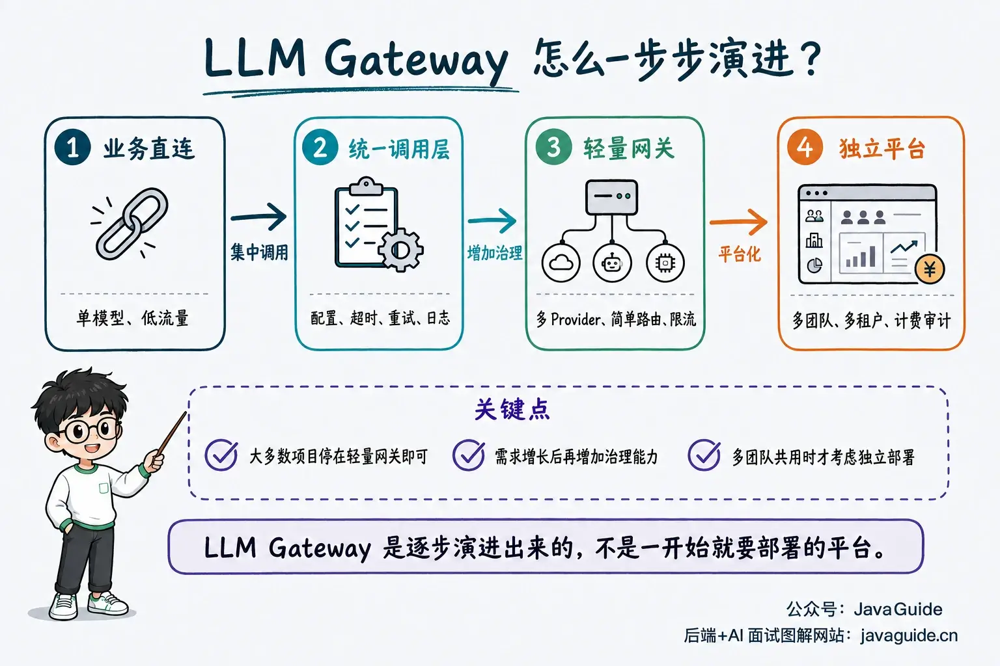
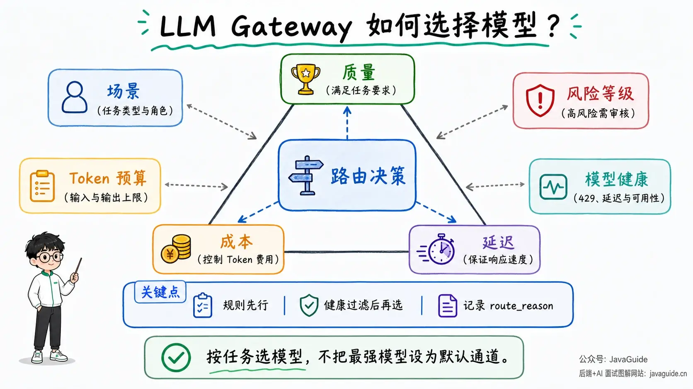
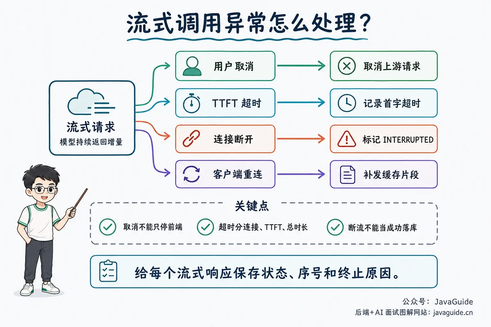
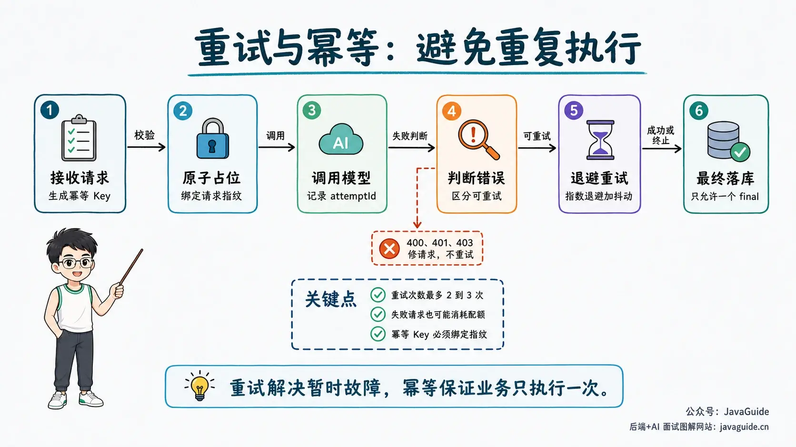
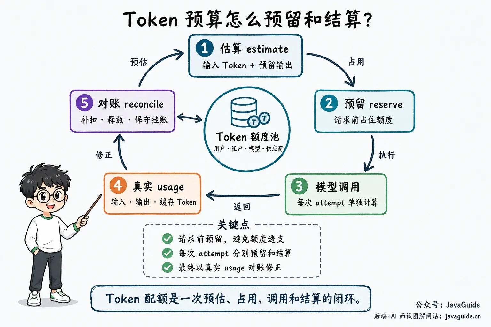
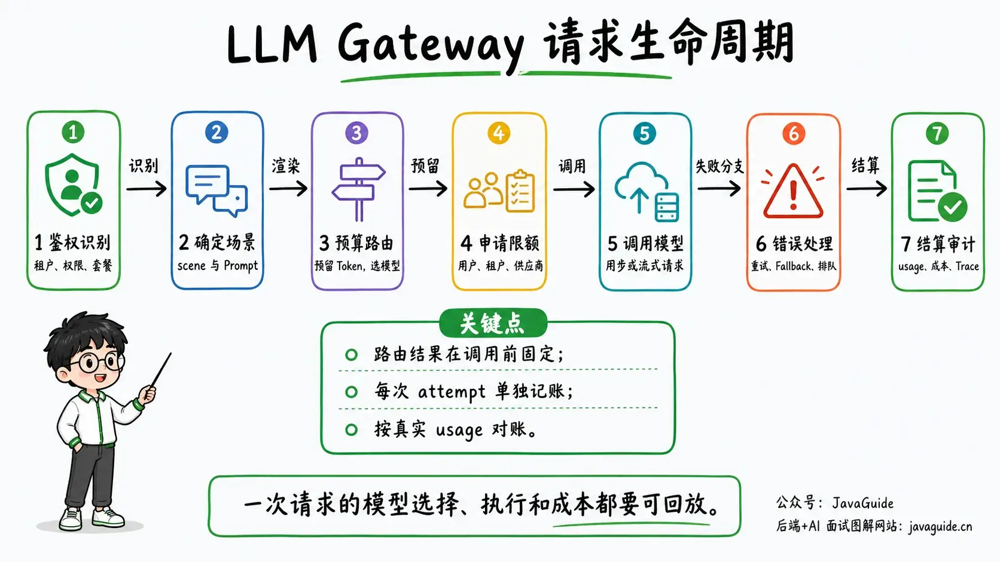

Recently, a reader asked me to explain LLM Gateways: what problems they solve, when they are worth deploying as a separate service, and how to choose one.

This article collects lessons from my project work. It is a detailed guide, with more than 30,000 Chinese characters including a small amount of code.

For most monoliths and single-team projects, a lightweight LLM Gateway inside the application is enough. First centralize model calls from different modules behind one entry point, then add timeouts, retries, logging, and simple routing as needed. You usually do not need to introduce a separate component such as LiteLLM or Kong AI Gateway, let alone build a standalone gateway platform from the start.

Using the same flagship model for intent classification, title generation, JSON repair, and complex report generation can simplify early development. As traffic grows, however, cost, latency, and provider rate limits become problems: lightweight tasks consume an expensive model's quota, critical tasks have no fallback when they fail, and monthly bills cannot be attributed to a tenant or feature.

These problems should not be solved independently by each business module; otherwise, model selection, retries, rate limiting, and call records quickly spread across the application code. An LLM Gateway provides a single entry point between the application and model providers, centralizing this shared logic.

## LLM Gateway Fundamentals

### What Is an LLM Gateway?

An LLM Gateway is best understood as **API gateway capabilities plus a control plane for model calls**.

A traditional API Gateway is a **single entry point** between clients and backend services. Client requests pass through it and are routed to the appropriate service. It primarily manages HTTP traffic: authentication, rate limiting, forwarding, logging, and circuit breaking.



An LLM Gateway handles model calls. In addition to common API concerns, it manages model-specific concerns such as model selection, token budgets, context length, provider differences, streaming, tool calls, structured responses, cost tracking, Prompt versions, and output quality.

More precisely, **an LLM Gateway is a governance layer between the application and model providers**. It does not necessarily replace an organization's existing API Gateway; it centralizes model-call routing, budgets, auditing, and provider adaptation.



Business code does not need to know how to call OpenAI, Anthropic, Gemini, Qwen, DeepSeek, or a self-hosted model. It sends a standard request to the Gateway, which chooses the model and provider based on the use case, budget, latency, availability, and business policy. It also decides whether to retry or fall back and what to log.

The first version of a Gateway can be lightweight, providing a common interface, timeouts, retries, and logging. In production, it may also manage model routing, token budgets, rate limits, cost attribution, caching, auditing, and security policies.

If it only forwards requests, it is a proxy. It becomes a Gateway when it also records why a model was selected, how the budget was consumed, and what fallback was used after a failure.

### Why Do You Need an LLM Gateway?

Many teams start building AI applications by calling the model directly from a business service:

```text
Controller -> Service -> OpenAI SDK -> Return answer
```

This call path is short and easy to develop. Once production usage grows, however, several problems emerge.

| Common issue                | Production symptom                                                                     | Gateway capability                                     |
| --------------------------- | -------------------------------------------------------------------------------------- | ------------------------------------------------------ |
| Hard-coded model names      | Model upgrades, retirements, or provider changes require edits throughout the codebase | Model registry and configurable routing                |
| Scattered API keys          | Each service stores its own keys, making rotation difficult                            | Centralized secret management                          |
| Provider rate limits        | Services retry aggressively after 429 responses, making the problem worse              | Rate limiting, queuing, fallback, and circuit breaking |
| Invisible costs             | The monthly bill shows a total but not the tenants, features, or Prompts responsible   | Usage records and cost attribution                     |
| One model for every request | Simple tasks waste money while complex tasks get poor results                          | Routing by task type                                   |
| Missing logs                | A user reports a bad answer, but the model input and output cannot be found            | Traces, Prompt versions, and model-call logs           |
| Scattered provider SDKs     | Each feature handles streaming, error codes, retries, and structured parsing           | A shared Provider Adapter                              |

Cost attribution and incident replay also need explicit design, in addition to access control.

These terms mean:

- **Cost attribution** identifies who or what feature incurred a model charge and which call caused it. Token usage and cost can be broken down by tenant, user, business scenario, Prompt version, model, and provider.
- **Incident replay** lets you retrieve the Prompt version, retrieved context, routing result, model version, tool calls, and errors for a `request_id` after a user reports a bad answer. This helps determine whether the problem came from the input, routing, model output, or downstream parsing.

Traditional API failures can often be diagnosed from the status code, request parameters, and database state. LLM failures are harder to trace: the Prompt may have changed, the model may have been upgraded, retrieved context may contain too much noise, the output may have been truncated, or routing may have selected an inexpensive but underpowered model.

Without a Gateway, all of these clues are scattered across the application.

That makes them difficult to manage.

### What Is the Difference Between an LLM Gateway and an LLM Router?

A Router has a narrower responsibility: choosing a model for a request. Its inputs may include the user's question, task type, budget, and context length; its output is a model name or a set of candidates.

A Gateway has a broader scope. It manages the full request lifecycle, including authentication, rate limiting, routing, fallback, logging, and cost records. A Router is one part of a Gateway.

| Dimension           | LLM Router                                       | LLM Gateway                                                                          |
| ------------------- | ------------------------------------------------ | ------------------------------------------------------------------------------------ |
| Main responsibility | Model selection                                  | Unified access, routing, rate limiting, fallback, observability, and cost governance |
| Decision scope      | Select a model for one request                   | Govern the full request lifecycle                                                    |
| Typical inputs      | User question, task type, budget, context length | Request, user, tenant, scenario, Prompt, model, provider, and policy                 |
| Typical outputs     | Target model or model set                        | Full result, usage, logs, errors, cost, and fallback history                         |
| Best suited for     | Multi-model calls becoming more complex          | AI applications entering production                                                  |

In short, **the Router selects a model; the Gateway manages the entire model call**.

You can use a Router without a Gateway for simple model routing, such as a function that returns a model based on the task type.

This can help with cost, but does not solve secret management, rate limiting, logging, auditing, consistent error handling, or provider switching.

Conversely, an early Gateway does not need a complex Router. A first version that provides unified access, logging, and fallback can already prevent many production incidents.

Avoid tying routing policies to specific model names. Prefer relatively stable attributes such as capability tier, cost range, context support, and risk level. Models and names change, but these decision criteria remain useful.

### How Does an LLM Gateway Relate to RAG, Agents, and MCP?

These concepts often appear together, but they have different responsibilities.

| Concept | Main purpose                                                                          | Relationship to the Gateway                                                                                                |
| ------- | ------------------------------------------------------------------------------------- | -------------------------------------------------------------------------------------------------------------------------- |
| RAG     | Retrieve external knowledge and add relevant context to a model request               | The Gateway can limit tokens, record Prompt versions, and cache post-retrieval results, but does not own retrieval quality |
| Agent   | Decompose tasks, call tools, and execute across turns                                 | The Gateway can manage the budget, routing, and fallback for each model call, but does not plan the agent's tasks          |
| MCP     | Give models or agents a standard protocol for accessing tools, resources, and context | The Gateway can audit model requests and tool-call logs, but does not replace an MCP Server or tool registry               |

The Gateway focuses on model-call governance; RAG, agents, and MCP focus on organizing application capabilities.

A complex agent can call the Gateway at several steps. The Gateway can record the `scene`, `route_reason`, token usage, and cost for each step.

### Does an LLM Gateway Add Latency?

It adds some latency, but this is usually not the main source of user-perceived wait time.

Routing, token estimation, and logging within the same data center add relatively little time. Model queueing, long-context inference, cross-region networking, output tokens, tool calls, and retries are more likely to increase end-to-end latency.

The Gateway can help with these bottlenecks. Route intent classification to a low-latency model, return cached results for repeated FAQs, and compress long contexts before sending them. For voice interactions and online support, include TTFT in candidate model health metrics. When a provider becomes unstable, switching candidates or queueing requests according to policy is easier to control than waiting for each application request to time out.

Routing also has a cost. Calling a powerful model for every request just to decide which model to use can consume the tokens and time you hoped to save. Without enough request volume, evaluation data, and quality feedback, rules by scenario or a lightweight classifier are often enough.

### Do You Really Need an LLM Gateway?

First consider how model calls fit into the system. If an internal tool calls one provider and handles only a few requests a day, a separately deployed Gateway is usually unnecessary. A shared `LLMClient` around the business service can handle timeouts, retries, basic logging, and error conversion.

The situation changes when multiple services, teams, or tenants reuse model calls. If model configuration is scattered, switching providers requires changing each service. If a scenario's costs rise, the bill may not be broken down by tenant, feature, or Prompt version. Provider switching, quotas, fallback, auditing, and quality replay will also be duplicated across call sites.

A heavy platform is not necessarily required, but model calls should have one entry point. Start with a shared module that manages model names, keys, call logs, and error handling, then add routing, budgets, and rate limits. Evolve it into a full LLM Gateway when multiple business lines share models, costs must be billed by tenant, or Prompt retention and sensitive content need centralized management.

My [AI interview platform](https://javaguide.cn/zhuanlan/interview-guide.html) follows this approach. It does not deploy a separate Gateway or add a dedicated LLM Gateway component. Instead, `LlmProviderRegistry` manages provider configuration, default models, API keys, `ChatClient`, and embedding models within the application. `StructuredOutputInvoker` centralizes structured-output validation, repair, retries, and metrics. This provides the core of a lightweight LLM Gateway and meets the project's current needs.

However, it is not the full production-grade Gateway described later in this article. Cross-provider fallback, token budgets, per-call cost attribution, gateway-level multi-dimensional rate limiting, and intelligent routing can be added when the application needs them. This illustrates that an LLM Gateway is first a set of responsibilities to manage centrally; it does not have to be a separate service or third-party component.



Decide whether to centralize calls by considering how many services a model-policy change affects and how many call paths an incident requires you to investigate. If calls are already in one module, adding models, switching providers, or adding auditing requires changes in one place. If calls are scattered across services, establish a shared entry point even if traffic is low.

## Why Not Use the Most Capable Model for Every Request?

### The Most Expensive Model Is Not Always the Best Fit

Setting the most capable model as the default avoids some early decisions, but does not replace task classification. Intent classification, title generation, JSON repair, and short summaries prioritize response speed, structured output, and fallback behavior. Keeping them on a powerful model increases cost and queueing time. A more expensive model does not automatically produce better results for complex tasks either; retrieved context, tool results, and output constraints also determine quality.

Names such as `tier-fast` and `tier-pro` represent capability tiers. A model registry should map them to the provider, model version, context window, and price currently in use. When a provider changes its model or pricing, routing rules do not need to change.

Routing records should include more than the final model name. Keep the scenario, model tier, candidates, routing reason, and actual usage so you can determine why a call used a fast model, when it switched to a fallback, and how that decision affected latency and cost.

### Which Tasks Suit Smaller Models, and Which Need a More Capable Model?

Start model selection with the task instead of comparing model leaderboards. Handle fixed-rule filtering, keyword checks, authorization, and template filling in code. Asking a model whether input is empty or a file has a PDF extension adds cost and unnecessary uncertainty.

Intent classification, title generation, short summaries, simple rewrites, and low-risk information extraction often suit lower-cost models. Enum constraints, structured-output validation, and clear failure handling matter more here than parameter count. Upgrade the model for a scenario when parsing fails or confidence is too low.

Multi-document synthesis, software architecture design, complex agent planning, and rigorous fact-checking need stronger reasoning. High-impact areas such as finance, law, and medicine also need human review or business rules. Reserve more capable models for these requests instead of making them the default for everything.

For example, in my multi-agent stock analysis project, a low-latency model can organize technical indicators and screen news. Synthesizing research materials and reconciling conflicting conclusions from multiple roles require stronger reasoning.

### How Does an LLM Router Choose a Model?

An LLM Router selects an appropriate model for each request.

The choice depends on more than answer quality. Consider cost, latency, context length, provider availability, and risk policy.

Projects such as [LLMRouter](https://github.com/ulab-uiuc/LLMRouter) dynamically select a model for each query to balance quality, cost, and latency. They explore single-turn, multi-turn, personalized, and agentic routing, with strategies such as KNN, SVM, MLP, matrix factorization, Elo rating, and graph-based routing.

These strategies are useful for learning and experimentation, but production systems first need explainability and replay. A steadier path is to **start with simple routing rules, then evolve them into a trainable, measurable, and iterative system as real needs emerge**.

Common routing strategies include:

| **Strategy**                  | **How it works**                                                    | **Suitable scenarios**                                  | **Risk**                                              |
| ----------------------------- | ------------------------------------------------------------------- | ------------------------------------------------------- | ----------------------------------------------------- |
| Fixed-rule routing            | Select a model by scenario, endpoint, or tenant plan                | First Gateway version; sufficient for many applications | Rules require manual maintenance and may become stale |
| Cost-first / cascade routing  | Start with a cheaper model and upgrade on failure or low confidence | Classification, summaries, support FAQs                 | Errors from the cheaper model can propagate           |
| Semantic / classifier routing | Select based on query meaning, complexity, and risk                 | Stable query types and higher traffic                   | Thresholds and classifiers need ongoing tuning        |
| Learned routing               | Train a Router on historical quality, cost, and latency             | Many models, tasks, and requests                        | Depends on evaluation data and a feedback loop        |
| Personalized routing          | Select based on user preferences and interaction history            | Consumer assistants, education, content platforms       | Higher privacy and consistency costs                  |
| Agentic routing               | Switch models and tools dynamically across turns                    | Complex agents and long workflows                       | Harder to debug and control costs                     |

The first version usually starts with fixed rules. Map translation, code generation, and default chat to model tiers, then override those defaults for different plans or risk levels. The rules may grow with the application, but they can be configured, audited, and rolled back. This is a practical way to centralize model calls.

Cascade routing starts with a lower-cost model and upgrades only when structured output cannot be parsed, confidence is too low, or business validation fails. It adds another inference or evaluation step, so it suits summaries, classification, and support FAQs that can tolerate extra latency. It is usually a poor fit for real-time voice or collaborative editing on the main request path.

Semantic or classifier-based routing can compare embeddings with task prototypes or model profiles, or use a lightweight classifier to label request complexity and risk. Model capabilities, user phrasing, and request distributions change, so monitor thresholds, misrouting rates, and evaluation examples. Learned and personalized routing depend even more on this data and must address privacy and explainability. Agentic routing must also control costs across multiple steps and remain debuggable.

Multi-agent systems add role selection. Check the role configuration first, then inherit the policy's default model, and use the system default only as a last resort. This is more stable than routing by endpoint alone when different roles handle technical analysis, public-opinion research, and final reports. Use the configured provider when it is healthy; only if it is unavailable or fails a health check should the system select from other candidates based on capability, latency, cost, and success rate.

Before an agent call begins, freeze the selected model, provider, model name, and any pre-call fallback decision in one routing result. If health status changes during streaming, do not reroute after completion and then record usage; that could attribute model A's cost to model B. Pre-call fallback is also different from replaying a failed request through another provider. For cross-provider replay, define which errors are retryable, whether ReAct tool results are reused, and what to do with text already sent to the user.

## What Capabilities Does an LLM Gateway Need?


### Unified Access to Multiple Models

Provider SDK calls are one of the first things to centralize in application code.

One service may call OpenAI, another DeepSeek, and a scheduled job Gemini. Each may work initially, but over time the same logic gets duplicated: API keys, timeouts, retries, stream parsing, error codes, usage, log formats, and model-name mappings.

A more reliable approach is to define a common request and response first.

```java
public record LLMRequest(
        String requestId,
        String idempotencyKey,
        String tenantId,
        String userId,
        String scene,
        List<ChatMessage> messages,
        Map<String, Object> responseSchema,
        LLMOptions options
) {
}

public record LLMResponse(
        String requestId,
        String model,
        String provider,
        String content,
        TokenUsage usage,
        String finishReason,
        boolean fallbackUsed
) {
}

public interface ProviderClient {

    String providerName();

    boolean supports(String model);

    LLMResponse chat(LLMRequest request, RenderedPrompt prompt, ModelRoute route);

    Flux<LLMChunk> streamChat(LLMRequest request, RenderedPrompt prompt, ModelRoute route);
}

public interface LLMGateway {

    LLMResponse chat(LLMRequest request);
}
```

These interfaces address several practical problems:

- Business code depends on `LLMGateway`, not on a provider SDK.
- Model names, providers, and fallback policies can be configured.
- Usage, cost, errors, and latency can be recorded consistently.
- Adding a model later requires only a new Provider Adapter.

A common engineering choice for the request interface is compatibility with OpenAI Chat Completions. LiteLLM, DeepSeek, and Qwen provide similar interfaces, and gateways such as Kong AI Gateway use OpenAI-compatible formats as one common entry point for AI plugins.

Exposing an OpenAI-compatible interface has a clear benefit: clients often need only to change `base_url` or the Gateway address to switch from a direct provider call to the shared entry point.

This standardizes the entry point, but not the provider-specific requests sent downstream.

Hosted gateways such as Cloudflare AI Gateway may require a supported Provider Native, REST, or Binding integration. Do not assume every provider can be passed through as if it used the OpenAI protocol. That protocol also cannot express some provider-specific features, such as Anthropic extended thinking or Gemini grounding metadata. Such options may need to go in `extra_body`, `metadata`, or internal extension fields, then be translated by a Provider Adapter into the target provider's request format.

A Provider Adapter must translate more than endpoints and authentication headers. It also needs to handle tool calls, streaming events, system instructions, structured output, usage, and error codes correctly.

| Dimension                 | OpenAI Chat Completions            | Anthropic Messages API                    | Gemini generateContent                 |
| ------------------------- | ---------------------------------- | ----------------------------------------- | -------------------------------------- |
| Tool-call field           | `tool_calls`                       | `tool_use` content block                  | `functionCall` part                    |
| Tool result               | `role=tool` message                | `role=user` + `tool_result` content block | `functionResponse` part                |
| Tool Schema               | JSON Schema                        | Subset of JSON Schema                     | Subset of OpenAPI                      |
| System instruction        | `system`/`developer` in `messages` | Top-level `system` field                  | `systemInstruction`                    |
| Multiple tool calls       | Native support                     | Native support                            | Verify behavior for each model and SDK |
| Provider-specific options | `metadata` / extension parameters  | thinking, `cache_control`, etc.           | grounding, `cachedContent`, etc.       |

An OpenAI-compatible interface simplifies client integration but does not remove provider protocol differences. Support for Claude, Gemini, or self-hosted models depends on whether the Provider Adapter correctly translates requests and events. A product's claim to support a provider does not mean every provider-specific feature maps without loss.

Centralize model calls first, then add routing, rate limiting, and auditing incrementally. This is usually easier to verify than implementing every provider-specific feature at the start.

### Model Routing

Model routing can provide clear benefits, especially when a system has distinct task tiers.

The first version can use configuration; there is no need to train a model.

```yaml
routes:
  - scene: intent_classification
    primary: tier-fast
    fallback:
      - tier-nano
      - tier-balanced
    max_output_tokens: 256
    risk_level: low

  - scene: complex_reasoning
    primary: tier-flagship
    fallback:
      - tier-pro
      - tier-balanced
    max_output_tokens: 4096
    risk_level: medium

  - scene: legal_review
    primary: tier-flagship
    fallback:
      - tier-compliance
    require_human_review: true
    risk_level: high

default:
  primary: tier-balanced
  fallback:
    - tier-fast
```

Here, `tier-*` names are internal capability tiers, not actual provider model IDs. In production, a `Model Registry` maps `tier-fast`, `tier-balanced`, and `tier-flagship` to currently available models and records both the tier and actual model name in logs. Model upgrades then require changes only to the registry and rollout configuration, not to business routing rules.

The Gateway should consider at least these factors when routing:

| Factor               | Purpose                                                                           |
| -------------------- | --------------------------------------------------------------------------------- |
| `scene`              | Selects the default model and risk level for the scenario                         |
| Input tokens         | Checks the model context window and token budget                                  |
| Output length        | Controls cost and latency                                                         |
| User plan            | Allows different models for free and enterprise users                             |
| Risk level           | Requires a compliant model or human review for high-risk tasks                    |
| Current model health | Switches away when a provider is unhealthy, returns 429s, or has high P95 latency |
| Historical quality   | Reduces a model's weight when it repeatedly fails a task type                     |

A simple router could start like this:

```java
public class RuleBasedModelRouter {

    private final RouteConfigRepository routeConfigRepository;
    private final ModelHealthService modelHealthService;

    public ModelRoute route(LLMRequest request, TokenBudget budget) {
        RoutePolicy policy = routeConfigRepository.findByScene(request.scene())
                .orElseGet(routeConfigRepository::defaultPolicy);

        for (String model : policy.candidates()) {
            if (!budget.fits(model)) {
                continue;
            }
            if (!modelHealthService.isAvailable(model)) {
                continue;
            }
            return ModelRoute.of(model, policy.providerOf(model), policy);
        }

        throw new NoAvailableModelException(request.scene());
    }
}
```

The code is straightforward; the important part is the separation of responsibilities. The router selects a model but does not call it. Health checks provide status without business logic. Budget checks are separate, so the estimation method can be replaced later.



### Graceful Fallback

Fallback is more than switching to another model whenever a request fails.

First distinguish between error types.

| Error type                 | Fallback suitability  | Handling                                                                                 |
| -------------------------- | --------------------- | ---------------------------------------------------------------------------------------- |
| Transient network failure  | Suitable              | Retry briefly, then switch to a backup model                                             |
| Provider 5xx               | Suitable              | Retry, use a circuit breaker, then switch providers                                      |
| 429 rate limit             | Suitable with care    | Read `Retry-After`; queue or switch models if needed                                     |
| Context limit exceeded     | Do not retry directly | Compress context, reduce retrieved passages, or use a model with a larger context window |
| Invalid parameters         | Unsuitable            | Fix the request instead of sending it again                                              |
| Safety refusal             | Usually unsuitable    | Follow the application's refusal or human-review flow                                    |
| Structured parsing failure | Limited recovery      | Retry with the same Schema, repair the format, or return an explicit failure             |

“Switch to a backup model” means the Gateway creates a new call attempt. It does not mean a generic retry callback should choose an arbitrary client after an exception. If a request has already performed a write, called a tool, or incurred a charge, first determine whether that step can be replayed. If streamed output has already reached the user, do not concatenate fragments from two models into one result.

Streaming calls also need explicit handling for user cancellation, TTFT timeouts, dropped connections, and client reconnections. The Gateway should track stream state, sequence numbers, and termination reasons so it does not mark a disconnected request as successful or resend chunks after reconnection.



A fallback chain might look like this:

```text
Primary model available -> Call it
Primary model returns 429 -> Read rate-limit details -> Switch to a backup model in the same tier
Backup model unavailable -> Switch to a lightweight model and shorten the output
Still unavailable -> Queue the request, return a fallback message, or escalate to a person
```

For requests with side effects, such as saving a report, executing a tool, or charging a user, design fallback together with idempotency. Plain text generation does not change business state, but duplicate calls still incur cost and may produce different content. Record every attempt and decide whether to reuse results based on the scenario.

Make fallback visible in the result. If a high-risk task such as legal review switches from a capable model to a lower-cost one, mark the change and send the result for review. If no candidate meets the quality requirements, return “The system is busy. Please try again later” instead of silently returning a low-quality result.

An idempotency record should store more than a “processed” flag. When results need to be reused, store the final `LLMResponse` and bind the key and value to the request semantics, for example `tenant_id + scene + idempotency_key + request_fingerprint`. Also record the Prompt and routing-policy versions and an expiration time. Reject reuse when the same idempotency key has a different request fingerprint, so a previous result is not returned for another request.

Concurrent requests need an atomic claim. Create a `running` record with a database unique constraint, conditional update, or Redis `SET NX`; only the request that acquires the claim may call the model. Other requests can wait, return a conflict, or reuse a `completed` result. Define behavior for `failed`, timed-out `running` records, and lease takeover. A “check, then write” sequence does not provide idempotency. Logs and caches must also follow tenant isolation, sensitive-data, and retention policies.



### Rate Limits and Quotas

LLM APIs can still be rate-limited by QPS, RPM, and concurrency, but request count alone is not enough.

Two requests each make one call, but their costs may differ by dozens of times:

- Request A: 500 input tokens and 100 output tokens.
- Request B: 80K input tokens and 8K output tokens.

By request count, B and A are equal. In provider quota, billing, and latency, they are very different.

An LLM Gateway usually needs rate limits at several levels.

| Limit scope | Controls                          | Purpose                                                     |
| ----------- | --------------------------------- | ----------------------------------------------------------- |
| User        | Requests from one user            | Prevent abuse and scripted traffic                          |
| Tenant      | Team budget                       | Control cost and separate plans                             |
| Model       | Requests to one model             | Keep a popular model from being saturated                   |
| Provider    | OpenAI, Anthropic, DeepSeek, etc. | Prevent an external dependency from overwhelming the system |
| Token       | Input and output tokens           | Control actual cost and quota pressure                      |

A safer approach is to reserve budget before sending a request to a provider.

```java
public record TokenBudget(
        int estimatedInputTokens,
        int reservedOutputTokens,
        int totalReservedTokens
) {
}

public interface LLMRateLimiter {

    RateLimitPermit acquire(String tenantId, String userId, String model, TokenBudget budget);

    void reconcile(RateLimitPermit permit, TokenUsage actualUsage);

    void release(RateLimitPermit permit);
}
```

When a request reaches the Gateway, estimate `input_tokens + reserved_output_tokens`. Send it only if the user, tenant, model, and provider buckets all have capacity. Otherwise, queue it, fall back, or reject it.

Reserve and settle budget per attempt. A primary model may have already consumed tokens when it times out or the stream disconnects, so do not release the entire reservation. When switching to a backup model, reserve again using that provider and price tier. Call `reconcile` when the provider returns usage. If usage is temporarily unavailable, record a conservative estimate and correct it later using billing data or asynchronous reconciliation.

Token estimates will not be exact, but a rough estimate is better than none. Budgets are especially important for RAG, long contexts, and agent tool calls, where usage can otherwise grow quickly.

Use this four-step flow: **estimate → reserve → actual usage → reconcile**. Reserve using an estimate, then correct it with the provider's actual `usage` when the call completes. Tokenizers and usage fields differ across providers and models. Production systems often reserve with a common approximation, then reconcile against actual `input_tokens` and `output_tokens`. Persisting estimates as final usage causes cost and quota statistics to drift over time.



### Cost Tracking

Many teams say they want to “reduce LLM costs” without knowing where the money goes.

That is guesswork, not optimization.

An LLM Gateway should record cost-attribution fields for every call.

| Field            | Description                                                       |
| ---------------- | ----------------------------------------------------------------- |
| `request_id`     | Unique ID for a business request                                  |
| `attempt_id`     | One model-call attempt; retries and fallback create more than one |
| `tenant_id`      | Tenant or team                                                    |
| `user_id`        | User                                                              |
| `scene`          | Business scenario, such as support, summary, or code generation   |
| `prompt_version` | Prompt version                                                    |
| `provider`       | Provider                                                          |
| `model_tier`     | Internal model tier selected by routing                           |
| `model`          | Model actually called                                             |
| `input_tokens`   | Input tokens                                                      |
| `output_tokens`  | Output tokens                                                     |
| `cached_tokens`  | Tokens served from a Prompt or provider cache                     |
| `cost`           | Cost calculated from a price snapshot                             |
| `price_version`  | Price version or effective time used to calculate cost            |
| `latency_ms`     | Total latency                                                     |
| `ttft_ms`        | Time to first token                                               |
| `fallback_used`  | Whether fallback occurred                                         |
| `error_code`     | Error type                                                        |

Calculate cost from a price snapshot, usually as `input_tokens × input price + output_tokens × output price`, plus any charges for cache writes, cache reads, or provider-specific fees. Do not treat `cached_tokens` as ordinary input tokens; interpret it together with the model and price version to reconstruct the call cost.

These fields tie costs to specific decisions. When a tenant's or feature's cost rises, check token usage, Prompt version, and model tier. When fallback becomes frequent, inspect the provider, candidates, and error codes. After a model upgrade, compare quality, latency, and cost for the same scenario.

Pricing, cache discounts, and provider charges change, so storing only `cost` is insufficient. Retain the `usage` details, price version, and calculation time with each call so you can recalculate when a bill differs. Use these call records and failure examples to guide later routing changes.

### Observability and Auditing

When a traditional system has a problem, engineers inspect logs, traces, and metrics. The same applies to AI systems, with additional model-related fields to record.

Products such as Cloudflare AI Gateway, LiteLLM, and Kong AI Gateway prominently expose logs, tokens, cost, errors, latency, caching, and rate limits. If an AI application records only the final answer, incidents are difficult to investigate.

A model-call trace should include at least:

```json
{
  "request_id": "req_202605210001",
  "attempt_id": "att_01",
  "tenant_id": "team_java",
  "user_id": "u_1024",
  "scene": "knowledge_qa",
  "prompt_version": "rag_qa_v7",
  "provider": "openai",
  "model_tier": "tier-balanced",
  "model": "provider-model-id",
  "route_reason": "scene=knowledge_qa,cost_priority=true",
  "input_tokens": 4210,
  "output_tokens": 612,
  "cost": 0.0059,
  "ttft_ms": 680,
  "latency_ms": 4120,
  "fallback_used": false,
  "finish_reason": "stop"
}
```

`request_id`, model, routing reason, and usage support most aggregated troubleshooting. Full Prompts and responses may contain personal information, company documents, internal code, or contract terms. Do not assume that logs should retain all raw text indefinitely. Decide based on data classification, processing purpose, contracts, applicable laws, and debugging needs. Products such as Cloudflare AI Gateway make request and response body collection configurable; custom systems should do the same through policy rather than hard-coding it into logging.

Metadata also needs a defined retention period. `usage`, model, latency, cost, `route_reason`, and error codes may be associated with a person or tenant. If Prompts or responses must be retained for sampling, control the sample rate and duration based on data classification, tenant authorization, and the shortest necessary period. Redact phone numbers, national IDs, bank cards, email addresses, and street addresses before they enter the logging pipeline. In addition to retention controls, provide access control, encryption, export, deletion, and legal-hold mechanisms, and record the purpose and deletion result for each data type.

### Caching and Semantic Caching

Caching saves cost only when an answer can be reused. If a request depends on permissions, real-time state, private context, or expert judgment, bypass the cache or use a strictly isolated key.

| Cache type               | How it works                                                     | Suitable scenarios                                      | Risk                                                                                   |
| ------------------------ | ---------------------------------------------------------------- | ------------------------------------------------------- | -------------------------------------------------------------------------------------- |
| Exact cache              | Return a previous result for an identical request                | FAQs, fixed instructions, repeated tests                | Can be incorrect for personalized or permission-sensitive requests                     |
| OpenAI Prompt Caching    | Automatically caches a stable long prefix                        | Long system prompts, stable tool Schemas                | Check supported models, thresholds, and discounts in current documentation and pricing |
| Anthropic Prompt Caching | Mark cacheable blocks with `cache_control`                       | Long system prompts, large documents, multi-turn agents | Verify current pricing for writes and reads                                            |
| Gemini Context Caching   | Reuse long contexts through cached content                       | Long documents, video, codebases, multi-turn Q&A        | Manage cached objects, TTL, storage cost, and invalidation                             |
| Semantic cache           | Reuse an answer for a semantically similar question              | Support FAQs, product information, low-risk Q&A         | Similar questions may need different answers                                           |
| Result-fragment cache    | Cache intermediate summaries, retrieval results, or tool results | Long-document summaries, batch processing               | Invalidation and version management are complex                                        |

Support FAQs are good candidates for caching: “How do I change my password?”, “Where can I download an invoice?”, and “How do I request a membership refund?” These answers are stable and rarely personalized, so caching can help.

Do not directly reuse generic answers for requests involving user permissions, real-time state, financial, medical, or legal advice, private multi-turn conversations, or current time, order, or inventory status.

Semantic cache keys should at least isolate tenant, permission scope, data version, scenario, and Prompt version. Vector similarity can identify cache candidates, but cannot replace these boundaries. “Why hasn't my order shipped?” and “Can I get a refund for my order?” may be close in vector space, but one asks about delivery status and the other about return policy. A false match can send users down the wrong path. Evaluate hit rate alongside business validation, complaint rate, and escalation rate.

Prompt caching does not automatically save money. Explicit caching usually charges differently for writes and reads. Automatic caching depends on supported models, minimum prefix length, and current pricing. If the System Prompt, tool Schema, or context includes a timestamp, random ID, or temporary user state on every request, the prefix keeps changing and the hit rate stays low. Put stable content first and dynamic content later when using provider caching.

## How Would You Design an LLM Gateway?

### What Does a Production-Grade LLM Gateway Look Like?

You can start by dividing an LLM Gateway into these components:

| Component              | Responsibility                                                                                                          |
| ---------------------- | ----------------------------------------------------------------------------------------------------------------------- |
| API Adapter            | Expose a unified API compatible with OpenAI-style requests or an internal standard request                              |
| Auth / Tenant          | Authenticate requests, identify tenants, and check plans and permissions                                                |
| Prompt Renderer        | Render Prompt templates and record Prompt versions                                                                      |
| Token Budget Estimator | Estimate input and output tokens and check the budget                                                                   |
| Model Registry         | Track model capabilities, prices, context windows, providers, and status                                                |
| Router                 | Select a model based on scenario, budget, latency, and risk                                                             |
| Provider Adapter       | Adapt provider protocols through a shared `ProviderClient`, including tool calls, stream events, usage, and error codes |
| Retry / Fallback       | Retry, fall back, and apply circuit breaking by error type                                                              |
| Rate Limiter           | Limit by user, tenant, model, provider, and tokens                                                                      |
| Cost Tracker           | Record usage, calculate cost, and attribute it by tenant and scenario                                                   |
| Observability          | Provide metrics, logs, traces, and alerts                                                                               |
| Audit Log              | Audit key requests, with redaction, retention, and replay support                                                       |

The first version should provide a unified API, Provider Adapters, and logs for usage, cost, errors, and latency. Once call records are stable, add rule-based routing, fallback, token budgets, and tenant quotas. Quality replay, auditing, and classifier-based routing depend on this data. This sequence lets you verify that model calls are centralized before deciding whether more complex routing is worth maintaining.

### What Happens Inside the Gateway After a Request Arrives?

When a request reaches the Gateway, it first authenticates the request and identifies the tenant, available features, plan, and budget limits. The Gateway then determines the `scene` from request parameters or a lightweight classifier and renders the corresponding Prompt, context, and tool Schema.

Token estimation and routing follow. The Gateway reserves input and maximum output tokens for candidate models and requests quota at the user, tenant, model, and provider levels. Once the route is fixed, the Provider Adapter makes a synchronous or streaming call. The response text, structured JSON, tool calls, usage, and finish reason all belong to that attempt.

For network errors, 429 responses, or parsing failures, error classification determines whether to retry, switch candidates, queue the request, or fail immediately. Reserve budget for each new attempt. When the call finishes, settle against actual usage and record the model, provider, Prompt version, routing reason, latency, and errors before returning a normalized result to the business service.



### How Should Routing Evolve from Simple to Intelligent?

Do not implement every routing strategy at once. Fixed rules, cascade routing, semantic or classifier-based routing, learned routing, personalized routing, and agentic routing form an evolution path, not a checklist for the first version.

A safer progression is to make the system controllable first, cost-efficient next, and intelligent last.

| Stage | Strategy                                 | Main capability                                                 | Signal to move to the next stage                                                |
| ----- | ---------------------------------------- | --------------------------------------------------------------- | ------------------------------------------------------------------------------- |
| One   | Fixed model and manual configuration     | Centralize calls and avoid scattering SDKs                      | Multiple scenarios share models and show clear cost or latency differences      |
| Two   | Fixed-rule routing                       | Choose models by scenario, tenant, and risk level               | Rules are growing and becoming difficult to maintain manually                   |
| Three | Cost-first / cascade routing             | Try a smaller model first; upgrade on failure or low confidence | Stable quality checks and acceptable additional latency are available           |
| Four  | Semantic / classifier routing            | Route by query type, complexity, and risk                       | Enough request examples exist to evaluate classifier drift                      |
| Five  | Quality feedback and cost regression     | Replay traces to measure model quality and cost                 | An evaluation set, human sampling, or a business feedback loop exists           |
| Six   | Learned / personalized / agentic routing | Select models dynamically, including per step                   | High traffic, multiple tasks and models, and continuous evaluation are in place |

Before moving to the next stage, verify that the added complexity provides value and keep fixed rules as a rollback path. Classifier-based routing needs monitoring for misroutes and threshold drift. Learned and agentic routing also require a stable evaluation set, production traces, cost limits, and privacy controls.

### What If Routing Makes the Wrong Choice?

Routing will make mistakes.

Every routing strategy can misclassify a request. Production systems need ways to detect, handle, and replay those mistakes.

Common fallback strategies include:

| Problem                                  | Fallback strategy                                                                |
| ---------------------------------------- | -------------------------------------------------------------------------------- |
| Low classifier confidence                | Use a default mid-to-high capability model or ask the user to clarify            |
| Low-quality output from a small model    | Upgrade and retry with a more capable model                                      |
| High-risk task routed to a low-risk path | Give risk rules priority over cost rules                                         |
| Quality drift after a new model launch   | Use a staged rollout, A/B testing, and regression against a fixed evaluation set |
| User reports an incorrect answer         | Replay the Prompt, model, context, and routing reason using `request_id`         |
| Model P95 latency increases              | Lower its weight through health checks or temporarily open the circuit           |

“Upgrade and retry with a more capable model” is suitable only for requests without side effects that can be replayed. For agents that call tools, first persist this turn's tool results or explicitly abandon the current execution. Otherwise, the upgraded model may call a tool again, causing inconsistent state and cost.

Routing logs should include `route_reason` as well as the model name so the reason for a selection can be reconstructed.

For example:

```json
{
  "scene": "intent_classification",
  "selected_model_tier": "tier-fast",
  "selected_model": "provider-model-id",
  "route_reason": "scene_rule:low_risk,cost_priority,estimated_tokens=320",
  "confidence": 0.91,
  "fallback_candidates": ["tier-nano", "tier-balanced"]
}
```

Without `route_reason`, the routing system will be difficult to tune later.

## How Should You Choose Among Available Solutions?

### How Do You Choose Between a Custom Gateway, LiteLLM, Cloudflare, Kong, and Inworld Router?

There are many LLM Gateway and Router options. Do not choose based only on the number of supported models. Consider the team's technology stack, compliance requirements, traffic volume, self-hosting needs, existing API Gateway, and observability requirements.

| Option                                         | Main advantages                                                                                                           | Suitable scenarios                                                                        | Less suitable scenarios                                                                                                                   |
| ---------------------------------------------- | ------------------------------------------------------------------------------------------------------------------------- | ----------------------------------------------------------------------------------------- | ----------------------------------------------------------------------------------------------------------------------------------------- |
| Lightweight custom Gateway                     | Controllable, tailored to the application, and closely integrated with internal permissions, billing, and auditing        | A team has backend expertise and clear needs, and wants to evolve from rule-based routing | A team needs many providers quickly or lacks capacity to maintain a Gateway                                                               |
| LiteLLM                                        | Multi-provider access, OpenAI-compatible format, and a mature Proxy / SDK ecosystem                                       | Platform teams, fast integration, multi-model experiments, and a unified entry point      | Strict compliance or deep enterprise governance may need customization; production use requires version pinning and supply-chain security |
| Cloudflare AI Gateway                          | Managed entry point, log analysis, caching, rate limits, retries, dynamic routing, DLP, BYOK, and more                    | Teams already on Cloudflare that want observability, caching, and unified access quickly  | Strong self-hosting requirements, private deployment, or complex enterprise governance                                                    |
| Kong AI Gateway                                | Strong enterprise API governance and mature plugins for authentication, rate limiting, PII redaction, and cost governance | Teams already using Kong or bringing AI requests into an enterprise API Gateway           | Early-stage small teams or teams that do not want a full API Gateway stack                                                                |
| Inworld Router                                 | Conditional routing, traffic splitting, experiments, and sticky user assignment                                           | Real-time voice, conversational AI, AI coding tools, user segmentation, and A/B tests     | Confirm separately when open-source auditing, private deployment, or a defined enterprise SLA is required                                 |
| Research projects such as LLMRouter / RouteLLM | Rich routing algorithms for evaluating complexity routing and quality-cost tradeoffs                                      | Research, experimentation, offline evaluation, and routing strategy validation            | A production Gateway requires additional authentication, billing, auditing, rate limiting, observability, and high availability           |

LiteLLM primarily avoids duplicating integrations for multiple model SDKs. Applications use a shared OpenAI-compatible interface, while the Proxy connects to different providers and can centralize keys, budgets, permissions, logs, and routing. It suits teams that need to connect to several providers quickly without building their own adapter layer.

Keep in mind that the Proxy stores provider keys and receives all model requests. In production, pin dependency and image versions, test upgrades, scan for vulnerabilities, and rotate keys. Do not use the `latest` image indefinitely.

Cloudflare AI Gateway suits teams already using Cloudflare. It can add logging, caching, rate limits, retries, and fallback with few changes to the request path. It also supports dynamic routing, BYOK, and DLP scanning.

The application still needs to decide which model to use. If data, networking, and auditing must remain fully under your control, first confirm that Cloudflare's managed deployment model is suitable.

Kong AI Gateway suits teams already using Kong or planning to standardize on an API Gateway. Existing authentication, rate limiting, auditing, security, and monitoring can be reused, with AI plugins providing model transformation, routing, and load balancing.

Kong may be too heavy for a small team. Some advanced AI plugins also require an enterprise license, so include licensing, deployment, and operational costs in the evaluation.

Inworld Router focuses on real-time routing and A/B experiments. It can select models by price, speed, capability, or user type, then compare model and Prompt quality, retention, and cost.

It suits real-time conversation, voice interactions, and AI coding tools. It is a managed service, however. For private deployment, data restrictions, SLAs, and procurement budgets, consult the latest official documentation and commercial terms.

LLMRouter is better suited to research and evaluation of routing algorithms. It supports methods such as KNN, SVM, MLP, Elo, graph-based, personalized, multi-turn, and agentic routing.

It is not a production Gateway by itself. You must add permissions, quotas, billing, auditing, rate limits, and operations. Without a stable evaluation set and production traces, it is difficult to show that complex algorithms outperform rule-based routing.

### Recommendations

For a new application, start with a lightweight custom Gateway. Do not buy a heavy platform immediately. Centralize model calls and add at least logging, usage tracking, token budgets, and fallback.

If you need to connect to many models and providers quickly, consider a mature unified interface such as LiteLLM. It can move a team from scattered SDK calls to one entry point quickly.

If the organization already uses Kong, consider Kong AI Gateway. Its value is bringing AI traffic into the existing API governance system.

If the organization relies heavily on Cloudflare, Cloudflare AI Gateway can provide observability, caching, rate limiting, and a unified entry point.

If you want intelligent routing, prepare evaluation data and production traces before considering learned strategies such as LLMRouter. Without data, more complex routing is harder to explain.

Keep the order: **establish operational controls before pursuing intelligent routing**.

## How Do You Measure an LLM Gateway?

Do not measure an LLM Gateway by the number of models it supports. A large number may only mean that many adapters were written; it does not prove the production call path is reliable.

Track routing accuracy, quality pass rate, fallback rate, cost, and latency separately by scenario, model tier, and provider.

| Metric                          | Meaning                                                                  |
| ------------------------------- | ------------------------------------------------------------------------ |
| Routing accuracy                | Whether requests reach the intended model or model tier                  |
| Quality pass rate               | Whether output passes evaluation, human sampling, or business validation |
| Fallback rate                   | Whether the primary path is stable or the backup is frequently triggered |
| Average cost                    | Cost per request or business scenario                                    |
| P95 latency                     | User experience, especially for interactive and voice scenarios          |
| TTFT                            | Time to first token, which affects streaming experience                  |
| 429 rate                        | Provider rate-limit pressure                                             |
| Cache hit rate                  | Requests and tokens saved by caching                                     |
| Structured parsing failure rate | Stability of Schemas, Prompts, and model adapters                        |
| Routing drift                   | Whether the routing policy stops working after model or traffic changes  |

“Routing drift” is one of the easiest metrics to overlook.

Model capabilities are not static. An inexpensive model that cannot handle complex summaries today may become good enough after an upgrade. Conversely, an upgrade can make a previously reliable model worse at a particular formatting task.

Routing rules need ongoing maintenance. Version them like Prompts and run regression tests as you would for code.

## Summary

An LLM Gateway keeps provider protocols, model routing, rate limits, caching, token budgets, and auditing out of business services, leaving them with one unified model-call interface.

For most projects, this entry point can be a lightweight module in the application; there is no need to add a separate component just to claim to “use an LLM Gateway.” My [AI interview platform](https://javaguide.cn/zhuanlan/interview-guide.html) takes this approach: a shared provider registry and call wrapper solve current needs, while actual traffic and governance requirements will determine whether to add routing, budgets, fallback, cost tracking, or a separate Gateway later.

The first version should verify three things: requests are adapted correctly, each call can be replayed using its actual model and usage, and failures trigger the intended fallback. Add quotas, cost governance, and caching in response to real traffic. Introduce classifier-based or learned routing only after stable evaluation sets, production traces, and rollback mechanisms are in place.

Reevaluate quality, latency, and cost under the same routing rules whenever model versions or prices change.

## References

- [LiteLLM Docs](https://docs.litellm.ai/docs/)
- [LiteLLM Security Update: Suspected Supply Chain Incident](https://docs.litellm.ai/blog/security-update-march-2026)
- [Cloudflare AI Gateway Docs](https://developers.cloudflare.com/ai-gateway/)
- [Cloudflare AI Gateway Request Handling](https://developers.cloudflare.com/ai-gateway/configuration/request-handling/)
- [Cloudflare AI Gateway Fallbacks](https://developers.cloudflare.com/ai-gateway/configuration/fallbacks/)
- [Cloudflare AI Gateway DLP](https://developers.cloudflare.com/ai-gateway/features/dlp/set-up-dlp/)
- [Cloudflare AI Gateway BYOK](https://developers.cloudflare.com/ai-gateway/configuration/bring-your-own-keys/)
- [Kong AI Gateway Docs](https://developer.konghq.com/ai-gateway/)
- [Inworld Router Docs](https://docs.inworld.ai/router/introduction)
- [LLMRouter GitHub Repository](https://github.com/ulab-uiuc/LLMRouter)
- [OpenAI Prompt Caching](https://platform.openai.com/docs/guides/prompt-caching)
- [Anthropic Prompt Caching](https://docs.anthropic.com/en/docs/build-with-claude/prompt-caching)
- [Gemini Context Caching](https://ai.google.dev/gemini-api/docs/caching)
