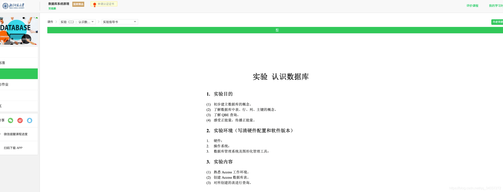
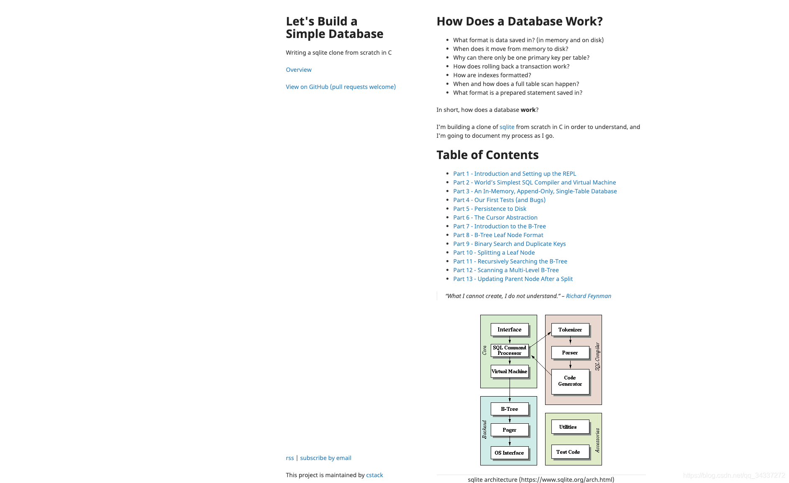
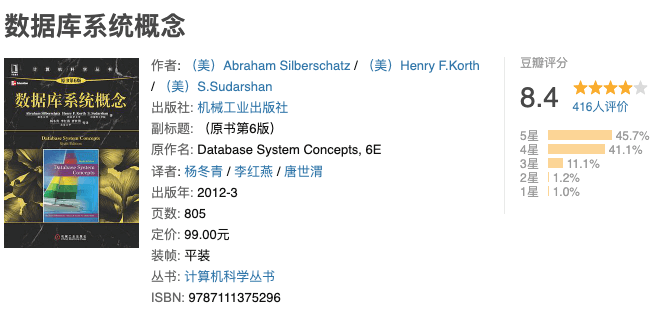
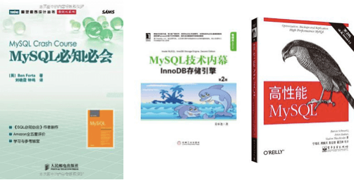
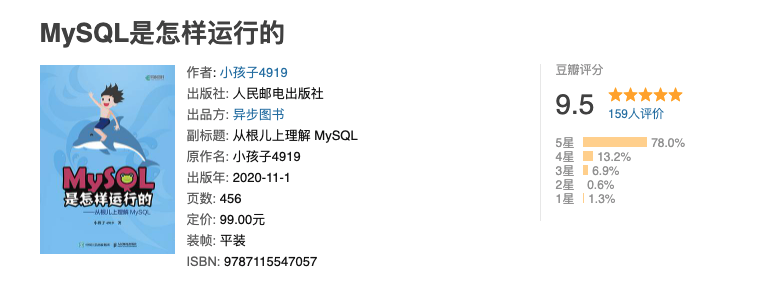
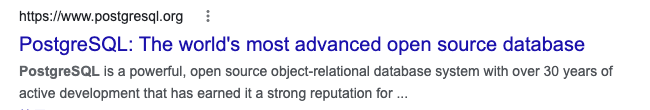
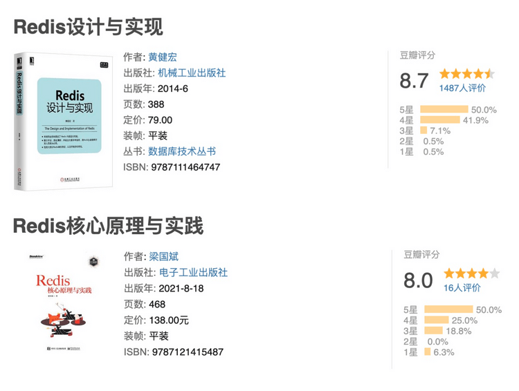

## Database Fundamentals

If database textbooks feel too dry, start with a video course. The courses [Database System Principles](https://www.icourse163.org/course/BNU-1002842007) from Beijing Normal University and [Database Systems (Part 2): Management and Technology](https://www.icourse163.org/course/HIT-1001578001) from Harbin Institute of Technology are good options.

The instructor for [Database System Principles](https://www.icourse163.org/course/BNU-1002842007) explains the material in detail. The exercises closely match each lesson, and the course includes many labs.

If you prefer hands-on learning, try [How to Build a Simple Database](https://cstack.github.io/db_tutorial/). This project walks you through implementing a simple database.

Developers have also built a small database in Java. See the detailed [Freedom project](https://github.com/alchemystar/Freedom). Another option is [db_tutorial](https://github.com/cstack/db_tutorial), a small database implemented in C.

Search GitHub for toy databases implemented in other languages.

**Reading about databases is not enough; build and experiment with one.**

### Database System Concepts

[Database System Concepts](https://book.douban.com/subject/10548379/) is a classic textbook with a clear structure that covers the full range of database concepts. It is a textbook, not just a reference.

### Database System Implementation

If you want to study the internals of MySQL, start with [Database System Implementation](https://book.douban.com/subject/4838430/).

MySQL and Oracle share many high-level design ideas. Their implementations differ in areas such as index data structures and storage engines.

Some parts of this book's translation are awkward. If you can, use the English edition.

_Database System Implementation_ is a Stanford textbook. [Fundamentals of Database Systems](https://book.douban.com/subject/3923575/) is a prerequisite that can introduce you to the subject.

## MySQL

Websites and applications typically use a database to store their data. MySQL is common in enterprise applications. If you want to learn MySQL, consider these three books:

- **[MySQL Crash Course](https://book.douban.com/subject/3354490/)**: A short, approachable introduction for beginners.
- **[High Performance MySQL](https://book.douban.com/subject/23008813/)**: A classic guide to using MySQL effectively, with both theory and practice. If you cannot read the whole book, focus on Chapter 5, “High-Performance Indexes,” and Chapter 6, “Query Performance Optimization.”
- **[MySQL Internals](https://book.douban.com/subject/24708143/)**: A good choice if you want to understand MySQL storage engines in depth.

For a video course, see [MySQL Database Tutorial](https://www.bilibili.com/video/BV1fx411X7BD) from Power Node.

I also recommend **[How MySQL Works](https://book.douban.com/subject/35231266/)**. Its detailed explanations make it useful for interview preparation without being tedious.

## PostgreSQL

Like MySQL, PostgreSQL is a powerful, free, open-source relational database. Its slogan is “the world's most advanced open-source relational database.”

PostgreSQL's newer features have led more projects to choose it over MySQL in recent years.

If you are deciding whether to try PostgreSQL, see this [Zhihu discussion comparing PostgreSQL and MySQL](https://www.zhihu.com/question/20010554).

### PostgreSQL Guide: Exploring the Internals

[PostgreSQL Guide: Exploring the Internals](https://book.douban.com/subject/33477094/) explains how PostgreSQL works, including the logical organization and physical implementation of database objects and its process and memory architecture.

I read about a third of it when I first needed PostgreSQL at work and found it useful.

### PostgreSQL Internals: Query Optimization in Depth

[PostgreSQL Internals: Query Optimization in Depth](https://book.douban.com/subject/30256561/) examines implementation details of PostgreSQL query optimization and helps explain how its query optimizer works.

## Redis

**Redis is a database written in C. Unlike traditional databases, it stores data in memory, which makes reads and writes fast. It is widely used for caching.**

If you want to learn Redis, these two books are good starting points:

- [Redis Design and Implementation](https://book.douban.com/subject/25900156/): A broad introduction to Redis concepts. I also discussed it in [A Redis Classic Published When Its Author Was 24](https://mp.weixin.qq.com/s?__biz=Mzg2OTA0Njk0OA==&mid=2247507030&idx=1&sn=0a5fd669413991b30163ab6f5834a4ad&chksm=cea1939df9d61a8b93925fae92f4cee0838c449534e60731cfaf533369831192e296780b32a6&token=709354671&lang=zh_CN&scene=21#wechat_redirect).
- [Redis: Core Principles and Practice](https://book.douban.com/subject/26612779/): Uses source code to explain important Redis topics, including data structures and advanced features.

[Redis Development and Operations](https://book.douban.com/subject/26971561/) is another useful book. It covers fundamentals and shares practical development and operations experience.

