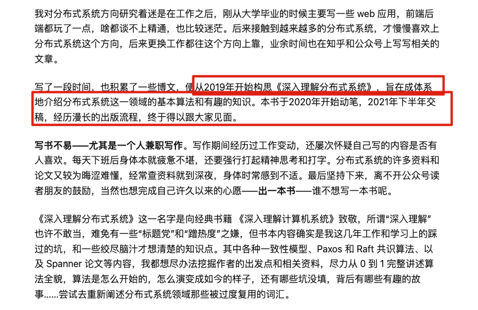
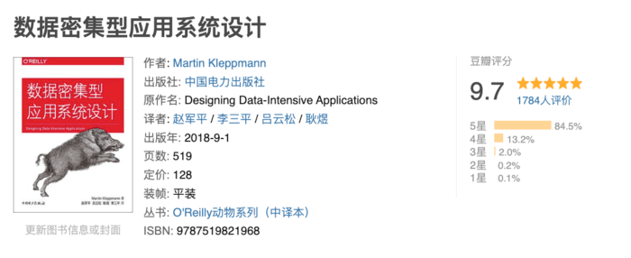
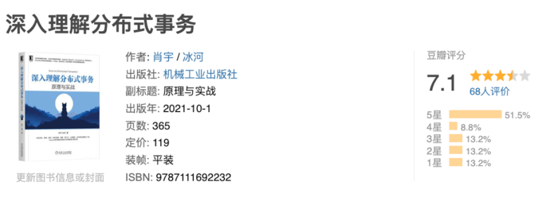
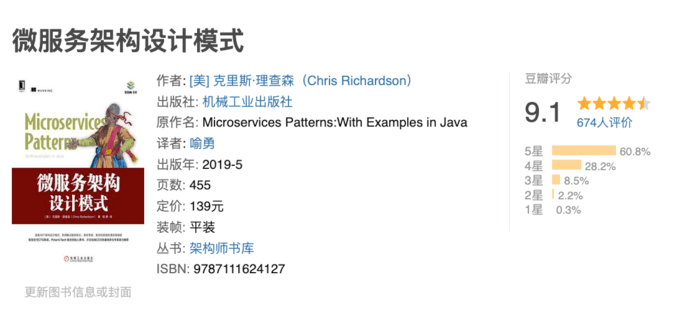

## Understanding Distributed Systems

**[Understanding Distributed Systems](https://book.douban.com/subject/35794814/)** is an original Chinese book published in 2022. It covers distributed-systems fundamentals, common challenges, and consensus algorithms.

A substantial part of the book is devoted to consensus algorithms. It also walks through implementing Paxos, an early consensus algorithm, from scratch in Go.

I have not read the book yet, but I have carefully read nearly all of the author's articles on distributed systems. The author began planning the book in 2019, started writing it in 2020, and spent almost two years completing the manuscript.

The author shares the story behind the book here: <https://zhuanlan.zhihu.com/p/487534882>.

The [source code and errata](https://github.com/tangwz/DistSysDeepDive) are also available.

## Designing Data-Intensive Applications

I highly recommend **[Designing Data-Intensive Applications](https://book.douban.com/subject/30329536/)** (DDIA). It is worth reading more than once. Nearly 90% of its Douban reviewers gave it five stars when this article was written.

The book covers distributed databases, data partitioning, transactions, and distributed systems.

You may have heard many of the concepts before, but the book often makes their underlying mechanisms much clearer.

I also recommended it in this [Zhihu answer about programming books](https://www.zhihu.com/question/50408698/answer/2278198495). If you find DDIA difficult, try the author's [chapter-by-chapter reading guide](https://ddia.qtmuniao.com).

## Understanding Distributed Transactions

One of the authors of **[Understanding Distributed Transactions](https://book.douban.com/subject/35626925/)** founded the Apache ShenYu (incubating) gateway and distributed transaction frameworks including Hmily, RainCat, and Myth.

This book is a useful reference for distributed transactions. It has some errors and awkward explanations, but overall it presents the main approaches well.

## From Paxos to ZooKeeper

**[From Paxos to ZooKeeper](https://book.douban.com/subject/26292004/)** is a good introduction to distributed-systems theory. It explains several common distributed consistency protocols and approaches to consistency problems, with a focus on Paxos and ZAB.

**Note:** ZooKeeper is less widely used today, so you do not need to prioritize it. Paxos and ZAB are still worth studying in depth.

## Deep Dive into Distributed Consensus Algorithms

**[Deep Dive into Distributed Consensus Algorithms](https://book.douban.com/subject/36335459/)** examines the principles and implementation details of major consensus algorithms, including Paxos, Raft, and ZAB. It is a useful reference for learning distributed consensus.

## Microservices Patterns

**[Microservices Patterns](https://book.douban.com/subject/33425123/)** is by Chris Richardson, a microservices pioneer and one of the world's leading software architects. It presents 44 proven architecture patterns for problems such as service decomposition, transaction management, queries, and cross-service communication. The book combines theory with Java examples to guide readers through building and deploying production-ready microservices.

## Phoenix Architecture

**[Phoenix Architecture](https://book.douban.com/subject/35492898/)** draws on Zhou Zhiming's years of experience in architecture and software development. It combines theory and practice and covers both breadth and depth.

As its subtitle, “Building Reliable Large-Scale Distributed Systems,” suggests, the book focuses on how to build reliable large-scale software systems. It covers:

- The evolution from monoliths to microservices and serverless architectures.
- Design concerns and practices for software architects.
- Distributed-systems foundations, including Paxos and Multi-Paxos.
- Immutable infrastructure, virtualization, containers, and service meshes.
- Common pitfalls when adopting microservices.

I have recommended this book several times. See these earlier articles:

- [Another excellent book by Zhou Zhiming](https://mp.weixin.qq.com/s?__biz=Mzg2OTA0Njk0OA==&mid=2247505254&idx=1&sn=04faf3093d6002354f06fffbfc2954e0&chksm=cea19aadf9d613bbba7ed0e02ccc4a9ef3a30f4d83530e7ad319c2cc69cd1770e43d1d470046&scene=178&cur_album_id=1646812382221926401#rd)
- [Another must-read for Java developers](https://mp.weixin.qq.com/s/9nbzfZGAWM9_qIMp1r6uUQ)

## Other Recommendations

- [Distributed Systems: Concepts and Design](https://book.douban.com/subject/21624776/): A comprehensive textbook that can also serve as a reference.
- [Principles and Practice of Distributed Architecture](https://book.douban.com/subject/35689350/): Published in 2021. It has received little attention, and I have not read it yet.
