## Java Fundamentals

**[Head First Java](https://book.douban.com/subject/2000732/)**

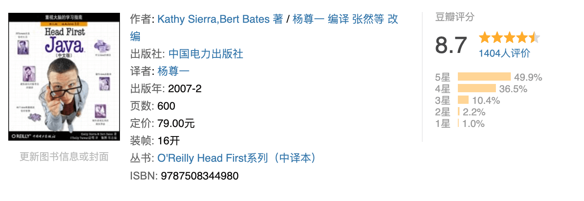

_Head First Java_ is approachable and engaging. It was one of my favorite books when I started learning to program, and it helped me get started with Java. Many of my friends also used it when they were learning Java.

Is it suitable for beginners? I think so, especially if you enjoy the style of the _Head First_ series.

**[Core Java, Volume I and Volume II](https://book.douban.com/subject/34898994/)**

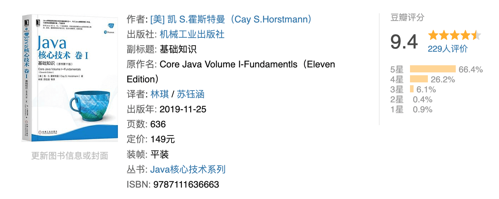

These are excellent references, but they cover a lot of material and take time to read from beginning to end. I often consult them when I need to check a Java fundamentals topic while writing.

I bought both volumes in college and would browse them from time to time. They are thorough and detailed, so they are a good choice once you have some Java experience.

**[Thinking in Java](https://book.douban.com/subject/2130190/)**

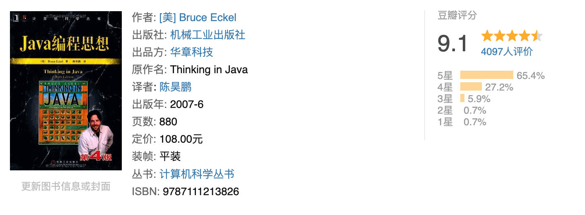

The author later published [On Java](https://book.douban.com/subject/35751619/), which I recommend for its newer coverage of Java 8, 11, and 17.

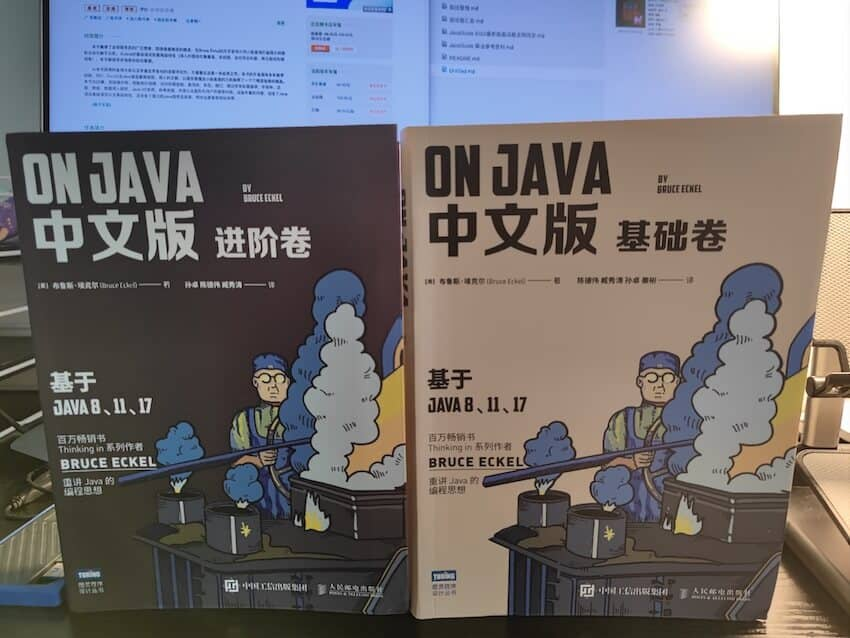

It is one of the few books available at the time of writing that covers all three of those long-term support releases.

**[Java 8 in Action](https://book.douban.com/subject/26772632/)**

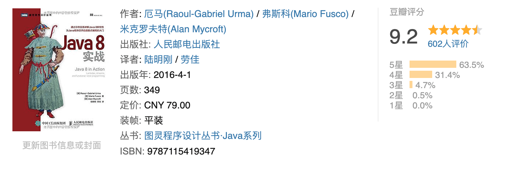

Java 8 was a major release, and many companies still use it. Its features, including lambdas and the Stream API, are useful to know. _Java 8 in Action_ is a good resource for learning them.

**[The Logic of Java](https://book.douban.com/subject/30133440/)**

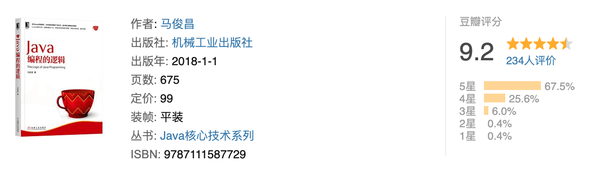

This is an underappreciated book with more depth than many introductory texts. It suits beginners and also works well as a review of Java fundamentals.

## Java Concurrency

**[The Art of Java Concurrency Programming](https://book.douban.com/subject/30351286/)**

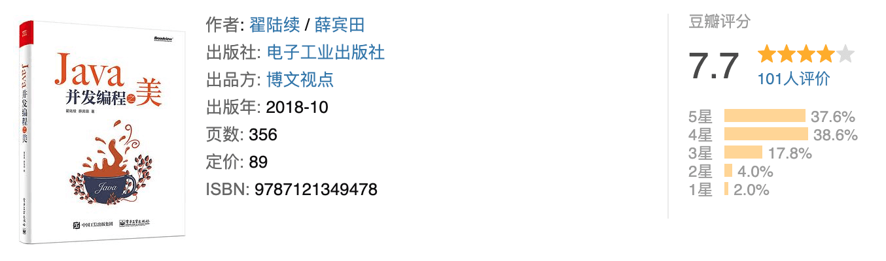

This book is a clear introduction to Java multithreading, from the fundamentals through practical applications. The author explains the topics with code examples and draws on extensive experience in concurrent programming.

The author also publishes technical articles online. The book brings together years of experience with multithreading.

**[Practical Java High Concurrency Programming](https://book.douban.com/subject/30358019/)**

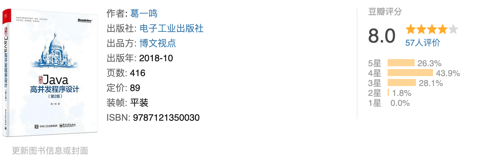

This is a good book for learning or advancing your knowledge of multithreading. It combines theory with practice and explains each topic clearly.

**[Java Multithreading: From Beginner to Expert](https://github.com/RedSpider1/concurrent)**

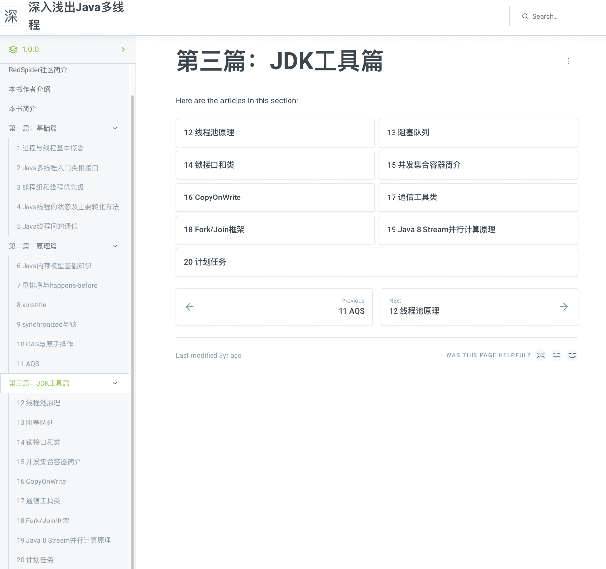

This open-source book was written by several experienced engineers. The authors drew on books, articles, and their own experience, and included examples and source-code analysis.

The book uses consistent formatting and a clear writing style. The authors review drafts together, review them again before merging, and revise the full text several times.

Read it online: <https://redspider.gitbook.io/concurrent/>.

**[Java Concurrency: JDK Source Code Analysis](https://book.douban.com/subject/35013531/)**

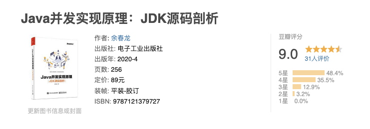

This book examines important parts of the Java `java.util.concurrent` package. It also covers concurrency topics such as the Java Memory Model (JMM), happens-before, and compare-and-swap (CAS).

It is useful for developers who want to study Java concurrency in depth or prepare for interviews.

## JVM

**[Understanding the Java Virtual Machine](https://book.douban.com/subject/34907497/)**

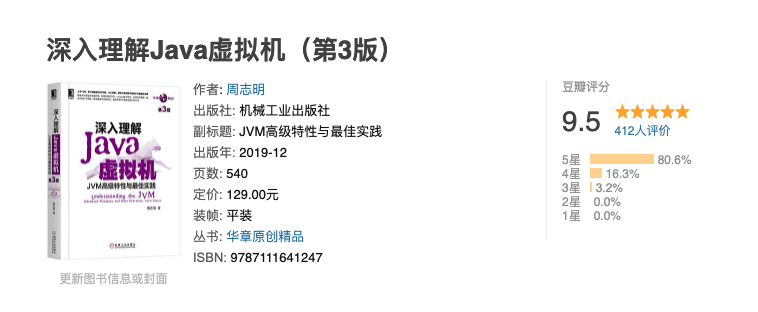

This is an excellent book. I hope more high-quality technical books like it will be published.

The third edition, released in late 2019, added substantial material, including explanations of newer garbage collectors such as ZGC. It had a 9.5 rating on Douban when this article was written.

The book is useful both for interview preparation and for learning the JVM. Read it more than once and work through its practical exercises.

Other recommendations include **[In-Depth Java Virtual Machine](https://book.douban.com/subject/26354292/)** and **[Design and Implementation of Virtual Machines: A JVM Example](https://book.douban.com/subject/34935105/)**.

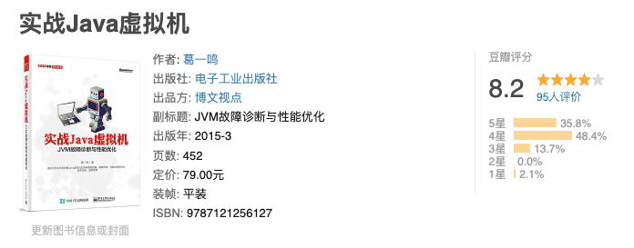

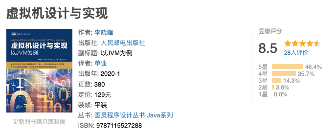

If you want to build a simple JVM yourself, see **[Write Your Own Java Virtual Machine](https://book.douban.com/subject/26802084/)**.

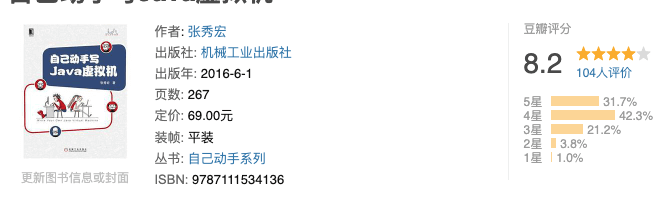

The examples in this book are implemented in Go. After understanding the principles, you could try implementing them in Java. If you want a starting point, several Java implementations are available online, including [Zachaxy's handwritten JVM series](https://zachaxy.github.io/tags/JVM/).

The book had an 8.2 rating on Douban when this article was written. I think it deserves a higher rating.

R, a well-known JVM engineer, also recommends several JVM books in [Learning JVM Implementation from the Inside Out](https://www.douban.com/doulist/2545443/).

## Commonly Used Tools

Git and Docker are especially useful.

- **IntelliJ IDEA**: Learn the basic operations and common shortcuts. See the [IntelliJ IDEA tutorial in Simplified Chinese](https://github.com/judasn/IntelliJ-IDEA-Tutorial).
- **Maven**: Spend a few days learning Maven before using common frameworks. It is easier than finding and downloading JAR files manually. See [Maven Core Concepts](https://javaguide.cn/tools/maven/maven-core-concepts.html).
- **Git**: Git is an essential skill. Try hosting your practice code on GitHub as you learn. See [Git: Core Concepts](https://javaguide.cn/tools/git/git-intro.html).
- **Docker**: Use Docker to install software such as MySQL for your studies. It can save setup time. See [Docker — From Beginner to Practitioner](https://yeasy.gitbook.io/docker_practice/).

Learn how to use GitHub as well. See [Practical GitHub Tips](https://javaguide.cn/tools/git/github-tips.html).

## Common Frameworks

For frameworks, start with their official documentation or tutorials.

### Spring and Spring Boot

Spring and Spring Boot are important for Java backend development.

Understand AOP and IoC, as well as Spring bean scopes and lifecycle and how Spring MVC works.

Spring Boot is widely used in Java backend development. Learn it well, including how to integrate it with technologies such as MyBatis, Elasticsearch, Spring Security, and Redis.

Here are some recommended books and guides.

**[Spring in Action](https://book.douban.com/subject/34949443/)**

This is an overview of Spring rather than a beginner's textbook. It introduces basic concepts and examples across many parts of Spring, but does not explore them in depth. As the author says on the final page, “Learning Spring is just beginning.”

**[Professional Java Development with the Spring Framework](https://book.douban.com/subject/30452637/)**

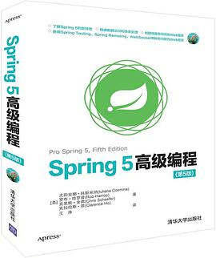

This book covers Spring 5 features in detail. It is long and can be a little dry, and some of the translation reads awkwardly. I use it as a reference.

**[Spring Boot: The Core Concepts](https://book.douban.com/subject/33390560/)**

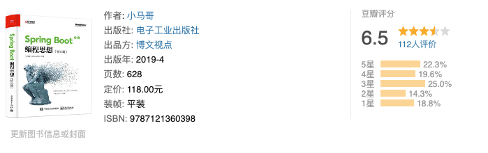

_A little wordy, but the explanations of the underlying principles are clear._

This book is a detailed guide to Spring Boot internals, but it may not suit beginners. I have read only a few chapters. It is quite long, and some topics feel overexplained, though its account of Spring Boot internals is clear.

**[Spring Boot in Action](https://book.douban.com/subject/26857423/)**

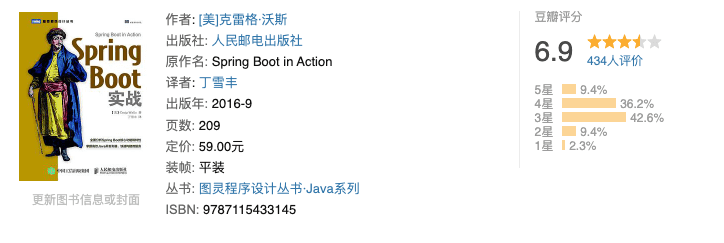

This book is fairly ordinary, but it is worth a quick look.

### MyBatis

MyBatis is widely used in China, but I do not think it requires a lot of study. Its source code, however, is worth reading for its useful coding practices. Here are two books about the MyBatis source code.

**[Write MyBatis: A Progressive Source-Code Walkthrough](https://book.douban.com/subject/36243250/)**

My friend Fu Ge wrote this practical guide. It focuses on the core logic of MyBatis and gradually implements its key features without covering unrelated details.

Companion project: <https://github.com/fuzhengwei/small-mybatis>.

**[A General Guide to Reading Source Code: MyBatis Explained](https://book.douban.com/subject/35138963/)**

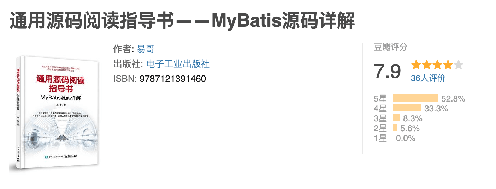

This book uses MyBatis to explain how to read source code. It analyzes more than 300 classes, covering their background, organization, logic, and implementation details.

Companion project: <https://github.com/yeecode/MyBatisDemo>.

### Netty

**[Netty in Action](https://book.douban.com/subject/27038538/)**

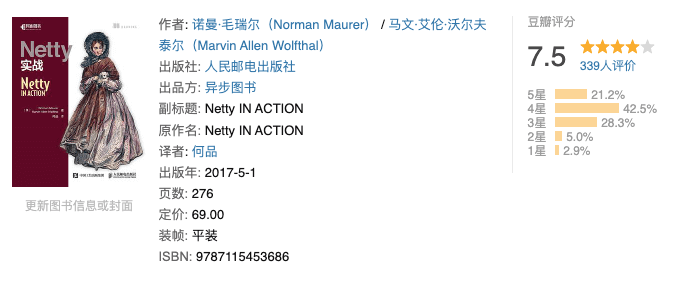

This book starts with BIO and NIO, explains why Netty was developed and why it is useful, and then covers its key concepts. The examples make it suitable for learning Netty through practice.

**[Netty in Practice: Learn Netty Through Examples](https://book.douban.com/subject/30381214/)**

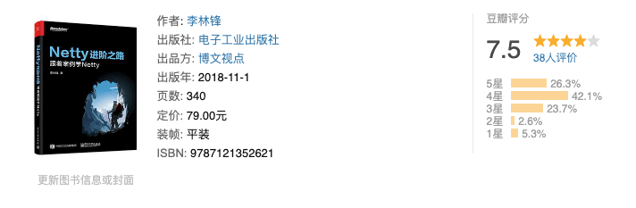

This book presents practical Netty examples, including memory-leak scenarios. It is a good next step once you know the basics.

**[Learn Netty with Flash: Instant Messaging and Internals](https://book.douban.com/subject/35752082/)**

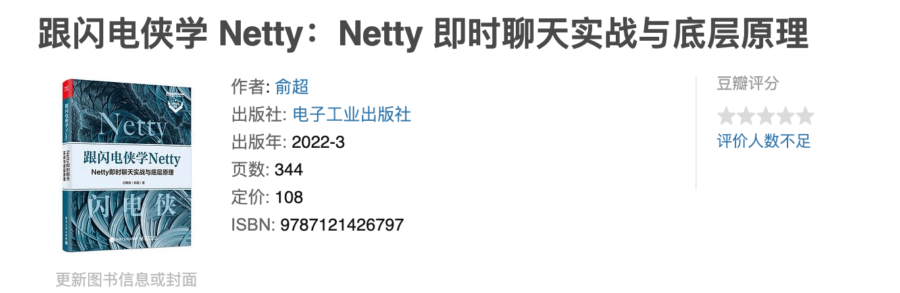

Published in March 2022, this book has two parts. The first builds an instant-messaging system to introduce Netty; the second analyzes the source code and explains its key internals.

## Performance Tuning

**[Java Performance: The Definitive Guide](https://book.douban.com/subject/26740520/)**

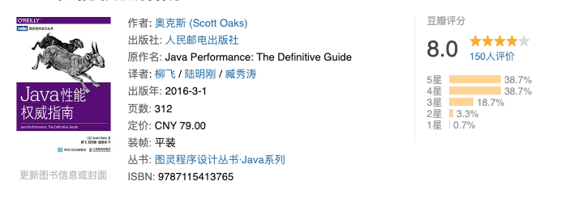

This O'Reilly book is an introduction to performance tuning. I consider performance tuning essential knowledge for Java developers.

Its practical material, especially on JVM tuning, is useful, though some content is dated. Few books cover this topic. It is not for beginners; learn Java first, and consider reading _Understanding the Java Virtual Machine_ beforehand.

## Website Architecture

I have read many books on website architecture, including _Large-Scale Website Architecture: Core Principles and Case Studies_, _Core Technologies for Websites with Billions of Visits_, and _The Art of Architecture: Gateways, Open Platforms, Distributed Systems, Microservices, and Fault Tolerance_.

The two books I would recommend are Li Yunhua's **[Learning Architecture from Scratch](https://book.douban.com/subject/30335935/)** and Yu Chunlong's **[Software Architecture Design: Integrating Large-Scale Website and Business Architecture](https://book.douban.com/subject/30443578/ "Software Architecture Design: Integrating Large-Scale Website and Business Architecture")**.

_Learning Architecture from Scratch_ is also available as a Geek Time course. The book and course share much of their content, so you can choose one. I have read only part of the book; it covers a broad range of topics and focuses on how to design architectures.

_Software Architecture Design_ covers transactions and locks, distributed systems (including CAP and distributed transactions), high concurrency, and high availability.

## Interview Preparation

**JavaGuide Interview Crash Course**

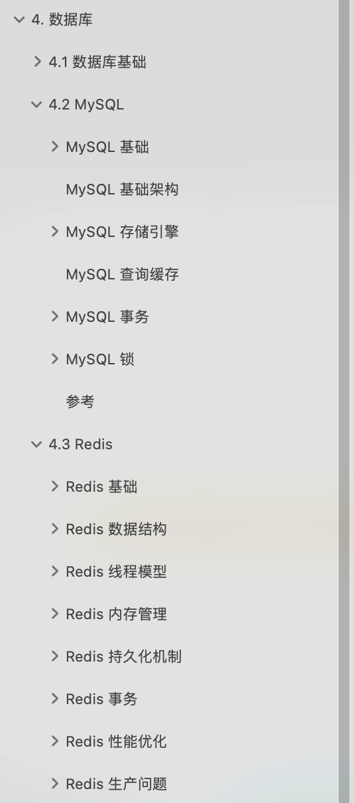

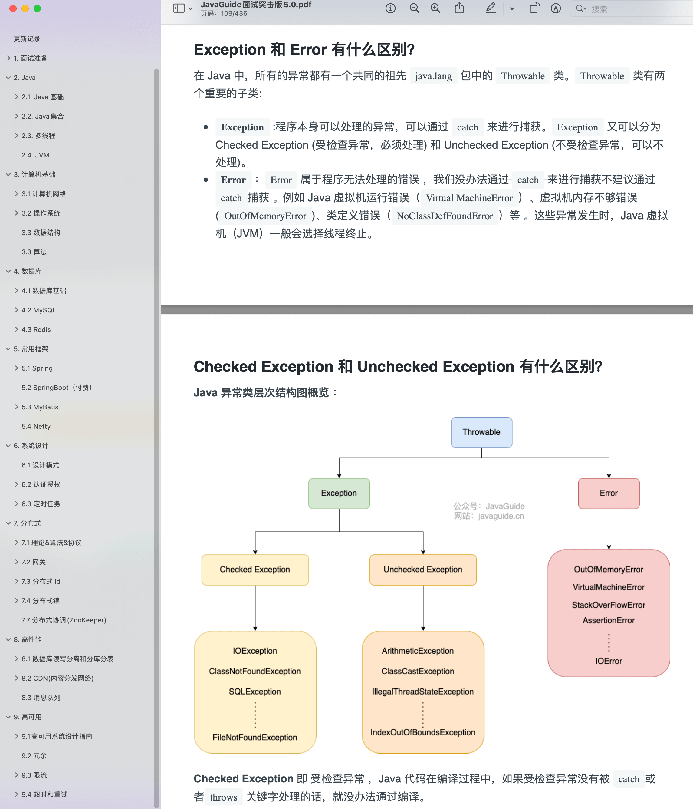

The interview edition of [JavaGuide](https://javaguide.cn/) covers many Java backend topics, including collections, the JVM, multithreading, and MySQL.

Follow the official JavaGuide account and reply with **“面试突击”** (Chinese for “interview crash course”) to get the guide for free.

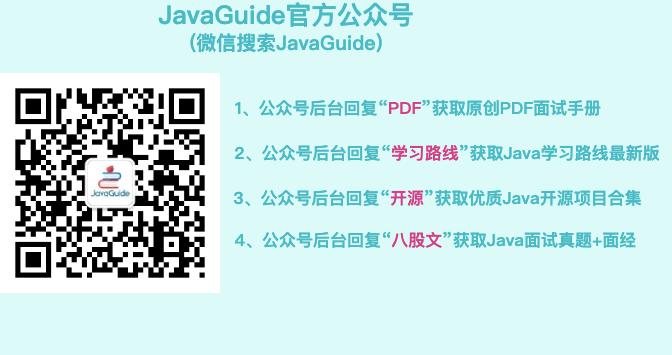
