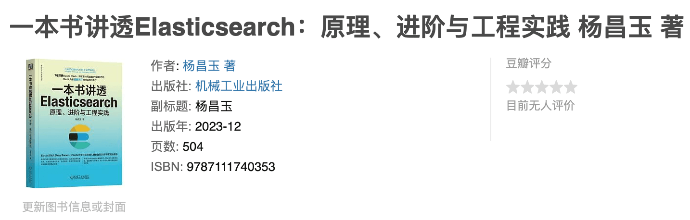
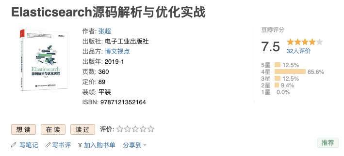

## Lucene

Elasticsearch is built on Apache Lucene. Before learning Elasticsearch, it is helpful to first review some Lucene concepts.

**[_Lucene in Action_](https://book.douban.com/subject/6440615/)** is one of the few Chinese-language books about Lucene. It is useful for learning Lucene concepts and common operations.

## Elasticsearch

**[_Elasticsearch Explained: Principles, Advanced Topics, and Engineering Practice_](https://book.douban.com/subject/36716996/)**

Written for version 8.x, this is currently one of the latest books covering Elasticsearch. It covers core topics from Elastic's official certification and draws on real project examples and enterprise questions.

**[_Elasticsearch: Core Concepts and Practice_](http://gk.link/a/10bcT "Elasticsearch: Core Concepts and Practice")**

This Geek Time course covers Elasticsearch 7.1, which is still relatively recent. The author is a senior technical expert at eBay with 20 years of industry experience, so the course is high quality.

**[_Elasticsearch Source Code Analysis and Optimization in Practice_](https://book.douban.com/subject/30386800/)**

If you want to study Elasticsearch internals in more depth, consider this book by Zhang Chao. It is the only book on the market that examines the Elasticsearch source code.
