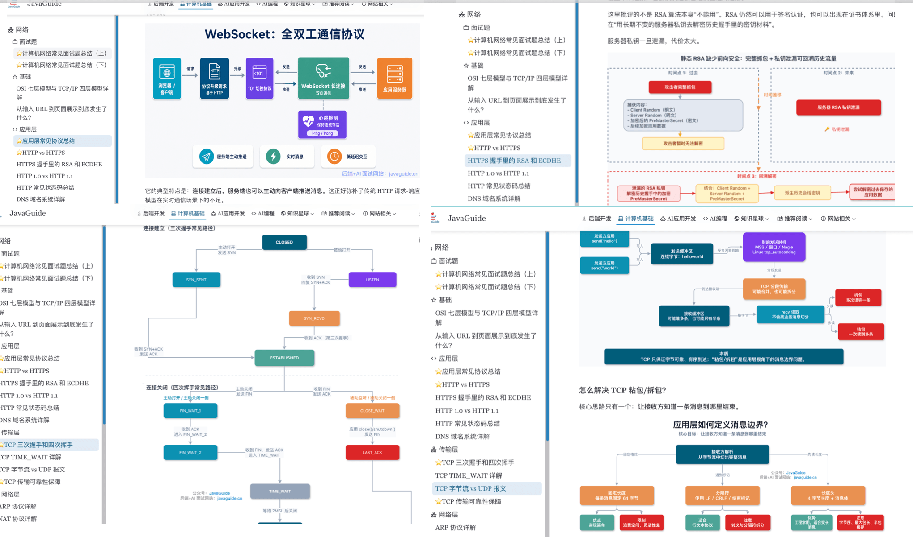

<!-- @include: @small-advertisement.snippet.md -->

This **computer science fundamentals guide** is for backend developers learning core concepts and preparing for interviews. It organizes the site's articles in this order: computer networking, operating systems, data structures, and algorithms.

If you have limited time, start with [common computer networking interview questions](./network/other-network-questions.md) and [common operating system interview questions](./operating-system/operating-system-basic-questions-01.md) to get an overview of frequently asked topics. To build a stronger foundation, work through the topics below in order.

The guide includes **300+ technical illustrations** that explain abstract concepts visually.

## Who This Guide Is For

- Backend developers building a systematic foundation in computer science.
- Candidates preparing for new graduate or experienced-hire interviews at technology companies.
- Readers who want to connect networking, operating systems, data structures, and algorithms.
- Engineers who write application code but want a stronger grasp of TCP/IP, HTTP, processes and threads, memory management, trees, graphs, and sorting.

## Key Topics

- **Computer networking:** Understand network layers, TCP/UDP, HTTP/HTTPS, DNS, ARP, NAT, and common security issues.
- **Operating systems:** Understand processes and threads, locks and synchronization, memory management, virtual memory, zero-copy, I/O multiplexing, file systems, Linux, and shell usage.
- **Data structures:** Understand arrays, linked lists, stacks, queues, hash tables, trees, graphs, heaps, tries, union-find, skip lists, red-black trees, Bloom filters, and LRU caches, including their trade-offs and use cases.
- **Algorithms:** Understand complexity analysis, binary search, two pointers, sliding windows, DFS/BFS, backtracking, dynamic programming, greedy algorithms, Top K, sorting, string and linked list problems, and common LeetCode patterns.
- **Interview answers:** Connect a concept to its principles, comparisons, use cases, and common questions.

## Suggested Reading Order

1. [Computer networking](./network/): Start with network layers, HTTP, TCP, DNS, and common networking interview questions to understand how network communication fits together.
2. [Operating systems](./operating-system/): Study processes and threads, memory, file systems, Linux, and shell usage. These topics support concurrency, JVM, and database work.
3. [Data structures](./data-structure/): Learn linear structures, hash tables, trees, graphs, heaps, tries, union-find, skip lists, red-black trees, Bloom filters, and LRU caches.
4. [Algorithms](./algorithms/): Practice complexity analysis, core algorithm templates, and common LeetCode problems.
5. Return to interview questions to find gaps. Review common networking and operating system questions, then practice data structure and algorithm problems by pattern.

If your target roles emphasize algorithms, combine steps 3 and 4. Study a data structure and then solve related problems. For example, after [hash tables](./data-structure/hash-table.md), practice Two Sum and prefix sum problems; after [heaps](./data-structure/heap.md), practice [Top K](./algorithms/top-k.md); after [trees](./data-structure/tree.md) and [graphs](./data-structure/graph.md), practice [DFS and BFS](./algorithms/dfs-bfs.md), [backtracking](./algorithms/backtracking.md), and [dynamic programming](./algorithms/dynamic-programming.md).

## Core Articles

### Computer Networking

- [Computer networking](./network/): Core networking concepts and common interview questions, organized by protocol layer.
- [Common computer networking interview questions, part 1](./network/other-network-questions.md): OSI/TCP-IP models, HTTP, HTTPS, DNS, and other fundamentals.
- [Common computer networking interview questions, part 2](./network/other-network-questions2.md): TCP, UDP, network security, sockets, and related topics.
- [The OSI seven-layer model and TCP/IP four-layer model](./network/osi-and-tcp-ip-model.md): Network layers and the responsibilities of each protocol.
- [What happens between entering a URL and seeing a page?](./network/the-whole-process-of-accessing-web-pages.md): DNS, TCP, HTTP, and browser rendering through one request.
- [HTTP vs. HTTPS](./network/http-vs-https.md), [HTTP/1.0 vs. HTTP/1.1](./network/http1.0-vs-http1.1.md), and [common HTTP status codes](./network/http-status-codes.md): Common HTTP interview topics.
- [TCP connection establishment and teardown](./network/tcp-connection-and-disconnection.md) and [TCP reliability](./network/tcp-reliability-guarantee.md): Connection management and reliable data transfer.

### Operating Systems

- [Operating systems](./operating-system/): From operating system fundamentals to common Linux questions.
- [Common operating system interview questions, part 1](./operating-system/operating-system-basic-questions-01.md): Fundamentals, processes and threads, deadlocks, and memory management.
- [Common operating system interview questions, part 2](./operating-system/operating-system-basic-questions-02.md): File systems, I/O, Linux, and related topics.
- [Processes and threads: differences, states, communication, context switching, and virtual threads](./operating-system/process-and-thread.md): Resource boundaries, state transitions, context switching, and Java virtual threads.
- [Inter-process communication (IPC)](./operating-system/ipc.md): Pipes, message queues, shared memory, sockets, and Binder.
- [Operating system locks and synchronization](./operating-system/os-lock-and-sync.md): Critical sections, mutexes, semaphores, condition variables, spinlocks, and futexes.
- [Operating system memory management](./operating-system/memory-management.md): Allocation, fragmentation, page tables, TLBs, page replacement, swap, and OOM.
- [Virtual memory](./operating-system/virtual-memory.md): Address translation, page tables, TLBs, page faults, and page replacement.
- [Operating system file systems](./operating-system/file-system.md): Inodes, dentries, file descriptors, VFS, page cache, and journaling.
- [I/O multiplexing](./operating-system/io-multiplexing.md): How `select`, `poll`, and `epoll` work, how they compare, and when to use them.
- [Zero-copy](./operating-system/zero-copy.md): Data paths and practical uses for traditional I/O, `mmap`, `sendfile`, and `splice`.
- [Linux fundamentals](./operating-system/linux-intro.md): Directory layout, file permissions, common commands, and system basics.
- [Shell scripting fundamentals](./operating-system/shell-intro.md): Scripts, variables, control flow, and common commands.

### Data Structures

- [Data structures](./data-structure/): Common data structures, organized by type and illustrated.
- [Linear data structures](./data-structure/linear-data-structure.md): Storage and operation complexity for arrays, linked lists, stacks, and queues.
- [Hash table interview questions](./data-structure/hash-table.md): Hash functions, collisions, resizing, and Java `HashMap`.
- [Trees](./data-structure/tree.md): Binary trees, binary search trees, AVL trees, B-trees, and B+ trees.
- [Graphs](./data-structure/graph.md): Graph representations, DFS, BFS, and shortest-path algorithms.
- [Heaps](./data-structure/heap.md), [red-black trees](./data-structure/red-black-tree.md), and [Bloom filters](./data-structure/bloom-filter.md): Common engineering structures and interview topics.
- [Trie interview questions](./data-structure/trie.md), [union-find](./data-structure/union-find.md), [skip lists](./data-structure/skip-list.md), and [LRU caches](./data-structure/lru-cache.md): String sets, connectivity, Redis sorted sets, and cache eviction.

Review related Java and database topics as well: arrays, linked lists, and hash tables connect to [Java collections](../java/collection/); B+ trees connect to [MySQL indexes](../database/mysql/mysql-index.md); skip lists connect to [Redis skip lists](../database/redis/redis-skiplist.md); and LRU caches and Bloom filters are used in caching.

### Algorithms

- [Algorithms](./algorithms/): Common algorithmic techniques, LeetCode problems, and classic sorting algorithms.
- [Time and space complexity](./algorithms/complexity-analysis.md): Big O, recursive complexity, and common analysis mistakes.
- [Binary search](./algorithms/binary-search.md) and [two pointers and sliding windows](./algorithms/two-pointers-and-sliding-window.md): Common templates for array, string, and linked list problems.
- [DFS and BFS](./algorithms/dfs-bfs.md) and [backtracking](./algorithms/backtracking.md): Tree, graph, and grid search; permutations, combinations, and path enumeration.
- [Dynamic programming](./algorithms/dynamic-programming.md), [greedy algorithms](./algorithms/greedy.md), and [Top K problems](./algorithms/top-k.md): Optimization, interval scheduling, heaps, and streaming data.
- [Classic algorithm patterns](./algorithms/classical-algorithm-problems-recommendations.md): Binary search, two pointers, sliding windows, backtracking, dynamic programming, and more.
- [LeetCode problems by data structure](./algorithms/common-data-structures-leetcode-recommendations.md): Practice recommendations grouped by data structure.
- [Common string algorithm problems](./algorithms/string-algorithm-problems.md) and [common linked list algorithm problems](./algorithms/linkedlist-algorithm-problems.md): Practice common problem patterns.
- [Selected Sword Offer problems](./algorithms/the-sword-refers-to-offer.md) and [ten classic sorting algorithms](./algorithms/10-classical-sorting-algorithms.md): Useful for interview review.

For algorithm practice, first learn each template, then work through a problem list. [Classic algorithm patterns](./algorithms/classical-algorithm-problems-recommendations.md) groups problems by pattern; [LeetCode problems by data structure](./algorithms/common-data-structures-leetcode-recommendations.md) groups them by structure.

## Common Interview Questions

- What are the OSI seven-layer model and the TCP/IP four-layer model? What does each layer do?
- What happens between entering a URL and seeing a page?
- How do HTTP and HTTPS differ? Why is HTTPS more secure?
- What do the TCP three-way handshake and four-way teardown accomplish? Why does TCP enter the TIME_WAIT state?
- How does TCP provide reliable data transfer? When should you use TCP or UDP?
- How do processes and threads differ? What is a deadlock, and how can it be avoided?
- What are memory management, virtual memory, paging, and segmentation?
- When are arrays, linked lists, stacks, queues, trees, graphs, and heaps useful?
- Where are hash tables, red-black trees, B+ trees, skip lists, Bloom filters, and LRU used in practice?
- How can you build reusable problem-solving patterns for algorithm questions?

## Related Topics

- [Java knowledge guide](../java/)
- [Database knowledge guide](../database/)
- [Distributed systems](../distributed-system/)
- [High-performance systems](../high-performance/)
- [System design](../system-design/)
- [Recommended computer science books](../books/cs-basics.md)

<!-- @include: @article-footer.snippet.md -->
