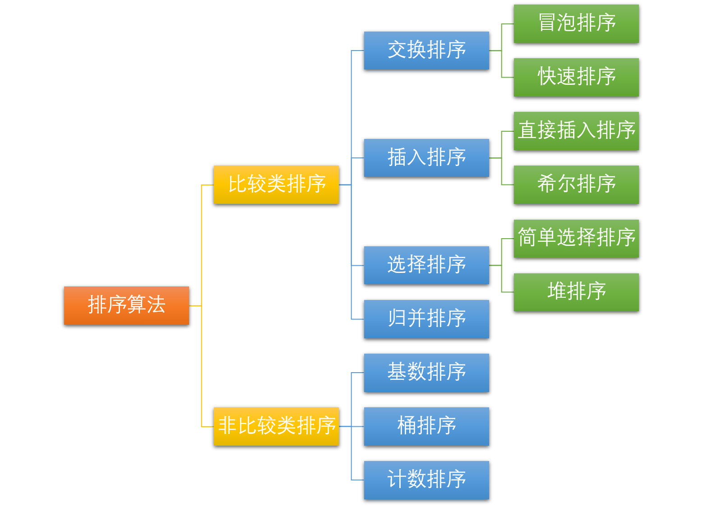
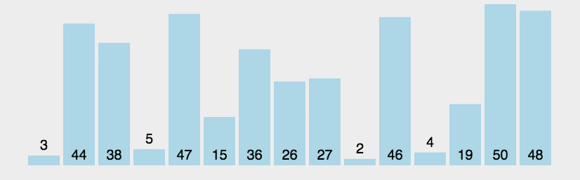
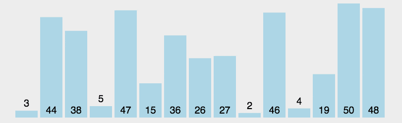
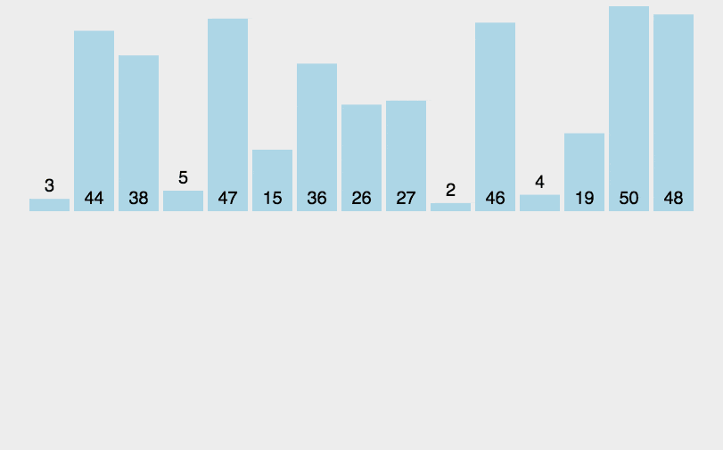
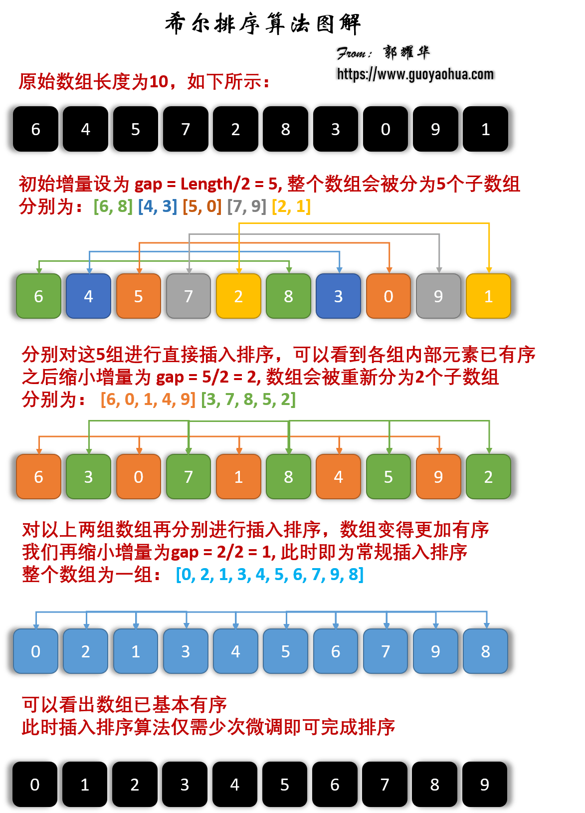
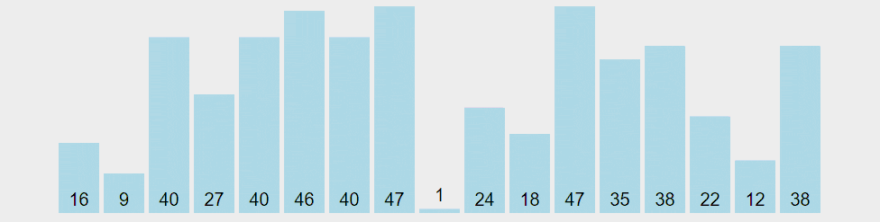
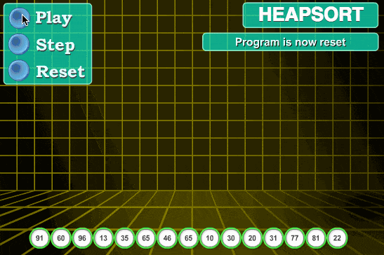
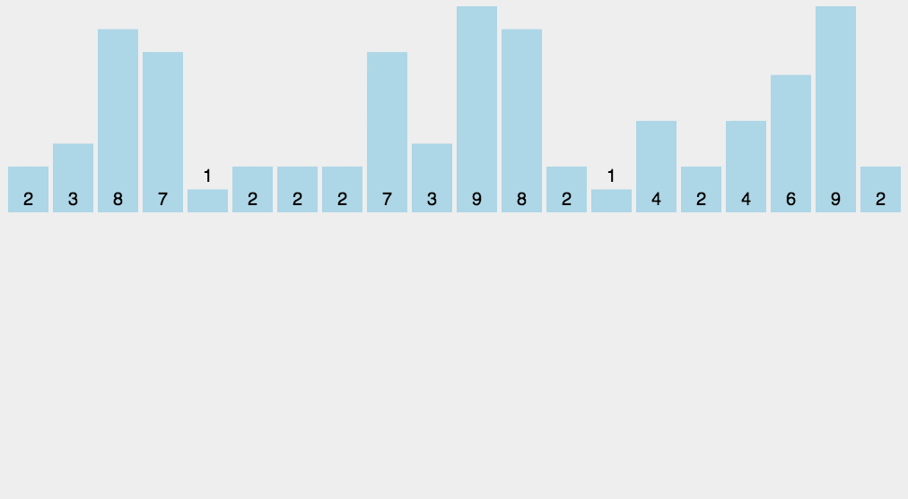
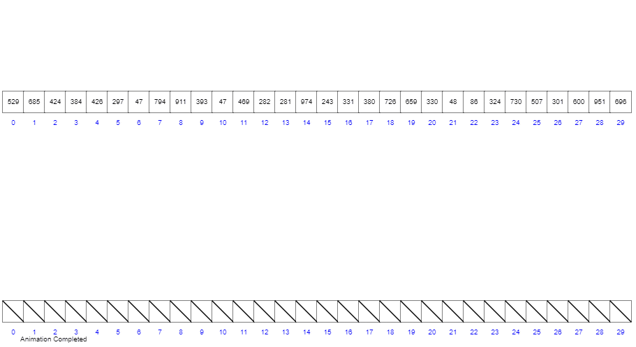
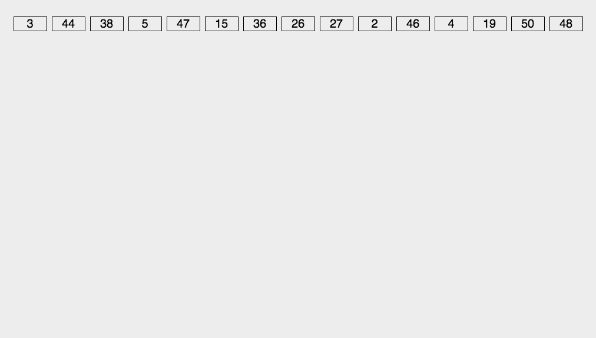

<!-- markdownlint-disable MD024 -->

## Introduction

Sorting arranges a sequence of records in ascending or descending order according to one or more keys. A sorting algorithm is a method for ordering records as required. Sorting matters in many fields, especially when processing large datasets. A good algorithm can save substantial resources. Choosing a practical algorithm requires considering data constraints and application requirements.

## Overview

### Sorting Algorithm Summary

Common in-memory sorting algorithms include **insertion sort**, **Shell sort**, **selection sort**, **bubble sort**, **merge sort**, **quicksort**, **heap sort**, and **radix sort**. This article focuses on in-memory sorting. The table below summarizes ten algorithms:

| Algorithm      | Average time            | Worst-case time        | Best-case time | Space                            | In-place | Stable                 |
| -------------- | ----------------------- | ---------------------- | -------------- | -------------------------------- | -------- | ---------------------- |
| Bubble sort    | `O(n^2)`                | `O(n^2)`               | `O(n)`         | `O(1)`                           | Yes      | Yes                    |
| Selection sort | `O(n^2)`                | `O(n^2)`               | `O(n^2)`       | `O(1)`                           | Yes      | No                     |
| Insertion sort | `O(n^2)`                | `O(n^2)`               | `O(n)`         | `O(1)`                           | Yes      | Yes                    |
| Shell sort     | Depends on gap sequence | `O(n^2)`               | `O(n log n)`   | `O(1)`                           | Yes      | No                     |
| Merge sort     | `O(n log n)`            | `O(n log n)`           | `O(n log n)`   | `O(n)`                           | No       | Yes                    |
| Quicksort      | `O(n log n)`            | `O(n^2)`               | `O(n log n)`   | Average `O(log n)`, worst `O(n)` | Yes      | No                     |
| Heap sort      | `O(n log n)`            | `O(n log n)`           | `O(n log n)`   | `O(1)`                           | Yes      | No                     |
| Counting sort  | `O(n + k)`              | `O(n + k)`             | `O(n + k)`     | `O(n + k)`                       | No       | Yes                    |
| Bucket sort    | Depends on distribution | Depends on bucket sort | `O(n + k)`     | `O(n + k)`                       | No       | Depends on bucket sort |
| Radix sort     | `O(d(n + r))`           | `O(d(n + r))`          | `O(d(n + r))`  | `O(n + r)`                       | No       | Yes                    |

**Terms:**

- **n:** Input size, or the number of items to sort.
- **k:** The counting range or number of buckets, depending on the algorithm.
- **d:** The maximum number of digits processed by radix sort.
- **r:** The radix used by radix sort, such as `r = 10` for decimal numbers.
- **In-memory sorting:** All input data fits in memory, and sorting is performed there. The code in this article uses in-memory sorting.
- **External sorting:** When the data does not fit in memory, it is processed in batches using external storage such as a disk. An algorithm can have both in-memory and external implementations, so this is not an inherent algorithm category.
- **Stable:** If A appears before B and $A=B$, A remains before B after sorting.
- **Unstable:** If A appears before B and $A=B$, A may appear after B after sorting.
- **Time complexity:** A description of how an algorithm's running time grows.
- **Space complexity:** A description of how an algorithm's memory use grows.

### Sorting Algorithm Categories

The ten sorting algorithms can be divided into two broad categories: **comparison sorts** and **non-comparison sorts**.



Common **comparison sorts** include **quicksort**, **merge sort**, **heap sort**, and **bubble sort**. They determine the relative order of elements by comparing them. In the comparison model, a general-purpose sort requires at least `Ω(n log n)` comparisons in the worst case. Bubble sort makes repeated passes and takes `O(n²)` time on average; merge sort and quicksort use divide and conquer and take `O(n log n)` time on average.

Comparison sorts work with different input sizes and distributions. In principle, they can sort any values that can be compared.

**Counting sort**, **radix sort**, and **bucket sort** are **non-comparison sorts**. They use additional information, such as key ranges, data distribution, or digit positions, to avoid the comparison-sort lower bound. They do not all run in `O(n)`: counting sort is usually `O(n + k)`, bucket sort depends on the distribution and the sort used within each bucket, and radix sort is usually `O(d(n + r))`.

Non-comparison sorts can be faster, but they use additional space to place values. They also require particular input sizes, value ranges, or distributions.

## Bubble Sort

Bubble sort repeatedly traverses a sequence and compares adjacent elements, swapping them when they are out of order. It continues until a pass requires no swaps. The name comes from smaller elements gradually “bubbling” to the top of the sequence.

### Steps

1. Compare adjacent elements. If the first is greater than the second, swap them.
2. Repeat for each adjacent pair through the end of the sequence. The largest value will be at the end.
3. Repeat for the remaining unsorted elements, excluding the last one.
4. Continue until the sequence is sorted.

### Visualization



### Implementation

```java
/**
 * Bubble sort
 * @param arr
 * @return arr
 */
public static int[] bubbleSort(int[] arr) {
    for (int i = 1; i < arr.length; i++) {
        // Set a flag, if true, that means the loop has not been swapped,
        // that is, the sequence has been ordered, the sorting has been completed.
        boolean flag = true;
        for (int j = 0; j < arr.length - i; j++) {
            if (arr[j] > arr[j + 1]) {
                int tmp = arr[j];
                arr[j] = arr[j + 1];
                arr[j + 1] = tmp;
                // Update the flag
                flag = false;
            }
        }
        if (flag) {
            break;
        }
    }
    return arr;
}
```

**The `flag` is a small optimization: it reduces the best-case time complexity to `O(n)` when the input is already sorted.**

### Analysis

- **Stability:** Stable
- **Time complexity:** Best: $O(n)$; worst: $O(n^2)$; average: $O(n^2)$
- **Space complexity:** $O(1)$
- **Sorting method:** In-place

## Selection Sort

Selection sort is simple and intuitive, but takes $O(n^2)$ time for any input, so it is best suited to small datasets. Its main advantage is that it uses no additional memory. It finds the smallest (or largest) value in the unsorted portion, places it at the start of that portion, then repeats for the remaining values until the entire sequence is sorted.

### Steps

1. Find the smallest (or largest) value in the unsorted portion and place it at the beginning of the sorted portion.
2. Find the next smallest (or largest) value among the remaining unsorted elements and place it at the end of the sorted portion.
3. Repeat until every element is sorted.

### Visualization



### Implementation

```java
/**
 * Selection sort
 * @param arr
 * @return arr
 */
public static int[] selectionSort(int[] arr) {
    for (int i = 0; i < arr.length - 1; i++) {
        int minIndex = i;
        for (int j = i + 1; j < arr.length; j++) {
            if (arr[j] < arr[minIndex]) {
                minIndex = j;
            }
        }
        if (minIndex != i) {
            int tmp = arr[i];
            arr[i] = arr[minIndex];
            arr[minIndex] = tmp;
        }
    }
    return arr;
}
```

### Analysis

- **Stability:** Unstable
- **Time complexity:** Best: $O(n^2)$; worst: $O(n^2)$; average: $O(n^2)$
- **Space complexity:** $O(1)$
- **Sorting method:** In-place

## Insertion Sort

Insertion sort builds a sorted sequence one element at a time. For each unsorted value, it scans backward through the sorted portion, shifts larger values to the right, and inserts the value in the correct position. It is usually implemented in-place with $O(1)$ extra space.

The idea is easy to understand: it is like sorting playing cards in your hand. Scan the sorted values from right to left, find the correct position for the next value, and insert it there.

Like bubble sort, insertion sort has a variation called binary insertion sort.

### Steps

1. Treat the first element as already sorted.
2. Take the next element and scan backward through the sorted portion.
3. If a sorted element is greater than the new value, move it one position to the right.
4. Repeat until reaching an element less than or equal to the new value.
5. Insert the new value after that element.
6. Repeat steps 2–5.

### Visualization



### Implementation

```java
/**
 * Insertion sort
 * @param arr
 * @return arr
 */
public static int[] insertionSort(int[] arr) {
    for (int i = 1; i < arr.length; i++) {
        int preIndex = i - 1;
        int current = arr[i];
        while (preIndex >= 0 && current < arr[preIndex]) {
            arr[preIndex + 1] = arr[preIndex];
            preIndex -= 1;
        }
        arr[preIndex + 1] = current;
    }
    return arr;
}
```

### Analysis

- **Stability:** Stable
- **Time complexity:** Best: $O(n)$; worst: $O(n^2)$; average: $O(n^2)$
- **Space complexity:** $O(1)$
- **Sorting method:** In-place

## Shell Sort

Shell sort was introduced by Donald Shell in 1959. It is a more efficient variation of insertion sort, also known as diminishing-increment sort. Its performance depends heavily on the gap sequence: later sequences achieve subquadratic upper bounds, while the original Shell sequence used here still has a worst-case complexity of $O(n^2)$.

Shell sort divides the sequence into groups based on a gap and applies insertion sort to each group. As the sequence becomes “mostly sorted,” the gap shrinks until a final insertion sort processes the entire sequence.

### Steps

This example uses the gap sequence $gap = length/2$, halving the gap after each pass until it reaches 1. The sequence $\lbrace \frac{n}{2}, \frac{(n/2)}{2}, \dots, 1 \rbrace$ is called the **gap sequence**. Choosing and analyzing gap sequences is mathematically difficult. This common sequence was suggested by Shell, but it is not optimal.

The algorithm proceeds as follows:

- Choose a gap sequence $\lbrace t_1, t_2, \dots, t_k \rbrace$, where $t_i > t_j$ when $i < j$ and $t_k = 1$.
- Perform k passes, one for each gap.
- For each gap $t$, divide the sequence into subsequences and apply insertion sort to each one. When the gap is 1, process the entire sequence as a single list.

### Visualization



### Implementation

```java
/**
 * Shell sort
 *
 * @param arr
 * @return arr
 */
public static int[] shellSort(int[] arr) {
    int n = arr.length;
    int gap = n / 2;
    while (gap > 0) {
        for (int i = gap; i < n; i++) {
            int current = arr[i];
            int preIndex = i - gap;
            // Insertion sort
            while (preIndex >= 0 && arr[preIndex] > current) {
                arr[preIndex + gap] = arr[preIndex];
                preIndex -= gap;
            }
            arr[preIndex + gap] = current;

        }
        gap /= 2;
    }
    return arr;
}
```

### Analysis

- **Stability:** Unstable
- **Time complexity:** Best: $O(n log n)$; worst: $O(n^2)$; average depends on the gap sequence.
- **Space complexity:** $O(1)$

## Merge Sort

Merge sort is an efficient sorting algorithm based on the merge operation and is a classic application of divide and conquer. It is stable: first sort smaller subsequences, then merge them into a fully sorted sequence. Merging two sorted lists is called a two-way merge.

Like selection sort, merge sort's performance does not depend on the input order. However, it is much faster because it always takes $O(n log n)$ time. The tradeoff is that it requires additional memory.

### Steps

Merge sort is recursive. If the input contains only one element, return it. Otherwise:

1. Split the input of length $n$ into two subsequences of about $n/2$ elements.
2. Recursively sort both subsequences.
3. Set a pointer to the start of each sorted subsequence.
4. Compare the pointed-to elements, copy the smaller one into the output, and advance its pointer.
5. Repeat until one subsequence is exhausted.
6. Copy the remaining elements from the other subsequence to the end of the output.

### Visualization


### Implementation

```java
/**
 * Merge sort
 *
 * @param arr
 * @return arr
 */
public static int[] mergeSort(int[] arr) {
    if (arr.length <= 1) {
        return arr;
    }
    int middle = arr.length / 2;
    int[] arr_1 = Arrays.copyOfRange(arr, 0, middle);
    int[] arr_2 = Arrays.copyOfRange(arr, middle, arr.length);
    return merge(mergeSort(arr_1), mergeSort(arr_2));
}

/**
 * Merge two sorted arrays
 *
 * @param arr_1
 * @param arr_2
 * @return sorted_arr
 */
public static int[] merge(int[] arr_1, int[] arr_2) {
    int[] sorted_arr = new int[arr_1.length + arr_2.length];
    int idx = 0, idx_1 = 0, idx_2 = 0;
    while (idx_1 < arr_1.length && idx_2 < arr_2.length) {
        if (arr_1[idx_1] <= arr_2[idx_2]) {
            sorted_arr[idx] = arr_1[idx_1];
            idx_1 += 1;
        } else {
            sorted_arr[idx] = arr_2[idx_2];
            idx_2 += 1;
        }
        idx += 1;
    }
    if (idx_1 < arr_1.length) {
        while (idx_1 < arr_1.length) {
            sorted_arr[idx] = arr_1[idx_1];
            idx_1 += 1;
            idx += 1;
        }
    } else {
        while (idx_2 < arr_2.length) {
            sorted_arr[idx] = arr_2[idx_2];
            idx_2 += 1;
            idx += 1;
        }
    }
    return sorted_arr;
}
```

### Analysis

- **Stability:** Stable
- **Time complexity:** Best, worst, and average: $O(n log n)$
- **Space complexity:** $O(n)$

## Quicksort

Quicksort and merge sort both use divide and conquer: they break a problem into smaller parts and sort them. Unlike merge sort, quicksort partitions the data into smaller and larger groups before recursion, so no merge is needed afterward. This makes its complexity dependent on how balanced the partitions are.

Quicksort partitions the sequence into two parts so that values in one part are smaller than those in the other, then recursively sorts both parts.

### Steps

Quicksort uses [divide and conquer](https://en.wikipedia.org/wiki/Divide-and-conquer_algorithm) to split a sequence into smaller and larger subsequences, then recursively sorts them:

1. **Choose a pivot:** Select an array element. Random selection can reduce the chance of worst-case behavior.
2. **Partition:** Rearrange the sequence so values smaller than the pivot are before it and larger values are after it. Equal values may go on either side. The pivot ends up between the two groups.
3. **Recurse:** Apply quicksort to the subsequences on either side of the pivot.

**Performance is a key difference from merge sort:**

- **Average and best case:** $O(n log n)$, when each partition divides the array into roughly equal halves.
- **Worst case:** $O(n^2)$, when each pivot is the smallest or largest value in the current array. For example, choosing the first element as the pivot in an already sorted array produces highly unbalanced partitions. This is why **random pivot selection** is useful.

### Visualization



### Implementation

```java
import java.util.concurrent.ThreadLocalRandom;

class Solution {
    public int[] sortArray(int[] a) {
        quick(a, 0, a.length - 1);
        return a;
    }

    // Core recursive quicksort function
    void quick(int[] a, int left, int right) {
        if (left >= right) { // Base case: the range has at most one element.
            return;
        }
        int p = partition(a, left, right); // Partition and return the pivot index.
        quick(a, left, p - 1); // Recursively sort the left subarray.
        quick(a, p + 1, right); // Recursively sort the right subarray.
    }

    // Partition the array so smaller values are on the left and larger ones are on the right.
    int partition(int[] a, int left, int right) {
        // Choose a random pivot to reduce the chance of worst-case behavior on nearly sorted input.
        int idx = ThreadLocalRandom.current().nextInt(right - left + 1) + left;
        swap(a, left, idx); // Move the pivot to the left end of the array.
        int pv = a[left]; // Pivot value.
        int i = left + 1; // Left pointer; points to the next element to check.
        int j = right; // Right pointer; scans for values smaller than the pivot.

        while (i <= j) {
            // Move the left pointer until it reaches a value greater than or equal to the pivot.
            while (i <= j && a[i] < pv) {
                i++;
            }
            // Move the right pointer until it reaches a value less than or equal to the pivot.
            while (i <= j && a[j] > pv) {
                j--;
            }
            // If the pointers have not crossed, swap the values that are on the wrong sides.
            if (i <= j) {
                swap(a, i, j);
                i++;
                j--;
            }
        }
        // Place the pivot at the partition index.
        swap(a, j, left);
        return j;
    }

    // Swap two array elements.
    void swap(int[] a, int i, int j) {
        int t = a[i];
        a[i] = a[j];
        a[j] = t;
    }
}
```

### Analysis

- **Stability:** Unstable
- **Time complexity:** Best: $O(n log n)$; worst: $O(n^2)$; average: $O(n log n)$
- **Space complexity:** Average: $O(log n)$; worst: $O(n)$ due to the recursion stack.

## Heap Sort

Heap sort uses a heap data structure. A heap has an almost-complete binary tree structure and satisfies the **heap property**: each child is always smaller (or larger) than its parent.

### Steps

1. Build a max-heap from the input sequence $(R_1, R_2, \dots, R_n)$. This is the initial unsorted region.
2. Swap the root $R_1$ with the last element $R_n$. The new unsorted region is $(R_1, R_2, \dots, R_{n-1})$, and the sorted region contains $R_n$. For every $i$ from 1 to $n-1$, $R_i \leqslant R_n$.
3. The new root $R_1$ may violate the heap property. Restore the heap in the unsorted region $(R_1, R_2, \dots, R_{n-1})$, then swap its root with the last unsorted element. The unsorted region becomes $(R_1, R_2, \dots, R_{n-2})$, and the sorted region contains $(R_{n-1}, R_n)$. Repeat until the sorted region contains all elements.

### Visualization



### Implementation

```java
// Global variable that records the length of an array;
static int heapLen;

/**
 * Swap the two elements of an array
 * @param arr
 * @param i
 * @param j
 */
private static void swap(int[] arr, int i, int j) {
    int tmp = arr[i];
    arr[i] = arr[j];
    arr[j] = tmp;
}

/**
 * Build Max Heap
 * @param arr
 */
private static void buildMaxHeap(int[] arr) {
    for (int i = arr.length / 2 - 1; i >= 0; i--) {
        heapify(arr, i);
    }
}

/**
 * Adjust it to the maximum heap
 * @param arr
 * @param i
 */
private static void heapify(int[] arr, int i) {
    int left = 2 * i + 1;
    int right = 2 * i + 2;
    int largest = i;
    if (right < heapLen && arr[right] > arr[largest]) {
        largest = right;
    }
    if (left < heapLen && arr[left] > arr[largest]) {
        largest = left;
    }
    if (largest != i) {
        swap(arr, largest, i);
        heapify(arr, largest);
    }
}

/**
 * Heap Sort
 * @param arr
 * @return
 */
public static int[] heapSort(int[] arr) {
    // index at the end of the heap
    heapLen = arr.length;
    // build MaxHeap
    buildMaxHeap(arr);
    for (int i = arr.length - 1; i > 0; i--) {
        // Move the top of the heap to the tail of the heap in turn
        swap(arr, 0, i);
        heapLen -= 1;
        heapify(arr, 0);
    }
    return arr;
}
```

### Analysis

- **Stability:** Unstable
- **Time complexity:** Best, worst, and average: $O(n log n)$
- **Space complexity:** $O(1)$

## Counting Sort

Counting sort uses input values as keys in an additional array. As a linear-time sorting algorithm, **it requires integer input values within a known range**.

Counting sort is stable. It uses an auxiliary array `C`, where the element at index `i` stores the number of times value `i` appears in input array `A`. The counts are then used to place values from `A` in their correct positions. **It sorts integers only.**

### Steps

1. Find the maximum value `max` and minimum value `min` in the array.
2. Create an array `C` of length `max - min + 1`, initialized to zero.
3. For each value `A[i]` in the input array, use `A[i] - min` as the index in `C` and count how often that value appears.
4. Convert `C` to prefix sums: **each entry becomes the sum of its value and the previous entry**, so `C[i] = C[i] + C[i - 1]` for `i > 0`.
5. Create an output array `R` with the same length as the input.
6. Iterate through `A` **from right to left**. Use `A[i] - min` to look up its count in `C`. The value `C[A[i] - min] - 1` is its index in `R`. Place it there, then decrement `C[A[i] - min]`.

### Visualization



### Implementation

```java
/**
 * Gets the maximum and minimum values in the array
 *
 * @param arr
 * @return
 */
private static int[] getMinAndMax(int[] arr) {
    int maxValue = arr[0];
    int minValue = arr[0];
    for (int i = 0; i < arr.length; i++) {
        if (arr[i] > maxValue) {
            maxValue = arr[i];
        } else if (arr[i] < minValue) {
            minValue = arr[i];
        }
    }
    return new int[] { minValue, maxValue };
}

/**
 * Counting Sort
 *
 * @param arr
 * @return
 */
public static int[] countingSort(int[] arr) {
    if (arr.length < 2) {
        return arr;
    }
    int[] extremum = getMinAndMax(arr);
    int minValue = extremum[0];
    int maxValue = extremum[1];
    int[] countArr = new int[maxValue - minValue + 1];
    int[] result = new int[arr.length];

    for (int i = 0; i < arr.length; i++) {
        countArr[arr[i] - minValue] += 1;
    }
    for (int i = 1; i < countArr.length; i++) {
        countArr[i] += countArr[i - 1];
    }
    for (int i = arr.length - 1; i >= 0; i--) {
        int idx = countArr[arr[i] - minValue] - 1;
        result[idx] = arr[i];
        countArr[arr[i] - minValue] -= 1;
    }
    return result;
}
```

### Analysis

When the input contains n integers between `0` and `k`, counting sort takes $O(n + k)$ time. It is not a comparison sort and can be faster than comparison-based algorithms. The length of `C` depends on the input range (the **maximum value minus the minimum value plus 1**), so a large range can require substantial extra memory.

- **Stability:** Stable
- **Time complexity:** Best, worst, and average: $O(n + k)$
- **Space complexity:** $O(n + k)$

## Bucket Sort

Bucket sort is a generalization of counting sort. It maps values to buckets, and its efficiency depends on choosing a good mapping function. To make bucket sort efficient:

1. Use more buckets when extra space is available.
2. Choose a mapping function that distributes the N input values evenly across K buckets.

Bucket sort assumes that the input is uniformly distributed. It distributes values among a finite number of buckets, sorts each bucket (possibly with another sorting algorithm or recursively with bucket sort), then concatenates the buckets.

### Steps

1. Choose `bucket_size`, the value range assigned to each bucket.
2. Iterate over the input and map each value to a bucket.
3. Sort each non-empty bucket with another sorting algorithm or recursively with bucket sort.
4. Concatenate the sorted values from the non-empty buckets.

### Visualization



### Implementation

```java
/**
 * Gets the maximum and minimum values in the array
 * @param arr
 * @return
 */
private static int[] getMinAndMax(List<Integer> arr) {
    int maxValue = arr.get(0);
    int minValue = arr.get(0);
    for (int i : arr) {
        if (i > maxValue) {
            maxValue = i;
        } else if (i < minValue) {
            minValue = i;
        }
    }
    return new int[] { minValue, maxValue };
}

/**
 * Bucket Sort
 * @param arr
 * @return
 */
public static List<Integer> bucketSort(List<Integer> arr, int bucket_size) {
    if (bucket_size <= 0) {
        throw new IllegalArgumentException("bucket_size must be positive");
    }
    if (arr.size() < 2) {
        return arr;
    }
    int[] extremum = getMinAndMax(arr);
    int minValue = extremum[0];
    int maxValue = extremum[1];
    int bucket_cnt = (maxValue - minValue) / bucket_size + 1;
    List<List<Integer>> buckets = new ArrayList<>();
    for (int i = 0; i < bucket_cnt; i++) {
        buckets.add(new ArrayList<Integer>());
    }
    for (int element : arr) {
        int idx = (element - minValue) / bucket_size;
        buckets.get(idx).add(element);
    }
    for (int i = 0; i < buckets.size(); i++) {
        if (buckets.get(i).size() > 1) {
            buckets.get(i).sort(Integer::compareTo);
        }
    }
    ArrayList<Integer> result = new ArrayList<>();
    for (List<Integer> bucket : buckets) {
        for (int element : bucket) {
            result.add(element);
        }
    }
    return result;
}
```

### Analysis

- **Stability:** Depends on the sort used within each bucket. This implementation preserves insertion order when distributing values and uses stable `List.sort`, so it is stable.
- **Time complexity:** Best case: $O(n + k)$. With a uniform distribution, expected time is close to $O(n + k)$. Worst case: $O(n log n + k)$. Using insertion sort within each bucket can make the worst case $O(n^2)$.
- **Space complexity:** $O(n + k)$

## Radix Sort

Radix sort is a non-comparison sort that processes each digit of a value, starting with the least significant digit. For an array of length $n$, with at most $d$ digits and radix $r$, its complexity is $O(d(n + r))$. The decimal LSD implementation below supports non-negative integers only.

Radix sort first sorts by the least significant digit and collects the values, then sorts by the next digit and collects them again, continuing through the most significant digit. This is useful when keys have multiple priorities: sort by the lower-priority key first, then by the higher-priority key. Values with equal higher-priority keys retain their lower-priority ordering. Since each pass sorts and collects stably, radix sort is stable.

### Steps

1. Find the largest value and its number of digits, which determines the number of passes $N$. For example, if the largest value is 1000, then $N = 4$.
2. Starting with the least significant digit, extract that digit from each value in array `A`.
3. Use counting sort to sort by that digit, taking advantage of its small range.
4. Copy the values back into the original array.
5. Repeat steps 2–4 for all $N$ digits.

### Visualization



### Implementation

```java
/**
 * Radix Sort
 *
 * @param arr
 * @return
 */
public static int[] radixSort(int[] arr) {
    if (arr.length < 2) {
        return arr;
    }
    for (int element : arr) {
        if (element < 0) {
            throw new IllegalArgumentException("radixSort only supports non-negative integers");
        }
    }
    int N = 1;
    int maxValue = arr[0];
    for (int element : arr) {
        if (element > maxValue) {
            maxValue = element;
        }
    }
    while (maxValue / 10 != 0) {
        maxValue = maxValue / 10;
        N += 1;
    }
    for (int i = 0; i < N; i++) {
        List<List<Integer>> radix = new ArrayList<>();
        for (int k = 0; k < 10; k++) {
            radix.add(new ArrayList<Integer>());
        }
        for (int element : arr) {
            int idx = (element / (int) Math.pow(10, i)) % 10;
            radix.get(idx).add(element);
        }
        int idx = 0;
        for (List<Integer> l : radix) {
            for (int n : l) {
                arr[idx++] = n;
            }
        }
    }
    return arr;
}
```

### Analysis

- **Stability:** Stable
- **Time complexity:** Best, worst, and average: $O(d(n + r))$
- **Space complexity:** $O(n + r)$

**Radix Sort vs. Counting Sort vs. Bucket Sort**

All three algorithms use buckets, but in different ways:

- **Radix sort:** Assign buckets based on each digit of the key.
- **Counting sort:** Each bucket stores one distinct key value.
- **Bucket sort:** Each bucket stores values within a range.

## References

- [Sorting algorithm summary (primary source for this article)](https://www.cnblogs.com/guoyaohua/p/8600214.html)
- <https://en.wikipedia.org/wiki/Sorting_algorithm>
- <https://sort.hust.cc/>

## Interview Review

Interviews rarely ask you to implement all ten sorting algorithms, but you should be able to explain their complexity, stability, in-place behavior, and use cases.

| Algorithm      | Average time            | Worst-case time        | Space                            | Stable                 | In-place |
| -------------- | ----------------------- | ---------------------- | -------------------------------- | ---------------------- | -------- |
| Bubble sort    | `O(n^2)`                | `O(n^2)`               | `O(1)`                           | Yes                    | Yes      |
| Selection sort | `O(n^2)`                | `O(n^2)`               | `O(1)`                           | No                     | Yes      |
| Insertion sort | `O(n^2)`                | `O(n^2)`               | `O(1)`                           | Yes                    | Yes      |
| Merge sort     | `O(n log n)`            | `O(n log n)`           | `O(n)`                           | Yes                    | No       |
| Quicksort      | `O(n log n)`            | `O(n^2)`               | Average `O(log n)`, worst `O(n)` | No                     | Yes      |
| Heap sort      | `O(n log n)`            | `O(n log n)`           | `O(1)`                           | No                     | Yes      |
| Counting sort  | `O(n + k)`              | `O(n + k)`             | `O(n + k)`                       | Yes                    | No       |
| Bucket sort    | Depends on distribution | Depends on bucket sort | `O(n + k)`                       | Depends on bucket sort | No       |
| Radix sort     | `O(d(n + r))`           | `O(d(n + r))`          | `O(n + r)`                       | Yes                    | No       |

Common follow-up questions:

- Why is quicksort `O(n^2)` in the worst case, and how can that risk be reduced? Random pivots or median-of-three selection can help.
- Why is merge sort stable? During merging, equal values can be taken from the left sequence first.
- Why is heap sort unstable? Heap adjustments and swaps may change the original order of equal values.
- When does insertion sort perform well? On small arrays that are already nearly sorted.
- Why are counting sort, bucket sort, and radix sort not general-purpose? They depend on the value range, distribution, or number of digits.

## Java Template

Quicksort and merge sort are the sorting algorithms most often written by hand in interviews. Pay close attention to partition boundaries in quicksort. Here is a common implementation:

```java
void quickSort(int[] nums, int left, int right) {
    if (left >= right) {
        return;
    }
    int pivotIndex = partition(nums, left, right);
    quickSort(nums, left, pivotIndex - 1);
    quickSort(nums, pivotIndex + 1, right);
}

int partition(int[] nums, int left, int right) {
    int pivot = nums[right];
    int less = left;
    for (int i = left; i < right; i++) {
        if (nums[i] <= pivot) {
            swap(nums, less, i);
            less++;
        }
    }
    swap(nums, less, right);
    return less;
}

void swap(int[] nums, int i, int j) {
    int temp = nums[i];
    nums[i] = nums[j];
    nums[j] = temp;
}
```

To reduce the chance of quicksort degrading on a sorted array, choose a random pivot before partitioning and swap it with the value at `right`.

```java
int randomIndex = left + new Random().nextInt(right - left + 1);
swap(nums, randomIndex, right);
```

## Walkthrough and Edge Cases

One quicksort partition works as follows:

```text
Array range: [left ... right]
pivot: choose nums[right]
less: points to the next position in the region of values <= pivot
i: scans from left to right - 1

After the scan:
[left ... less - 1] <= pivot
[less ... right - 1] > pivot
Swap the pivot into position less, then recurse on both sides.
```

Check these edge cases before coding:

- Empty array or one element: return immediately.
- Sorted or reverse-sorted input: always choosing the first or last value as pivot can cause poor partitions.
- Many duplicate values: a two-way partition may be inefficient; consider three-way quicksort.
- If asked about stability, do not call quicksort stable. Standard quicksort swaps can change the order of equal values.

<!-- @include: @article-footer.snippet.md -->
