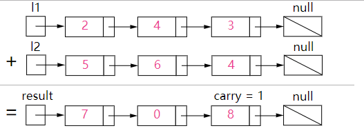
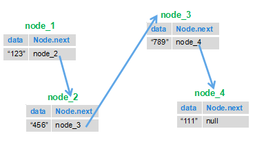
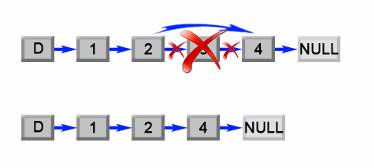

<!-- markdownlint-disable MD024 -->

## 1. Add Two Numbers

### Problem

> LeetCode: You are given two non-empty linked lists representing two non-negative integers. The digits are stored in reverse order, and each node contains a single digit. Add the numbers and return the sum as a linked list.
>
> You may assume that neither number contains leading zeroes, except for the number 0 itself.

Example:

```plain
Input: (2 -> 4 -> 3) + (5 -> 6 -> 4)
Output: 7 -> 0 -> 8
Explanation: 342 + 465 = 807
```

### Analysis

See the [LeetCode solution](https://leetcode-cn.com/problems/add-two-numbers/solution/).

> When an operation may change the head node, create a dummy node and use `dummy.next` as the actual head. This avoids special cases when the list is empty or its head changes.

Track the carry and add corresponding digits, starting at the heads of the lists, which contain the least significant digits.



### Solution

Start at the least significant digits in `l1` and `l2`, and account for the carry:

```java
/**
 * Definition for singly-linked list.
 * public class ListNode {
 *     int val;
 *     ListNode next;
 *     ListNode(int x) { val = x; }
 * }
 */
// https://leetcode-cn.com/problems/add-two-numbers/description/
class Solution {
    public ListNode addTwoNumbers(ListNode l1, ListNode l2) {
        ListNode dummyHead = new ListNode(0);
        ListNode p = l1, q = l2, curr = dummyHead;
        int carry = 0;
        while (p != null || q != null) {
            int x = (p != null) ? p.val : 0;
            int y = (q != null) ? q.val : 0;
            int sum = carry + x + y;
            carry = sum / 10;
            curr.next = new ListNode(sum % 10);
            curr = curr.next;
            if (p != null) p = p.next;
            if (q != null) q = q.next;
        }
        if (carry > 0) {
            curr.next = new ListNode(carry);
        }
        return dummyHead.next;
    }
}
```

## 2. Reverse a Linked List

### Problem

> Sword Offer: Given a linked list, reverse it and return the head of the reversed list.



### Analysis

The key is to make each node point to its previous node. Save the next node before changing the link, or the rest of the list will be lost.

### Solution

```java
public class ListNode {
    int val;
    ListNode next = null;

    ListNode(int val) {
        this.val = val;
    }
}
```

```java
public class Solution {
    public ListNode ReverseList(ListNode head) {
        ListNode next = null;
        ListNode prev = null;

        while (head != null) {
            next = head.next;
            head.next = prev;
            prev = head;
            head = next;
        }
        return prev;
    }
}
```

Test it with a five-node list:

```java
public static void main(String[] args) {
    ListNode a = new ListNode(1);
    ListNode b = new ListNode(2);
    ListNode c = new ListNode(3);
    ListNode d = new ListNode(4);
    ListNode e = new ListNode(5);
    a.next = b;
    b.next = c;
    c.next = d;
    d.next = e;
    new Solution().ReverseList(a);
    while (e != null) {
        System.out.println(e.val);
        e = e.next;
    }
}
```

Output:

```plain
5
4
3
2
1
```

## 3. Find the Kth Node from the End

### Problem

> Sword Offer: Given a linked list, return its kth node from the end.

### Analysis

If the list has length `L`, the kth node from the end is the `(L - k + 1)`th node from the beginning. Use two pointers: advance the first pointer by `k` nodes, then move both pointers together. When the first pointer reaches the end, the second points to the answer.

### Solution

The following implementation returns `null` when the list is empty, `k` is not positive, or the list has fewer than `k` nodes. It runs in `O(n)` time with one traversal.

```java
/*
public class ListNode {
    int val;
    ListNode next = null;
    ListNode(int val) { this.val = val; }
}
*/
// https://www.nowcoder.com/practice/529d3ae5a407492994ad2a246518148a?tpId=13&tqId=11167&tPage=1&rp=1&ru=/ta/coding-interviews&qru=/ta/coding-interviews/question-ranking
public class Solution {
    public ListNode FindKthToTail(ListNode head, int k) {
        if (head == null || k <= 0) {
            return null;
        }
        ListNode first = head, second = head;
        int count = 0;
        int originalK = k;
        while (first != null) {
            first = first.next;
            count++;
            if (k < 1) {
                second = second.next;
            }
            k--;
        }
        if (count < originalK) {
            return null;
        }
        return second;
    }
}
```

## 4. Remove the Nth Node from the End

> LeetCode: Given the head of a linked list, remove the nth node from the end and return the head.

Example:

```plain
Input: 1 -> 2 -> 3 -> 4 -> 5, n = 2
After removal: 1 -> 2 -> 3 -> 5
```

The problem guarantees that `n` is valid. Can you solve it in one pass?

### Analysis

This is equivalent to removing the `(L - n + 1)`th node from the beginning, where `L` is the list length.



### Two-Pass Solution

Add a dummy node before the head to simplify edge cases, such as a one-node list or removing the head. First find the list length `L`. Then advance from the dummy node to position `L - n` and link that node to the node after the one being removed.

```java
/**
 * Definition for singly-linked list.
 * public class ListNode {
 *     int val;
 *     ListNode next;
 *     ListNode(int x) { val = x; }
 * }
 */
// https://leetcode-cn.com/problems/remove-nth-node-from-end-of-list/description/
public class Solution {
    public ListNode removeNthFromEnd(ListNode head, int n) {
        ListNode dummy = new ListNode(0);
        dummy.next = head;
        int length = 0;
        ListNode current = head;
        while (current != null) {
            length++;
            current = current.next;
        }
        length -= n;
        ListNode target = dummy;
        while (length > 0) {
            target = target.next;
            length--;
        }
        target.next = target.next.next;
        return dummy.next;
    }
}
```

### One-Pass Solution

Use two pointers starting at the dummy node. Advance the first pointer `n + 1` steps, then advance both pointers until the first reaches the end. The second pointer is then immediately before the node to remove.

```java
/**
 * Definition for singly-linked list.
 * public class ListNode {
 *     int val;
 *     ListNode next;
 *     ListNode(int x) { val = x; }
 * }
 */
public class Solution {
    public ListNode removeNthFromEnd(ListNode head, int n) {
        ListNode dummy = new ListNode(0);
        dummy.next = head;
        ListNode first = dummy, second = dummy;
        for (int i = 0; i <= n; i++) {
            first = first.next;
        }
        while (first != null) {
            first = first.next;
            second = second.next;
        }
        second.next = second.next.next;
        return dummy.next;
    }
}
```

## 5. Merge Two Sorted Linked Lists

### Problem

> Sword Offer: Given two lists sorted in non-decreasing order, merge them into one sorted list.

### Analysis

Compare the two head nodes. Link the smaller one to the merged list, advance that list, and repeat. When either list is empty, append the remainder of the other. This can also be implemented recursively.

### Recursive Solution

```java
/*
public class ListNode {
    int val;
    ListNode next = null;
    ListNode(int val) { this.val = val; }
}
*/
// https://www.nowcoder.com/practice/d8b6b4358f774294a89de2a6ac4d9337?tpId=13&tqId=11169&tPage=1&rp=1&ru=/ta/coding-interviews&qru=/ta/coding-interviews/question-ranking
public class Solution {
    public ListNode Merge(ListNode list1, ListNode list2) {
        if (list1 == null) {
            return list2;
        }
        if (list2 == null) {
            return list1;
        }
        if (list1.val <= list2.val) {
            list1.next = Merge(list1.next, list2);
            return list1;
        }
        list2.next = Merge(list1, list2.next);
        return list2;
    }
}
```

## Interview Review

Linked list solutions are often short, but pointer update order is easy to get wrong. Be comfortable with four templates: dummy nodes, list reversal, fast and slow pointers, and merging sorted lists.

| Template               | Use cases                                              | Key point                                                 |
| ---------------------- | ------------------------------------------------------ | --------------------------------------------------------- |
| Dummy node             | Deletion, merging, or when the head may change         | Return `dummy.next`.                                      |
| Reversal               | Full or range reversal, reversing nodes in groups of K | Save `next` before assigning `cur.next`.                  |
| Fast and slow pointers | Cycle detection, kth node from the end, middle node    | Check `fast != null && fast.next != null`.                |
| Merge                  | Two or K sorted lists                                  | Use recursion or iteration and attach the remaining list. |

An iterative reversal template is worth knowing well:

```java
ListNode reverseList(ListNode head) {
    ListNode prev = null;
    ListNode cur = head;
    while (cur != null) {
        ListNode next = cur.next;
        cur.next = prev;
        prev = cur;
        cur = next;
    }
    return prev;
}
```

## Pointer Walkthrough and Edge Cases

When reversing a list, save `next` before changing `cur.next`:

```text
Initial: prev = null, cur = head

Each iteration:
next = cur.next
cur.next = prev
prev = cur
cur = next

End: cur == null, and prev is the new head
```

For deletion and merging, consider using a dummy node:

```java
ListNode dummy = new ListNode(0);
dummy.next = head;
// Perform operations on the list after dummy.
return dummy.next;
```

Common edge cases:

- A dummy node handles removing the head when deleting the nth node from the end.
- For range reversal, save the nodes before and after the range first.
- For cycle detection, use the loop condition `fast != null && fast.next != null`.
- Recursive merging is concise, but a very long list may cause a stack overflow.
- Check empty lists, single-node lists, and deletion of the head or tail.

<!-- @include: @article-footer.snippet.md -->
