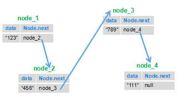
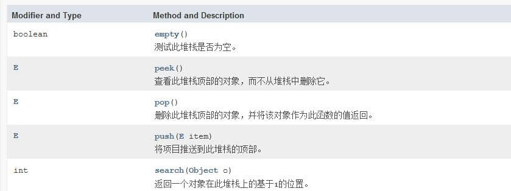

# Selected Coding Problems from Sword Offer

## Fibonacci Sequence

**Problem:** Given an integer `n`, return the nth Fibonacci number. Assume `n <= 39`.

The recursive solution repeats many calculations and can become very slow. An iterative solution stores and reuses the two previous values.

Iterative solution:

```java
int Fibonacci(int number) {
    if (number <= 0) {
        return 0;
    }
    if (number == 1 || number == 2) {
        return 1;
    }
    int first = 1, second = 1, third = 0;
    for (int i = 3; i <= number; i++) {
        third = first + second;
        first = second;
        second = third;
    }
    return third;
}
```

Recursive solution:

```java
public int Fibonacci(int n) {
    if (n <= 0) {
        return 0;
    }
    if (n == 1 || n == 2) {
        return 1;
    }
    return Fibonacci(n - 2) + Fibonacci(n - 1);
}
```

The iterative implementation takes `O(n)` time and `O(1)` extra space. The naive recursive implementation repeats work and has exponential time complexity.

## Climbing Stairs

**Problem:** A frog can climb either one or two steps at a time. How many distinct ways can it reach step `n`?

The first jump is either one step, leaving `n - 1` steps, or two steps, leaving `n - 2`. Therefore, `f(n) = f(n - 1) + f(n - 2)`, with `f(1) = 1` and `f(2) = 2`. This is the Fibonacci recurrence with different base cases.

For example, `f(6) = f(5) + f(4)`: any way to reach step 5 can take one more step, and any way to reach step 4 can take two more steps.

```java
int jumpFloor(int number) {
    if (number <= 0) {
        return 0;
    }
    if (number == 1) {
        return 1;
    }
    if (number == 2) {
        return 2;
    }
    int first = 1, second = 2, third = 0;
    for (int i = 3; i <= number; i++) {
        third = first + second;
        first = second;
        second = third;
    }
    return third;
}
```

## Jumping Multiple Steps

**Problem:** A frog can jump from one to `n` steps at a time. How many ways are there to reach step `n`?

For `n >= 2`, the first jump can be any length from 1 to `n`. Thus:

```text
f(n) = f(n - 1) + f(n - 2) + ... + f(1) + f(0)
```

Since `f(n - 1) = f(n - 2) + ... + f(1) + f(0)`, it follows that `f(n) = 2 * f(n - 1)`. With `f(1) = 1`, the result is `2^(n - 1)`.

```java
int JumpFloorII(int number) {
    return 1 << --number; // 2^(number - 1)
}
```

Java has three shift operators:

1. `<<`: left shift, equivalent to multiplying by a power of two, subject to integer overflow.
2. `>>`: signed right shift, which preserves the sign bit.
3. `>>>`: unsigned right shift, which fills vacated left bits with zeroes.

```java
int a = 16;
int b = a << 2; // 16 * 2^2, or 64
int c = a >> 2; // 16 / 2^2, or 4
```

## Search a Two-Dimensional Array

**Problem:** Each row of a matrix is sorted in ascending order from left to right, and each column is sorted in ascending order from top to bottom. Determine whether the matrix contains a target value.

Start at the bottom-left corner. Moving up decreases the value; moving right increases it. If the current value is too large, move up. If it is too small, move right. Each move eliminates one row or one column, so the time complexity is `O(m + n)`.

```java
public boolean Find(int target, int[][] array) {
    int row = array.length - 1;
    int column = 0;
    while (row >= 0 && column < array[0].length) {
        if (array[row][column] > target) {
            row--;
        } else if (array[row][column] < target) {
            column++;
        } else {
            return true;
        }
    }
    return false;
}
```

## Replace Spaces

**Problem:** Replace each space in a string with `"%20"`. For example, `We Are Happy` becomes `We%20Are%20Happy`.

Build a result string while scanning, or use `String.replace()`:

```java
public String replaceSpace(StringBuffer str) {
    StringBuffer out = new StringBuffer();
    for (int i = 0; i < str.length(); i++) {
        char ch = str.charAt(i);
        if (ch == ' ') {
            out.append("%20");
        } else {
            out.append(ch);
        }
    }
    return out.toString();
}
```

```java
public String replaceSpace(StringBuffer str) {
    return str.toString().replace(" ", "%20");
}
```

## Power Function

**Problem:** Given a `double` base and an integer exponent, calculate `base` raised to `exponent`.

Use exponentiation by squaring. Handle a zero base with a negative exponent, and convert the exponent to `long` before negating it so `Integer.MIN_VALUE` doesn't overflow. The algorithm takes `O(log n)` time.

```java
public class Solution {
    public double Power(double base, int exponent) {
        if (base == 0.0 && exponent < 0) {
            throw new ArithmeticException("zero cannot be raised to a negative exponent");
        }

        long exp = exponent;
        if (exp < 0) {
            base = 1.0 / base;
            exp = -exp;
        }

        double result = 1.0;
        while (exp > 0) {
            if ((exp & 1L) != 0) {
                result *= base;
            }
            base *= base;
            exp >>= 1;
        }
        return result;
    }
}
```

A direct repeated-multiplication solution takes `O(n)` time:

```java
public double powerAnother(double base, int exponent) {
    if (base == 0.0 && exponent < 0) {
        throw new ArithmeticException("zero cannot be raised to a negative exponent");
    }
    long exp = exponent;
    if (exp < 0) {
        exp = -exp;
    }
    double result = 1.0;
    for (long i = 0; i < exp; i++) {
        result *= base;
    }
    return exponent >= 0 ? result : 1.0 / result;
}
```

## Put Odd Numbers Before Even Numbers

**Problem:** Reorder an integer array so that odd numbers come before even numbers, while preserving the relative order among the odd numbers and among the even numbers.

Count the odd values, then copy odd and even values into a second array in their original order. This stable approach takes `O(n)` time and `O(n)` extra space.

```java
public class Solution {
    public void reOrderArray(int[] array) {
        if (array.length <= 1) {
            return;
        }
        int oddCount = 0, oddIndex = 0;
        int[] reordered = new int[array.length];
        for (int value : array) {
            if ((value & 1) == 1) {
                oddCount++;
            }
        }
        int evenIndex = oddCount;
        for (int value : array) {
            if ((value & 1) == 1) {
                reordered[oddIndex++] = value;
            } else {
                reordered[evenIndex++] = value;
            }
        }
        for (int i = 0; i < array.length; i++) {
            array[i] = reordered[i];
        }
    }
}
```

## Find the Kth Node from the End

**Problem:** Given a linked list, return its kth node from the end.

Let the list length be `n`. The kth node from the end is the `(n - k + 1)`th node from the beginning. Keep two pointers `k - 1` nodes apart. When the first reaches the end, the second points to the target. This takes `O(n)` time in one pass.

```java
/*
public class ListNode {
    int val;
    ListNode next = null;
    ListNode(int val) { this.val = val; }
}
*/
public class Solution {
    public ListNode FindKthToTail(ListNode head, int k) {
        if (head == null || k <= 0) {
            return null;
        }
        ListNode fast = head, slow = head;
        for (int i = 0; i < k; i++) {
            if (fast == null) {
                return null;
            }
            fast = fast.next;
        }
        while (fast != null) {
            fast = fast.next;
            slow = slow.next;
        }
        return slow;
    }
}
```

## Reverse a Linked List

**Problem:** Reverse a linked list and return all its elements in reverse order.

Save the next node before redirecting each link to the previous node:



```java
/*
public class ListNode {
    int val;
    ListNode next = null;
    ListNode(int val) { this.val = val; }
}
*/
public class Solution {
    public ListNode ReverseList(ListNode head) {
        ListNode next = null;
        ListNode prev = null;
        while (head != null) {
            next = head.next;
            head.next = prev;
            prev = head;
            head = next;
        }
        return prev;
    }
}
```

## Merge Two Sorted Linked Lists

**Problem:** Merge two lists sorted in non-decreasing order into one sorted list.

Repeatedly select the smaller head node and append it to the result. When one list is empty, append the remainder of the other list.

Iterative solution:

```java
/*
public class ListNode {
    int val;
    ListNode next = null;
    ListNode(int val) { this.val = val; }
}
*/
public class Solution {
    public ListNode Merge(ListNode list1, ListNode list2) {
        if (list1 == null) return list2;
        if (list2 == null) return list1;

        ListNode dummy = new ListNode(0);
        ListNode current = dummy;
        while (list1 != null && list2 != null) {
            if (list1.val <= list2.val) {
                current.next = list1;
                list1 = list1.next;
            } else {
                current.next = list2;
                list2 = list2.next;
            }
            current = current.next;
        }
        current.next = list1 == null ? list2 : list1;
        return dummy.next;
    }
}
```

Recursive solution:

```java
public ListNode Merge(ListNode list1, ListNode list2) {
    if (list1 == null) return list2;
    if (list2 == null) return list1;
    if (list1.val <= list2.val) {
        list1.next = Merge(list1.next, list2);
        return list1;
    }
    list2.next = Merge(list1, list2.next);
    return list2;
}
```

## Implement a Queue Using Two Stacks

**Problem:** Implement the queue's `push` and `pop` operations using two stacks of integers.

A stack is last-in, first-out (LIFO), while a queue is first-in, first-out (FIFO). Push new values onto `stack1`. When `stack2` is empty, move all values from `stack1` to `stack2`; popping from `stack2` then returns the oldest value. Transfer only when `stack2` is empty to preserve amortized `O(1)` operation time.



```java
import java.util.Stack;

public class Solution {
    Stack<Integer> stack1 = new Stack<>();
    Stack<Integer> stack2 = new Stack<>();

    public void push(int node) {
        stack1.push(node);
    }

    public int pop() {
        if (stack1.empty() && stack2.empty()) {
            throw new RuntimeException("Queue is empty!");
        }
        if (stack2.empty()) {
            while (!stack1.empty()) {
                stack2.push(stack1.pop());
            }
        }
        return stack2.pop();
    }
}
```

## Validate a Stack Pop Sequence

**Problem:** Given two integer sequences, determine whether the second can be a pop sequence for a stack pushed in the order of the first. All pushed values are distinct, and the sequences have equal length. For example, push order `1, 2, 3, 4, 5` can produce `4, 5, 3, 2, 1`, but not `4, 3, 5, 1, 2`.

Use an auxiliary stack. Push each value from the input sequence, and after every push, pop while the top matches the next requested output. The pop sequence is valid if the auxiliary stack is empty after all input values have been processed.

For push order `1, 2, 3, 4, 5` and pop order `4, 5, 3, 2, 1`, push `1`, `2`, `3`, and `4`. The top now matches `4`, so pop it. Continue with `5`, then pop `5`, `3`, `2`, and `1` as each becomes the top. The auxiliary stack ends empty.

```java
import java.util.Stack;

public class Solution {
    public boolean IsPopOrder(int[] pushA, int[] popA) {
        if (pushA.length == 0 || popA.length == 0 || pushA.length != popA.length) {
            return false;
        }
        Stack<Integer> stack = new Stack<>();
        int popIndex = 0;
        for (int value : pushA) {
            stack.push(value);
            while (!stack.empty() && stack.peek() == popA[popIndex]) {
                stack.pop();
                popIndex++;
            }
        }
        return stack.empty();
    }
}
```

<!-- @include: @article-footer.snippet.md -->
