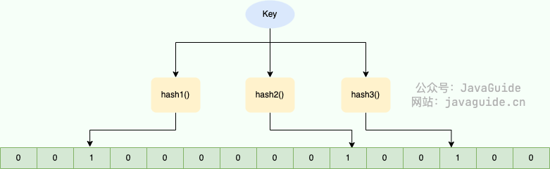

# Bloom Filter

You may have heard of Bloom filters even if you have not used one.

Bloom filters help answer membership queries on large datasets. They work well when a small error rate is acceptable, for example when preventing cache penetration or deduplicating large datasets.

This article covers:

1. What a Bloom filter is.
2. How it works.
3. Common use cases.
4. A manual Java implementation.
5. The Bloom filter included in Google's Guava library.
6. Bloom filters in Redis.

## What Is a Bloom Filter?

Let's start with the basic concept.

The Bloom filter (BF) was introduced by Burton Howard Bloom in 1970. It consists of a bit array and a set of hash functions. Compared with structures such as lists, maps, and sets, it uses less space and can be faster, but its answers are probabilistic rather than exact. As more elements are added, the false-positive rate generally increases. Deleting elements is also difficult.

A Bloom filter uses a bit array, where each bit is either 0 or 1. This is why it uses little memory. A bit array with one million bits requires 1,000,000 / 8 = 125,000 bytes, or about 122 KiB.


In short, **a Bloom filter is an efficient, compact structure for checking whether an element may be in a large set. It can produce false positives, and deleting elements is difficult. The false-positive rate generally increases as more elements are added.**

## How Bloom Filters Work

**When an element is added to a Bloom filter:**

1. Apply each hash function to the element to get one hash value per function.
2. Use the hash values as indexes and set the corresponding bits to 1.

**To check whether an element is in the filter:**

1. Apply the same hash functions to the element.
2. Check the corresponding bits. If any bit is 0, the element was definitely not added. If all are 1, it may have been added; a false positive is still possible.

The diagram below shows the basic idea:



When a string is added, multiple hash functions produce indexes, and the corresponding bits are set to 1. The bit array starts with all bits set to 0. When the same string is checked later, all corresponding bits are 1, so the filter reports that it may be present. The application must still check the underlying data to confirm.

To check a string, apply the same hash functions again. If any corresponding bit is 0, the string was definitely not added. If every bit is 1, it may have been added, or the bits may have been set by other elements.

**Different strings can map to the same bit positions. Increasing the bit-array size or changing the hash functions can reduce collisions.**

In summary: **a Bloom filter can incorrectly report that an element is present, but if it reports that an element is absent, the element was definitely not added.**

## Bloom Filter Use Cases

1. **Membership checks:** Check whether a value may be in a large dataset, whether a requested key may exist before querying a database to prevent cache penetration, whether an email address is on a spam list, or whether an IP address or phone number is on a blocklist.
2. **Deduplication:** Avoid processing URLs that have already been crawled, or filter duplicates from large collections of account or order IDs.

Deduplication also requires membership checks, so Bloom filters are mainly used to test membership in large datasets.

## Implementation

### Implementing a Bloom Filter in Java

Now that we have covered the principles, we can implement a simple Bloom filter.

The implementation needs:

1. A bit array of a suitable size.
2. Several hash functions.
3. A method to add an element to the filter.
4. A method to check whether an element may be present.

The following example is adapted from existing implementations and works with objects of any type:

```java
import java.util.BitSet;

public class MyBloomFilter {

    /**
     * Size of the bit array
     */
    private static final int DEFAULT_SIZE = 2 << 24;
    /**
     * Seeds used to create six different hash functions
     */
    private static final int[] SEEDS = new int[]{3, 13, 46, 71, 91, 134};

    /**
     * Bit array. Each bit is either 0 or 1.
     */
    private BitSet bits = new BitSet(DEFAULT_SIZE);

    /**
     * Array of hash function instances
     */
    private SimpleHash[] func = new SimpleHash[SEEDS.length];

    /**
     * Initialize hash function instances with different seeds
     */
    public MyBloomFilter() {
        // Initialize different hash functions
        for (int i = 0; i < SEEDS.length; i++) {
            func[i] = new SimpleHash(DEFAULT_SIZE, SEEDS[i]);
        }
    }

    /**
     * Add an element to the bit array
     */
    public void add(Object value) {
        for (SimpleHash f : func) {
            bits.set(f.hash(value), true);
        }
    }

    /**
     * Check whether the specified element may be in the bit array
     */
    public boolean contains(Object value) {
        boolean ret = true;
        for (SimpleHash f : func) {
            ret = bits.get(f.hash(value));
            if(!ret)
              return ret;
        }
        return ret;
    }

    /**
     * Static nested class for hashing
     */
    public static class SimpleHash {

        private int cap;
        private int seed;

        public SimpleHash(int cap, int seed) {
            this.cap = cap;
            this.seed = seed;
        }

        /**
         * Calculate the hash value
         */
        public int hash(Object value) {
            int h;
            return (value == null) ? 0 : Math.abs((cap - 1) & seed * ((h = value.hashCode()) ^ (h >>> 16)));
        }

    }
}
```

Test:

```java
String value1 = "https://javaguide.cn/";
String value2 = "https://github.com/Snailclimb";
MyBloomFilter filter = new MyBloomFilter();
System.out.println(filter.contains(value1));
System.out.println(filter.contains(value2));
filter.add(value1);
filter.add(value2);
System.out.println(filter.contains(value1));
System.out.println(filter.contains(value2));
```

Output:

```plain
false
false
true
true
```

Test:

```java
Integer value1 = 13423;
Integer value2 = 22131;
MyBloomFilter filter = new MyBloomFilter();
System.out.println(filter.contains(value1));
System.out.println(filter.contains(value2));
filter.add(value1);
filter.add(value2);
System.out.println(filter.contains(value1));
System.out.println(filter.contains(value2));
```

Output:

```java
false
false
true
true
```

### Using Guava's Bloom Filter

The manual implementation is useful for learning how Bloom filters work. Guava provides a well-tested implementation, so most projects do not need to write their own.

First, add Guava to the project. Manage its version through the project's dependency management and choose a supported release from [Guava Releases](https://github.com/google/guava/releases):

```xml
<dependency>
    <groupId>com.google.guava</groupId>
    <artifactId>guava</artifactId>
    <version>${guava.version}</version>
</dependency>
```

Example:

This creates a Bloom filter sized for an estimated 1,500 integers and a target false-positive probability of 1% (`0.01`). The value 1,500 is a capacity estimate, not a hard limit after which the filter stops working.

```java
// Create a Bloom filter
BloomFilter<Integer> filter = BloomFilter.create(
    Funnels.integerFunnel(),
    1500,
    0.01);
// Check whether an element may be present
System.out.println(filter.mightContain(1));
System.out.println(filter.mightContain(2));
// Add elements to the Bloom filter
filter.put(1);
filter.put(2);
System.out.println(filter.mightContain(1));
System.out.println(filter.mightContain(2));
```

In this example, `mightContain()` returning `false` means the element was definitely not added; `true` means it may have been added. The `0.01` parameter is the target false-positive probability for queries of elements that were not added, assuming the capacity estimate and implementation assumptions hold. It does not mean that a `true` result has a 99% chance of being correct.

**Guava's Bloom filter is stored in the current process's memory. It is simple to use and suits single-process applications or cases where nodes do not need to share filter state. For shared state across nodes, consider a centralized option such as RedisBloom.**

## Bloom Filters in Redis

### Overview

RedisBloom provides probabilistic data structures such as Bloom and Cuckoo filters. Starting with Redis 8, these capabilities are included in Redis Open Source, so the old third-party `rebloom` image is no longer required. See the [Redis Bloom Filter documentation](https://redis.io/docs/latest/develop/data-types/probabilistic/bloom-filter/) for commands and client support.

### Run Redis with Docker

You can start Redis 8 with Docker to try it out. For real projects, pin a tested version instead of relying on the `latest` tag:

```bash
docker run -d --name redis -p 6379:6379 redis:8
docker exec -it redis redis-cli
```

For production installation and version choices, see the [Redis Open Source installation guide](https://redis.io/docs/latest/operate/oss_and_stack/).

### Common Commands

> Here, `key` is the Bloom filter name and `item` is the element to add or check.

1. `BF.ADD`: Adds an element, creating the filter if it does not exist. Syntax: `BF.ADD {key} {item}`.
2. `BF.MADD`: Adds one or more elements, creating the filter if needed. Like `BF.ADD`, but accepts multiple items and returns multiple results. Syntax: `BF.MADD {key} {item} [item ...]`.
3. `BF.EXISTS`: Checks whether an element may be in the filter. Syntax: `BF.EXISTS {key} {item}`.
4. `BF.MEXISTS`: Checks whether one or more elements may be in the filter. Syntax: `BF.MEXISTS {key} {item} [item ...]`.

The `BF.RESERVE` command is also useful:

Its syntax is:

`BF.RESERVE {key} {error_rate} {capacity} [EXPANSION expansion]`。

The parameters are:

1. `key`: The Bloom filter name.
2. `error_rate`: The target false-positive rate, from 0 to 1. For example, a target rate of 0.1% is `0.001`. Lower values use more memory per item and more CPU per operation.
3. `capacity`: The estimated number of items. A scalable filter creates subfilters when it exceeds this capacity, and queries must check more subfilters. A fixed-size filter created with `NONSCALING` may exceed its target false-positive rate if more items are added than planned.

Optional parameter:

- `expansion`: When a new subfilter is created, its size is the current filter size multiplied by `expansion`. The default is 2, so each subsequent subfilter is twice the size of the previous one.

### Example

```shell
127.0.0.1:6379> BF.ADD myFilter java
(integer) 1
127.0.0.1:6379> BF.ADD myFilter javaguide
(integer) 1
127.0.0.1:6379> BF.EXISTS myFilter java
(integer) 1
127.0.0.1:6379> BF.EXISTS myFilter javaguide
(integer) 1
127.0.0.1:6379> BF.EXISTS myFilter github
(integer) 0
```

## Interview Review

Common interview questions ask why Bloom filters are fast and compact, why false positives occur, and why deletion is difficult.

| Question                            | Key point                                                                                         |
| ----------------------------------- | ------------------------------------------------------------------------------------------------- |
| Why is it compact?                  | It represents a set with a bit array and hash functions instead of storing the original elements. |
| Why can it produce false positives? | Different elements may set the same bits, making a query look present.                            |
| Can it produce false negatives?     | A standard Bloom filter does not report an inserted element as absent.                            |
| Why is deletion difficult?          | Multiple elements may share a bit; clearing it could affect other elements.                       |

Common engineering use cases:

- **Cache penetration:** Check whether a key may exist before querying the database; skip the database lookup if it definitely does not exist.
- **Large-scale deduplication:** Deduplicate URLs, filter blocklists, or track items already seen by a recommendation system.
- **Distributed systems:** Guava is simple for a single process; RedisBloom is an option when state must be shared across nodes.

Mention the limitation in your answer: Bloom filters suit cases where a small number of false positives is acceptable but false negatives are not. If the application requires exact membership checks, a Bloom filter alone is not enough.

## Common Follow-Up Questions

- How does the false-positive rate relate to bit-array size and the number of hash functions?
- Can a Bloom filter delete elements?
- What are cache penetration, cache breakdown, and cache avalanche?
- When should you choose Guava's Bloom filter or RedisBloom?
- What happens if the capacity estimate is wrong?

<!-- @include: @article-footer.snippet.md -->
