# Graphs

Graphs are a relatively complex non-linear data structure. **What makes them complex?**

As discussed earlier:

- Elements in a linear data structure follow a single linear relationship. Each element, except the first and last, has one immediate predecessor and one immediate successor.
- Elements in a tree have a clear hierarchical relationship.

In a graph, however, elements can have arbitrary relationships.

**What is a graph?** A graph consists of a finite, non-empty set of vertices and a set of edges between them. It is usually written as **G(V, E)**, where G is the graph, V is the set of vertices, and E is the set of edges.

The diagram below shows a graph data structure, specifically a directed graph.

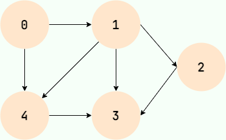

Graphs have many real-world uses. For example, a social network can represent friendships as a graph.

## Graph Fundamentals

### Vertices

The data elements in a graph are called vertices. A graph has at least one vertex, so its vertex set is finite and non-empty.

In a friendship graph, each user is a vertex.

### Edges

Edges represent relationships between vertices.

In a friendship graph, an edge connects two users who are friends.

### Degree

The degree of a vertex is the number of edges connected to it. In a directed graph, this is split into **out-degree**, the number of edges leaving the vertex, and **in-degree**, the number entering it.

In a friendship graph, a user's degree represents the number of their friends.

### Undirected and Directed Graphs

Some relationships are bidirectional. For example, if A is B's classmate, then B is also A's classmate. The relationship has no direction, so an edge without an arrow represents it. A graph with such edges is an **undirected graph**.

Other relationships have a direction, such as parent-child relationships, teacher-student relationships, or following someone on social media. A may be B's parent without B being A's parent; A may follow B without B following A. In these cases, arrows show the direction, and the graph is a **directed graph**.

### Unweighted and Weighted Graphs

If we care only whether a relationship exists, not how strong it is, we can represent it with an **unweighted graph**.

If we care both whether a relationship exists and how strong it is—for example, the distance between two cities on a map—we can use a **weighted graph**. Each edge has a numeric weight representing the relationship's strength or cost.

The diagram below is a weighted directed graph.

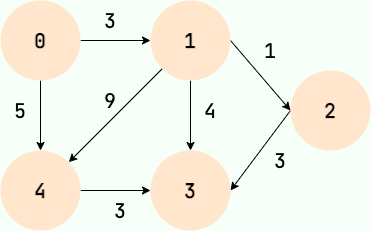

## Graph Representations

### Adjacency Matrix

An adjacency matrix stores a graph in a two-dimensional matrix. It is a straightforward representation.

If there is an edge from vertex i to vertex j with weight n, then `A[i][j] = n`.

For an unweighted graph, set `A[i][j] = 1` when vertices i and j are connected, and `A[i][j] = 0` otherwise. The diagram below shows an example:

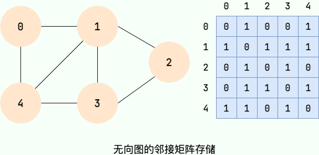

Note that **the adjacency matrix of an undirected graph is symmetric**: if vertex i is connected to vertex j, then vertex j is also connected to vertex i.

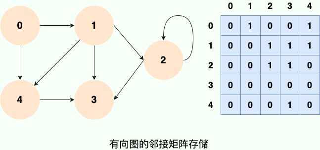

An adjacency matrix is simple to implement with a two-dimensional array, and checking whether two vertices are connected takes constant time. Its main drawback is that it can waste space, especially for sparse graphs.

### Adjacency List

An **adjacency list** is another representation that avoids the space overhead of an adjacency matrix for sparse graphs.

An adjacency list stores the neighbors of each vertex in a list. For every vertex Vi, the vertices Vj adjacent to it are linked in a list called Vi's **adjacency list**. The diagrams below show examples:

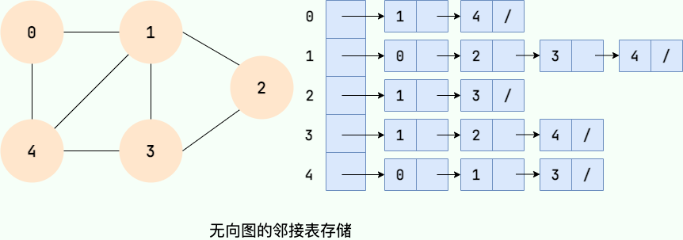

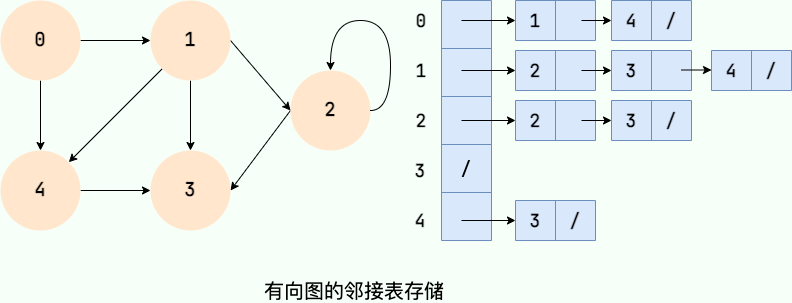

Count the entries in the adjacency lists and compare them with the number of edges:

- In an undirected graph, each edge appears in two lists, so the total number of entries is twice the number of edges. In the left diagram, 7 edges produce 14 entries.
- In a directed graph, each edge appears once, so the number of entries equals the number of edges. In the right diagram, 8 edges produce 8 entries.

## Graph Traversal

### Breadth-First Search

Breadth-first search expands outward one layer at a time, like ripples on water:

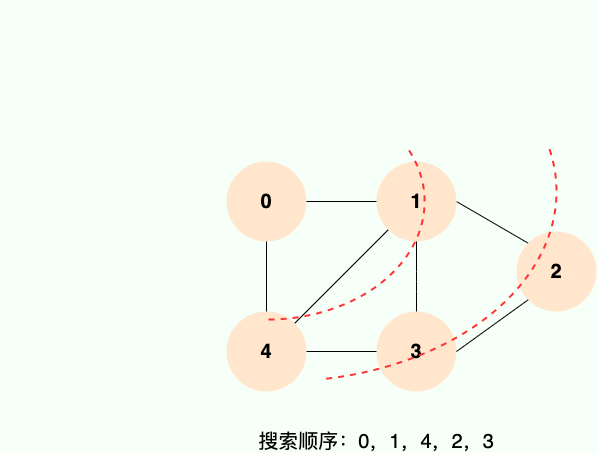

**Breadth-first search is implemented with a queue**, a linear data structure introduced earlier. The steps are shown below:

**Step 1:**

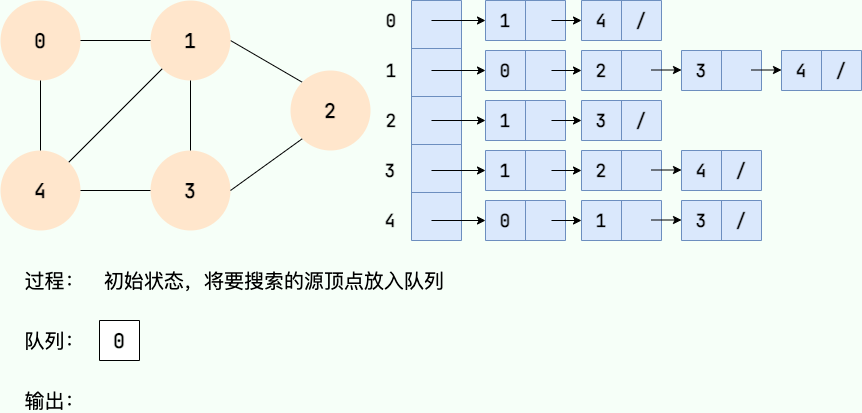

**Step 2:**

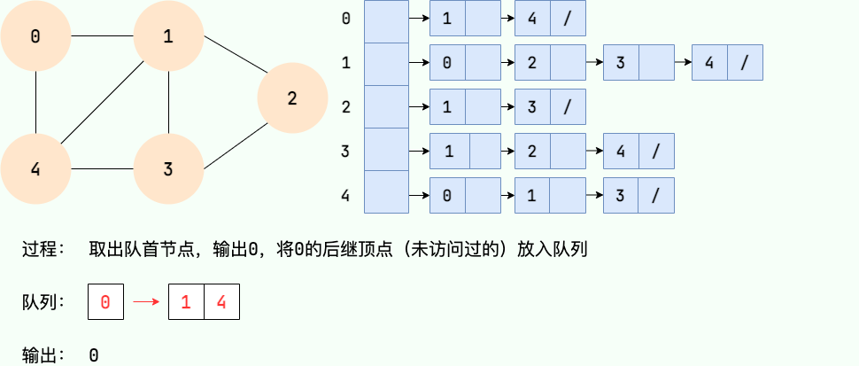

**Step 3:**

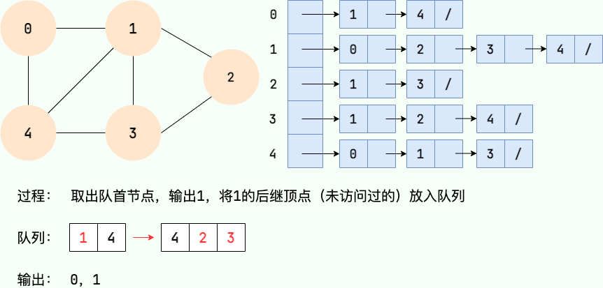

**Step 4:**

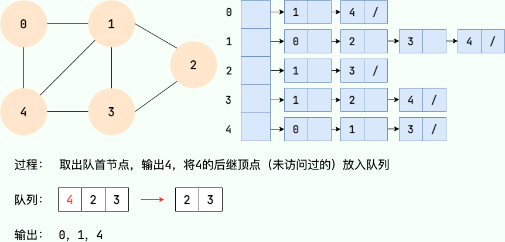

**Step 5:**

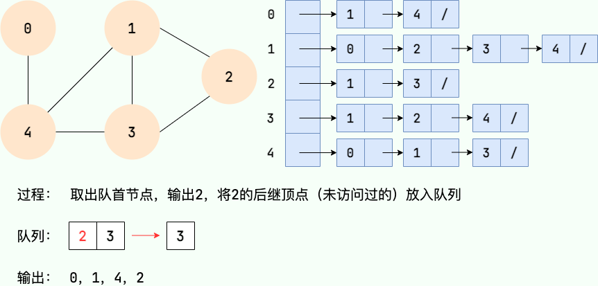

**Step 6:**

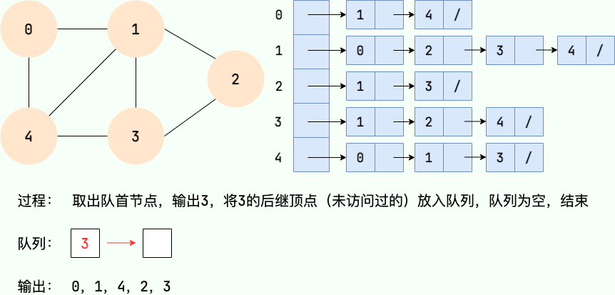

### Depth-First Search

Depth-first search follows one path as far as it can. Starting from a source vertex, it continues until there are no unvisited neighbors, then backtracks and explores another path:

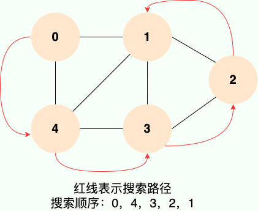

**Like breadth-first search, depth-first search uses a linear data structure—in this case, a stack.** The steps are shown below:

**Step 1:**

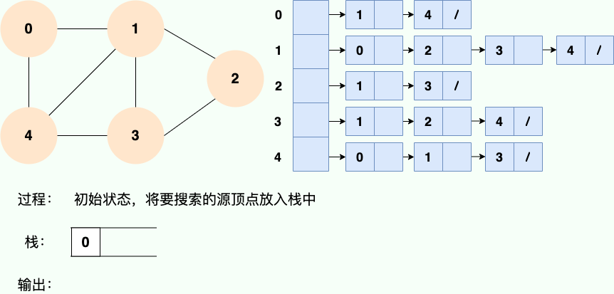

**Step 2:**

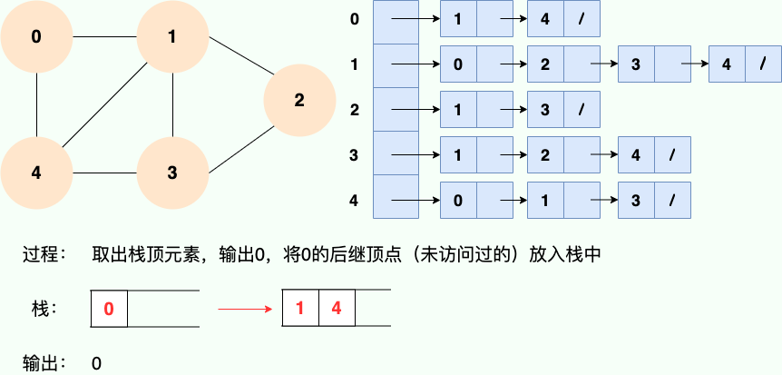

**Step 3:**

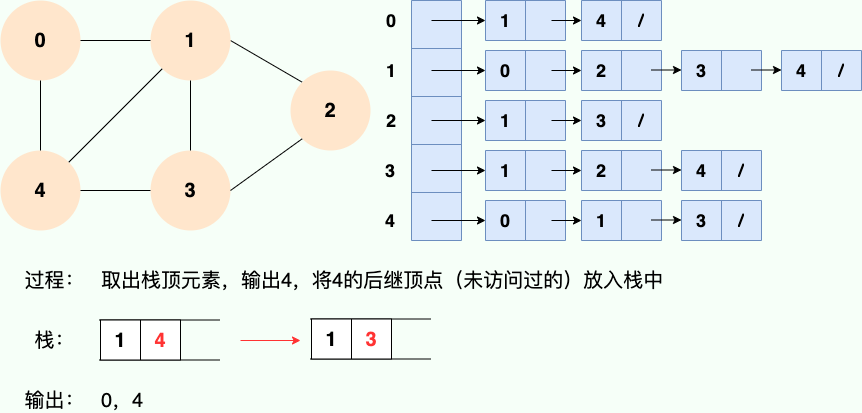

**Step 4:**

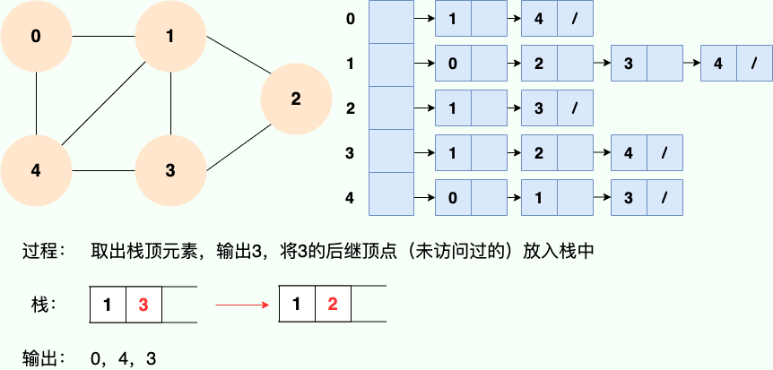

**Step 5:**

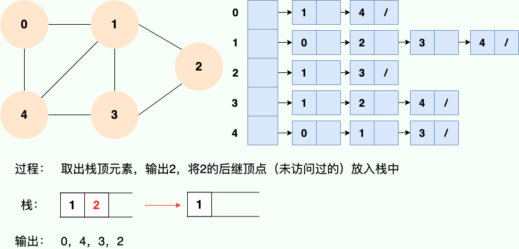

**Step 6:**

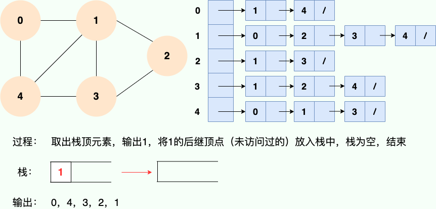

## Interview Review

For graph problems, choose a representation first, then a traversal strategy. Four common interview problem types are connected components, shortest paths by number of edges, dependencies, and cycle detection.

| Representation   | Space complexity | Check whether two vertices are adjacent | Traverse a vertex's neighbors | Suitable for                                |
| ---------------- | ---------------- | --------------------------------------- | ----------------------------- | ------------------------------------------- |
| Adjacency matrix | `O(V^2)`         | `O(1)`                                  | `O(V)`                        | Dense graphs with relatively few vertices   |
| Adjacency list   | `O(V + E)`       | Depends on the list structure           | Proportional to the degree    | Sparse graphs; common in algorithm problems |

For DFS and BFS templates, see [DFS and BFS Interview Questions](../algorithms/dfs-bfs.md). A few additional points to mention in an interview:

- With an adjacency list, DFS and BFS usually run in `O(V + E)` time.
- For the shortest path in an unweighted graph, consider BFS first.
- Topological sorting is commonly used for dependencies in directed graphs; Course Schedule is a typical example.
- DFS, BFS, or union-find can be used to check connectivity and detect cycles in undirected graphs.
- Ordinary BFS does not solve weighted shortest-path problems. Common algorithms include Dijkstra, Bellman-Ford, and Floyd-Warshall; choose based on the problem's constraints.

## Java Templates

An adjacency list is the most common representation in algorithm problems. Vertices are usually numbered from `0` to `n - 1`, and can be stored as `List<Integer>[]`.

```java
List<Integer>[] buildGraph(int n, int[][] edges) {
    List<Integer>[] graph = new ArrayList[n];
    for (int i = 0; i < n; i++) {
        graph[i] = new ArrayList<>();
    }
    for (int[] edge : edges) {
        int from = edge[0];
        int to = edge[1];
        graph[from].add(to);
        // Add the reverse edge for an undirected graph:
        // graph[to].add(from);
    }
    return graph;
}
```

BFS is useful for finding the shortest path length in an unweighted graph:

```java
int bfs(List<Integer>[] graph, int start, int target) {
    boolean[] visited = new boolean[graph.length];
    Queue<Integer> queue = new ArrayDeque<>();
    queue.offer(start);
    visited[start] = true;
    int step = 0;
    while (!queue.isEmpty()) {
        int size = queue.size();
        for (int i = 0; i < size; i++) {
            int cur = queue.poll();
            if (cur == target) {
                return step;
            }
            for (int next : graph[cur]) {
                if (!visited[next]) {
                    visited[next] = true;
                    queue.offer(next);
                }
            }
        }
        step++;
    }
    return -1;
}
```

## Walkthrough and Edge Cases

For a shortest-path search in an unweighted graph, BFS expands by layers:

```text
Layer 0: start
Layer 1: all unvisited neighbors of start
Layer 2: all unvisited neighbors of the vertices in layer 1
...
When target is first reached, the current layer is the shortest path length.
```

Check these edge cases:

- If `start == target`, the answer should be `0`.
- If the graph is disconnected and the target is unreachable, the answer should be `-1`.
- Forgetting to add the reverse edge when building an undirected graph can make a connected graph appear disconnected.
- Without a `visited` check, BFS or DFS can revisit vertices in a cyclic graph indefinitely.

## Practice Problems

- [200. Number of Islands](https://leetcode.cn/problems/number-of-islands/)
- [695. Max Area of Island](https://leetcode.cn/problems/max-area-of-island/)
- [994. Rotting Oranges](https://leetcode.cn/problems/rotting-oranges/)
- [207. Course Schedule](https://leetcode.cn/problems/course-schedule/)
- [547. Number of Provinces](https://leetcode.cn/problems/number-of-provinces/)

<!-- @include: @article-footer.snippet.md -->
