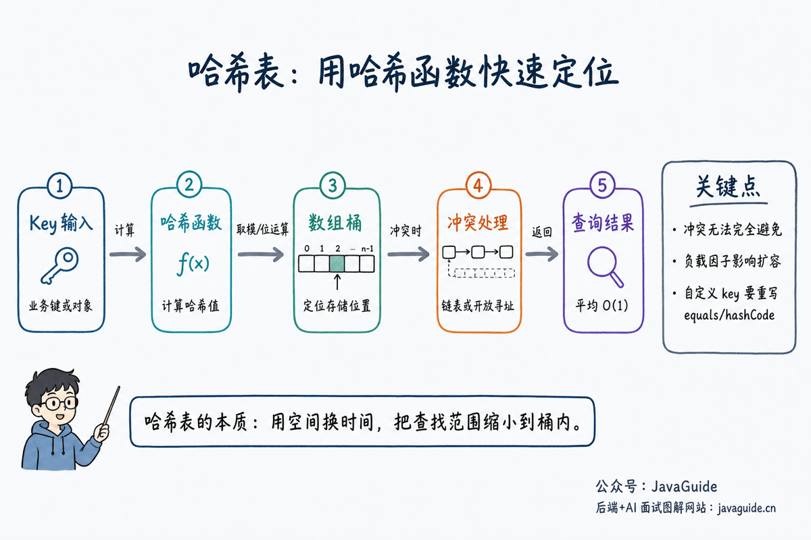

Hash tables are common in interviews because they connect fast lookup and counting in algorithm problems with practical uses such as Java `HashMap`, caching, deduplication, and sharding in distributed systems.

The key question is how to map a key to an array index quickly while maintaining acceptable lookup performance despite collisions, resizing, and pathological inputs.

This article covers:

1. What is a hash table?
2. How does a hash table map a key to an array index?
3. What problems do collisions, load factors, and resizing address?
4. How is Java `HashMap` related to a general hash table?
5. How are hash tables used in algorithms and production systems?



## What Is a Hash Table?

A hash table stores key-value mappings. Maps, dictionaries, and associative arrays can all be implemented using hash tables.

If keys are consecutive integers, such as student IDs from `0` to `999`, an array provides `O(1)` access through `students[id]`. Real-world keys are less regular: they may be strings, user IDs, order numbers, URLs, or custom objects. A hash table uses a hash function to convert each key into an integer, then maps that integer to an array index.

You can think of a hash table as having three parts:

1. **Array:** Stores the data and is often described as a set of buckets.
2. **Hash function:** Converts a key into a hash value.
3. **Collision-resolution strategy:** Determines how to store keys that map to the same bucket.

A hash table does not eliminate searching entirely. The hash function narrows the search: ideally, the target bucket is found immediately; if collisions occur, only a few comparisons are needed within that bucket.

## Why Use a Hash Table?

Suppose you need to check whether a URL has already been crawled. A simple approach stores crawled URLs in a list and scans it for each new URL. This works for small datasets, but scanning millions of URLs each time quickly becomes too slow.

Hash tables trade space for time: they use an array to distribute URLs across buckets. Instead of scanning every URL, a lookup computes a hash and jumps to the relevant bucket.

This makes hash tables useful for lookup, counting, deduplication, and cache indexes. They do not order elements or preserve their relative values; their goal is to find a value quickly given a key.

## What Should a Hash Function Do?

The goal of a hash function is to distribute keys evenly across the array. A good hash function should generally meet three requirements:

| Requirement      | Meaning                                                                                 |
| ---------------- | --------------------------------------------------------------------------------------- |
| Stable           | The same key should produce the same hash value each time.                              |
| Fast             | The hash function should not be so slow that it erases the table's performance benefit. |
| Well distributed | Different keys should spread across the array to reduce collisions.                     |

Note that hash functions for hash tables differ from cryptographic hash functions. Hash tables prioritize speed and distribution; cryptographic hashes prioritize security properties such as collision and tamper resistance.

In Java, custom objects used as `HashMap` keys must implement `hashCode()` and `equals()` consistently: if two objects are equal according to `equals()`, they must have the same hash code. The reverse is not required, which is one reason hash collisions occur.

## Interview Topics

- A hash function maps a key to an array index.
- Collisions cannot be completely avoided, so hash tables need a strategy to handle them.
- Lookup, insertion, and deletion take `O(1)` on average, but can degrade in the worst case.
- Java `HashMap` uses an array, linked lists, and red-black trees; since JDK 8, long chains may be converted to trees.
- Hash tables are commonly used for fast lookup, counting, deduplication, and cache indexes.

## How Does a Hash Table Work?

When inserting a key-value pair, a hash table generally does the following:

1. Compute the key's hash value.
2. Map the hash value to an index based on the array length.
3. Insert the pair if that position is empty.
4. If there is a collision, apply the collision-resolution strategy.

```java
int index = hash(key) & (table.length - 1);
```

When `HashMap` has a capacity that is a power of two, it can use a bitwise operation instead of modulo. This is faster and also makes redistribution during resizing easier.

Here, `hash(key)` usually does not use the object's raw `hashCode()` directly. It applies a bit-spreading step so that high-order bits also affect the lower bits used to calculate the index. When the array length is a power of two, the lower bits of `length - 1` are all 1s, so a direct `&` relies heavily on the hash value's lower bits. Poor distribution in those bits can concentrate collisions.

## How Are Hash Collisions Handled?

| Method          | Approach                                       | Typical use                       | Tradeoff                                             |
| --------------- | ---------------------------------------------- | --------------------------------- | ---------------------------------------------------- |
| Chaining        | Store a list or tree at each array position    | Java `HashMap`                    | Long lists can slow lookups                          |
| Open addressing | Probe another array position after a collision | Some high-performance hash tables | Deletion and load-factor management are more complex |
| Rehashing       | Use another hash function after a collision    | Common in theoretical discussions | More complex to implement                            |

Java `HashMap` primarily uses chaining. Since JDK 8, when a list reaches a threshold and the array is large enough, it may be converted to a red-black tree to reduce lookup cost under heavy collisions.

Chaining is straightforward to implement and makes deletion relatively easy. Each bucket can hold a linked list, with colliding elements added to that list. A lookup first finds the bucket by hash, then compares keys in its list or tree.

Open addressing stores every element directly in the array instead of using linked lists. After a collision, it probes for another available position using a rule such as linear probing, quadratic probing, or double hashing. It often has better memory locality, but deletion, load-factor management, and clustering are more complicated.

## Load Factor and Resizing

The load factor measures how full a hash table is:

```text
Load factor = number of elements / array capacity
```

`HashMap` has a default load factor of `0.75`. When the number of elements exceeds `capacity * loadFactor`, it resizes, usually doubling its capacity.

Resizing incurs a rehashing cost. In an interview, explain that insertion is `O(1)` on average, although an insertion that triggers resizing must move elements. Amortized across many insertions, the average cost remains `O(1)`.

The load factor is not just about space utilization. A higher load factor saves space but increases the chance of collisions; a lower one reduces collisions but leaves more buckets unused. `0.75` is Java `HashMap`'s practical balance between time and space.

## Why Is Hash Table Access O(1) on Average?

The `O(1)` complexity describes average or expected performance, not a guarantee for every possible input.

With a well-distributed hash function and a controlled load factor, elements are spread across buckets, leaving only a few values in each one. Lookup mainly computes a hash, finds an array index, and performs a small number of comparisons, which is treated as constant time.

If many keys map to the same bucket, performance degrades. With chaining, a long list can make lookup approach `O(n)`. Since JDK 8, `HashMap` can convert a bucket to a tree under certain conditions, reducing lookup in that bucket to about `O(log n)`. Collisions can still affect performance.

## Hash Tables and Java HashMap

Common follow-up questions about `HashMap` include:

- Why is the initial capacity usually set to a power of two?
- Why is the default load factor `0.75`?
- Why did JDK 8 introduce red-black trees?
- Why is `HashMap` not thread-safe?
- How do `HashMap` and `ConcurrentHashMap` differ?

These questions go beyond data structure basics, but the underlying structure is still a hash table: the array locates entries, lists or red-black trees handle collisions, and resizing controls the load.

## Common Algorithm Pattern

Two Sum:

```java
int[] twoSum(int[] nums, int target) {
    Map<Integer, Integer> map = new HashMap<>();
    for (int i = 0; i < nums.length; i++) {
        int need = target - nums[i];
        if (map.containsKey(need)) {
            return new int[] {map.get(need), i};
        }
        map.put(nums[i], i);
    }
    return new int[] {-1, -1};
}
```

This code shows a common use for hash tables: trading space for time to reduce a lookup from `O(n)` to `O(1)` on average.

## Example: Subarray Sum Equals K

[560. Subarray Sum Equals K](https://leetcode.cn/problems/subarray-sum-equals-k/) is a good example of using prefix sums with a hash table. The task is to count contiguous subarrays whose sum is `k`.

Enumerating every pair of endpoints takes `O(n^2)`. Instead, let `sum` be the current prefix sum and look for an earlier prefix sum `prev` such that:

```text
sum - prev = k
```

That gives `prev = sum - k`. Store the frequency of each prefix sum in a hash table; at each position, this tells us how many subarrays ending there sum to `k`.

```java
int subarraySum(int[] nums, int k) {
    Map<Integer, Integer> count = new HashMap<>();
    count.put(0, 1);

    int sum = 0;
    int ans = 0;
    for (int num : nums) {
        sum += num;
        ans += count.getOrDefault(sum - k, 0);
        count.put(sum, count.getOrDefault(sum, 0) + 1);
    }
    return ans;
}
```

The `count.put(0, 1)` initialization is important: it records the empty prefix once. This lets the algorithm count a subarray from the start of the array when its sum equals `k`.

Another common pitfall is the order of operations: look up first, then increment the count. If the current `sum` is added to the map before checking `sum - k`, then when `k = 0` the current prefix may be paired with itself, producing an incorrect count.

For example, with `nums = [1]` and `k = 0`, the correct lookup-before-increment order finds no non-empty subarray with sum 0. If the current prefix sum `1` is added first, then looking up `sum - k = 1` pairs the prefix with itself and incorrectly counts one subarray.

## Java HashMap Follow-Up Questions

Concepts alone may not be enough in a Java backend interview; candidates are often asked follow-up questions about `HashMap`. Prepare along these lines:

| Question                                | Key point                                                                                                         |
| --------------------------------------- | ----------------------------------------------------------------------------------------------------------------- |
| Why is capacity usually a power of two? | It enables index calculation with `hash & (length - 1)` and simplifies redistribution during resizing.            |
| Why is the default load factor `0.75`?  | It balances space use and collision probability; too low wastes space, while too high increases collisions.       |
| Why did JDK 8 add red-black trees?      | Tree bins reduce lookup cost when collisions make a linked list too long.                                         |
| Why is `HashMap` not thread-safe?       | Concurrent modifications can corrupt its structure; it also provides no synchronization or visibility guarantees. |
| What should custom keys account for?    | `equals()` and `hashCode()` must be consistent, and fields used by them should not change after insertion.        |

You do not need to memorize every source-code detail. Explain the main ideas: array indexing, collision handling, redistribution during resizing, and optimization for severe collisions. Together, these determine `HashMap` performance.

## Common Pitfalls

- Average `O(1)` does not mean `O(1)` for every operation in every case.
- Override `equals()` and `hashCode()` consistently when using custom objects as keys.
- Mutable objects are usually poor hash table keys.
- For frequency counts over a small, fixed character set, an array may be more suitable than `HashMap`.
- Hash tables speed up lookup but require additional space.

## Review Questions

- Why is hash table lookup `O(1)` on average, and when can it degrade?
- How do chaining and open addressing differ?
- Why does `HashMap` resize, and how should you understand its cost?
- Why should custom key classes implement both `equals()` and `hashCode()`?
- Why should the prefix-sum algorithm look up before incrementing the count?

## Practice Problems

- [1. Two Sum](https://leetcode.cn/problems/two-sum/)
- [242. Valid Anagram](https://leetcode.cn/problems/valid-anagram/)
- [49. Group Anagrams](https://leetcode.cn/problems/group-anagrams/)
- [560. Subarray Sum Equals K](https://leetcode.cn/problems/subarray-sum-equals-k/)
- [146. LRU Cache](https://leetcode.cn/problems/lru-cache/)

## References

- [Algorithms, 4th Edition: Hash Tables](https://algs4.cs.princeton.edu/34hash/)
- [Java SE 21 API: HashMap](https://docs.oracle.com/en/java/javase/21/docs/api/java.base/java/util/HashMap.html)
- [OpenJDK: HashMap source](https://github.com/openjdk/jdk/blob/master/src/java.base/share/classes/java/util/HashMap.java)
- [Java SE 21 API: Object#hashCode](https://docs.oracle.com/en/java/javase/21/docs/api/java.base/java/lang/Object.html#hashCode%28%29)

<!-- @include: @article-footer.snippet.md -->
