## What Is a Heap?

A heap is a tree that satisfies the following property:

Each node is greater than or equal to every node in its subtree, or less than or equal to every node in its subtree. Equivalently, each node is greater than or equal to, or less than or equal to, its children.

> Think of a max-heap as a company where the strongest person is always at the top. No one below the leader is stronger than the leader. This analogy can help explain heap operations.

**Important:**

- Some articles say that a heap is a complete binary tree, but **a heap is not necessarily a complete binary tree**. We often represent binary heaps as complete binary trees because that makes storage and indexing convenient. Well-known Fibonacci heaps and binomial heaps are not complete binary trees; in fact, they are not binary trees.
- A (**binary**) heap is an array that can be viewed as an **almost complete binary tree**. — _Introduction to Algorithms_, 3rd edition

Which of the diagrams below satisfy the heap property?

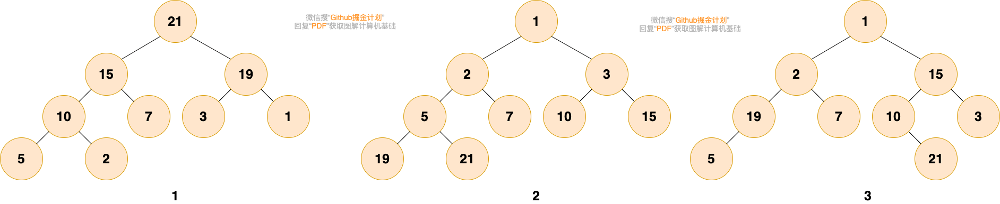

The first and second diagrams are heaps. The first is a max-heap, where each node is greater than every node in its subtree. The second is a min-heap, where each node is smaller than every node in its subtree.

The third diagram is not a heap: its root, 1, is smaller than 2 and 15, while 15 is greater than 3 and 19 is greater than 5. It does not satisfy the heap property.

## When to Use a Heap

Use a heap when you need to repeatedly retrieve the minimum or maximum value and insert or remove elements.

A sorted array is another option. Sorting it takes `O(n log n)`, and reading the minimum or maximum takes `O(1)`. However, inserting or deleting an element takes `O(n)` because elements must be shifted, even if binary search finds the position in `O(log n)`.

**Compared with a sorted array, a heap's main advantage is faster insertion and deletion.** Because a binary heap is represented as a complete binary tree, these operations move a node up or down the tree in `O(log n)` time, compared with `O(n)` for a sorted array.

Note that Floyd's bottom-up build-heap algorithm starts sifting down from the last non-leaf node and takes `O(n)` time. Inserting n elements one by one into an empty heap takes `O(n log n)`.

## Types of Heaps

The two common types are **max-heaps** and **min-heaps**. They differ in how node values are ordered.

- **Max-heap:** Every node is greater than or equal to every node in its subtree.
- **Min-heap:** Every node is less than or equal to every node in its subtree.

In the diagram below, figure 1 is a max-heap and figure 2 is a min-heap.

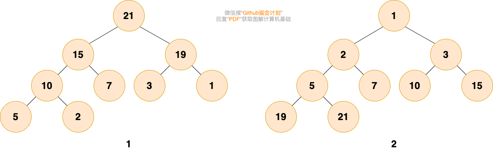

## Heap Representation

As discussed in the section on trees, a complete binary tree can be stored compactly in an array. If the root is at index 1, then for any node at index i, its left child is at `2*i` and its right child is at `2*i+1`.

A binary heap is commonly stored as a complete binary tree to simplify storage and indexing, as shown below:

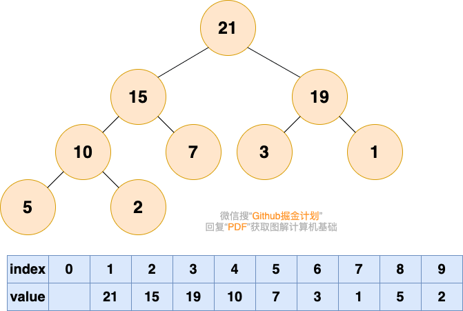

## Heap Operations

The two main heap update operations are **inserting an element** and **removing the root**. Make sure you understand how both work.

> Remember the company analogy: a capable employee moves to a position that matches their ability.

### Inserting an Element

> When a new employee joins the company, they start at the bottom.

**1. Add the new element at the end.**

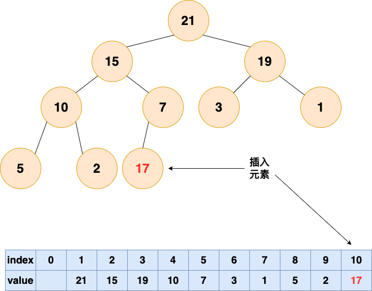

> A capable person gradually moves up. Good work gets noticed!

**2. Sift up.** For a max-heap, if the parent is smaller than the new element, swap them. Repeat until no further swap is needed.

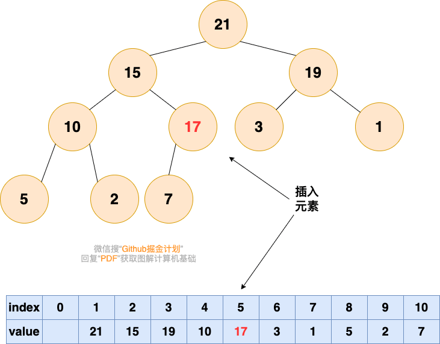

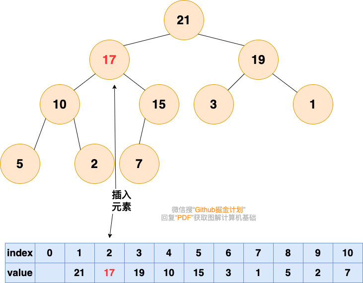

### Removing the Root

By the heap property, the root of a max-heap is its largest element, and the root of a min-heap is its smallest. A heap is useful when you need to retrieve the minimum or maximum repeatedly.

After removing the root, adjust the heap to restore its property. This process is called **heapifying**. There are two common directions:

- **Bottom-up heapify:** During insertion, the new element moves up from the end of the array; this is also called sifting up.
- **Top-down heapify:** After removing the root, the last element moves down from the root; this is also called sifting down.

#### An Incomplete Hole-Moving Approach

> Imagine the leader of the company leaving. Their position is now empty.

First, consider an intuitive but incomplete approach: remove the root directly, leaving index 1 of the array empty.

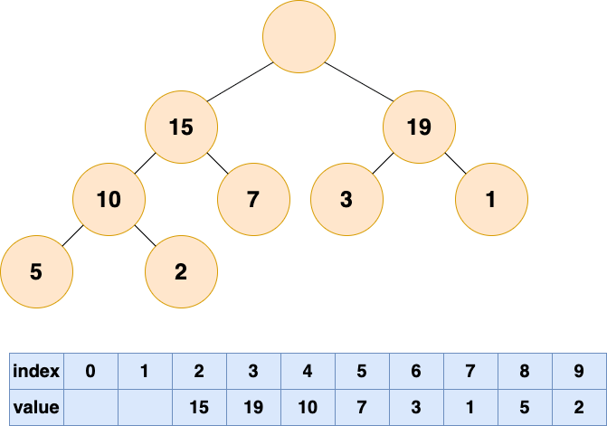

> Who takes their place? One of their direct reports, whichever is more capable.

Compare the root's left and right children, at array indexes 2 and 3, and move the larger one to the root at index 1.

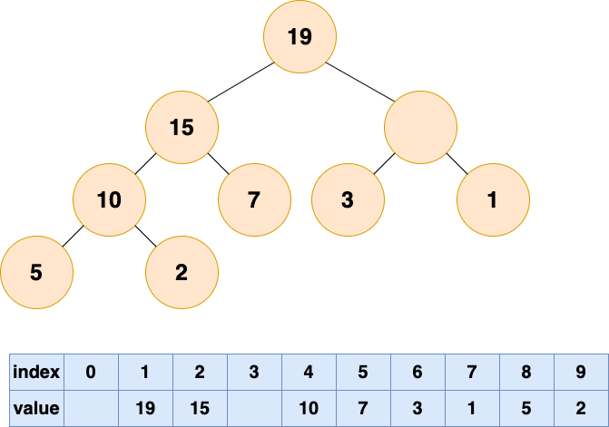

> This leaves another empty position. As before, move up the stronger child.

Continue comparing the children of the empty position and move the larger one up until reaching the bottom of the heap.

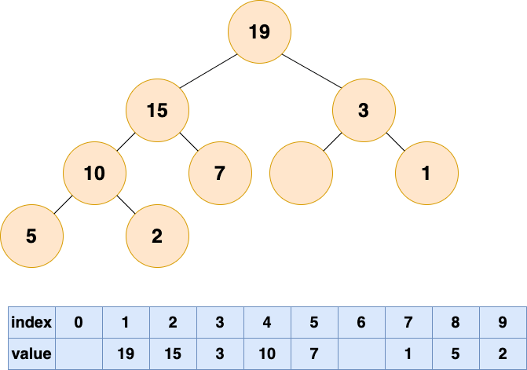

Although the larger children have moved up, the array now has an empty position and no longer represents a complete binary tree. This is not a complete root removal. The standard approach moves the last element to the root, then sifts it down.

#### Top-Down Heapify

Top-down heapify is like a stone sinking to the bottom. First lift the stone—the last element in the heap—to the surface by moving it to the root.

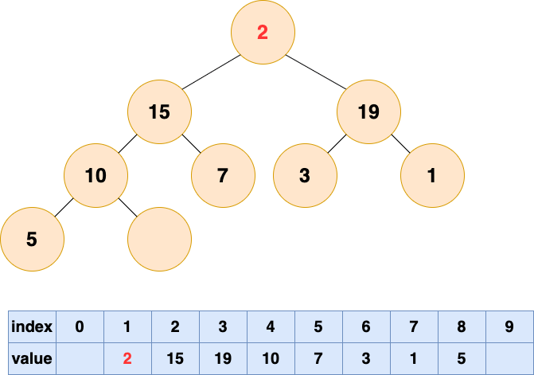

Now let the element sink: compare it with its children and swap it with the larger child until no further swap is needed.

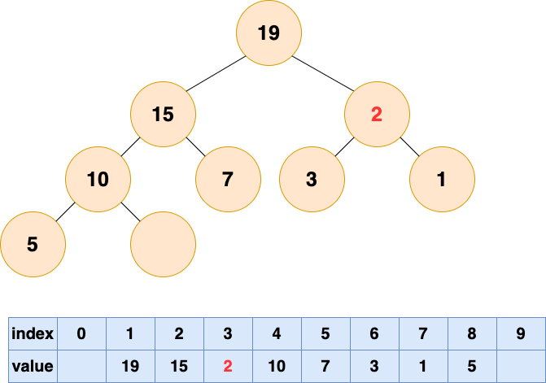

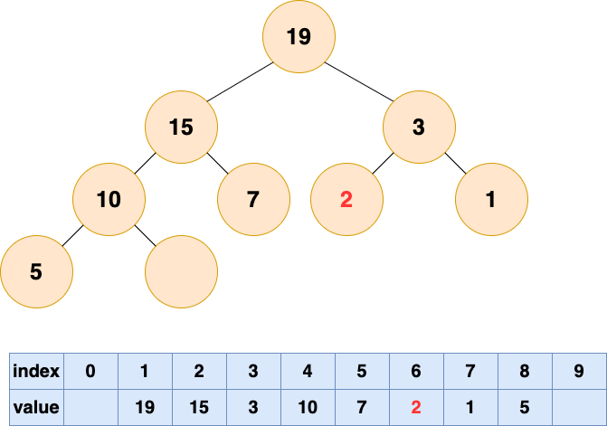

### Summary of Heap Operations

- **Insert:** Add the element at the end of the array, then sift it up to restore the heap property.
- **Remove the root:** Swap the root with the last element, reduce the heap size, and sift the new root down until the heap property is restored.

## Heap Sort

Heap sort has two steps:

- **Build a heap** from the unsorted array.
- **Sort the elements** by removing the root, heapifying the remaining elements, and repeating until all elements have been removed.

### Building a Heap

Once you understand heapify, building a heap is straightforward: sift down each non-leaf node, working from the bottom upward.

The parent of the last node and every node before it are non-leaf nodes. If there are n nodes, sift down the nodes from `n/2` to 1.

The process is shown below:

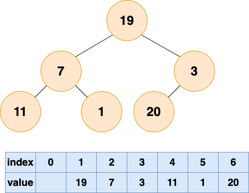

Represent the initial array as a tree. The diagram has 6 nodes: nodes 4, 5, and 6 are leaves, while nodes 1, 2, and 3 are non-leaf nodes. Sift down nodes 1 through 3 in reverse order, starting at node 3 and ending at node 1.

After sifting down node 3:

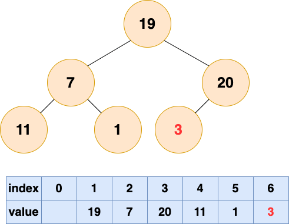

After sifting down node 2:

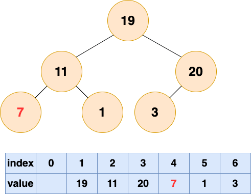

After sifting down node 1:

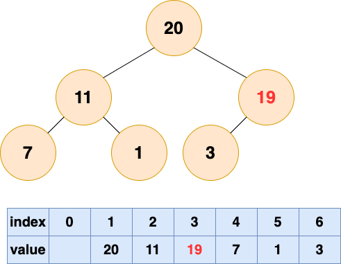

The tree represented by the array is now a max-heap, so heap construction is complete.

### Sorting

Because the root is the largest element, repeatedly move it to the end of the array and heapify the remaining elements.

Consider two questions:

- After removing the root, should we sift down or sift up?
- Where should the removed root go? Do we need a separate array?

First, the heap needs to be sifted down. This operation begins by moving the last element to the root, leaving the last array position free. Since the heap has become smaller, that position is outside the heap, so we can store the removed root there.

This is simply a swap: exchange the root and the last element. It combines removing the root with the first step of heapifying, which moves the last element to the root.

The steps are shown below:

Remove the first element and heapify:

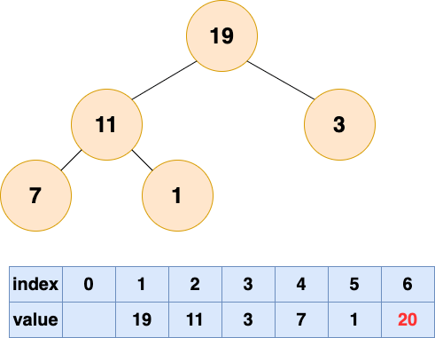

Remove the second element and heapify:

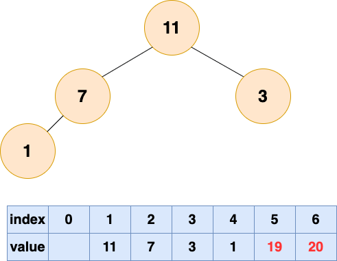

Remove the third element and heapify:

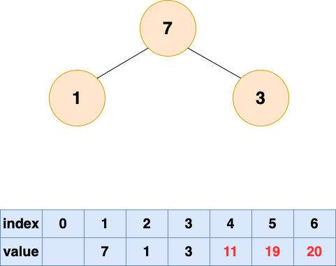

Remove the fourth element and heapify:

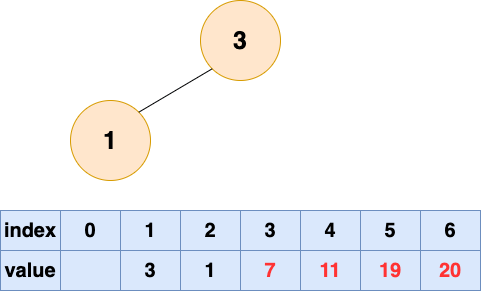

Remove the fifth element and heapify:

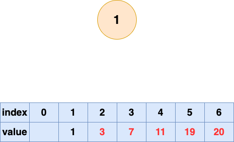

Remove the sixth element and heapify:

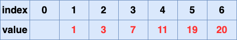

Heap sort is complete.

## Interview Review

Heaps often come up in interviews alongside priority queues, Top K problems, scheduled tasks, and delay queues.

| Operation    | Time complexity | Notes                                                                |
| ------------ | --------------- | -------------------------------------------------------------------- |
| Peek at root | `O(1)`          | The root is the maximum in a max-heap and the minimum in a min-heap. |
| Insert       | `O(log n)`      | Add at the end, then sift up.                                        |
| Remove root  | `O(log n)`      | Move the last element to the root, then sift down.                   |
| Build heap   | `O(n)`          | Sift down from the last non-leaf node.                               |
| Heap sort    | `O(n log n)`    | In-place, but not stable.                                            |

Java's `PriorityQueue` is a min-heap by default:

```java
PriorityQueue<Integer> minHeap = new PriorityQueue<>();
PriorityQueue<Integer> maxHeap = new PriorityQueue<>((a, b) -> Integer.compare(b, a));
```

Avoid writing `b - a`; it can overflow for extreme integer values and produce an incorrect comparison.

Common approaches to Top K problems:

- For the Kth largest element in a general setting or stream, maintain a min-heap of size K. Time is `O(n log k)` and space is `O(k)`.
- For the Kth largest element in a one-time array when linear time is required, use quickselect, which takes `O(n)` time on average.
- To find the K most frequent elements, count with a hash table, then use a min-heap to retain the K most frequent.
- To find the median of a stream, use a max-heap for the lower half and a min-heap for the upper half.

Note that a min-heap is a general solution for finding the Kth largest element, but it does not meet every problem's complexity requirement. For example, [LeetCode 215. Kth Largest Element in an Array](https://leetcode.cn/problems/kth-largest-element-in-an-array/) requires an `O(n)` algorithm. Randomized quickselect is the usual choice, with expected `O(n)` time; BFPRT is needed for a strict worst-case `O(n)` guarantee. See [Top K Interview Questions](../algorithms/top-k.md#quick-sort-partition) for a comparison of approaches.

## Java Templates

Use a min-heap of size K to find the Kth largest element. The root is the smallest among the current K largest values. If a new value is larger than the root, replace it. This takes `O(n log k)` time and `O(k)` space, and works for general Top K and streaming problems.

```java
int findKthLargest(int[] nums, int k) {
    PriorityQueue<Integer> heap = new PriorityQueue<>();
    for (int num : nums) {
        if (heap.size() < k) {
            heap.offer(num);
        } else if (num > heap.peek()) {
            heap.poll();
            heap.offer(num);
        }
    }
    return heap.peek();
}
```

For the K most frequent elements, combine hash table counting with a min-heap:

```java
int[] topKFrequent(int[] nums, int k) {
    Map<Integer, Integer> count = new HashMap<>();
    for (int num : nums) {
        count.put(num, count.getOrDefault(num, 0) + 1);
    }
    PriorityQueue<int[]> heap = new PriorityQueue<>((a, b) -> Integer.compare(a[1], b[1]));
    for (Map.Entry<Integer, Integer> entry : count.entrySet()) {
        heap.offer(new int[] {entry.getKey(), entry.getValue()});
        if (heap.size() > k) {
            heap.poll();
        }
    }
    int[] ans = new int[k];
    for (int i = k - 1; i >= 0; i--) {
        ans[i] = heap.poll()[0];
    }
    return ans;
}
```

## Walkthrough and Edge Cases

Think of a size-K min-heap as a pool of candidates:

```text
1. If the pool is not full, add the element.
2. If the pool is full and the new element is less than or equal to the root, skip it; it cannot enter the top K.
3. If the pool is full and the new element is greater than the root, remove the root and add the new element.
4. After processing all values, the root is the Kth largest.
```

Check these edge cases:

- `k == 1`: Find the maximum.
- `k == nums.length`: Find the minimum.
- If the array contains duplicates, the Kth largest is based on sorted position, not the Kth distinct value.
- Do not write a comparator as `b - a`; it can overflow for extreme values.

## Practice Problems

- [215. Kth Largest Element in an Array](https://leetcode.cn/problems/kth-largest-element-in-an-array/) (the problem requires `O(n)` time; practice quickselect first)
- [347. Top K Frequent Elements](https://leetcode.cn/problems/top-k-frequent-elements/)
- [703. Kth Largest Element in a Stream](https://leetcode.cn/problems/kth-largest-element-in-a-stream/)
- [295. Find Median from Data Stream](https://leetcode.cn/problems/find-median-from-data-stream/)

<!-- @include: @article-footer.snippet.md -->
