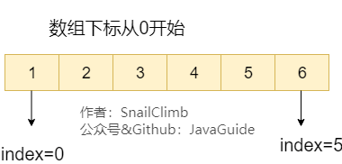
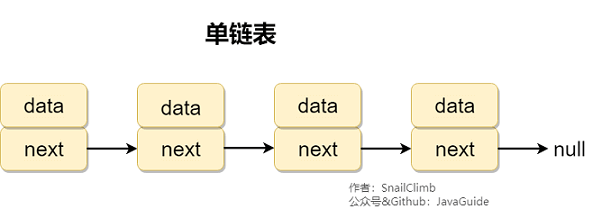
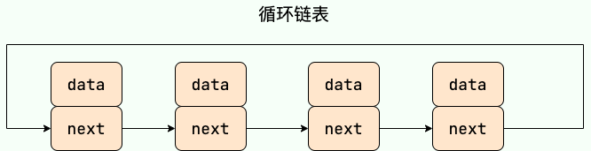
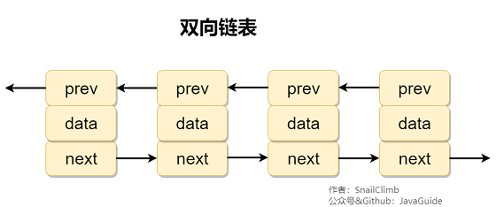
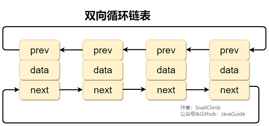
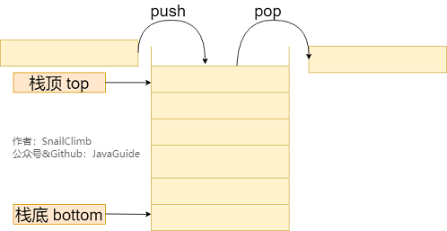
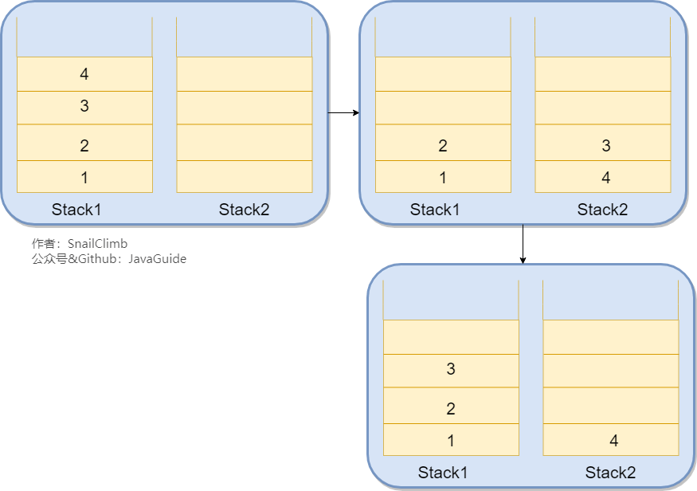
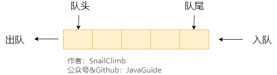
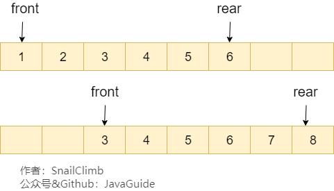
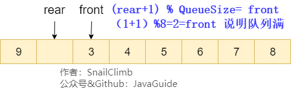

# Linear Data Structures

## 1. Arrays

An **array** is a common data structure made up of elements of the same type, stored in a contiguous block of memory.

An element's index can be used to calculate its memory address directly.

Arrays provide **random access**, but their capacity is fixed.

```java
Assume the array has n elements.
Access: O(1) // access an element at a specific index
Insertion: O(n) // worst case: insert at the beginning and shift all elements
Deletion: O(n) // worst case: delete the first element and shift all following elements
```



## 2. Linked Lists

### 2.1. Introduction

Although a **linked list** is a linear data structure, its elements are not stored in sequence in memory. They occupy separate, non-contiguous memory locations.

Insertion and deletion take `O(1)` if you already have a reference to the node before the target position. Finding a node or accessing an element by index takes `O(n)`.

Linked lists do not require the data size to be known in advance, so they can grow dynamically. However, they do not save space: each node also stores pointers to other nodes. Linked lists also lack the random access that arrays provide.

### 2.2. Types of Linked Lists

**Common types of linked lists:**

1. Singly linked list
2. Doubly linked list
3. Circular linked list
4. Doubly circular linked list

```java
Assume the linked list has n elements.
Access: O(n) // access an element at a specific position
Insertion and deletion: O(1) // assumes the target position is already known
```

#### 2.2.1. Singly Linked Lists

A **singly linked list** has one direction: each node has a `next` pointer to the following node. Nodes are usually not contiguous in physical memory. The first node is called the head. A list may use a `head` node that stores no value as an entry point for traversing the list. The tail usually points to `null`.



#### 2.2.2. Circular Linked Lists

A **circular linked list** is a type of singly linked list whose tail points to the head instead of `null`.



#### 2.2.3. Doubly Linked Lists

A **doubly linked list** has two pointers: `prev` points to the previous node and `next` points to the following node.



#### 2.2.4. Doubly Circular Linked Lists

In a **doubly circular linked list**, the tail's `next` points to the head, and the head's `prev` points to the tail, forming a cycle.



### 2.3. Use Cases

- Linked lists do not support random access.
- A linked list may be suitable when the number of elements is unknown and elements are frequently added or removed.
- An array may be suitable when the number of elements is known and additions or removals are infrequent.

### 2.4. Arrays vs. Linked Lists

- Arrays support random access; linked lists do not.
- Arrays use contiguous memory, which works well with CPU caches. Linked lists have poorer cache locality.
- Arrays have a fixed size, while linked lists grow dynamically. If an array is too small, a larger one must be allocated and the elements copied, which takes time.

## 3. Stacks

### 3.1. Introduction

A **stack** allows elements to be added (`push`) and removed (`pop`) at one end, called the **top**. It follows the **last in, first out (LIFO)** principle. **Both push and pop operate on the top of the stack.**

Stacks are commonly implemented with an array or linked list. An array-based stack is called a **sequential stack**, and a linked-list-based stack is called a **linked stack**.

```java
Assume the stack has n elements.
Access: O(n) // worst case
Insertion and deletion: O(1) // push and pop at the top
```



### 3.2. Common Uses of Stacks

Use a stack when data is added and removed at one end and follows the **last in, first out (LIFO)** rule.

#### 3.2.1. Browser Back and Forward Navigation

Two stacks, `Stack1` and `Stack2`, can implement this feature. Suppose you visit pages 1, 2, 3, and 4 in order, pushing each onto `Stack1`. To return to page 2, press Back and move pages 4 and 3 from `Stack1` to `Stack2`. To go forward to page 3, pop it from `Stack2` and push it onto `Stack1`. The diagram below illustrates the process:



#### 3.2.2. Checking Whether Brackets Are Balanced

> Given a string containing only `'('`, `')'`, `'{'`, `'}'`, `'['`, and `']'`, determine whether it is valid.
>
> A valid string must satisfy these conditions:
>
> 1. Each opening bracket is closed by a bracket of the same type.
> 2. Brackets are closed in the correct order.
>
> For example, `"()"`, `"()[]{}"`, and `"{[]}"` are valid, while `"(]"` and `"([)]"` are not.

This is a LeetCode problem that can be solved with a stack.

1. Store the matching bracket pairs in a `Map`.
2. Create a stack and iterate over the string. Push each opening bracket. For a closing bracket, compare it with the top of the stack; if they do not match, return `false`. After the iteration, return `true` if the stack is empty.

```java
public boolean isValid(String s){
    // Map each closing bracket to its matching opening bracket
    HashMap<Character, Character> mappings = new HashMap<Character, Character>();
    mappings.put(')', '(');
    mappings.put('}', '{');
    mappings.put(']', '[');
    Stack<Character> stack = new Stack<Character>();
    char[] chars = s.toCharArray();
    for (int i = 0; i < chars.length; i++) {
        if (mappings.containsKey(chars[i])) {
            char topElement = stack.empty() ? '#' : stack.pop();
            if (topElement != mappings.get(chars[i])) {
                return false;
            }
        } else {
            stack.push(chars[i]);
        }
    }
    return stack.isEmpty();
}
```

#### 3.2.3. Reversing a String

Push each character onto a stack, then pop them to produce the reversed string.

#### 3.2.4. Managing Function Calls

The most recently called function must finish first, which follows the stack's **last in, first out (LIFO)** behavior. Recursive calls can be managed with a stack; each call pushes its parameters and return address.

#### 3.2.5. Depth-First Search (DFS)

During depth-first search, a stack stores the current path so the algorithm can backtrack to the previous level.

### 3.3. Implementing a Stack

A stack can be implemented with an array or a linked list. In either case, push and pop take `O(1)` time.

The following array-based implementation provides `push()`, `pop()` (return and remove the top element), `peek()` (return the top element without removing it), `isEmpty()`, and `size()`.

> Before each push, check that the stack has enough capacity. If not, resize it with `Arrays.copyOf()`.

```java
public class MyStack {
    private int[] storage; // array storing the stack elements
    private int capacity; // stack capacity
    private int count; // number of elements in the stack
    private static final int GROW_FACTOR = 2;

    // Constructor without an initial capacity; defaults to 8
    public MyStack() {
        this.capacity = 8;
        this.storage=new int[8];
        this.count = 0;
    }

    // Constructor with an initial capacity
    public MyStack(int initialCapacity) {
        if (initialCapacity < 1)
            throw new IllegalArgumentException("Capacity too small.");

        this.capacity = initialCapacity;
        this.storage = new int[initialCapacity];
        this.count = 0;
    }

    // Push an element
    public void push(int value) {
        if (count == capacity) {
            ensureCapacity();
        }
        storage[count++] = value;
    }

    // Ensure the stack has enough capacity
    private void ensureCapacity() {
        int newCapacity = capacity * GROW_FACTOR;
        storage = Arrays.copyOf(storage, newCapacity);
        capacity = newCapacity;
    }

    // Return and remove the top element
    public int pop() {
        if (count == 0)
            throw new IllegalArgumentException("Stack is empty.");
        count--;
        return storage[count];
    }

    // Return the top element without removing it
    public int peek() {
        if (count == 0){
            throw new IllegalArgumentException("Stack is empty.");
        }else {
            return storage[count-1];
        }
    }

    // Check whether the stack is empty
    public boolean isEmpty() {
        return count == 0;
    }

    // Return the number of elements in the stack
    public int size() {
        return count;
    }

}
```

Example:

```java
MyStack myStack = new MyStack(3);
myStack.push(1);
myStack.push(2);
myStack.push(3);
myStack.push(4);
myStack.push(5);
myStack.push(6);
myStack.push(7);
myStack.push(8);
System.out.println(myStack.peek());// 8
System.out.println(myStack.size());// 8
for (int i = 0; i < 8; i++) {
    System.out.println(myStack.pop());
}
System.out.println(myStack.isEmpty());// true
myStack.pop();// throws java.lang.IllegalArgumentException: Stack is empty.
```

## 4. Queues

### 4.1. Introduction

A **queue** is a linear data structure that follows **first in, first out (FIFO)**. It is commonly implemented with an array or linked list; these are called an **array-based queue** and a **linked queue**, respectively. **Elements are enqueued at the rear and dequeued from the front.**

Queue operations resemble stack operations, but a queue only allows new elements to be added at the rear.

```java
Assume the queue has n elements.
Access: O(n) // worst case
Insertion and deletion: O(1) // enqueue at rear and dequeue from front
```



### 4.2. Types of Queues

#### 4.2.1. Simple Queues

A simple queue adds each new element at the rear. It can be implemented as an **array-based queue** or a **linked queue**.

**An array-based queue can suffer from “false overflow,” where the queue cannot accept an element even though the array has unused positions.**

Suppose the array-based queue below dequeues its first two elements, 1 and 2, then enqueues 7 and 8. Both `front` and `rear` keep moving forward. When `rear` reaches the end, no more elements can be added even though the array has free space at the beginning. This is **false overflow**. As shown below, adding 8 can also move `rear` past the end of the array.

> To avoid ambiguity when the queue has one element and the front and rear coincide, use two pointers: `front` points to the first element, and `rear` points to the position after the last element. Then, when `front` equals `rear`, the queue is empty. — _Data Structures Illustrated_



#### 4.2.2. Circular Queues

A circular queue avoids false overflow and out-of-bounds movement by wrapping the rear pointer back to the beginning of the array.

In the diagram below, point `rear` to array index 0 after it reaches the end. As elements are added, `rear` moves forward again.



In a simple array-based queue, `front == rear` means the queue is empty. In a circular queue, it could also mean the queue is full, as shown above. There are two ways to distinguish the cases:

1. Keep a flag variable: when `front == rear`, `flag = 0` means the queue is empty and `flag = 1` means it is full.
2. Reserve one empty array slot. Then `front == rear` means empty, and the queue is full when `(rear + 1) % QueueSize == front`.

#### 4.2.3. Deques

A **deque** (double-ended queue) allows insertion and deletion at both ends, making it more flexible than a simple queue.

Common deque operations include `addFirst`, `addLast`, `removeFirst`, and `removeLast`.

#### 4.2.4. Priority Queues

A **priority queue** is not a linear data structure internally; it is usually implemented with a heap.

1. When an element is enqueued, the priority queue inserts it into the heap and restores the heap property.
2. When the head is dequeued, the priority queue returns the root and restores the heap property.

For details on heaps, see [Heaps](https://javaguide.cn/cs-basics/data-structure/heap.html).

A priority queue only guarantees that its head has the highest (or lowest) current priority. It does not guarantee that its backing array, iterator, or entire collection is globally sorted. After the head is removed, the next-highest-priority element becomes the new head.

Although a priority queue is usually implemented with a non-linear structure such as a heap, its queue interface provides removal by priority. “Priority” describes the removal order; it does not mean that all elements in the collection are automatically sorted.

### 4.3. Common Uses of Queues

Use a queue when data needs to be processed in a particular order.

- **Blocking queues:** These add blocking operations to a queue. Dequeue waits while the queue is empty, and enqueue waits while it is full. Blocking queues are useful for implementing the producer-consumer pattern.
- **Thread-pool task queues:** When no worker thread is free, a thread pool can place new tasks in a queue until a worker becomes available. Queues may be unbounded (often linked-list-based) or bounded (often array-based). An unbounded queue can keep accepting tasks until system resources run out. For example, `FixedThreadPool` uses a `LinkedBlockingQueue` with a default capacity of `Integer.MAX_VALUE`, so it is effectively unbounded. With a bounded queue, the thread pool rejects new tasks when the queue is full and throws `java.util.concurrent.RejectedExecutionException`.
- **Stacks:** A deque supports stack operations such as `push`, `pop`, and `peek`, which are defined by the `Deque` interface. `Stack` is not deprecated, but it is an older subclass of `Vector`; the JDK documentation recommends using `Deque` implementations such as `ArrayDeque` for stack operations.
- **Breadth-first search (BFS):** A queue stores nodes to visit and ensures graph nodes are traversed level by level.
- Linux kernel process queues, where processes can be scheduled by priority.
- Real-world lines, such as a party queue or a media player's playlist.
- Message queues.
- And more.

## Interview Review

Linear data structures are fundamental to algorithm problems and Java collections. Interviews often compare arrays, linked lists, stacks, and queues.

| Structure   | Lookup           | Insertion/deletion            | Common Java type              | Common problem types                      |
| ----------- | ---------------- | ----------------------------- | ----------------------------- | ----------------------------------------- |
| Array       | By index: `O(1)` | Middle: `O(n)`                | `ArrayList` backing array     | Binary search, two pointers, prefix sums  |
| Linked list | `O(n)`           | `O(1)` when the node is known | `LinkedList`                  | Reversal, fast and slow pointers, merging |
| Stack       | Top: `O(1)`      | Top: `O(1)`                   | `ArrayDeque`                  | Bracket matching, monotonic stack, DFS    |
| Queue       | Head: `O(1)`     | Enqueue/dequeue: `O(1)`       | `ArrayDeque`, blocking queues | BFS, producer-consumer, task scheduling   |

A few useful points for interviews:

- Arrays support fast random access because contiguous memory lets the address be calculated from the base address and index.
- Linked-list insertion and deletion are fast only when the target node is already known. Finding it first still takes `O(n)` overall.
- In Java, `Deque` implementations such as `ArrayDeque` are generally preferred over `Stack`.
- Queues are used beyond BFS, including thread-pool task queues, message queues, and traffic shaping.
- Circular queues must distinguish empty from full, often by reserving one array slot or tracking the element count separately.

## Practice Problems

- Arrays: [704. Binary Search](https://leetcode.cn/problems/binary-search/), [26. Remove Duplicates from Sorted Array](https://leetcode.cn/problems/remove-duplicates-from-sorted-array/)
- Linked lists: [206. Reverse Linked List](https://leetcode.cn/problems/reverse-linked-list/), [19. Remove Nth Node From End of List](https://leetcode.cn/problems/remove-nth-node-from-end-of-list/)
- Stacks: [20. Valid Parentheses](https://leetcode.cn/problems/valid-parentheses/), [739. Daily Temperatures](https://leetcode.cn/problems/daily-temperatures/)
- Queues: [102. Binary Tree Level Order Traversal](https://leetcode.cn/problems/binary-tree-level-order-traversal/), [239. Sliding Window Maximum](https://leetcode.cn/problems/sliding-window-maximum/)

<!-- @include: @article-footer.snippet.md -->
