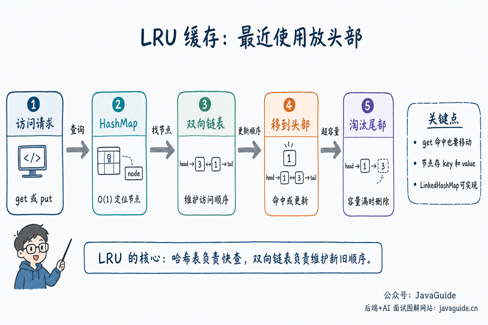

LRU stands for **Least Recently Used**. When a cache reaches capacity, it evicts the data that has not been accessed for the longest time.

Implementing an LRU cache is a common interview problem because it combines a hash table and a doubly linked list: the hash table finds a node in `O(1)`, and the list moves nodes or removes the tail in `O(1)`.

This article covers:

1. What is an LRU cache?
2. Why is LRU useful for cache eviction?
3. Why combine a hash table and a doubly linked list?
4. How do you implement `get` and `put`?
5. How can Java `LinkedHashMap` implement LRU?
6. What else must a production LRU cache consider?



## What Is an LRU Cache?

A cache has limited space, but ideally keeps data that is likely to be accessed again in memory.

A program cannot know the future. LRU uses recent access as a rough predictor: recently accessed data may be accessed again, while data that has not been used for a long time is a candidate for eviction when the cache is full.

For example, consider a cache with capacity 2 and these operations:

```text
put(1, 1)
put(2, 2)
get(1)
put(3, 3)
```

Before `put(3, 3)`, the cache contains `1` and `2`. Although `1` was inserted first, it was just accessed by `get(1)`, so `2` is the least recently used and should be evicted.

This example shows that LRU tracks which item was accessed least recently, not which one was inserted first.

## Why Do Caches Need an Eviction Policy?

Caches are finite. In-memory caches, Redis, database buffer pools, and operating system page caches all have capacity limits.

When a cache is full and has no eviction policy, it can only reject new data or remove something at random. Random eviction may remove frequently used data and reduce the hit rate. LRU uses access order as a heuristic: data that has not been accessed for a long time is often less likely to be needed soon.

Here is a brief comparison of common eviction policies:

| Policy | Eviction criterion                    | Characteristics                                                                   |
| ------ | ------------------------------------- | --------------------------------------------------------------------------------- |
| FIFO   | The item that entered the cache first | Simple, but ignores how often the item is accessed later.                         |
| LRU    | The item least recently accessed      | Fits workloads with temporal locality.                                            |
| LFU    | The item accessed least often         | Fits workloads with long-term hot items, but requires tracking frequencies.       |
| TTL    | Expiration time                       | Fits data with a defined lifetime; it is not the same as capacity-based eviction. |

LRU is a common interview problem because it has practical applications and tests how well you combine data structures.

## Interview Topics

- Explain why a hash table or linked list alone is not sufficient.
- Implement `get` and `put`.
- Explain what the head and tail of the doubly linked list represent.
- Handle a full cache, updates to existing keys, and tail removal.
- Know that Java `LinkedHashMap` can implement LRU.

## How Does LRU Maintain Access Order?

Every access changes the recency of an item in an LRU cache.

Use these conventions:

- The head of the list represents the most recently used item.
- The tail represents the least recently used item.
- On a successful `get(key)`, move the node to the head.
- For a new key in `put(key, value)`, insert the node at the head.
- For an existing key, update its value and move it to the head.
- When the cache exceeds capacity, remove the tail node.

It is easy to overlook `get()`. A read still counts as an access, so a cache hit makes that key the most recently used.

## Data Structure Design

| Component                 | Purpose                                                                        |
| ------------------------- | ------------------------------------------------------------------------------ |
| `HashMap<Integer, Node>`  | Find a list node quickly by key.                                               |
| Doubly linked list        | Order nodes by access time: most recent at the head, least recent at the tail. |
| Dummy head and tail nodes | Simplify insertion and deletion at the boundaries.                             |

After accessing a key, move its node to the head. Insert new keys at the head too. When capacity is exceeded, remove the node immediately before the tail.

Why combine the two structures?

A hash table alone can find a value in `O(1)`, but it does not track which key was used least recently. You would still need to maintain access order.

A linked list alone can maintain access order, with the tail as the eviction candidate. But finding a node by key requires scanning the list in `O(n)`.

The hash table and doubly linked list complement each other:

- The hash table locates a list node directly by key.
- The doubly linked list moves nodes and removes the tail efficiently.
- Each node stores both its key and value so the key can be removed from the hash table when the tail is evicted.

## A Step-by-Step Implementation

LRU has several moving parts, so do not start by writing the entire class. Break the implementation into steps:

1. Define the list order: the head is most recently used and the tail is least recently used.
2. Implement `get`: return `-1` if the key is missing; otherwise move its node to the head.
3. Implement `put`: update an existing key and move it to the head, or insert a new key at the head.
4. Handle eviction: when over capacity, remove the node before the tail and delete its key from the hash table.
5. Encapsulate list operations in `addToHead`, `remove`, `moveToHead`, and `removeTail`.

This keeps `get` and `put` focused on combining basic list operations instead of repeatedly changing pointers in the main logic, which reduces mistakes.

## Why Use a Doubly Linked List?

To move a node to the head, first unlink it from its current position, then insert it after the head node.

With a singly linked list, removing a node requires its predecessor. Even if the hash table locates the node directly, it cannot locate the predecessor without scanning from the head.

A doubly linked list stores both `prev` and `next`, so removing any node requires updating only four pointers:

```java
node.prev.next = node.next;
node.next.prev = node.prev;
```

This is why LRU uses a doubly linked list: it must remove the tail and move arbitrary nodes to the head when `get()` succeeds or `put()` updates an existing key.

Dummy `head` and `tail` nodes are also useful. They let head insertion, tail deletion, and empty-list handling share the same code without repeated `null` checks.

## Implementing LRU

```java
class LRUCache {
    private final int capacity;
    private final Map<Integer, Node> map = new HashMap<>();
    private final Node head = new Node(0, 0);
    private final Node tail = new Node(0, 0);

    LRUCache(int capacity) {
        this.capacity = capacity;
        head.next = tail;
        tail.prev = head;
    }

    int get(int key) {
        Node node = map.get(key);
        if (node == null) {
            return -1;
        }
        moveToHead(node);
        return node.value;
    }

    void put(int key, int value) {
        Node node = map.get(key);
        if (node != null) {
            node.value = value;
            moveToHead(node);
            return;
        }
        Node newNode = new Node(key, value);
        map.put(key, newNode);
        addToHead(newNode);
        if (map.size() > capacity) {
            Node removed = removeTail();
            map.remove(removed.key);
        }
    }

    private void moveToHead(Node node) {
        remove(node);
        addToHead(node);
    }

    private void addToHead(Node node) {
        node.prev = head;
        node.next = head.next;
        head.next.prev = node;
        head.next = node;
    }

    private void remove(Node node) {
        node.prev.next = node.next;
        node.next.prev = node.prev;
    }

    private Node removeTail() {
        Node node = tail.prev;
        remove(node);
        return node;
    }

    private static class Node {
        int key;
        int value;
        Node prev;
        Node next;

        Node(int key, int value) {
            this.key = key;
            this.value = value;
        }
    }
}
```

Both `get` and `put` take `O(1)` time, and the space complexity is `O(capacity)`.

## Walkthrough

Suppose the cache has capacity 2 and performs these operations in order:

```text
put(1, 1)
put(2, 2)
get(1)
put(3, 3)
```

The list changes as follows; the left side represents the most recently used item:

| Operation     | List state | Description                                         |
| ------------- | ---------- | --------------------------------------------------- |
| Initial state | Empty      | Dummy head and tail are linked; the cache is empty. |
| `put(1, 1)`   | `1`        | Insert the new node at the head.                    |
| `put(2, 2)`   | `2 -> 1`   | `2` is the most recently used.                      |
| `get(1)`      | `1 -> 2`   | Move `1` to the head after access.                  |
| `put(3, 3)`   | `3 -> 1`   | Capacity is exceeded, so evict the tail item, `2`.  |

This table highlights two points: accessing an existing node updates its recency, and eviction removes the least recently used tail node, not the newly inserted node.

## Implementing LRU with LinkedHashMap

Java's `LinkedHashMap` can maintain elements in access order:

```java
class LRUCacheWithLinkedHashMap extends LinkedHashMap<Integer, Integer> {
    private final int capacity;

    LRUCacheWithLinkedHashMap(int capacity) {
        super(capacity, 0.75f, true);
        this.capacity = capacity;
    }

    @Override
    protected boolean removeEldestEntry(Map.Entry<Integer, Integer> eldest) {
        return size() > capacity;
    }
}
```

Set the constructor's third parameter, `accessOrder`, to `true` to use access order instead of insertion order.

The `LinkedHashMap` documentation notes that access-order mode is suitable for building LRU caches. Keep two points in mind:

1. With `accessOrder = false`, iteration follows insertion order; with `accessOrder = true`, it follows access order.
2. `removeEldestEntry()` is called after a new mapping is inserted. Returning `true` removes the eldest entry.

However, `LinkedHashMap` is not thread-safe. For a local cache used by multiple threads, add synchronization or choose a mature caching library.

## How Does LRU Relate to Redis?

When Redis is used as a cache, it applies an eviction policy after memory reaches the `maxmemory` limit. Redis supports policies such as `allkeys-lru` and `volatile-lru`:

- `allkeys-lru`: Evict the least recently used key from all keys.
- `volatile-lru`: Evict the least recently used key only among keys with an expiration set.

Redis's LRU is not the exact LRU used in an interview implementation. To save memory and CPU, Redis uses an approximation: it samples a small set of keys and evicts the least recently accessed one. The sample size can be adjusted with `maxmemory-samples`.

This illustrates the difference between an interview problem and a production system: interview solutions usually implement exact LRU with a hash table and doubly linked list, while production systems balance memory, throughput, concurrency, and hit rate.

## Production Use Cases

- Local cache eviction.
- Operating system page replacement.
- Caching frequently accessed data.
- Small result caches in gateways, client SDKs, or middleware.

Production systems must also consider thread safety, expiration, memory limits, metrics, and eviction callbacks. A handwritten LRU interview problem mainly tests how data structures are combined; these concerns do not need to be added to that implementation.

For a local cache in a Java project, it is often better to use a library such as Caffeine instead of implementing LRU yourself. A production cache needs more than capacity-based eviction: it may also need expiration, concurrency, loading, statistics, asynchronous refresh, and per-entry weights. Caffeine supports eviction based on size, time, and references.

## Interview Follow-Up Questions

| Question                                | Key point                                                                                                                                   |
| --------------------------------------- | ------------------------------------------------------------------------------------------------------------------------------------------- |
| Why not use only a `HashMap`?           | It can look up values, but does not track which key was used least recently.                                                                |
| Why not use only a linked list?         | It can maintain order, but finding a node by key takes `O(n)`.                                                                              |
| Why use a doubly linked list?           | Removing an arbitrary node requires reconnecting its predecessor and successor; a singly linked list cannot find the predecessor in `O(1)`. |
| Why use dummy head and tail nodes?      | They simplify insertions and removals for empty lists and at either end.                                                                    |
| How does `LinkedHashMap` implement LRU? | Enable `accessOrder` in the constructor and override `removeEldestEntry` to enforce capacity.                                               |
| What else does a production cache need? | Thread safety, expiration, memory limits, eviction callbacks, hit-rate metrics, and protection against cache stampedes.                     |

## Common Pitfalls

- Move an existing key to the head when updating it.
- Remove the key from the hash table after deleting the tail node.
- Update both pointers when removing a node from a doubly linked list.
- Dummy head and tail nodes simplify empty-list boundary cases.
- Set `LinkedHashMap`'s `accessOrder` to `true`.

## Review Questions

- Why does LRU combine a hash table with a doubly linked list?
- Why does `get` move a node?
- Why must an update to an existing key also change its list position?
- Why remove the key from the hash table after evicting the tail?
- How do insertion order and access order differ in `LinkedHashMap`?

## Practice Problems

- [146. LRU Cache](https://leetcode.cn/problems/lru-cache/)
- [460. LFU Cache](https://leetcode.cn/problems/lfu-cache/)

## References

- [Java SE 17 API: LinkedHashMap](https://docs.oracle.com/en/java/javase/17/docs/api/java.base/java/util/LinkedHashMap.html)
- [Redis documentation: Key eviction](https://redis.io/docs/latest/develop/reference/eviction/)
- [Operating Systems: Three Easy Pieces](https://pages.cs.wisc.edu/~remzi/OSTEP/)
- [Caffeine Wiki: Eviction](https://github.com/ben-manes/caffeine/wiki/Eviction)

<!-- @include: @article-footer.snippet.md -->
