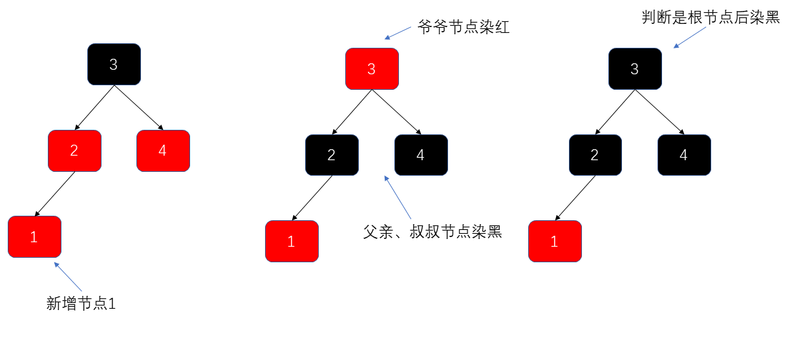
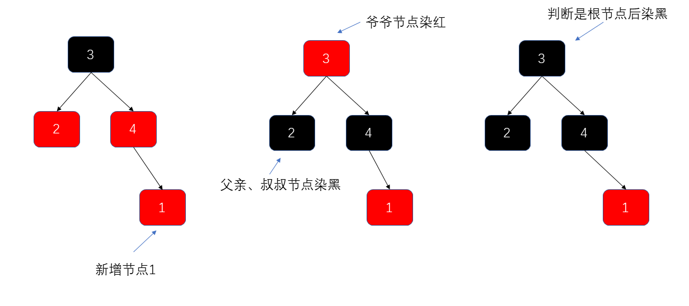
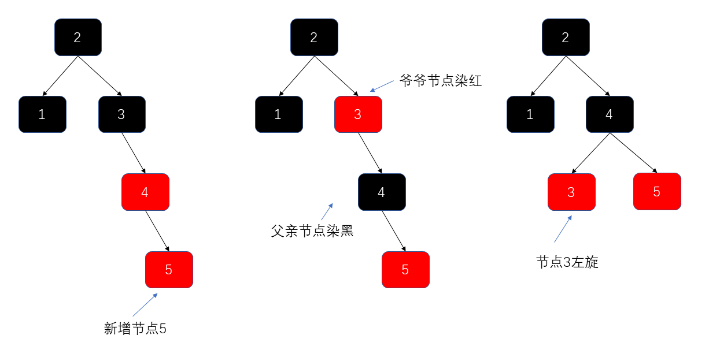
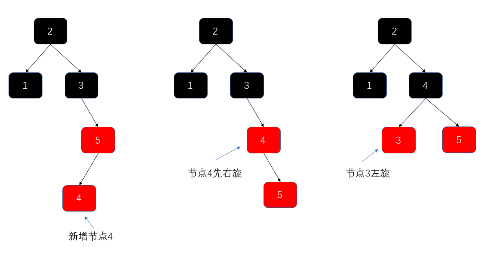
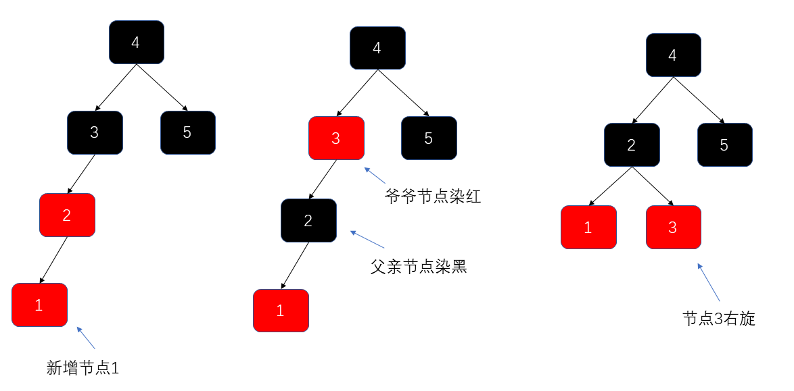
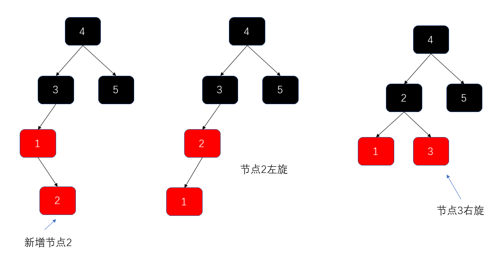

# Red-Black Trees

## Introduction

A **red-black tree** is a self-balancing binary search tree. Rudolf Bayer invented it in 1972 as a symmetric binary B-tree. In 1978, Leo J. Guibas and Robert Sedgewick modified it into what is now known as the red-black tree.

Its self-balancing property guarantees `O(log n)` worst-case time for lookup, insertion, and deletion, providing stable performance.

In the JDK, `TreeMap` and `TreeSet` use red-black trees. Since JDK 8, `HashMap` may also use them for heavily populated buckets.

## Why Use a Red-Black Tree?

Red-black trees address a weakness of ordinary binary search trees.

A binary search tree orders nodes by key: each left child is smaller than its parent, and each right child is larger. This makes lookup, insertion, and deletion straightforward because comparisons guide the search. However, the tree's shape depends on insertion order. If values are inserted in ascending or descending order, the tree can become a linear structure like a linked list. Its performance then degrades from `O(log n)` to `O(n)`.

Red-black trees prevent this degradation by keeping the tree approximately balanced.

## Red-Black Tree Properties

1. Every node is either red or black.
2. The root is always black.
3. Every empty child link is treated as a black NIL leaf.
4. A red node must have black children; there cannot be two consecutive red nodes on a path.
5. Every path from a node to any of its descendant NIL leaves contains the same number of black nodes. This number is called the **black height**.

In the correspondence between red-black trees and 2-3 trees, a black node and its connected red node can represent a multi-key node. This is only a structural mapping; a red-black tree node itself still has at most two children.

These properties keep the tree balanced and limit its height to at most `2 log(n + 1)`.

## Related Tree Structures

AVL trees and red-black trees are both self-balancing binary search trees, while 2-3 trees are multiway search trees. Red-black trees can be mapped structurally to 2-3 or 2-3-4 trees, but these structures should not all be called B-trees. Red-black trees have looser balancing requirements than AVL trees and constrain their height through color rules and black height.

## Red-Black Tree Node Structure

```java
public class Node {

    public Class<?> clazz;
    public Integer value;
    public Node parent;
    public Node left;
    public Node right;

    // Required by AVL trees
    public int height;
    // Required by red-black trees
    public Color color = Color.RED;

}
```

### 1. Left-Leaning Recoloring



- During recoloring, use the current node's grandparent to find its uncle.
- Recolor the parent and uncle black, and the grandparent red. The grandparent's red color may be temporary; after rebalancing, the root is recolored black.

### 2. Right-Leaning Recoloring



### 3. Rebalancing with Left Rotations

#### 3.1. Single Left Rotation



#### 3.2. Right Rotation Followed by Left Rotation



### 4. Rebalancing with Right Rotations

#### 4.1. Single Right Rotation



#### 4.2. Left Rotation Followed by Right Rotation



## Interview Review

Interviews rarely require implementing all red-black tree insertion and deletion fixes. More often, candidates are asked to explain its properties, why it is approximately balanced, how it differs from an AVL tree, and where Java uses it.

| Comparison             | AVL tree                                      | Red-black tree                                   |
| ---------------------- | --------------------------------------------- | ------------------------------------------------ |
| Balance requirement    | Stricter                                      | Less strict                                      |
| Lookup performance     | More consistent                               | Also maintains `O(log n)`                        |
| Insertion and deletion | May require more rotations                    | Usually requires fewer adjustments               |
| Common uses            | Search structures with more reads than writes | `TreeMap`, `TreeSet`, and tree bins in `HashMap` |

Structure an interview answer in this order:

1. An ordinary binary search tree can become a linked list when values are inserted in sorted order.
2. Red-black tree color rules constrain the height, keeping lookup, insertion, and deletion at `O(log n)`.
3. It is approximately balanced rather than perfectly balanced, so insertions and deletions usually require fewer adjustments than in an AVL tree.
4. Java's `TreeMap` and `TreeSet` use red-black trees. Since JDK 8, a long `HashMap` bucket list can also be converted into a red-black tree.

Treeifying a `HashMap` bucket also depends on the table capacity; reaching the list-length threshold alone does not guarantee conversion. This detail often comes up in Java collections interviews.

<!-- @include: @article-footer.snippet.md -->
