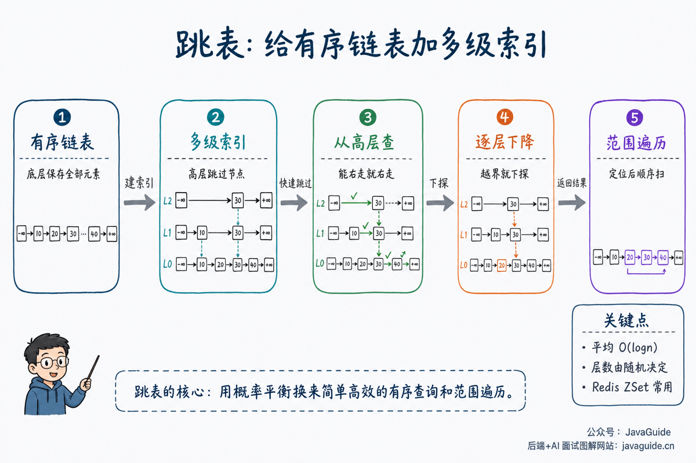

A skip list is a sorted linked list with multiple levels of indexes. Looking up an item in a regular sorted linked list takes `O(n)` because it may require scanning from the head. A skip list adds index levels above the list, allowing a lookup to skip over nodes before descending to lower levels.

Redis sorted sets (ZSets) use a combination of skip lists and hash tables, so skip lists often come up alongside Redis in backend interviews.

This article covers:

1. What is a skip list?
2. How does a skip list reduce average lookup time from `O(n)` to `O(log n)`?
3. How does a skip list support lookup, insertion, and deletion?
4. How do skip lists compare with red-black trees?
5. Why does Redis ZSet use a skip list?



## What Is a Skip List?

A **skip list** is a data structure built on a sorted linked list. The bottom level contains every element. Above it, the skip list builds several sparser index levels.

Think of it like a book with a table of contents:

- The bottom-level list is like the pages of the book: it contains everything, but finding a page by scanning from the beginning is slow.
- The upper indexes are like the table of contents: they contain less detail, but help you jump close to the target.
- A lookup starts at the highest level, moves right while possible, then drops down a level until it reaches the bottom.

That is the main difference between a skip list and a regular linked list: a regular list moves one node at a time, while a skip list can jump over several nodes at higher levels.

## What Does a Skip List Node Look Like?

A regular linked list node usually has one `next` pointer. A skip list node can have several forward pointers. A node at level 3 has pointers for levels 0, 1, and 2 as well.

At a high level, a skip list node can look like this:

```java
class SkipListNode {
    int value;
    SkipListNode[] forward;
}
```

Here, `forward[i]` points to the next node at level `i`. Production implementations may also store a score, member, backward pointer, or span to support ranking, reverse traversal, and range queries.

## How Are Levels Chosen?

Skip lists do not use rotations or recoloring to stay balanced. Instead, they assign node levels randomly.

When a new node is inserted, a random function determines how many levels it occupies. Think of flipping a coin: the node always appears at the bottom level; each heads moves it up one level, until tails appears or it reaches the maximum level.

As a result, higher levels contain fewer nodes, while lower levels are denser. Ideally, each level contains about half as many nodes as the level below it. The structure is not strictly balanced, but its expected height is `O(log n)`.

These upper indexes are what let a skip list “skip” over ranges of elements during lookup.

## Interview Topics

- Explain why lookups are faster than in a regular linked list.
- Describe the basic lookup, insertion, and deletion operations.
- State that lookup, insertion, and deletion take `O(log n)` time on average.
- Explain the tradeoffs between skip lists and red-black trees.
- Connect skip lists to range queries in Redis ZSet.

## How Does Lookup Work?

Lookup starts at the highest index level:

1. If the next node is smaller than the target, move right.
2. If the next node is greater than the target or is empty, move down one level.
3. Continue until reaching the bottom level and determine whether the target exists.

This resembles binary search in a sorted array, although the bottom level of a skip list remains a linked list.

More precisely, each skip list level is a sorted linked list. The rule is simple: move right when possible; otherwise, move down.

Suppose we want to find `26`:

1. Start at the head node on the highest level.
2. If the next node is less than `26`, the target may be farther right, so continue moving right.
3. If the next node is greater than `26`, moving right would pass the target, so move down a level.
4. Repeat until reaching the bottom level, where you can confirm whether the target exists.

If the target does not exist, the search still identifies where it belongs: the last node on the bottom level with a value smaller than the target is its predecessor.

## Insertion and Deletion

To insert a node, first find its predecessor at each level, then link in the new node. A random function usually determines how many levels the new node occupies.

To delete a node, find its predecessors at each level and update their pointers to skip over the target.

Skip lists rely on random levels rather than rotations to keep index height within a reasonable range. This also makes them simpler to implement than red-black trees.

Insertion code often maintains an `update` array: `update[i]` stores the predecessor of the new node at level `i`. Record each predecessor while searching for the insertion point. Once the new node's random height is known, update the pointers at each level.

Deletion follows a similar process: find the predecessor at each level, and if its next node is the target, point its `forward` reference to the target's next node.

Insertion and deletion must update not only the bottom list but also every index level that contains the target node.

## Complexity

| Operation   | Average complexity | Notes                                                       |
| ----------- | ------------------ | ----------------------------------------------------------- |
| Lookup      | `O(log n)`         | Skip over nodes using multiple index levels.                |
| Insertion   | `O(log n)`         | Find the position, then update pointers at multiple levels. |
| Deletion    | `O(log n)`         | Find predecessors and bypass the target.                    |
| Range query | `O(log n + k)`     | Find the starting point, then return k elements in order.   |

Space complexity is `O(n)`, with additional index pointers compared with a regular linked list.

The `O(log n)` complexity is an average-case bound based on the probabilistic balance provided by random levels. Unlike red-black trees, skip lists do not guarantee strict worst-case balance, but they are usually stable when the random-level function and parameters are reasonable.

Range queries are a good fit for skip lists: find the start in `O(log n)`, then traverse the bottom-level list to return k results.

## Skip Lists vs. Red-Black Trees

| Comparison          | Skip list                          | Red-black tree                                    |
| ------------------- | ---------------------------------- | ------------------------------------------------- |
| Balancing           | Randomly assigned levels           | Rotations and recoloring                          |
| Implementation      | Relatively straightforward         | Insertion and deletion fixes are more complex     |
| Range queries       | Easy to scan the bottom-level list | Possible with in-order traversal, but less direct |
| Worst-case bound    | Depends on randomness              | Strict balance constraints                        |
| Production examples | Redis ZSet                         | Java `TreeMap` and tree bins in `HashMap`         |

## Why Does Redis ZSet Use a Skip List?

ZSet needs to support:

- Fast score lookup by member.
- Sorting by score.
- Range queries by score.
- Retrieving ranks.

A hash table efficiently looks up a score by member, while a skip list maintains score order and supports range queries. Together, they provide both fast lookup and ordered traversal.

More specifically:

- The hash table finds a member's score directly.
- The skip list orders members by score.
- For range queries such as `ZRANGE` and `ZRANGEBYSCORE`, the skip list finds the starting point and returns consecutive results by traversing the list.
- Span information in skip list nodes can support rank-related operations.

Redis may use different internal encodings depending on the data size and configuration to save memory. In interviews, saying “ZSet uses a hash table and a skip list” usually refers to its core structure for larger sorted sets.

## Common Pitfalls

- A skip list is neither an array nor a binary tree; its bottom level is a linked list.
- Its average complexity is `O(log n)` and is not guaranteed by strict balance.
- Range queries are a strength: find the start, then traverse the bottom-level list.
- Redis ZSet combines a skip list with a hash table.

## Review Questions

- Why are skip list lookups fast?
- How do skip lists differ from red-black trees?
- Why does Redis ZSet use a skip list instead of a red-black tree?
- How are skip list levels chosen?
- What is the complexity of a skip list range query?

## References

- [Skip Lists: A Probabilistic Alternative to Balanced Trees](https://dl.acm.org/doi/10.1145/78973.78977)
- [William Pugh: A Skip List Cookbook](https://drum.lib.umd.edu/bitstreams/17176ef8-8330-4a6c-8b75-4cd18c570bec/download)
- [Redis documentation: Sorted sets](https://redis.io/docs/latest/develop/data-types/sorted-sets/)
- [Redis source: t_zset.c](https://github.com/redis/redis/blob/unstable/src/t_zset.c)

<!-- @include: @article-footer.snippet.md -->
