A tree is a data structure shaped like an upside-down real-world tree. Every non-empty tree has exactly one root.

A tree has the following properties:

1. There is exactly one path between any two nodes.
2. A tree with n nodes has exactly n - 1 edges.
3. A tree contains no cycles.

The diagram below shows a tree, specifically a binary tree.

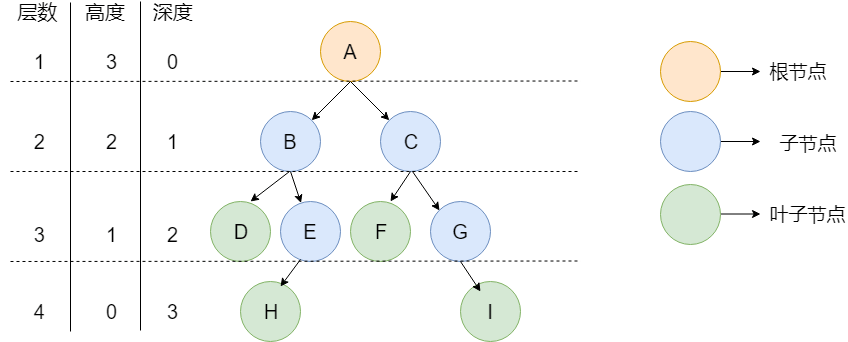

The diagram above illustrates some common tree terms:

- **Node:** An element in a tree.
- **Root:** The top node, which has no parent. In the diagram, A is the root.
- **Parent:** A node that has one or more children. In the diagram, B is the parent of D and E.
- **Child:** The root of a subtree below a given node. In the diagram, D and E are children of B.
- **Siblings:** Nodes that share a parent. D and E are siblings because they share parent B.
- **Leaf:** A node with no children. D, F, H, and I are leaves in the diagram.
- **Node height:** The number of edges on the longest path from the node to a leaf.
- **Node depth:** The number of edges on the path from the root to the node.
- **Node level:** The node's depth plus 1.
- **Tree height:** The height of the root.

> For more on the definitions of tree depth and height, see this Stack Overflow question: [What is the difference between tree depth and height?](https://stackoverflow.com/questions/2603692/what-is-the-difference-between-tree-depth-and-height).

## Types of Binary Trees

A **binary tree** is a tree in which each node has at most two children.

The two branches of a binary tree are called the **left subtree** and the **right subtree**. They have an order and cannot be swapped arbitrarily.

The i-th level of a binary tree contains at most `2^(i-1)` nodes. Using this article's convention that the root has depth 0, a binary tree with depth k has at most `2^(k+1)-1` nodes (a full binary tree) and at least `k+1` nodes (a tree that has degenerated into a chain). Definitions of node depth vary across references; this article follows [Wikipedia's definition of node depth](<https://zh.wikipedia.org/wiki/%E6%A0%91_(%E6%95%B0%E6%8D%AE%E7%BB%93%E6%9E%84)#/%E6%9C%AF%E8%AF%AD>).

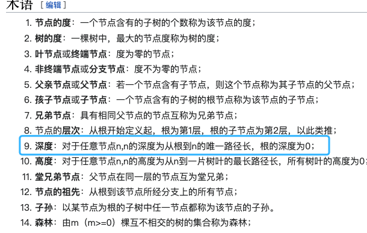

### Full Binary Trees

A binary tree is **full** if every level has the maximum possible number of nodes. In other words, a binary tree with k levels and `2^k - 1` nodes is full, as shown below:

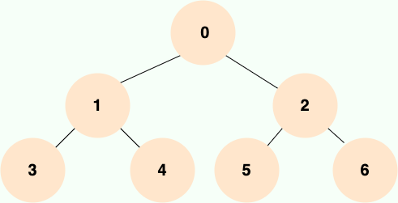

### Complete Binary Trees

A binary tree is **complete** if every level except the last is full, and the last level is filled from left to right with no gaps.

Imagine expanding a tree from its root: fill the left child before the right child, then move to the next level. The diagram below shows a complete binary tree:

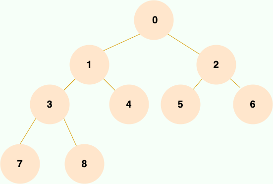

Complete binary trees have a useful property: **the array indexes of parents and children are related.**

When the root is at index 1, a parent at index i has its left child at `2i` and its right child at `2i + 1`. This lets a complete binary tree be stored efficiently in an array and makes it easy to find a node's parent or children by index. Array storage is covered in more detail below.

### AVL Trees (Height-Balanced Binary Search Trees)

An **AVL tree** is a height-balanced binary search tree with these properties:

1. It may be empty.
2. If it is not empty, the heights of its left and right subtrees differ by at most 1, and both subtrees are also AVL trees.

Red-black trees, scapegoat trees, and weight-balanced trees also prevent binary search trees from becoming severely unbalanced, but they do not use the AVL condition that subtree heights differ by at most 1. Splay trees use adjustments after access to provide amortized complexity guarantees.

Before looking at a balanced binary tree, consider this example:

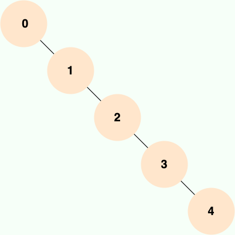

**You call this a tree?**

Yes. This tree has degenerated into a linked list, so it is called a **skewed tree**.

**Why not just use a linked list, then?**

That's a fair question.

A binary tree alone does not guarantee faster lookups than a linked list. A tree can make **searching** and **updates** more efficient when it uses binary-search ordering or another index relationship; an unbalanced binary search tree can still degrade to `O(n)` in the worst case.

If a binary search tree degenerates into a linked list, it loses the lookup advantage of its ordered structure. AVL trees avoid this by using a strict height-balance condition: the heights of each node's left and right subtrees differ by at most 1, as shown below:

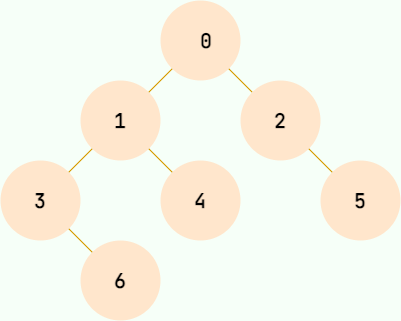

## Binary Tree Storage

Binary trees are mainly stored using **linked storage** or **array storage**.

### Linked Storage

Like a linked list, linked storage connects nodes with references and does not require contiguous memory.

Each node has three fields:

- Data. Depending on the use case, `data` may contain multiple values of different types.
- A reference to the left child, `left`.
- A reference to the right child, `right`.

But Java has no pointers!

Use object references instead (do not ask where to find the object).

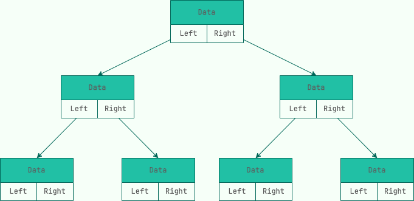

### Array Storage

Array storage stores only each node's data, not references to its children. Child relationships are represented by array indexes. If the root is at index 1 and a node is at index i, its left child is at `2i` and its right child is at `2i + 1`.

The diagram below shows an array representation of a complete binary tree:

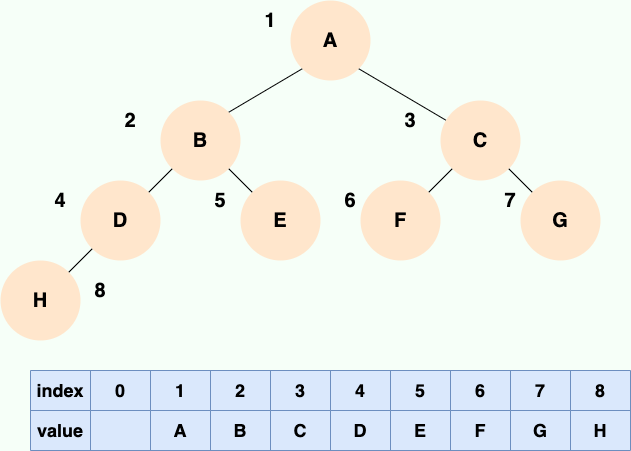

Try filling in the array representation of the following binary tree and compare it with the complete binary tree above:

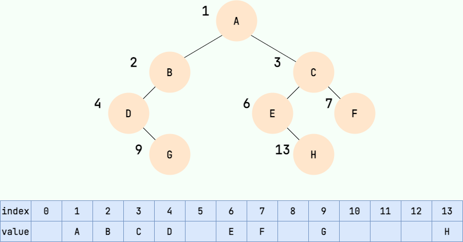

As shown, storing a non-complete binary tree in an array can leave gaps and waste memory.

## Binary Tree Traversal

### Preorder Traversal

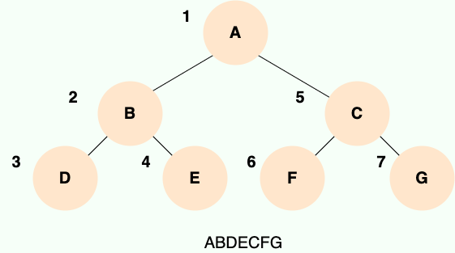

Preorder traversal visits the root first, then the left subtree, and finally the right subtree. The same rule applies recursively to each subtree.

Implementation:

```java
public void preOrder(TreeNode root){
    if(root == null){
        return;
    }
    System.out.println(root.data);
    preOrder(root.left);
    preOrder(root.right);
}
```

### Inorder Traversal

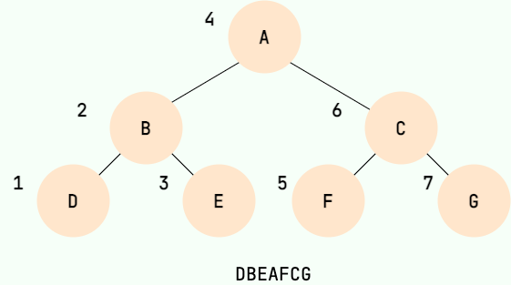

Inorder traversal recursively visits the left subtree, outputs the root, and then recursively visits the right subtree. Imagine flattening the tree: each parent appears between its left and right children, as shown below:

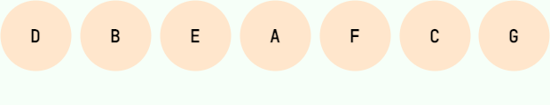

Implementation:

```java
public void inOrder(TreeNode root){
    if(root == null){
        return;
    }
    inOrder(root.left);
    System.out.println(root.data);
    inOrder(root.right);
}
```

### Postorder Traversal

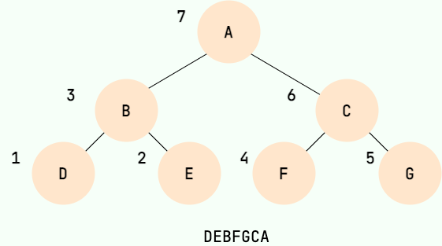

Postorder traversal recursively visits the left subtree, then the right subtree, and finally outputs the root.

Implementation:

```java
public void postOrder(TreeNode root){
    if(root == null){
        return;
    }
    postOrder(root.left);
    postOrder(root.right);
    System.out.println(root.data);
}
```

## Interview Review

Tree interviews often start with binary tree traversal, then move on to binary search trees, balanced trees, B-trees, and B+ trees.

| Structure          | Properties                                                   | Common follow-up questions                                     |
| ------------------ | ------------------------------------------------------------ | -------------------------------------------------------------- |
| Binary tree        | At most two children per node                                | Traversal, paths, lowest common ancestor, construction         |
| Binary search tree | Left subtree is less than the root; right subtree is greater | Inorder traversal is sorted; can degenerate into a linked list |
| AVL tree           | Height-balanced                                              | Fast lookups; more rotations during updates                    |
| Red-black tree     | Approximately balanced                                       | Java `TreeMap` and tree bins in `HashMap`                      |
| B-tree             | Balanced multiway search tree                                | Efficient disk I/O                                             |
| B+ tree            | Data is usually in leaves, which are linked in order         | MySQL indexes and range queries                                |

Be able to write the basic binary tree traversal template:

```java
void dfs(TreeNode root) {
    if (root == null) {
        return;
    }
    // Preorder position
    dfs(root.left);
    // Inorder position
    dfs(root.right);
    // Postorder position
}
```

Common binary search tree interview points:

- Inorder traversal of a binary search tree produces an increasing sequence.
- A regular BST can degenerate into a linked list if values are inserted in sorted order.
- AVL trees are more strictly balanced than red-black trees and provide consistent lookup performance; red-black trees have looser balance requirements and lower update costs.
- B+ trees are suitable for database indexes: each node can hold more keys, keeping the tree shorter, and linked leaves support range queries.

Classify binary tree problems by asking what role the current node plays in the recursion:

- **Path problems:** Add the current node to the path, then undo that change after recursion. Examples include root-to-leaf paths and path sums.
- **Subtree information:** Get results from the left and right subtrees, then combine them at the current node. Examples include height, diameter, and balance checks.
- **Branch convergence:** Search for targets in both subtrees, then check whether they meet at the current node. The lowest common ancestor is a common example.
- **Tree construction:** Identify the root, then split the ranges for the left and right subtrees. A common example is building a tree from preorder and inorder traversals.

## Java Templates

Level-order traversal is the most common iterative binary tree template in interviews. Variants can solve problems such as finding the maximum value at each level, zigzag traversal, and minimum depth.

```java
List<List<Integer>> levelOrder(TreeNode root) {
    List<List<Integer>> ans = new ArrayList<>();
    if (root == null) {
        return ans;
    }
    Queue<TreeNode> queue = new ArrayDeque<>();
    queue.offer(root);
    while (!queue.isEmpty()) {
        int size = queue.size();
        List<Integer> level = new ArrayList<>();
        for (int i = 0; i < size; i++) {
            TreeNode node = queue.poll();
            level.add(node.val);
            if (node.left != null) {
                queue.offer(node.left);
            }
            if (node.right != null) {
                queue.offer(node.right);
            }
        }
        ans.add(level);
    }
    return ans;
}
```

When validating a BST, do not compare a node only with its immediate children. Pass lower and upper bounds to each subtree:

```java
boolean isValidBST(TreeNode root) {
    return check(root, Long.MIN_VALUE, Long.MAX_VALUE);
}

boolean check(TreeNode node, long lower, long upper) {
    if (node == null) {
        return true;
    }
    if (node.val <= lower || node.val >= upper) {
        return false;
    }
    return check(node.left, lower, node.val) && check(node.right, node.val, upper);
}
```

The lowest common ancestor (LCA) can be found with a postorder approach: search both subtrees first, then use their return values to determine whether the targets meet at the current node.

```java
TreeNode lowestCommonAncestor(TreeNode root, TreeNode p, TreeNode q) {
    if (root == null || root == p || root == q) {
        return root;
    }
    TreeNode left = lowestCommonAncestor(root.left, p, q);
    TreeNode right = lowestCommonAncestor(root.right, p, q);
    if (left != null && right != null) {
        return root;
    }
    return left != null ? left : right;
}
```

If `p` and `q` are found in different subtrees, the current node is their lowest common ancestor. If they are found on the same side, return that side's result to the parent.

To build a binary tree from preorder and inorder arrays, the first preorder value is the root. Values to the left of the root in the inorder array belong to the left subtree; values to the right belong to the right subtree. Store inorder indexes in a hash table to avoid scanning the array for each root.

```java
TreeNode buildTree(int[] preorder, int[] inorder) {
    Map<Integer, Integer> index = new HashMap<>();
    for (int i = 0; i < inorder.length; i++) {
        index.put(inorder[i], i);
    }
    return build(preorder, 0, preorder.length - 1, 0, inorder.length - 1, index);
}

TreeNode build(
    int[] preorder,
    int preLeft,
    int preRight,
    int inLeft,
    int inRight,
    Map<Integer, Integer> index
) {
    if (preLeft > preRight) {
        return null;
    }
    int rootVal = preorder[preLeft];
    int rootIndex = index.get(rootVal);
    int leftSize = rootIndex - inLeft;
    TreeNode root = new TreeNode(rootVal);
    root.left = build(preorder, preLeft + 1, preLeft + leftSize, inLeft, rootIndex - 1, index);
    root.right = build(preorder, preLeft + leftSize + 1, preRight, rootIndex + 1, inRight, index);
    return root;
}
```

Range boundaries are the most error-prone part of tree construction. Define what `preLeft/preRight` and `inLeft/inRight` represent, then split the preorder range using the left subtree size, `leftSize`.

## Walkthrough and Edge Cases

For a binary tree problem, first decide what the current node should do, then choose preorder, inorder, postorder, or level-order traversal.

```text
Preorder: process the current node, then its subtrees; useful for copying a tree and building paths.
Inorder: left -> root -> right; produces a sorted sequence for a BST.
Postorder: process the subtrees before the current node; useful for height, diameter, and deletion.
Level order: process one level at a time; useful for minimum depth, per-level statistics, and serialization.
```

Check these edge cases before coding:

- Empty tree: many problems should return an empty list, `0`, or `true`.
- Single-node tree: both recursive base cases and the level-order queue must handle it.
- Skewed tree: recursion depth may reach `n`; do not assume `O(log n)`.
- BST containing `Integer.MIN_VALUE` or `Integer.MAX_VALUE`: use `long` bounds.
- In LCA, one target may be an ancestor of the other; return the current node as soon as it matches a target.
- Empty input arrays when building a tree: if `preLeft > preRight`, return `null`.

## Practice Problems

- [144. Binary Tree Preorder Traversal](https://leetcode.cn/problems/binary-tree-preorder-traversal/)
- [102. Binary Tree Level Order Traversal](https://leetcode.cn/problems/binary-tree-level-order-traversal/)
- [98. Validate Binary Search Tree](https://leetcode.cn/problems/validate-binary-search-tree/)
- [236. Lowest Common Ancestor of a Binary Tree](https://leetcode.cn/problems/lowest-common-ancestor-of-a-binary-tree/)
- [105. Construct Binary Tree from Preorder and Inorder Traversal](https://leetcode.cn/problems/construct-binary-tree-from-preorder-and-inorder-traversal/)

<!-- @include: @article-footer.snippet.md -->
