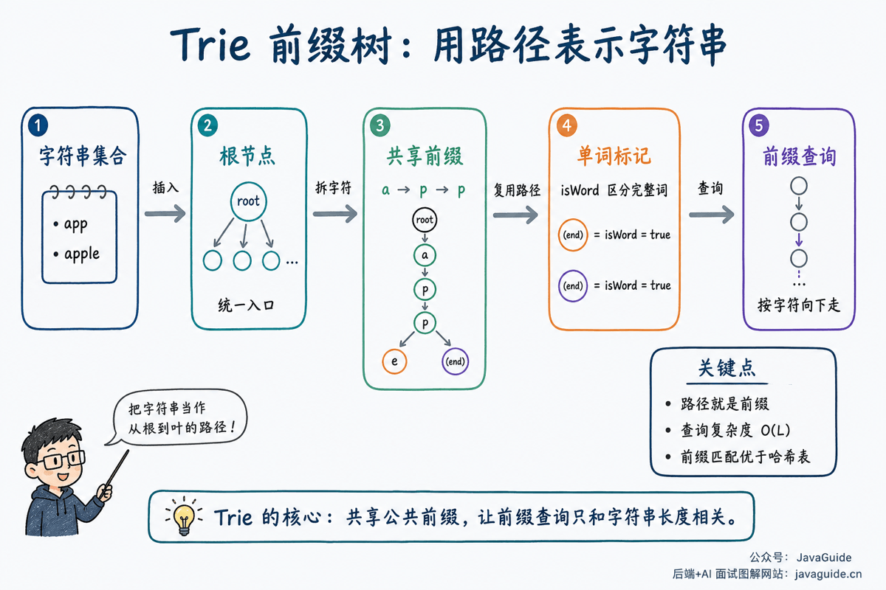

A **trie**, also called a prefix tree, is useful for prefix matching across large sets of strings. Tries are used for search suggestions, dictionary lookup, word filtering, and route-prefix matching.

The idea is simple: split strings into characters and share paths for common prefixes. For example, `app`, `apple`, and `apply` share the path `a -> p -> p`.

This article covers:

1. What is a trie?
2. Why are tries useful for prefix matching?
3. How should trie nodes be designed?
4. How do you implement insertion, lookup, and prefix lookup?
5. When should you choose a trie over a hash table?



## What Is a Trie?

A trie is a data structure designed for sets of strings. Unlike a binary search tree, it usually organizes nodes by character paths rather than by relative order.

Think of it this way:

- The root does not represent a character; it is the entry point for all strings.
- Each step down from the root matches one character in a string.
- The characters along a path from the root to a node form a prefix.
- A node marked as the end of a word means that the path from the root forms a complete word.

For example, after inserting `app`, `apple`, and `apply`, they share the path `a -> p -> p`. The last `p` for `app` must be marked as the end of a word. Otherwise, the trie knows that `app` is a prefix of other words but not that `app` is also a complete word.

That is the purpose of the `isWord` field. Without it, the trie cannot distinguish a path that is only a prefix from one that forms a complete word.

## Why Are Tries Useful for Prefix Matching?

A hash table is good for checking whether a complete string exists, such as whether `apple` is in a set. But to find every word starting with `app`, a hash table is less convenient: without a separate prefix index, it must scan many keys.

A trie represents each prefix as a path. To look up the prefix `app`, follow `a`, `p`, and `p` from the root:

- If a character path is missing, no word starts with `app`.
- If the path reaches the last `p`, every word below that node starts with `app`.

Trie prefix lookup depends mainly on the prefix length, not directly on the number of words in the dictionary. This is useful for search suggestions, longest-prefix route matching, and dictionary filtering.

## Interview Topics

- Explain why tries are useful for prefix lookup.
- Implement insertion, complete-word lookup, and prefix lookup.
- Analyze time complexity in terms of string length.
- Explain why tries may use a lot of space.
- Compare tries with hash tables.

## Node Structure

A trie node usually stores two kinds of information:

1. References to child nodes, used to match the next character.
2. A flag indicating whether the node ends a complete word.

For lowercase English letters, use an array of length 26:

```java
class TrieNode {
    TrieNode[] children = new TrieNode[26];
    boolean isWord;
}
```

For a variable character set, use `Map<Character, TrieNode>`. This is more space-flexible but adds hash table lookup overhead.

Neither approach is always better:

| Node representation                      | Advantage                                                               | Disadvantage                                  |
| ---------------------------------------- | ----------------------------------------------------------------------- | --------------------------------------------- |
| `TrieNode[] children = new TrieNode[26]` | Fast access; suitable for a small, fixed character set.                 | Wastes space when many child slots are empty. |
| `Map<Character, TrieNode>`               | Stores only characters that occur and supports flexible character sets. | Adds object and hash lookup overhead.         |

In an interview, use an array when the problem specifies lowercase English letters. If the character set includes uppercase letters, other scripts, path segments, or arbitrary characters, a `Map` is a safer choice.

## Basic Implementation

This template assumes that strings contain only lowercase English letters:

```java
class Trie {
    private final TrieNode root = new TrieNode();

    public void insert(String word) {
        TrieNode node = root;
        for (char c : word.toCharArray()) {
            int index = c - 'a';
            if (node.children[index] == null) {
                node.children[index] = new TrieNode();
            }
            node = node.children[index];
        }
        node.isWord = true;
    }

    public boolean search(String word) {
        TrieNode node = find(word);
        return node != null && node.isWord;
    }

    public boolean startsWith(String prefix) {
        return find(prefix) != null;
    }

    private TrieNode find(String text) {
        TrieNode node = root;
        for (char c : text.toCharArray()) {
            int index = c - 'a';
            if (node.children[index] == null) {
                return null;
            }
            node = node.children[index];
        }
        return node;
    }
}
```

Insertion and lookup follow the same path: start at the root and move down one level for each character. Insertion creates a node when a path is missing; lookup returns `false` if it is missing. The final check differs: `search()` checks `isWord`, while `startsWith()` only needs to reach the end of the prefix.

## How Does Deletion Work?

Deletion is easier to get wrong than insertion or lookup because you cannot simply remove the entire path for a word.

If the trie contains both `app` and `apple`, deleting `app` should only clear the `isWord` flag on its last `p` node. Do not delete the path `a -> p -> p`, or `apple` will be lost too.

To remove nodes, work backward from the end of the word. A node can be deleted only if it has no children and is not the end of another word. If an interview problem does not require deletion, focus first on insertion, complete-word lookup, and prefix lookup.

## Complexity

Let `L` be the string length:

- Insertion: `O(L)`
- Complete-word lookup: `O(L)`
- Prefix lookup: `O(L)`

Space complexity depends on the number of nodes. In the worst case, when strings share few prefixes, the trie may use close to one node per character.

Enumerating every word with a given prefix takes more than `O(L)`: locating the prefix node takes `O(L)`, then the subtree below that node must be traversed. The additional cost depends on the subtree size and number of results.

## Tries vs. Hash Tables

| Use case                  | Trie                                          | Hash table            |
| ------------------------- | --------------------------------------------- | --------------------- |
| Complete-string lookup    | Supported, but uses more space.               | More straightforward. |
| Prefix lookup             | A natural fit.                                | Requires extra work.  |
| Enumerate words by prefix | A natural fit.                                | Inconvenient.         |
| Large character set       | May require an optimized node representation. | Easier to handle.     |

For checking whether a word exists, a hash table is usually simpler. For frequent prefix lookups, a trie is a better fit.

One more difference is easy to overlook: hash tables are often more space-efficient and general for exact matches, while tries store shared prefixes as paths and naturally support prefix lookup, prefix enumeration, and longest-prefix matching. They serve different needs rather than replacing each other.

## Production Use Cases

- Search autocomplete: find candidate words from the user's prefix.
- Word filtering: combine a trie with the Aho-Corasick automaton for multi-pattern matching.
- IP routing: longest-prefix matching can use trie-based approaches.
- Dictionary validation: quickly check whether a word or prefix exists.

Production systems also use trie variants:

- **Compressed trie / radix tree:** Compress consecutive paths with a single child into one string to reduce the number of nodes.
- **Ternary search trie:** Organize characters through less-than, equal-to, and greater-than links, balancing space use with lookup flexibility.
- **Aho-Corasick automaton:** Add failure links to a trie for multi-pattern string matching.

You do not need to memorize every variant at first. They all build on the same idea: represent strings as paths and reuse paths for shared prefixes.

## Common Pitfalls

- Do not omit `isWord`; it distinguishes `app` from `apple`.
- The character set may include more than lowercase letters; adapt the implementation to the problem.
- Deletion is more complex than insertion and lookup because a node may be shared by other words.
- Trie lookup depends on string length, not directly on dictionary size.

## Practice Problems

- [208. Implement Trie](https://leetcode.cn/problems/implement-trie-prefix-tree/)
- [211. Design Add and Search Words Data Structure](https://leetcode.cn/problems/design-add-and-search-words-data-structure/)
- [212. Word Search II](https://leetcode.cn/problems/word-search-ii/)
- [648. Replace Words](https://leetcode.cn/problems/replace-words/)

## References

- [Algorithms, 4th Edition: Tries](https://algs4.cs.princeton.edu/52trie/)
- [Algorithms, 4th Edition: TrieST API](https://algs4.cs.princeton.edu/code/javadoc/edu/princeton/cs/algs4/TrieST.html)
- [Stanford CS166：Tries and Suffix Trees](https://web.stanford.edu/class/archive/cs/cs166/cs166.1216/lectures/16/Slides16.pdf)

<!-- @include: @article-footer.snippet.md -->
