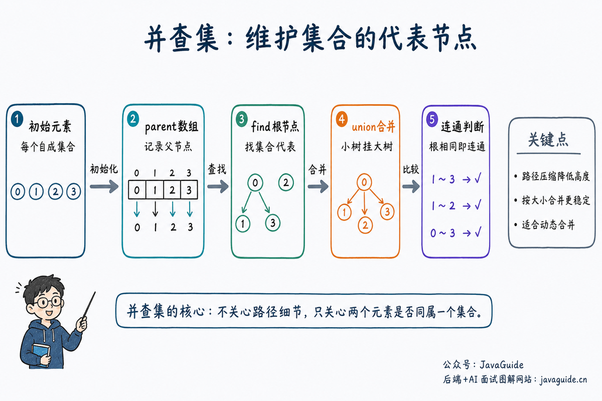

Union-find is designed for grouping and connectivity problems. Are two elements in the same group? How many connected components remain after merging sets? Would adding an edge create a cycle? Union-find can answer these questions.

The implementation is short, but a poorly written `find` operation can hurt performance.

This article covers:

1. What is union-find?
2. How does union-find represent sets with an array?
3. What do `find`, `union`, and `connected` do?
4. How do path compression and union by size improve performance?
5. Which connectivity problems are a good fit for union-find?



## What Is Union-Find?

**Disjoint Set Union (DSU)**, also called **union-find**, maintains a collection of disjoint sets. It is especially useful for two operations:

1. **Find:** Are two elements currently in the same set?
2. **Union:** Merge the sets containing two elements.

Union-find does not track the full structure within a set or the exact edges connecting two nodes. For example, in a social network, it can quickly tell whether A and B belong to the same connected group, but it cannot find the shortest path between them.

This is one difference between union-find and BFS/DFS: BFS and DFS search through a graph when needed, while union-find maintains connectivity as sets are merged. Later queries compare the elements' representative nodes.

## How Does Union-Find Represent Sets?

Union-find usually represents a forest of trees with a `parent` array:

- `parent[x]` is the parent of element `x`.
- If `parent[x] == x`, then `x` is the root of its set.
- The root represents the set.

Initially, each element is its own set, so each element is its own parent:

```text
parent[0] = 0
parent[1] = 1
parent[2] = 2
...
```

After `union(0, 1)`, the root of `1` can be attached to the root of `0`, placing both elements in the same set. When `union(1, 2)` is called, it is the roots of `1` and `2` that are actually merged.

The key is not just a node's immediate parent, but the root reached by following parent pointers. `find(x)` locates that root.

## Three Core Operations

The three common operations are:

| Operation         | Purpose                                                      |
| ----------------- | ------------------------------------------------------------ |
| `find(x)`         | Find the representative, or root, of the set containing `x`. |
| `union(a, b)`     | Merge the sets containing `a` and `b`.                       |
| `connected(a, b)` | Check whether `a` and `b` have the same representative.      |

If two elements have the same root, they are already in the same set. If their roots differ, `union` attaches one root beneath the other.

## Interview Topics

- Implement `find` and `union`.
- Explain what path compression does.
- Count connected components with union-find.
- Solve problems involving cycle detection, friend groups, provinces, and equations.
- Explain why union-find supports dynamic merging but not frequent deletions.

## From Quick Find to Quick Union

To understand union-find, start with two basic variants:

- **Quick Find:** Store each element's set ID directly in an array. Checking whether two elements are in the same set is fast, but merging sets requires scanning the entire array to update IDs.
- **Quick Union:** Store parent pointers in an array and represent each set by its root. A union changes one root's parent pointer, but `find` can be slow if the tree is tall.

Interview and problem-solving implementations usually optimize Quick Union with **path compression and union by size or rank**.

- **Path compression:** During `find(x)`, attach nodes along the path directly to the root so later lookups are faster.
- **Union by size:** When merging sets, attach the smaller tree beneath the larger one to keep the trees from getting too tall.

Together, these optimizations make a sequence of union-find operations take nearly constant time per operation.

## Basic Template

```java
class UnionFind {
    private final int[] parent;
    private final int[] size;
    private int count;

    UnionFind(int n) {
        parent = new int[n];
        size = new int[n];
        count = n;
        for (int i = 0; i < n; i++) {
            parent[i] = i;
            size[i] = 1;
        }
    }

    int find(int x) {
        if (parent[x] != x) {
            parent[x] = find(parent[x]);
        }
        return parent[x];
    }

    boolean union(int a, int b) {
        int rootA = find(a);
        int rootB = find(b);
        if (rootA == rootB) {
            return false;
        }
        if (size[rootA] < size[rootB]) {
            parent[rootA] = rootB;
            size[rootB] += size[rootA];
        } else {
            parent[rootB] = rootA;
            size[rootA] += size[rootB];
        }
        count--;
        return true;
    }

    boolean connected(int a, int b) {
        return find(a) == find(b);
    }

    int count() {
        return count;
    }
}
```

`parent[x]` is the parent of `x`; a root is its own parent. Path compression attaches nodes along the search path directly to the root, making later lookups faster.

Two details in this template are worth a closer look:

1. `parent[x] = find(parent[x])` in `find()` performs path compression. Once the recursive call returns the root, it connects `x` directly to that root.
2. `union()` uses `size` to decide which root becomes the parent. This is union by size and limits tree height.

`count` stores the number of connected components. Decrement it only when `union()` merges two previously separate sets; do not decrement it when the elements are already connected.

## Complexity

With path compression and union by size, the amortized complexity per operation is `O(α(n))`, where `α(n)` is the inverse Ackermann function and grows very slowly. In an interview, it is usually enough to call this nearly constant time.

Space complexity is `O(n)`, mainly for the `parent` and `size` arrays.

## Common Use Cases

| Use case                              | Approach                                                                             |
| ------------------------------------- | ------------------------------------------------------------------------------------ |
| Check whether two nodes are connected | Compare `find(a)` and `find(b)`.                                                     |
| Merge two sets                        | `union(a, b)`.                                                                       |
| Count connected components            | Initialize to `n` and decrement after each successful union.                         |
| Detect a cycle in an undirected graph | If the endpoints of an edge are already connected, adding that edge creates a cycle. |
| Equation constraints                  | Merge equality relations, then check whether any inequality is violated.             |

Union-find is a good fit when relationships are repeatedly merged and queries ask whether elements are in the same set. Examples include Number of Provinces, Redundant Connection, account merging, and Kruskal's minimum spanning tree algorithm.

Union-find does not handle deletions well. Once two sets are merged, it usually discards the details of which edges connect them. After deleting an edge, connectivity cannot be determined by simply changing the `parent` array.

## Common Pitfalls

- `find` must return the root, not just the parent.
- Do not omit the recursive return value during path compression.
- Decrement the component count only when `union` merges two previously separate sets.
- Union-find is useful for merging, but not for deleting relationships.
- For a 2D grid, map `(i, j)` to a one-dimensional index, such as `i * cols + j`.

## Practice Problems

- [547. Number of Provinces](https://leetcode.cn/problems/number-of-provinces/)
- [684. Redundant Connection](https://leetcode.cn/problems/redundant-connection/)
- [990. Satisfiability of Equality Equations](https://leetcode.cn/problems/satisfiability-of-equality-equations/)
- [1319. Number of Operations to Make Network Connected](https://leetcode.cn/problems/number-of-operations-to-make-network-connected/)
- [200. Number of Islands](https://leetcode.cn/problems/number-of-islands/)

## References

- [Algorithms, 4th Edition: Union-Find](https://algs4.cs.princeton.edu/15uf/)
- [Algorithms, 4th Edition: WeightedQuickUnionPathCompressionUF](https://algs4.cs.princeton.edu/15uf/WeightedQuickUnionPathCompressionUF.java.html)
- [CP-Algorithms：Disjoint Set Union](https://cp-algorithms.com/data_structures/disjoint_set_union.html)

<!-- @include: @article-footer.snippet.md -->
