Application-layer protocols include HTTP, WebSocket, SMTP, POP3/IMAP, FTP, Telnet, SSH, RTP, and DNS.

You don't need to learn the implementation details of every protocol. But memorizing names without understanding their purpose, transport protocol, and typical use cases makes them easy to confuse.

This article answers three questions:

1. What problems do protocols such as HTTP, WebSocket, SMTP, FTP, SSH, and DNS solve?
2. Do they usually use TCP or UDP, and what are their common ports and use cases?
3. Which protocols are easy to confuse, and how should you tell them apart?

## HTTP: Hypertext Transfer Protocol

**HTTP (Hypertext Transfer Protocol)** is an application-layer protocol for transferring hypertext and multimedia content. Its most common use is communication between web browsers and web servers.

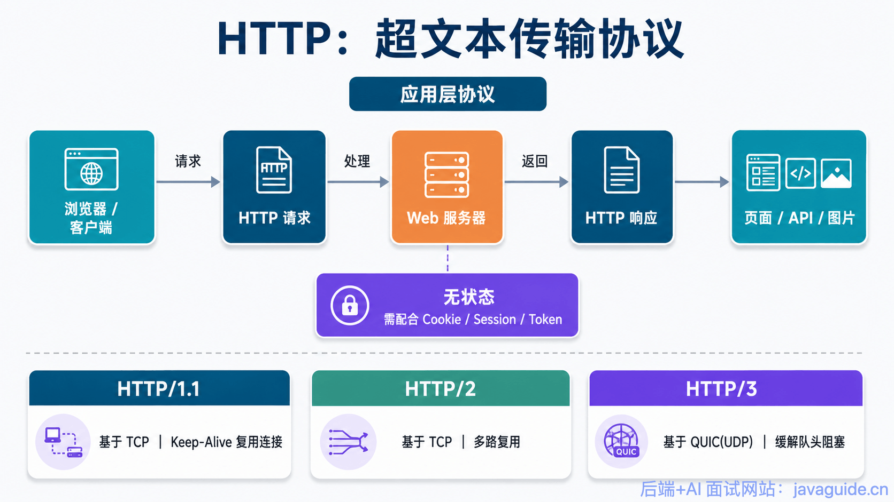

When you visit a web page, the browser sends an HTTP request and the server returns an HTTP response. HTML, CSS, JavaScript, images, video, and other page resources are commonly loaded over HTTP.

HTTP follows a client-server model: the client sends an HTTP Request and the server returns an HTTP Response.

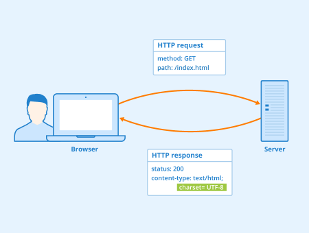

HTTP is an application-layer protocol and doesn't provide reliable transport itself. Different HTTP versions use different transport protocols:

- **HTTP/1.1:** Uses TCP.
- **HTTP/2:** Usually uses TCP and adds features such as multiplexing and header compression.
- **HTTP/3:** Uses QUIC, which runs over UDP. This reduces connection setup overhead and avoids some of the head-of-line blocking associated with TCP.

HTTP/1.1 uses persistent connections by default. Multiple HTTP requests can reuse the same TCP connection, avoiding the overhead of a new TCP handshake for every request.

Keep-Alive solves connection reuse, but requests on one HTTP/1.1 connection can still block one another. HTTP/2 adds multiplexing on a single TCP connection, allowing multiple requests and responses to be transferred concurrently. Since HTTP/2 still uses TCP, packet loss can affect all streams on that connection.

HTTP/3 is based on QUIC, which implements multiplexing and reliable delivery over UDP. Its streams are independent, which helps avoid TCP-level head-of-line blocking between streams.

HTTP is also **stateless**: a server doesn't inherently remember who made the previous request or what state that client was in. Web applications commonly use cookies, sessions, or tokens (including JWTs) to maintain login and session state.

## WebSocket: Full-Duplex Communication

**WebSocket** is a full-duplex protocol over a TCP connection. The client and server can both send and receive data over the same connection.

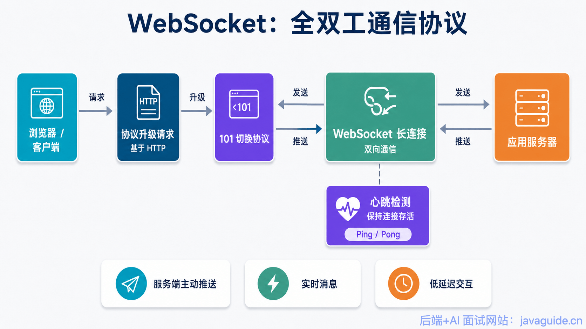

Its key feature is that **the server can push messages to the client after the connection is established**, which suits real-time communication better than the traditional HTTP request-response model.

WebSocket was introduced in 2008 and became an international standard in 2011. Modern browsers support it, as do many programming languages, frameworks, and servers.

WebSocket is an application-layer protocol. It usually starts with an HTTP request to upgrade the connection. Once the upgrade succeeds, the client and server keep a persistent connection for bidirectional communication.

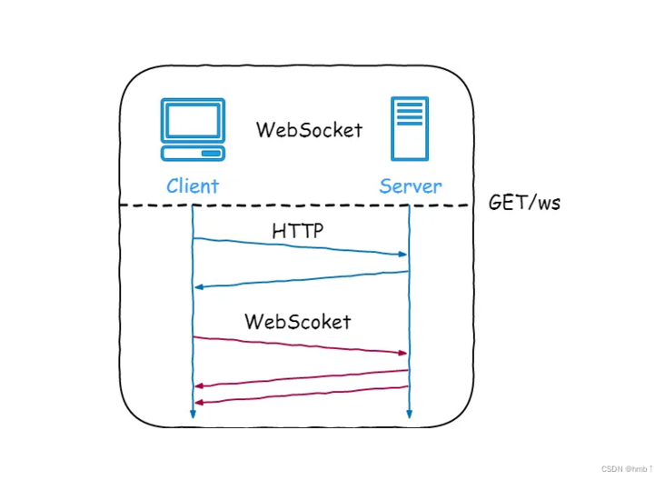

Common use cases include:

- Video comments and live overlays
- Real-time message delivery; see [Web Real-Time Message Delivery](https://javaguide.cn/system-design/web-real-time-message-push.html)
- Multiplayer games
- Collaborative editing
- Customer support and social chat
- Live updates such as stock prices and sports scores

A WebSocket connection is established as follows:

1. The client sends an HTTP request with headers such as `Upgrade: websocket`, `Connection: Upgrade`, and `Sec-WebSocket-Key` to request an upgrade.
2. If the server supports WebSocket, it returns `101 Switching Protocols` with headers including `Upgrade: websocket`, `Connection: Upgrade`, and `Sec-WebSocket-Accept`.
3. After the upgrade, the client and server have a WebSocket connection and can communicate in both directions.
4. Data is transmitted in frames. A message may be split across multiple frames and reassembled by the receiver.
5. Either side can send a close frame. The other side responds with a close frame, and both close the TCP connection.

WebSocket connections often use **heartbeats**. For example, peers can periodically send Ping/Pong frames or application-level heartbeat messages to check that a connection is still usable and detect stale connections.

## SMTP: Simple Mail Transfer Protocol

**SMTP (Simple Mail Transfer Protocol)** is an application-layer protocol over TCP used mainly to **send and relay email**.

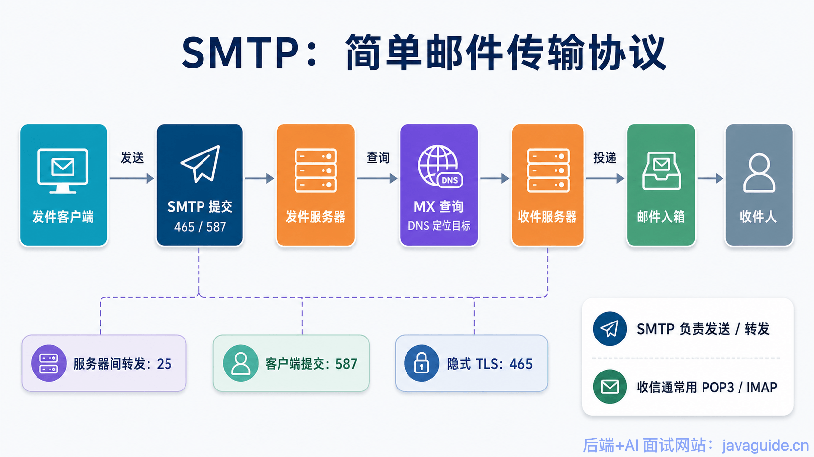

One distinction is easy to miss:

**SMTP sends and relays email between mail servers; POP3 and IMAP let users retrieve email from a mail server.**

Email is usually relayed from the sender's mail server to the recipient's mail server using SMTP. Users typically use POP3 or IMAP to read messages from their mailboxes.

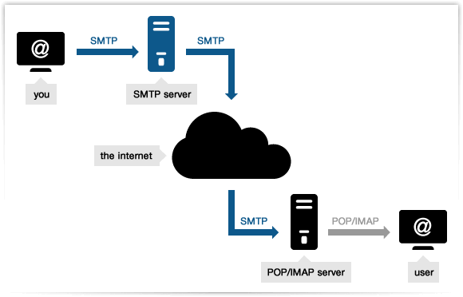

Common SMTP ports include 25, 465, and 587, but their uses differ:

| Port | Common use                           | Notes                                                                                                          |
| ---- | ------------------------------------ | -------------------------------------------------------------------------------------------------------------- |
| 25   | Mail relay between servers           | Mainly MTA-to-MTA delivery. Many cloud providers and ISPs restrict outbound traffic on port 25 to reduce spam. |
| 587  | Client message submission            | The standard submission port, commonly used with STARTTLS and authentication.                                  |
| 465  | Message submission over implicit TLS | TLS is established immediately when the client connects; many email providers still support it.                |

### How Email Is Sent

Suppose I use `<dabai@cszhinan.com>` and want to email `<xiaoma@qq.com>`:

1. I write the message in a mail client or webmail.
2. The client submits it over SMTP to the mail server for `cszhinan.com`.
3. The sender's mail server looks up the mail server for the recipient domain, `qq.com`.
4. The sender's server relays the message to the QQ mail server using SMTP.
5. The QQ mail server receives and stores the message.
6. `<xiaoma@qq.com>` reads the message from the QQ mail server using POP3 or IMAP.

### Can You Check Whether an Email Address Exists?

Some systems try to determine whether an email address exists by probing its mail server over SMTP:

1. Look up the domain's MX record to find its mail server.
2. Connect to the mail server.
3. Simulate the SMTP delivery commands.
4. Use the server's response as an indication of whether the address might exist.

This isn't always reliable. To prevent spam, credential stuffing, and privacy leaks, many providers block such probes or return ambiguous results. SMTP probing can't prove with certainty that an address exists or doesn't exist.

Online email verification tools include:

1. <https://verify-email.org/>
2. <http://tool.chacuo.net/mailverify>
3. <https://www.emailcamel.com/>

## POP3 and IMAP: Email Retrieval

**POP3 and IMAP are TCP-based application-layer protocols for receiving email.**

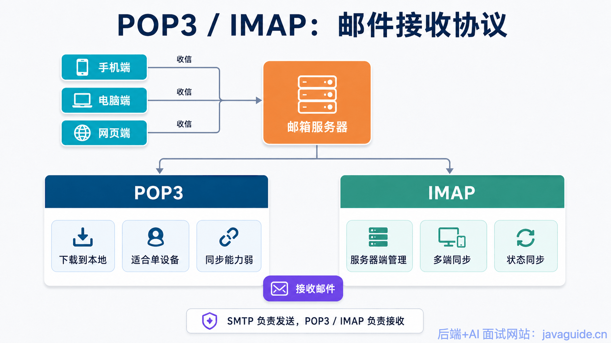

Remember: **SMTP sends and relays email; POP3 and IMAP let users retrieve email from a mail server.**

POP3 is simple and commonly downloads messages to a local device. It can work well for a single device, but provides weaker synchronization across devices.

IMAP is more commonly used today. It lets users manage messages on the server and synchronize state such as read/unread, deleted, archived, and folder placement. IMAP is usually a better fit when accessing the same mailbox from a phone, computer, and browser.

| Protocol | Main purpose              | Characteristics                                                            |
| -------- | ------------------------- | -------------------------------------------------------------------------- |
| POP3     | Retrieve email            | Primarily downloads messages locally; limited multi-device synchronization |
| IMAP     | Retrieve and manage email | Supports multi-device synchronization, search, flags, and archiving        |
| SMTP     | Send and relay email      | Handles email delivery                                                     |

## FTP: File Transfer Protocol

**FTP (File Transfer Protocol)** is a TCP-based application-layer protocol for transferring files between a client and a server.

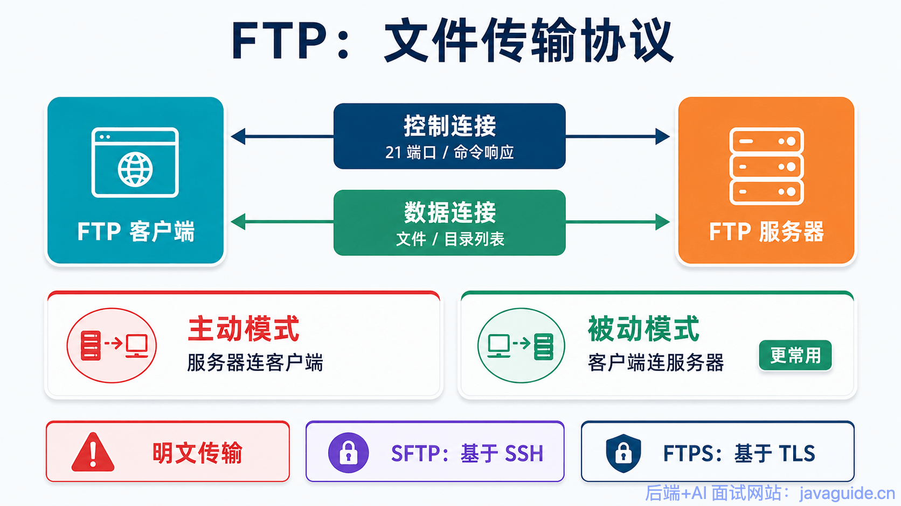

FTP follows a client-server model and commonly uses two separate TCP connections:

> 1. **Control connection:** Carries commands and responses, such as login, directory changes, and file deletion.
> 2. **Data connection:** Transfers file content or directory listings.

Separating commands from file data keeps the two kinds of traffic independent.

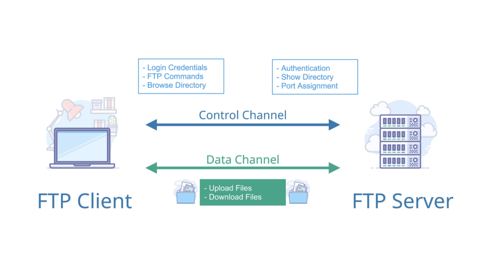

FTP has two data-connection modes: active (PORT) and passive (PASV).

- **Active mode:** The client tells the server which port it is listening on over the control connection. The server then initiates a connection to that client port. This often fails when the client is behind NAT or a firewall because the server initiates the connection.
- **Passive mode:** The client asks the server to open a data port, then initiates a connection to that port. Since the connection goes from client to server, this mode works more easily through NAT and firewalls and is more common in production.

FTP is insecure by default. It doesn't encrypt data, so usernames, passwords, and file contents may be intercepted or modified.

For sensitive files, use a secure alternative:

- **SFTP:** A file-transfer protocol that runs over SSH.
- **FTPS:** FTP protected with TLS/SSL.

Despite their similar names, SFTP and FTPS are different protocols. SFTP uses SSH; FTPS is FTP over TLS.

## Telnet: Remote Login

**Telnet** is a TCP-based remote-login protocol that uses port 23 by default. It lets users log in to a remote server through a terminal and run commands there.

Telnet's main problem is that it **transmits data in plaintext**.

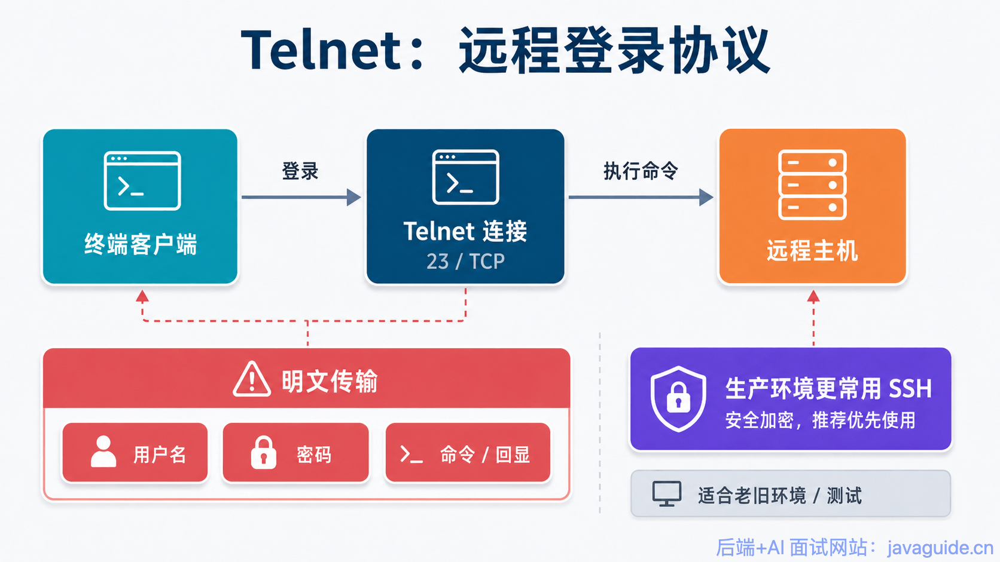

Usernames, passwords, commands, and responses aren't encrypted. Anyone able to monitor the traffic may see sensitive information.

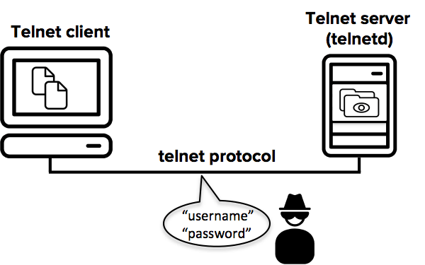

Telnet is rarely used for remote administration today. SSH is the usual replacement.

## SSH: Secure Shell

**SSH (Secure Shell)** is a secure network protocol over TCP that uses port 22 by default. Encryption and authentication protect remote login, command execution, and file transfer.

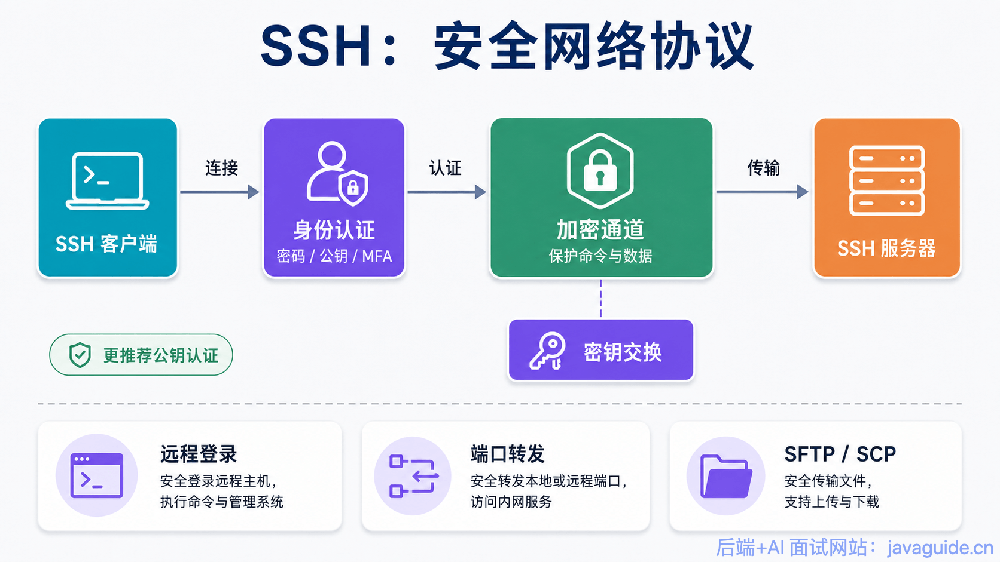

The most familiar SSH use is logging in to a remote server:

```bash
ssh user@server_ip
```

SSH also supports:

- Remote command execution
- Port forwarding
- Tunneling
- X11 forwarding
- Secure file transfer through SFTP or SCP

SSH follows a client-server model. The SSH server listens for requests and the SSH client initiates the connection. They negotiate cryptographic algorithms and use key exchange to derive symmetric keys for subsequent communication.

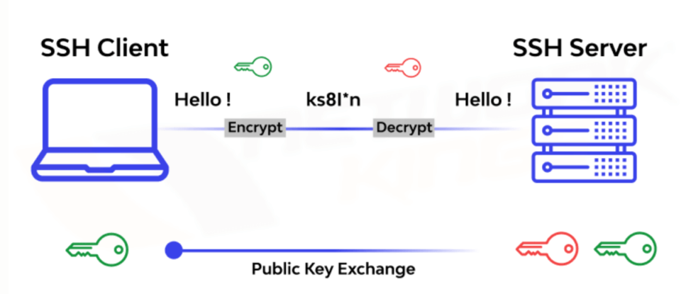

SSH security comes from authentication as well as encryption. Common authentication methods include:

- Password authentication
- Public-key authentication
- Multi-factor authentication

Public-key authentication is generally preferable in production; avoid weak password logins.

## RTP: Real-Time Transport Protocol

**RTP (Real-time Transport Protocol)** carries real-time data such as audio and video and usually runs over UDP. In the TCP/IP model, UDP is below the application layer, so RTP is classified as an application-layer protocol. Its functions—sequence numbers, timestamps, synchronization, and quality feedback—are closer to transport-layer functions. RFC 3550 notes that RTP is usually integrated into application processing rather than implemented as a separate layer.

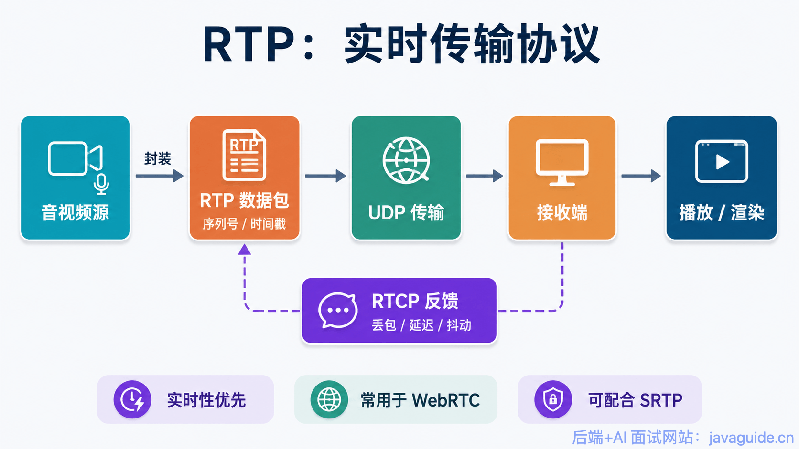

RTP is used for voice calls, video conferences, live streams, and other real-time applications. It doesn't guarantee reliable or timely delivery. Instead, sequence numbers and timestamps help the receiver reorder, synchronize, and control playback. RTP can also be carried over TCP (for example, under RFC 4571), usually for special cases such as firewall traversal or compatibility. UDP remains the common choice for real-time audio and video.

RTP is commonly paired with RTCP:

- **RTP** carries real-time audio and video.
- **RTCP (RTP Control Protocol)** carries control and statistics, such as packet loss, delay, and jitter.

RTP and RTCP are foundational to WebRTC media transport. WebRTC also uses SRTP encryption, congestion control, jitter buffers, NACK, FEC, and other mechanisms to improve security and quality.

RTP itself doesn't reserve resources or guarantee real-time quality. It provides basic real-time media transport; higher-level mechanisms are needed to manage quality.

## DNS: Domain Name System

**DNS (Domain Name System)** maps domain names to IP addresses.

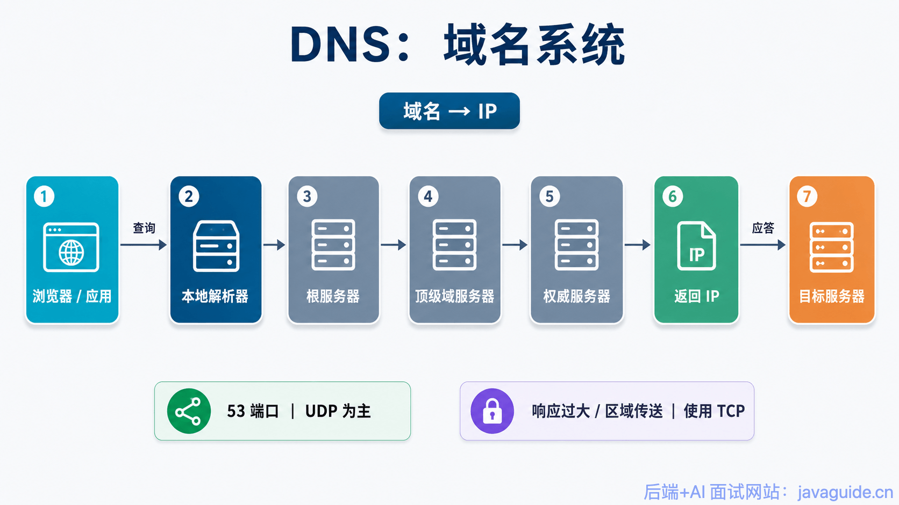

For example, a user may enter a domain name:

```text
www.javaguide.cn
```

Network communication needs an IP address, so DNS resolves the name to its corresponding address.

DNS usually uses UDP on port 53. Most queries and responses are small, so UDP avoids TCP's three-way handshake and responds quickly.

Early DNS specifications limited UDP messages to 512 bytes, excluding the IP and UDP headers. If a response was too large, the server set a truncation flag and the client retried over TCP.

EDNS(0) later extended the maximum size of DNS messages over UDP, allowing larger responses such as those containing DNSSEC data. TCP is still used when a response exceeds the negotiated UDP size, is truncated, or during a zone transfer, when DNS servers synchronize an entire zone. Ordinary name lookups rarely trigger a zone transfer.

More privacy-focused DNS options include:

- **DoH (DNS over HTTPS)**
- **DoT (DNS over TLS)**

Both aim to reduce the privacy and security risks of plaintext DNS queries.

## Common Application-Layer Protocol Ports

| Protocol  | Default port(s)                                       | Transport   | Main use                              |
| --------- | ----------------------------------------------------- | ----------- | ------------------------------------- |
| HTTP      | 80                                                    | TCP         | Web access                            |
| HTTPS     | 443                                                   | TCP / QUIC  | Encrypted web access                  |
| WebSocket | 80 / 443                                              | TCP         | Bidirectional real-time communication |
| SMTP      | 25 / 465 / 587                                        | TCP         | Email submission and relay            |
| POP3      | 110 / 995                                             | TCP         | Email retrieval                       |
| IMAP      | 143 / 993                                             | TCP         | Email retrieval and synchronization   |
| FTP       | 20 / 21                                               | TCP         | File transfer                         |
| SSH       | 22                                                    | TCP         | Secure remote login and file transfer |
| Telnet    | 23                                                    | TCP         | Plaintext remote login                |
| DNS       | 53                                                    | UDP / TCP   | Domain name resolution                |
| RTP       | Dynamic ports (even); RTCP uses the adjacent odd port | Usually UDP | Real-time audio and video             |

HTTPS is listed as TCP / QUIC because traditional HTTPS usually uses TLS over TCP, while HTTP/3 uses QUIC.

## Summary

This article is a quick guide to common application-layer protocols, not a detailed explanation of their packet formats or implementations.

Keep these distinctions in mind:

- HTTP is an application-layer protocol. HTTP/1.1 and HTTP/2 usually use TCP; HTTP/3 uses QUIC.
- HTTP/1.1 reuses TCP connections with Keep-Alive. HTTP/2 multiplexes over one TCP connection. HTTP/3 uses QUIC to avoid TCP-level head-of-line blocking.
- WebSocket upgrades an HTTP connection and then supports bidirectional communication.
- SMTP sends and relays email; POP3 and IMAP let users retrieve it.
- Common SMTP ports include 25, 587, and 465 for server relay, client submission, and submission over implicit TLS, respectively.
- FTP has active and passive modes; passive mode is more common in production.
- FTP, SFTP, and FTPS are different: FTP sends plaintext, SFTP uses SSH, and FTPS uses TLS.
- Telnet sends plaintext and isn't suitable for production remote administration; SSH is the common alternative.
- DNS usually uses UDP, but also uses TCP for large or truncated responses and zone transfers.
- RTP usually runs over UDP and is classified at the application layer, though some of its functions resemble transport-layer functions. RTP commonly uses an even port, with RTCP on the adjacent odd port.

## References

- _Computer Networking: A Top-Down Approach_, 7th edition
- [Introduction to RTP](https://mthli.xyz/rtp-introduction/)
- RFC 6455: The WebSocket Protocol
- RFC 9110: HTTP Semantics
- RFC 8446: TLS 1.3
- RFC 9000: QUIC
- RFC 3550: RTP: A Transport Protocol for Real-Time Applications
- RFC 4571: Framing Real-time Transport Protocol (RTP) and RTP Control Protocol (RTCP) Packets over Connection-Oriented Transport
- RFC 6891: Extension Mechanisms for DNS (EDNS(0))

<!-- @include: @article-footer.snippet.md -->
