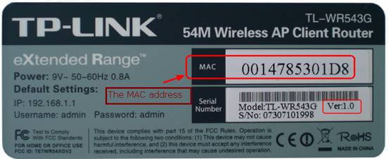

IP addresses are used for network-layer addressing. To forward a frame across a local network, however, a device also needs the MAC address of the next hop.

ARP solves this mapping problem: **given a destination IP address, how do you find its MAC address?** This simple protocol connects the network and link layers and is essential to understanding local network communication, gateway forwarding, and ARP spoofing.

This article answers four questions:

1. Where does ARP fit in the protocol stack?
2. How does ARP resolve an address with a broadcast request and a unicast reply?
3. What does an ARP table do, and what happens when an entry expires?
4. How do common ARP attacks work, and how can you defend against them?

## MAC Addresses

Before discussing ARP, let's look at MAC addresses.

A **Media Access Control (MAC) address** identifies a link-layer interface and is used to send frames on a local network. It belongs to a network interface, not permanently to an entire device. A device can have multiple interfaces, each with its own MAC address.

MAC addresses are also called LAN addresses, physical addresses, or Ethernet addresses. Unlike IP addresses, which are used for network-layer routing, MAC addresses are primarily used on the current link or within the current broadcast domain.

> Network devices also have IP addresses. For example, a router has an IP address on each interface. A router connects networks, and its interfaces often use private IP addresses. Devices on a private network use NAT when communicating with devices outside that network.

A common Ethernet MAC address is the six-byte (48-bit) EUI-48 format. IEEE allocates address blocks of different sizes, including MA-L, MA-M, and MA-S, which manufacturers use to assign globally administered addresses. Locally administered addresses also exist and don't require a global IEEE allocation. Operating systems can change or randomize MAC addresses, so an address isn't guaranteed to remain permanent; the same address can also appear on different networks.

One special MAC address is the broadcast address: `FF-FF-FF-FF-FF-FF`, consisting of all 1s.

## How ARP Works

ARP relies on an **ARP table**. Each network interface maintains a table of some other devices' IP-to-MAC mappings on the local network. An entry is stored as an `<IP, MAC, TTL>` tuple. TTL is the entry's lifetime; a typical value is 20 minutes, after which the entry is discarded.

We'll look at two scenarios:

1. Resolving a MAC address for a device on the same local network.
2. Sending a packet to a device on a different local network.

### Resolving an Address on the Same Local Network

Suppose host A, with IP address `137.196.7.23`, wants to send an IP datagram to host B, with IP address `137.196.7.14`, on the same local network.

> When a host sends an IP datagram at the network layer, it knows the destination IP address but not necessarily the destination MAC address. ARP resolves that address.

Host A uses ARP to find host B's MAC address, then encapsulates the IP packet in a link-layer frame and sends it to the next hop. The following events happen in order:

1. Host A checks its ARP table. There is no mapping for host B's IP address, so A doesn't know B's MAC address.

2. Host A creates an ARP request and broadcasts it on the local network.

   ARP requests and replies have the same field layout, including the sender's and target's protocol and hardware addresses. When A sends a request, it knows the sender IP, sender MAC, and target IP, but not the target hardware address, which is usually set to all zeros. The **Ethernet frame** carrying the ARP request sets its destination MAC address to the broadcast address `FF-FF-FF-FF-FF-FF`, so every interface in the broadcast domain can receive it. Don't confuse the Ethernet frame's destination MAC address with the target hardware address inside the ARP message.

3. Every device on the local network receives the broadcast and checks whether the target IP address is its own. Host B recognizes its IP address; other devices discard the request.

4. Host B creates an ARP reply addressed only to host A. B also uses the request's sender IP and MAC addresses to add A's mapping to its own ARP table.

   The reply uses the same field layout as the request, but the sender and target addresses are reversed. The sender MAC is B's MAC address, and the target MAC is A's. Unlike the request, the reply is unicast.

5. Host A receives B's reply, extracts the IP and MAC addresses, and adds the mapping to its ARP table.

Keep a few details in mind:

1. If host A already has B's IP-to-MAC mapping in its ARP table, A doesn't need to broadcast a request. It can use the MAC address to build and send the link-layer frame.
2. ARP table entries have a lifetime, typically around 20 minutes.
3. After receiving a request, the target host can add the sender's IP-to-MAC mapping to its own table, which lets it address the reply correctly.

In short, ARP uses a **broadcast request and a unicast reply**.

### Resolving an Address Across Local Networks

Now suppose hosts A and B are on different subnets connected by a router. A network device, more precisely, has an IP address and a MAC address on each interface. A router has multiple interfaces, each with its own IP address and MAC address. Each router interface maintains its own ARP table; the router doesn't have just one table for all its interfaces.

An Ethernet broadcast frame reaches interfaces in the current broadcast domain, regardless of whether the target IP is on the sender's subnet. Only the node that recognizes the target IP responds. Before sending the IP datagram, the host checks its routing table. If the destination isn't on a directly connected network, the host resolves the MAC address of the next-hop router interface—not the remote host. The process is:

1. Host A checks its ARP table for the MAC address of the router interface on A's local subnet.

   This is the router that can forward the packet toward the subnet containing host B.

2. If A doesn't have that mapping, it uses ARP to resolve the router interface's MAC address. Since that interface is on A's subnet, this works like address resolution between hosts on the same local network.

3. Host A creates an IP datagram with A's IP address as the source and B's IP address as the destination. It then creates a link-layer frame with A's MAC address as the source and the router interface's MAC address on A's subnet as the destination. A sends the frame to the router interface by unicast.

4. The router interface receives the frame, examines the destination IP address, checks its forwarding table, and forwards the IP datagram through the interface connected to B's subnet.

   The packet has now moved from A's subnet to B's subnet.

5. The router interface checks its ARP table for host B's MAC address.

6. If it doesn't have the mapping, the router interface uses ARP to broadcast a request and receive a unicast reply from B.

7. The router interface encapsulates the IP datagram in a new link-layer frame addressed to B's MAC address and sends it by unicast toward its destination.

<!-- @include: @article-footer.snippet.md -->
