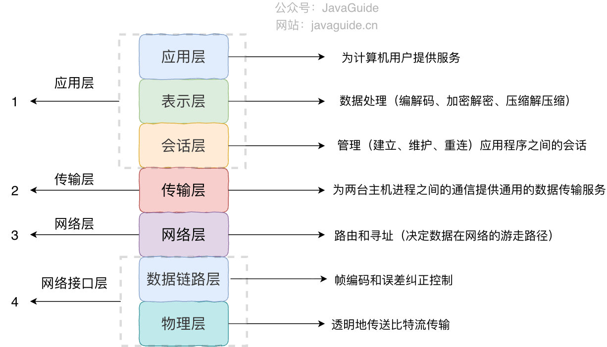
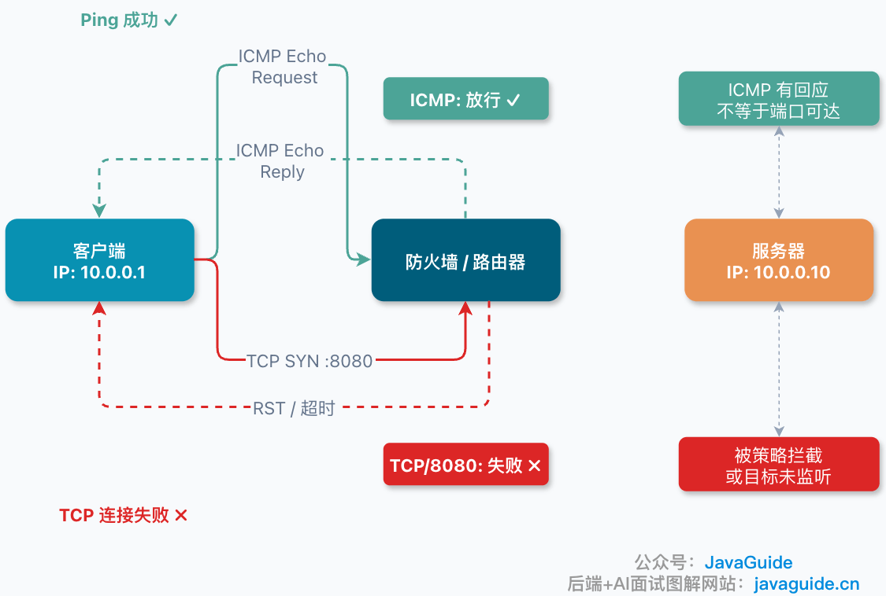
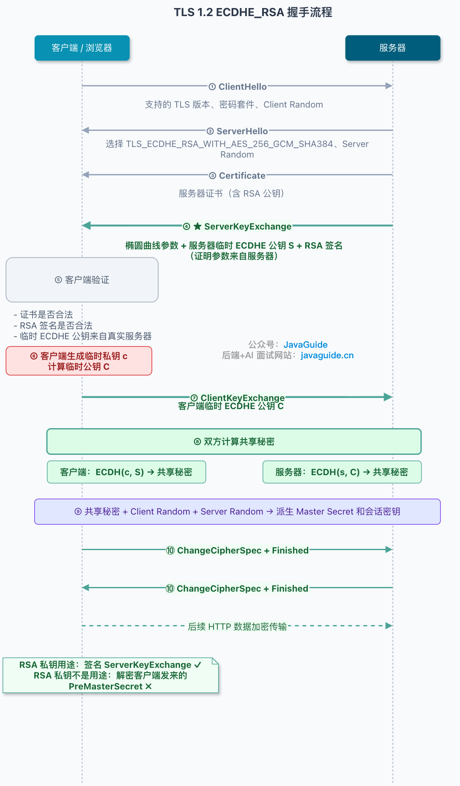
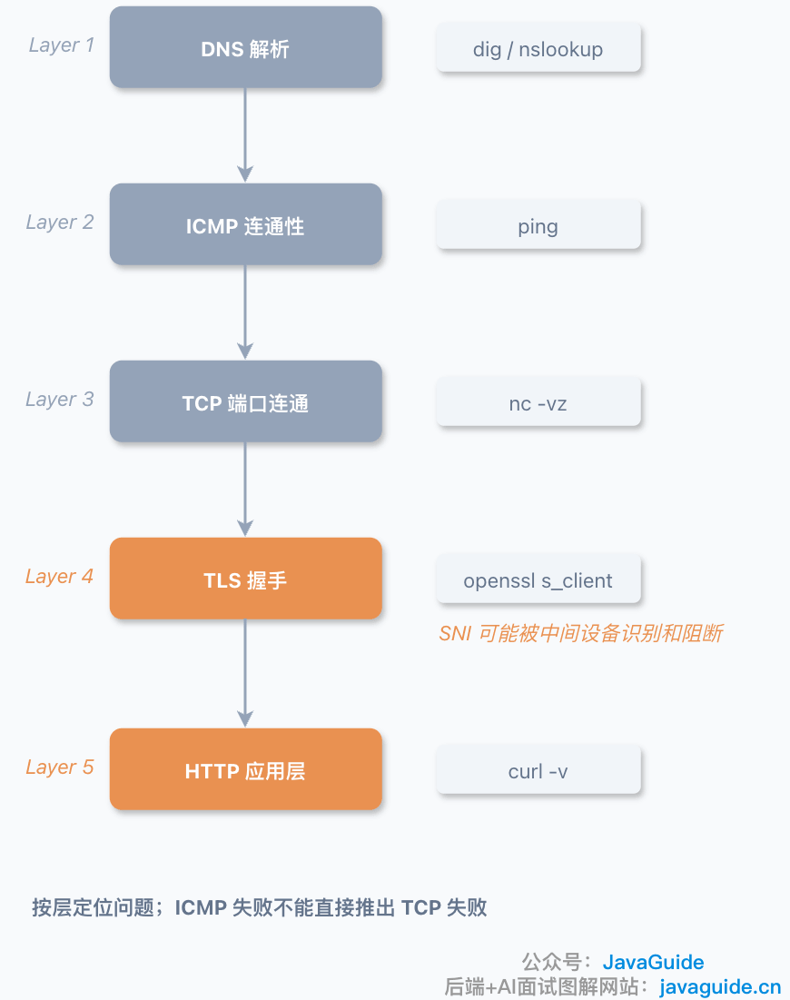

Does a successful Ping mean TCP will connect? The short answer is **no**.

You might wonder why TCP can fail when Ping succeeds. More precisely, a successful Ping only shows that an ICMP Echo request and reply can travel back and forth under the current network policies. It does not mean the target TCP port is reachable.

Even after studying networking and reading a lot of material, I was a little thrown off the first time I was asked this in an interview.

The answer is simple: **Ping uses ICMP, while a TCP connection uses TCP. They may follow the same network path, but intermediate devices can handle them differently based on protocol, port, connection state, and security policy.**

ICMP works at the network layer, while TCP works at the transport layer. They operate at different layers of the protocol stack:



## A Successful Ping Only Shows That ICMP Got a Reply



Ping uses ICMP (Internet Control Message Protocol) to send and receive probe messages.

ICMP messages fall into two categories: **query messages**, such as Ping's Echo Request and Echo Reply (types 8 and 0), and **error messages**, such as Destination Unreachable, which report network errors.

On common operating systems, `ping` uses Echo probes: ICMP Echo Request/Reply for IPv4 and ICMPv6 Echo Request/Reply for IPv6. It does not check ports or whether a service is running on the target. Tools such as `tcping`, `hping`, and cloud-provider probes may use different probe types.

If a machine responds to Ping, you can conclude that the ICMP probe received a response and that its request and reply paths worked. If NAT, a load balancer, a firewall, or Anycast sits in front of the target IP, the reply may come from an intermediary or edge node. It does not prove that a backend service port is reachable.

That is all it tells you.

TCP requires more. To connect to `example.com:443`, the client sends a `SYN`, the server replies with `SYN-ACK`, and the client sends an `ACK`. The TCP connection is established only after these three steps. TLS, HTTP, or application authentication can still fail afterward.

If a firewall drops any of these packets, a security group blocks them, or no service is listening on the port, the TCP connection will fail.

So `ping` is a useful first check, but it cannot prove that TCP is working.

## Allowing ICMP Does Not Mean TCP Is Allowed

Many network devices allow ICMP because it is useful for operations. A Ping can give a rough idea of whether a host is online, how much latency there is, and whether packets are being dropped.

TCP rules are often stricter. A server may allow only ports `22`, `80`, and `443`, while blocking database, application, and debugging ports.

That can produce a result like this:

```bash
ping 10.0.0.10
# Ping succeeds

nc -vz 10.0.0.10 8080
# Times out or is refused
```

There is no contradiction: ICMP and TCP port traffic may be subject to different rules.

It also helps to distinguish between two kinds of failure:

1. `Connection timed out` usually means the `SYN` received no valid response. A firewall may be silently dropping it, or there may be a routing or return-path problem.
2. `Connection refused` usually means the target returned an `RST`, often because no service is listening or a policy actively rejected the connection.

| Symptom                | What it usually means                                                                                          |
| ---------------------- | -------------------------------------------------------------------------------------------------------------- |
| `Connection refused`   | An `RST` was received; no service may be listening, or a policy rejected the connection                        |
| `Connection timed out` | The `SYN` received no valid response; it may have been dropped, or there may be a routing or return-path issue |
| `No route to host`     | A local route, nearby network, or ICMP unreachable issue                                                       |
| TLS handshake failure  | TCP may be working; check SNI, certificates, protocol versions, or proxy policies                              |
| HTTP `4xx` / `5xx`     | The request reached the application layer; check the application or gateway                                    |

There is an even simpler case: the host is up, but the service is down. It can reply to ICMP even if Nginx is not running or MySQL is not listening on the address you are connecting to. Ping succeeds, but TCP fails.

## Ping Is Even Less Conclusive When There Is a Gateway

The device behind a public IP is often a firewall, NAT gateway, load balancer, or security appliance rather than a single server.

The ICMP response may come from the device hosting the virtual IP, an edge node, or a backend, depending on the NAT, load-balancer, and firewall setup. An ICMP response does not prove that the backend application is available.

TCP traffic may need to be forwarded to a backend when you access `public-IP:443`. A missing port mapping, a failed backend service or health check, or a security group rule can prevent the TCP connection from succeeding.

From the outside, it looks like this: the IP responds to Ping, but the port is unreachable.

When troubleshooting, do not stop at `ping`. If the target is a domain name, first check DNS results, especially its A and AAAA records, CDN routing, and IPv4/IPv6 differences:

```bash
dig example.com A +short
dig example.com AAAA +short
```

The application and `ping` may choose different address families. `curl` may also use Happy Eyeballs to choose between IPv6 and IPv4. Use `curl -4`, `curl -6`, or `curl --resolve` to control these variables when needed.

Then test the port:

```bash
nc -vz example.com 443
```

If the port is reachable, check the application layer:

```bash
curl -v https://example.com
```

For HTTPS, inspect the TLS handshake as well:

```bash
openssl s_client -connect example.com:443 -servername example.com -brief
```

When multiple domains share an IP, include `-servername`; otherwise, you may get the default certificate and draw the wrong conclusion.

If the issue is still unclear, capture packets to identify where it occurs:

```bash
tcpdump -nn host <ip> and port <port>
tcpdump -nn icmp
```

If you see only retransmitted `SYN` packets, the TCP connection is probably not established. If TCP is established but TLS stalls, inspect the `ClientHello`, SNI, certificate, proxy, and security policies.

## HTTPS Can Also Fail Because of SNI

Here is another easy-to-miss case: using port `443` and HTTPS does not guarantee a successful connection.

HTTPS content is encrypted, but the TLS `ClientHello` usually includes SNI (Server Name Indication), a TLS extension that tells the server which domain the client wants. This lets multiple HTTPS sites share one IP address.

Traditional SNI is usually sent in plaintext.



The TLS handshake has several stages: ClientHello (with SNI and supported cipher suites) → ServerHello (selecting a cipher suite) → certificate → key exchange → both sides calculate the shared secret → handshake complete. An intermediary does not need to decrypt HTTPS content to see the domain in the `ClientHello` and apply a domain-based policy.

The TLS ecosystem introduced ECH (Encrypted ClientHello) to encrypt more `ClientHello` information, including the real SNI. Whether ECH works depends on the client, server, DNS `HTTPS`/SVCB records, and network environment, so do not assume that SNI is hidden for every HTTPS connection.

When a policy matches, an intermediary may silently drop packets, inject an `RST`, terminate TLS, return a block page, or leave the connection stuck during the TLS handshake. The behavior depends on the firewall, proxy, or security appliance.

This can be confusing in a packet capture: the TCP three-way handshake may succeed, but there is no response after the `ClientHello`, or the connection is quickly reset.

So “TCP connects” and “HTTPS works” are not the same thing. The first depends on the three-way handshake; the second also depends on TLS, SNI, certificates, proxies, and security policies.

## Summary

`ping` tests ICMP. For TCP, check whether the target port is listening, whether the three-way handshake completes, and whether network devices allow the traffic. HTTPS can still fail during the TLS handshake, including at the SNI stage.

The reverse is also true: a failed Ping does not prove that TCP is unavailable. Some servers and cloud security groups block ICMP while leaving application ports open. Do not draw a conclusion from one command; check each layer.

I usually check in this order: if the target is a domain, check DNS; use `ping` to test ICMP; use `nc` to test the port; then use `curl` or `openssl s_client` to inspect HTTPS/TLS. Do not let a single Ping determine the diagnosis.


