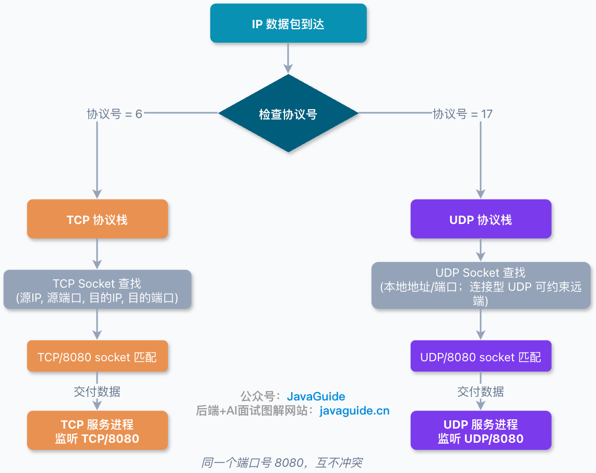
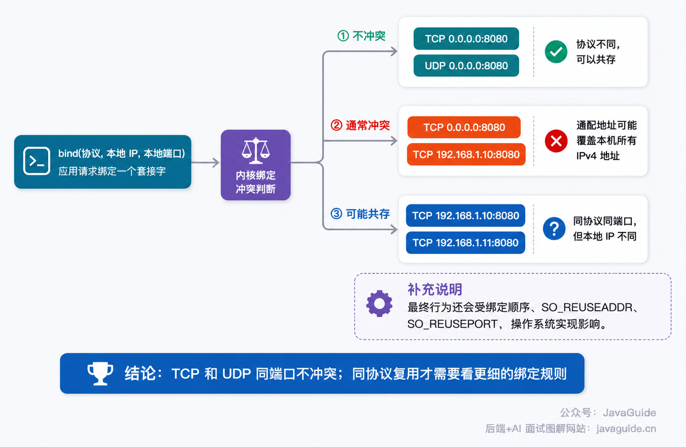
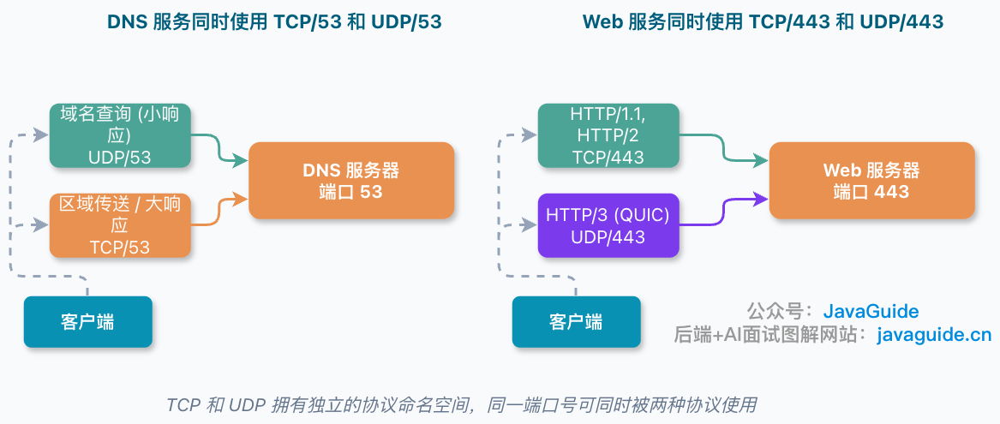
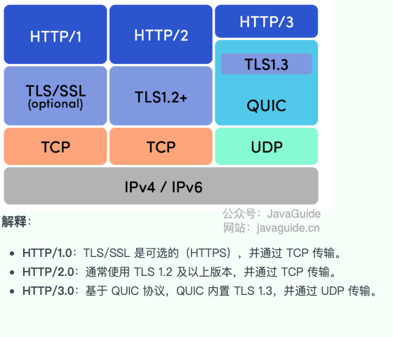

This is a common interview question: if a machine is already listening on TCP port `8080`, can it also listen on UDP port `8080`?

**Yes. TCP and UDP have separate port namespaces, so the same numeric port can be used by both protocols without a conflict.** One process can listen on `TCP/8080` while another listens on `UDP/8080`; the kernel dispatches traffic through the appropriate protocol stack.

## Which Protocol Does a Port Belong To?

A port is a transport-layer number used to identify an application process. An IP address identifies a host, while a port identifies an application on that host.

TCP and UDP headers both contain 16-bit source and destination port fields, so their port-number ranges are both `0–65535`. In APIs, port `0` usually has a special meaning, such as asking the system to assign an ephemeral port. It isn't normally used as a service's listening port.

**Having the same numeric range doesn't mean TCP and UDP share the same bindings.** Service registration, listening sockets, packet captures, firewall rules, and security-group rules generally need both the transport protocol and the port, such as `TCP/53`, `UDP/53`, `TCP/443`, or `UDP/443`.

`TCP/443` and `UDP/443` use the same number but follow different protocol paths. When an IP packet arrives, the kernel first checks the IP protocol identifier: the IPv4 Protocol field or the corresponding IPv6 Next Header field. TCP's protocol number is `6`; UDP's is `17`. The kernel dispatches the packet to the appropriate protocol stack before looking up a port.



TCP and UDP are both transport-layer protocols, but they differ in many ways:

| Feature           | TCP                                                                                                             | UDP                                                              |
| ----------------- | --------------------------------------------------------------------------------------------------------------- | ---------------------------------------------------------------- |
| **Connection**    | Connection-oriented; uses a three-way handshake to establish a connection and a four-way teardown to close it   | Connectionless; sends datagrams directly                         |
| **Reliability**   | Reliable delivery using sequence numbers, acknowledgments, retransmission, flow control, and congestion control | Best-effort delivery; packets may be lost or arrive out of order |
| **State**         | Maintains connection state                                                                                      | Doesn't maintain connection state after sending a datagram       |
| **Overhead**      | Higher due to connection setup, acknowledgments, and retransmissions                                            | Lower due to a simpler structure                                 |
| **Data model**    | Byte stream; doesn't preserve message boundaries                                                                | Datagram-oriented; preserves message boundaries                  |
| **Header size**   | 20–60 bytes                                                                                                     | Fixed at 8 bytes                                                 |
| **Communication** | Point-to-point unicast                                                                                          | Supports unicast, multicast, and broadcast                       |
| **Common uses**   | HTTP/HTTPS, FTP, SMTP, SSH                                                                                      | DNS, DHCP, SNMP, TFTP, VoIP, and video streaming                 |

Because TCP and UDP are separate transport protocols, the kernel dispatches their traffic separately before port lookup.

## Why Don't Socket Bindings Conflict?

A server usually creates a socket and binds it to a local IP address and port with `bind()`. A TCP socket and a UDP socket can usually both bind to port `8080`. When checking for a conflict, the kernel considers more than the port number; protocol and local address also matter.

A TCP connection is commonly identified by a four-tuple: source IP, source port, destination IP, and destination port. In firewalls, NAT, packet captures, and traffic investigations, the transport protocol is often added to form a five-tuple:

```text
protocol, source IP, source port, destination IP, destination port
```

Two communications can use destination port `8080` if their protocols differ. UDP has no TCP-style connection state machine, but UDP packets still include source and destination IP addresses and ports.

## Try It Yourself

You can test this with `nc`, though its options vary across operating systems. The following syntax is common in OpenBSD netcat. If a command fails, check your local options with `nc -h`.

Start a TCP listener:

```bash
nc -l 8000
```

Then start a UDP listener:

```bash
nc -u -l 8000
```

Both can run at the same time. On Linux, inspect them with:

```bash
ss -tulnp | grep 8000
```

You should see one TCP listener and one UDP listener on the same port number.

You can also verify this in code. In Java, `ServerSocket(8000)` and `DatagramSocket(8000)` can coexist. In Go, `net.Listen("tcp", ":8000")` and `net.ListenPacket("udp", ":8000")` can coexist too. Trying to listen twice with the same protocol will usually report that the address is already in use.

## When Can a Binding Conflict?



TCP and UDP don't conflict with each other, but that doesn't mean any port can be bound more than once.

Conflicts are more common **within the same protocol**. For example, if one process binds `0.0.0.0:8080`, it usually covers port `8080` on all local IPv4 addresses. Another process may then conflict when binding `TCP/8080` on a specific IPv4 address. The exact behavior depends on binding order, `SO_REUSEADDR`, `SO_REUSEPORT`, and the operating system.

Two processes may be able to bind the same port with the same protocol if they use different local IP addresses. For example, both `192.168.1.10:8080` and `192.168.1.11:8080` can be bound over TCP.

IPv6 wildcard address `[::]:8080` may also receive IPv4-mapped traffic on some systems. `IPV6_V6ONLY` affects whether that socket conflicts with an IPv4 socket. When troubleshooting, use `ss -tulnp` to inspect listeners on both `0.0.0.0:port` and `[::]:port`.

`SO_REUSEADDR` and `SO_REUSEPORT` can change binding behavior. They're used for cases such as quick restarts, multiple listener processes, and load distribution. The key point is:

**TCP and UDP can listen on the same numeric port because they use different protocols; `SO_REUSEPORT` isn't needed for that. `SO_REUSEADDR` and `SO_REUSEPORT` affect address and port reuse, quick restarts, and multiple listeners within the same protocol. Whether and how reuse works depends on the operating system and socket type.**

## Two Real-World Examples

### Why Does DNS Use Both TCP and UDP on Port 53?



DNS is a classic example. IANA registers the `domain` service for both `TCP/53` and `UDP/53`, and DNS servers commonly listen on both.

Everyday DNS queries usually use UDP because the requests and responses are small, and UDP doesn't require connection setup. DNS may use TCP when a UDP response is truncated (the DNS `TC` flag is set, often because the response exceeds the UDP size limit), during a zone transfer, or when a DNSSEC response is too large. This isn't a case where `UDP/53` prevents using `TCP/53`; DNS can use both protocols on port 53 at the same time.

### HTTPS and HTTP/3 Also Use Port 443

Traditional HTTPS usually runs HTTP/1.1 or HTTP/2 over TLS over TCP and uses `TCP/443`. HTTP/3 runs over QUIC, which is built on UDP. Browsers can learn that a server supports HTTP/3 through `Alt-Svc` or HTTPS DNS records, then try a QUIC connection. A common deployment opens both `TCP/443` and `UDP/443`.



This doesn't conflict with `TCP/443`. A server can provide both:

```text
HTTPS (HTTP/1.1, HTTP/2) -> TCP/443
HTTP/3                   -> UDP/443
```

From outside the server, both use port `443`; inside the protocol stack, they're handled separately.

In production, allowing only `TCP/443` may leave HTTP/1.1 and HTTP/2 working while HTTP/3 remains unavailable. Check `TCP/443` and `UDP/443` separately in cloud security groups, load balancers, Nginx or other gateways, and host firewalls. Then use `curl --http3` or browser developer tools to confirm that HTTP/3 is actually in use.

## A Concise Interview Answer

TCP and UDP can use the same port number because they're separate transport protocols. The kernel dispatches packets to the TCP or UDP stack based on the IP protocol identifier, then looks up sockets by their addresses and ports. Therefore, `TCP/8080` and `UDP/8080` can coexist.

Conflicts are more likely when two sockets using the same protocol bind to the same local IP address and port. That's when options such as `SO_REUSEADDR` and `SO_REUSEPORT` may matter. Two examples are DNS on both `UDP/53` and `TCP/53`, and HTTP/3 on `UDP/443` alongside traditional HTTPS on `TCP/443`.

<!-- @include: @article-footer.snippet.md -->
