These notes are based on material I collected while studying computer networking as a sophomore. Most of the content follows Xie Xiren's [_Computer Networking_, 7th edition](https://www.elias.ltd/usr/local/etc/%E8%AE%A1%E7%AE%97%E6%9C%BA%E7%BD%91%E7%BB%9C%EF%BC%88%E7%AC%AC7%E7%89%88%EF%BC%89%E8%B0%A2%E5%B8%8C%E4%BB%81.pdf).

Networking textbooks cover many connected topics: terminology, layers, links, routing, the transport layer, and the application layer. I reorganized my notes and added diagrams to make them easier to review.

This article answers four questions:

1. What do common networking terms mean?
2. How should we understand the OSI and TCP/IP models?
3. What problems do the link, network, transport, and application layers solve?
4. Which concepts are easy to confuse when reviewing computer networking?

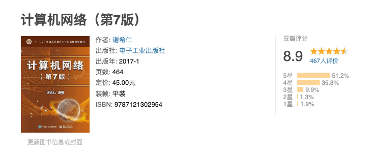

Related discussion: [What do you think of Xie Xiren's _Computer Networking_, 7th edition? (Zhihu)](https://www.zhihu.com/question/327872966).

## 1. Computer Networking Overview

### 1.1. Basic Terms

1. **Node:** A device in a network, such as a computer, hub, switch, or router.
2. **Link:** A physical connection between two nodes, with no intermediate junctions.
3. **Host:** A computer connected to the Internet.
4. **ISP (Internet Service Provider):** A company that provides Internet access or related services.

   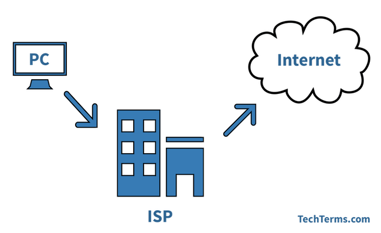

5. **IXP (Internet Exchange Point):** Allows two networks to connect directly and exchange packets without routing them through a third network.

   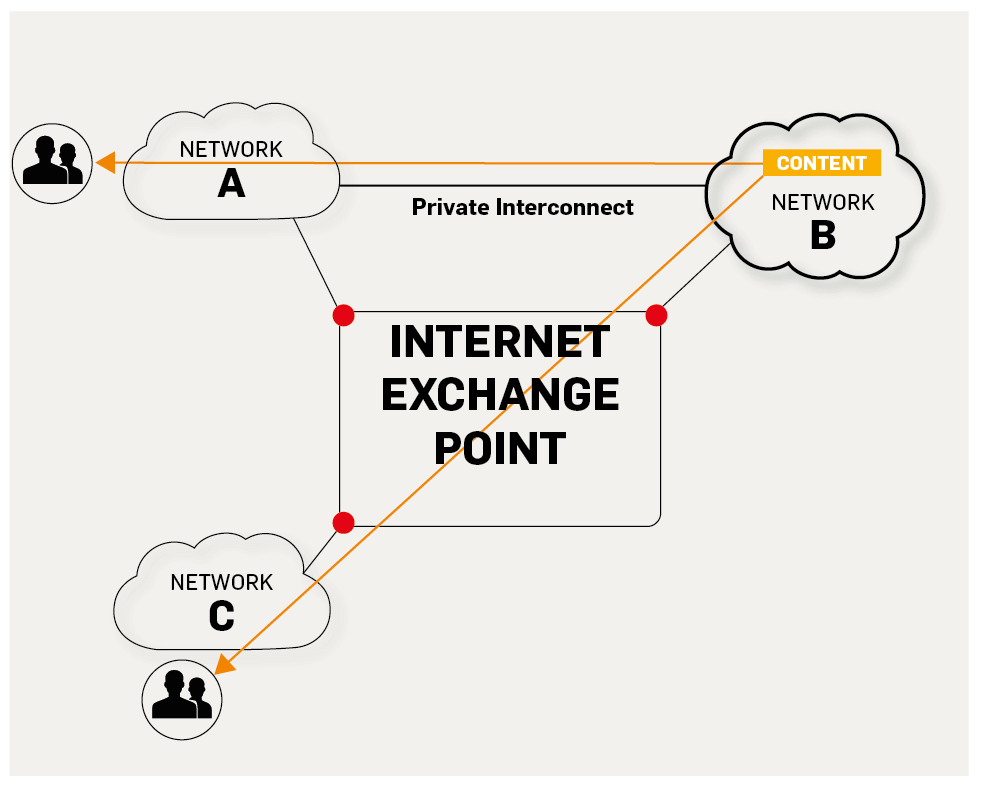

   
https://labs.ripe.net/Members/fergalc/ixp-traffic-during-stratos-skydive

6. **RFC (Request for Comments):** A collection of documents describing Internet standards, protocols, and related technical information.
7. **WAN (Wide Area Network):** Connects hosts over long distances.
8. **MAN (Metropolitan Area Network):** Connects multiple local area networks in a metropolitan area.
9. **LAN (Local Area Network):** A network in a limited area. Schools and companies often have several interconnected LANs.

   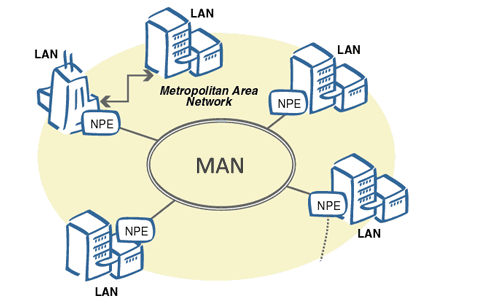

   
http://conexionesmanwman.blogspot.com/

10. **PAN (Personal Area Network):** Connects a person's devices over a short range, often using wireless technology.

    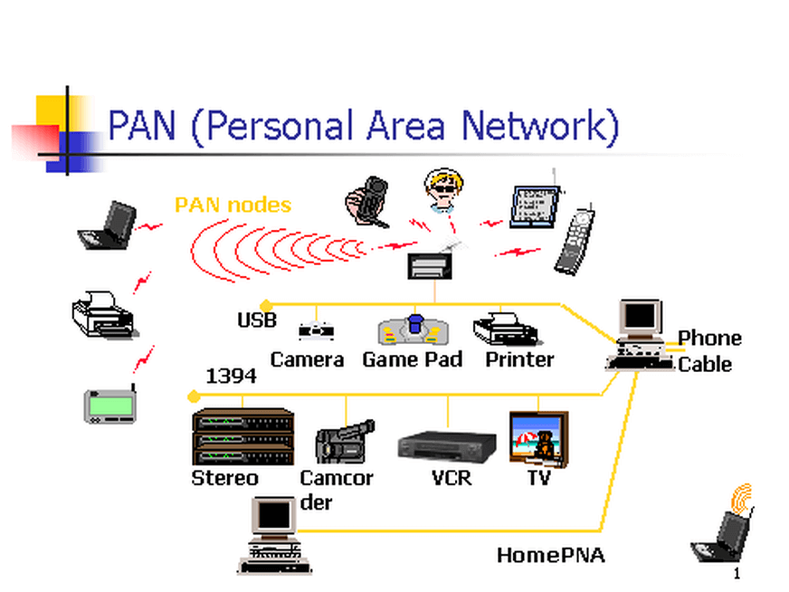

    
https://www.itrelease.com/2018/07/advantages-and-disadvantages-of-personal-area-network-pan/

11. **Packet:** A unit of data sent over the Internet. It consists of a header and payload; it is also sometimes called a data packet.
12. **Store and forward:** A router receives a packet, checks it, reads its destination address, looks up the outgoing interface, and forwards it.

    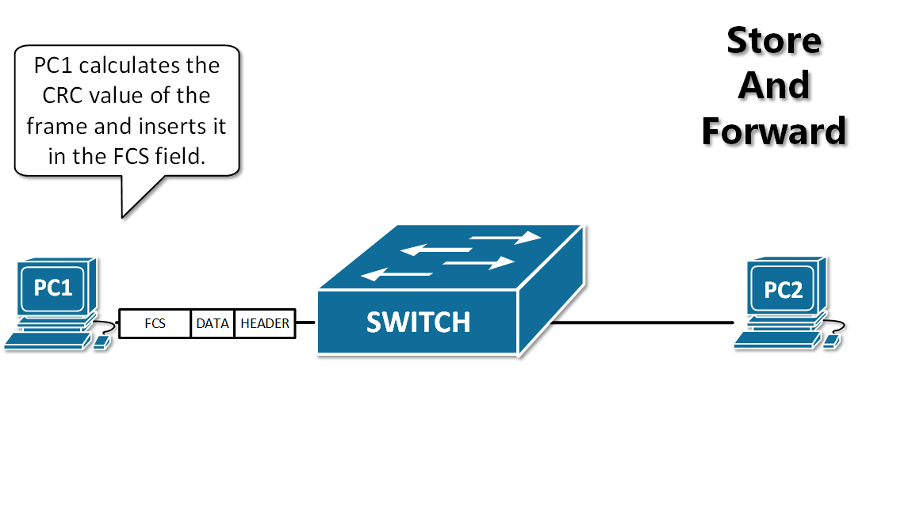

13. **Bandwidth:** The maximum data rate a network path can carry, usually measured in bits per second (bit/s).
14. **Throughput:** The amount of data that actually passes through a network, channel, or interface per unit time. Throughput is limited by the available bandwidth or link rate.

### 1.2. Key Concepts

1. **A computer network connects computers; the Internet connects networks. It is a network of networks.**
2. Lowercase **internet** is a general term for interconnected networks, which may use different communication protocols. Capitalized **Internet** refers to the global, open network of networks that uses the TCP/IP suite and evolved from ARPANET.
3. Routers are central to packet switching: they forward packets through the network core. Packet switching divides a message into smaller pieces, adds a header containing control information such as source and destination addresses, and sends the resulting packets. Each packet can be routed independently to its destination.
4. The Internet has an edge and a core. Hosts at the edge process information. The core consists of interconnected networks and routers that provide connectivity and packet forwarding.
5. Computer communication is communication between processes (running programs). Common models include client-server (C/S) and peer-to-peer (P2P).
6. A client and a server are application processes: the client requests a service, and the server provides it.
7. Networks are commonly grouped by scope as WANs, MANs, LANs, and PANs.
8. **Common performance metrics include data rate, bandwidth, throughput, delay (transmission, processing, and queuing), bandwidth-delay product, round-trip time, and channel utilization.**
9. A network protocol is a set of rules for exchanging data. The layers of a network and their protocols form its architecture.
10. **The five-layer model consists of the application, transport, network (Internet), data link, and physical layers. TCP and UDP are key transport protocols; IP is the key network-layer protocol.**

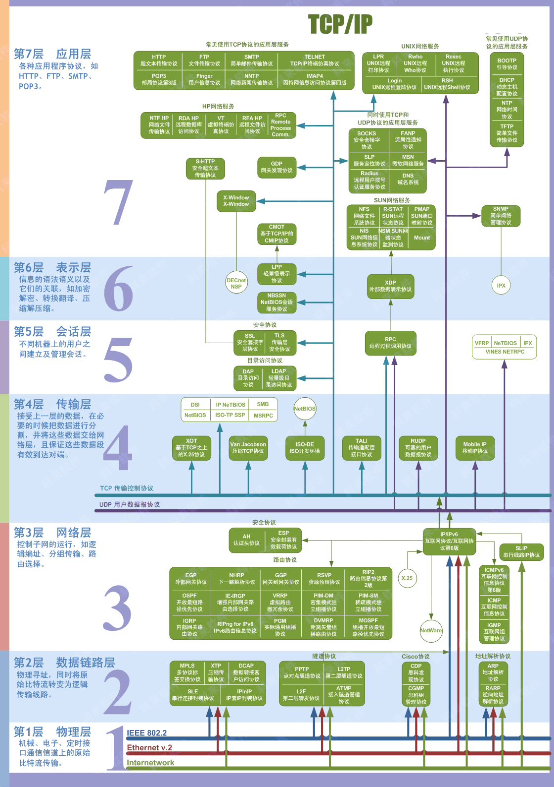

The following sections introduce the five layers: **physical, data link, network (Internet), transport, and application**.

## 2. Physical Layer

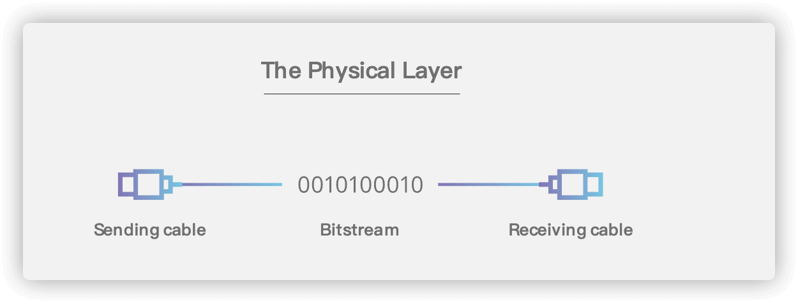

### 2.1. Basic Terms

1. **Data:** The information being carried.
2. **Signal:** The electrical or electromagnetic representation of data, suitable for transmission over a medium.
3. **Symbol:** A basic waveform representing one of several discrete values in a digital signal.
4. **Simplex:** Communication in one direction only.
5. **Half-duplex:** Both parties can send data, but not at the same time.
6. **Full-duplex:** Both parties can send and receive data at the same time.

   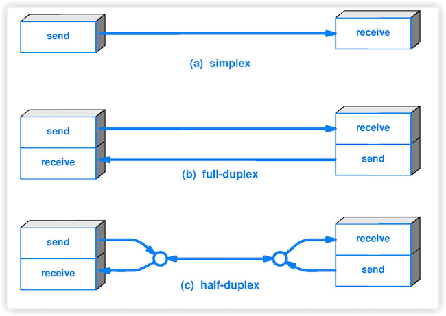

7. **Distortion:** A received signal differs from the transmitted signal, for example because of attenuation or noise. The degree of distortion depends on the symbol rate, transmission distance, interference, and medium quality.

   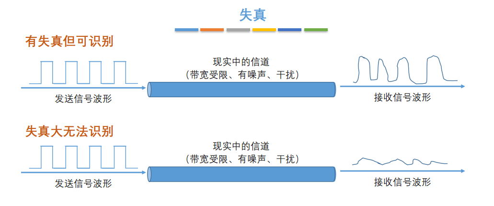

8. **Nyquist criterion:** A channel has an upper limit on its symbol rate. Exceeding it causes severe intersymbol interference, making symbols difficult for the receiver to distinguish.
9. **Shannon theorem:** A bandwidth-limited channel with noise has a maximum information rate for reliable transmission.
10. **Baseband signal:** An unmodulated signal from a source; it can be digital or analog.
11. **Bandpass signal:** A baseband signal shifted to a higher frequency range by modulation so it can pass through a channel.
12. **Modulation:** Processing source information and applying it to a carrier so it can be transmitted over a channel.
13. **Signal-to-noise ratio (SNR):** The ratio of average signal power to average noise power, written as S/N. In decibels, SNR = 10 × log10(S/N).
14. **Channel multiplexing:** Sharing one channel among multiple users, not necessarily at the same time.

    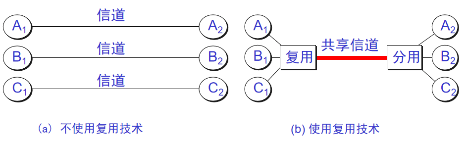

15. **Bit rate:** The number of bits transmitted per second.
16. **Baud rate:** The number of changes in a carrier's modulation state per second.
17. **Multiplexing:** A method for sharing a communication channel.
18. **ADSL (Asymmetric Digital Subscriber Line):** A DSL technology with asymmetric upstream and downstream rates.
19. **HFC (Hybrid Fiber-Coaxial):** A residential broadband access network built on cable television infrastructure.

### 2.2. Key Concepts

1. **The physical layer defines properties of the interface to the transmission medium, including mechanical, electrical, functional, and procedural characteristics.**
2. A data communication system has a source, a transmission system, and a destination. The source includes the origin and a transmitter; the destination includes a receiver and an endpoint.
3. **Communication carries messages such as speech, text, and images. Data represents a message, and signals are the electrical or electromagnetic form of that data.**
4. Signals can be analog (continuous) or digital (discrete). A basic waveform that represents one discrete value in a digital signal is called a symbol.
5. Communication can be simplex, half-duplex, or full-duplex, depending on whether data flows in one direction, alternates directions, or flows in both directions at once.
6. A source produces a baseband signal. Modulation adapts a signal for transmission over a channel. Basic bandpass methods include amplitude, frequency, and phase modulation; quadrature amplitude modulation is a more complex method.
7. Better media or modulation can increase data rates, but every channel has limits.
8. Transmission media are guided (twisted-pair cable, coaxial cable, and fiber) or unguided (radio, infrared, and free-space optical communication).
9. Passive optical networks (PONs) are widely used between fiber backbones and subscribers. They do not require powered equipment in the distribution network, reducing operating and management costs. Common types include EPON and GPON.

### 2.3. Additional Notes

#### 2.3.1. What Does the Physical Layer Do?

The physical layer **transmits a bit stream transparently**. It also defines the interface to the medium: mechanical properties such as connector shape and size, electrical properties such as voltage ranges, functional properties that define what voltage levels mean, and procedural properties that specify event sequences.

**The physical layer concerns how to transmit bits over a medium, not which specific medium is used.** Networks use many types of hardware, media, and communication methods. The physical layer hides as many of these differences as possible from the data link layer, allowing it to focus on its own protocols and services.

#### 2.3.2. Common Channel Multiplexing Techniques

1. **Frequency-division multiplexing (FDM):** Users share the channel at the same time on different frequency bands.
2. **Time-division multiplexing (TDM):** Users take turns using the same frequency band.
3. **Statistical TDM:** An improved form of TDM that can use channel capacity more efficiently.
4. **Code-division multiplexing (CDM):** Users transmit with distinct codes that allow their signals to be separated. The signals are resistant to interference and have a noise-like spectrum.
5. **Wavelength-division multiplexing (WDM):** Frequency-division multiplexing for light.

#### 2.3.3. Common Broadband Access Technologies: ADSL and FTTx

Common broadband access technologies include ADSL, which upgrades existing copper telephone lines without requiring new wiring; VDSL, a faster DSL variant; HFC, which uses cable television infrastructure; and FTTx, meaning fiber to a point such as the home, building, or cabinet.

## 3. Data Link Layer

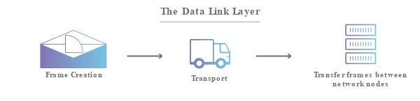

### 3.1. Basic Terms

1. **Link:** A physical connection between one node and an adjacent node.
2. **Data link:** A link together with the hardware (such as a network adapter) and software (such as protocol implementations) needed to control data transfer.
3. **CRC (Cyclic Redundancy Check):** A widely used data-link error-detection technique.
4. **Frame:** A data-link-layer transmission unit consisting of a header and the encapsulated payload.
5. **MTU (Maximum Transmission Unit):** The maximum size of a packet payload that a link can carry.
6. **BER (Bit Error Rate):** The ratio of incorrectly transmitted bits to the total number of bits over a period.
7. **PPP (Point-to-Point Protocol):** A data-link protocol used for communication between a user's computer and an ISP. The diagram below shows a PPP frame:
   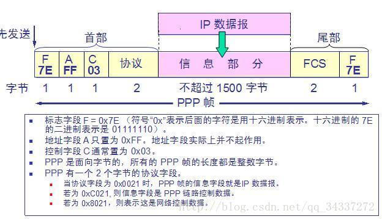
8. **MAC address (Media Access Control):** Also called a physical or hardware address, it identifies a network interface on a local link. In the OSI model, IP addresses belong to the network layer and MAC addresses to the data link layer. A host may have multiple MAC addresses, one for each interface. A name identifies a resource, an address indicates where it is, and a route describes how to reach it.

   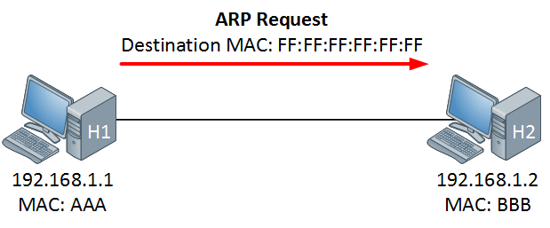

9. **Bridge:** A data-link device that connects two or more LAN segments.
10. **Switch:** A device that forwards frames between ports. A data-link switch is essentially a multiport bridge.

### 3.2. Key Concepts

1. A link is a physical connection between adjacent nodes. A data link adds the hardware and software needed to control communication.
2. The data link layer mainly uses **point-to-point** and **broadcast** channels.
3. The data-link protocol data unit is a frame. Its three basic tasks are **framing**, **transparent transmission**, and **error detection**.
4. **CRC** detects errors; the **Frame Check Sequence (FCS)** is the redundant value added to a frame.
5. **PPP** is a common data-link protocol. It is simple, detects but does not correct errors, does not use sequence numbers or flow control, and supports multiple network-layer protocols.
6. PPPoE is a data-link protocol used by hosts to access broadband services.
7. **LANs support broadcast, make network expansion easier, and can improve reliability, availability, and resilience.**
8. A network adapter (network interface card or NIC) connects a computer to a LAN. **The adapter stores its hardware address in ROM.**
9. Ethernet is connectionless: frames are not numbered, and the sender does not require acknowledgments. A destination that receives a corrupted frame discards it.
10. Traditional shared Ethernet uses **CSMA/CD (Carrier Sense Multiple Access with Collision Detection)**: listen before sending, monitor while sending, stop if a collision is detected, then retry after a random backoff. Stations share the Ethernet channel equally.
11. An Ethernet adapter filters frames and accepts the unicast, broadcast, or multicast frames intended for it.
12. A hub can extend Ethernet at the physical layer; the extended network remains one collision domain.

### 3.3. Additional Notes

1. The characteristics of point-to-point and broadcast channels and their protocols, including PPP and CSMA/CD.
2. The data link layer's three basic tasks: **framing**, **transparent transmission**, and **error detection**.
3. Ethernet MAC addresses.
4. The roles and use cases of adapters, repeaters, hubs, bridges, and Ethernet switches.

## 4. Network Layer

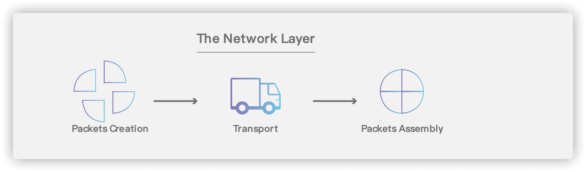

### 4.1. Basic Terms

1. **Virtual circuit:** A logical bidirectional channel between endpoints. Packets follow this logical path using store-and-forward; no dedicated physical connection is necessarily established.
2. **IP (Internet Protocol):** One of the main protocols in the TCP/IP suite and the core of its Internet layer. Related protocols include ARP, RARP, ICMP, and IGMP.
3. **ARP (Address Resolution Protocol):** Resolves an IP address to a hardware address on a local network.
4. **ICMP (Internet Control Message Protocol):** Allows hosts and routers to report errors and other network conditions.
5. **Subnet mask:** Identifies which bits of an IP address represent the network and which represent the host. It is used together with an IP address.
6. **CIDR (Classless Inter-Domain Routing):** Replaces class-based addressing with network prefixes of varying lengths.
7. **Default route:** The route a router uses when its routing table has no more specific route to the destination. A default route can reduce routing-table size and lookup work.
8. **Routing algorithm:** A core part of a routing protocol. The Internet uses adaptive, hierarchical routing protocols.

### 4.2. Key Concepts

1. **The TCP/IP network layer provides a simple, connectionless, best-effort datagram service. It does not guarantee quality of service or delivery time; packets may be corrupted, lost, duplicated, or reordered. The transport layer provides reliability between processes.**
2. Internet delivery is either direct within the local network or indirect through one or more routers. The final delivery to a host is direct on its local network.
3. Classful IP addresses have a network field and a host field. Addressing is hierarchical: address authorities assign network numbers, and organizations assign host numbers within their networks. A router connects at least two networks and therefore has at least two IP addresses.
4. An IP datagram has a header and payload. The IPv4 header has a 20-byte fixed portion with fields such as source address, destination address, and total length, followed by optional fields. The Time to Live (TTL) limits how many routers a datagram can pass through and prevents it from circulating indefinitely.
5. **ARP resolves IP addresses to hardware addresses. An ARP cache reduces network traffic because a host can reuse a recently learned hardware address instead of broadcasting another ARP request.**
6. CIDR helps use IP address space more efficiently. CIDR notation appends a slash and prefix length to an address, such as `/24`. Addresses with the same prefix form a CIDR block, which is used for routing and allocation.
7. ICMP is a network-layer protocol carried inside IP datagrams. It is not used to provide reliable delivery; it lets hosts and routers report errors and other conditions. ICMP messages include error-reporting and query messages.
8. **IPv6 addresses IPv4 exhaustion with a much larger address space.** It uses 128-bit addresses and has a flexible header format, revised options, support for autoconfiguration, and 8-byte header alignment.
9. **A virtual private network (VPN) uses the public Internet to connect an organization's private networks. VPNs use private addresses internally and generally encrypt traffic sent over the Internet. A VPN gateway needs a globally reachable address to communicate with another gateway.**
10. MPLS supports connection-oriented quality of service, traffic engineering, load balancing, and VPNs. An ingress node adds a fixed-length label to each IP datagram; label-switching routers forward packets based on that label, often using hardware for faster forwarding.

## 5. Transport Layer

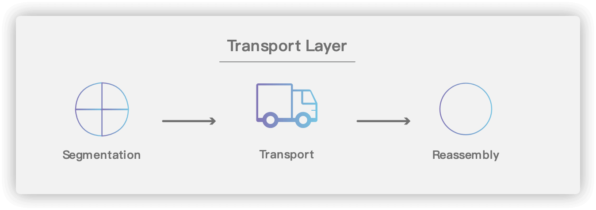

### 5.1. Basic Terms

1. **Process:** A running program.
2. **Communication between application processes:** Data exchange between processes on different hosts. The true endpoints are the processes, not the hosts.
3. **Transport-layer multiplexing and demultiplexing:** Multiplexing lets processes share a transport protocol at the sender. Demultiplexing delivers incoming data to the correct application process at the receiver.
4. **TCP (Transmission Control Protocol).**
5. **UDP (User Datagram Protocol).**

   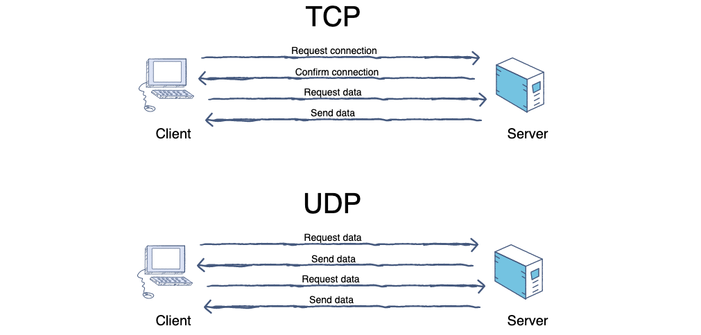

6. **Port:** Identifies the application process on a host that should receive data. A port number is also called a protocol port number.
7. **Stop-and-wait protocol:** The sender transmits one packet and waits for an acknowledgment before sending the next.
8. **Flow control:** Limits the sender's rate so the receiver can keep up.
9. **Congestion control:** Prevents too much data from entering the network and overloading routers or links. It assumes the network can handle the existing load.

### 5.2. Key Concepts

1. **The transport layer provides logical communication between application processes. It hides network details such as topology and routing from applications, making the processes appear to have an end-to-end logical channel.**
2. **The network layer provides logical communication between hosts; the transport layer provides it between application processes.**
3. The main transport protocols are UDP and TCP. In OSI terminology, the data exchanged by peer transport entities is a Transport Protocol Data Unit (TPDU). In TCP/IP, these are called TCP segments and UDP datagrams.
4. **UDP does not require connection setup or acknowledgments. It does not provide reliable delivery, but can be efficient for some applications. TCP is connection-oriented: it establishes a connection before transferring data and releases it afterward. TCP does not support broadcast or multicast. Reliability and connection management add overhead, including acknowledgments, flow control, timers, and connection state.**
5. A hardware port connects physical devices; a software port identifies an application endpoint to the transport layer. TCP and UDP headers contain source and destination port numbers. The transport layer uses the destination port to deliver data from IP to the appropriate application process.
6. Transport ports are 16-bit numbers and have local meaning on each host. The same port number on different computers does not identify a shared endpoint. TCP and UDP deliver data to the destination process through the appropriate port.
7. Server ports include well-known ports (`0–1023`) and registered ports (`1024–49151`); clients typically use ephemeral ports (`49152–65535`).
8. **UDP is connectionless, best-effort, message-oriented, has no built-in congestion control, supports unicast and multicast/broadcast communication patterns, and has a small header with four fields: source port, destination port, length, and checksum.**
9. **TCP is connection-oriented, provides reliable delivery and full-duplex communication, and presents data as a byte stream. Each TCP connection is point-to-point.**
10. **A TCP endpoint is identified by an IP address and port number, often called a socket. A TCP connection is uniquely identified by the endpoints at both ends.**
11. Stop-and-wait supports reliable delivery by making the sender wait for an acknowledgment after each packet.
12. Pipelining improves utilization by allowing the sender to transmit multiple packets before waiting for acknowledgments.
13. In stop-and-wait, the sender retransmits a packet if its acknowledgment does not arrive before a timeout. The timeout should exceed the expected round-trip time. This is an Automatic Repeat reQuest (ARQ) mechanism. Duplicate packets are discarded, but acknowledged again. Continuous ARQ uses a send window to transmit multiple packets and often uses cumulative acknowledgments for in-order data.
14. A TCP header has a 20-byte fixed portion and up to 40 bytes of options. Padding aligns the header to a 4-byte boundary, so the total header length is 20–60 bytes.
15. **TCP uses a sliding window. The sequence numbers in the send window indicate which data may be sent. As acknowledgments arrive, the window advances. Flow control limits the sender so the receiver can keep up and avoid buffer overflow.**
16. Congestion occurs when demand for a network resource exceeds its capacity. Congestion control prevents too much data from entering the network and overloading routers or links. It is a network-wide process, unlike flow control, which is end-to-end and regulates the sender to match the receiver's capacity.
17. **For congestion control, TCP maintains a congestion window (`cwnd`) that changes with network conditions. The effective send window is limited by the smaller of the congestion window and the receiver's advertised window.**
18. **TCP congestion control commonly uses slow start, congestion avoidance, fast retransmit, and fast recovery. Routers can also use packet-dropping strategies such as Active Queue Management (AQM).**
19. A transport connection has three phases: establishment, data transfer, and release.
20. **The application process that initiates a TCP connection is the client; the process that waits for a connection is the server. TCP uses a three-way handshake: the server acknowledges the client's request, and the client acknowledges the server's response.**
21. TCP connection release usually uses four segments. Either side can initiate release. After the first side's FIN is acknowledged, the connection is half-closed; the other side can send remaining data before sending its own FIN.

### 5.3. Additional Review Topics

Review these topics in particular:

1. Ports and sockets.
2. Differences between UDP and TCP and their use cases.
3. Reliable delivery over an unreliable network, including stop-and-wait and ARQ.
4. TCP sliding windows, flow control, congestion control, and connection management.
5. The TCP three-way handshake and four-way teardown.

## 6. Application Layer

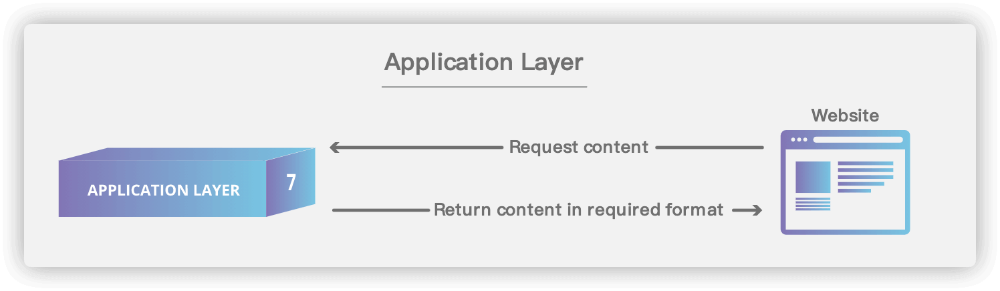

### 6.1. Basic Terms

1. **DNS (Domain Name System):** Converts human-readable domain names such as `www.baidu.com` into IP addresses such as `220.181.38.148`. It is like an Internet directory.

   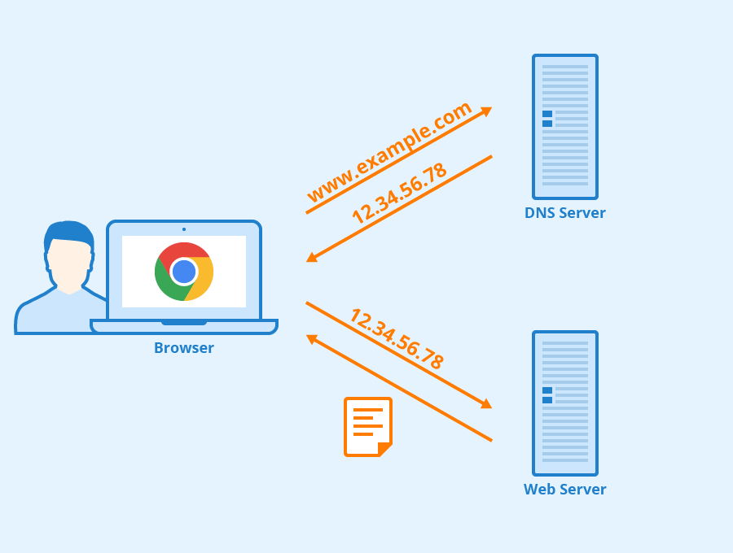

   
https://www.seobility.net/en/wiki/HTTP_headers

2. **FTP (File Transfer Protocol):** Transfers files between a client and a server. Downloading copies a file from a remote host to the local computer; uploading copies it in the opposite direction. FTP clients on different operating systems follow the same protocol.

   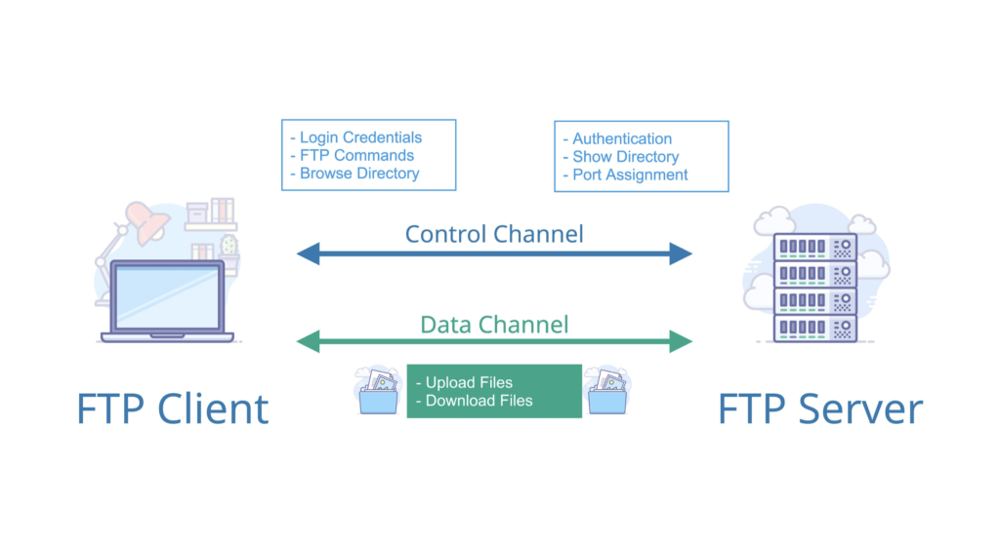

3. **TFTP (Trivial File Transfer Protocol):** A simple, low-overhead protocol for transferring files between clients and servers. It uses port `69`.
4. **Telnet:** A TCP/IP protocol for remote terminal access. A user runs a Telnet client, connects to a server, and enters commands that run on the remote host. Telnet is insecure because it does not encrypt the session; use SSH instead.
5. **WWW (World Wide Web):** A system of interlinked hypertext documents and other resources accessed over the Internet. Web clients, commonly browsers, request resources from web servers using protocols such as HTTP. Resources are identified by URIs. The World Wide Web Consortium (W3C), founded at MIT in 1994 by Tim Berners-Lee, develops Web standards. The Web is one service that runs over the Internet, not the Internet itself.
6. **A simplified view of how the Web works:**

   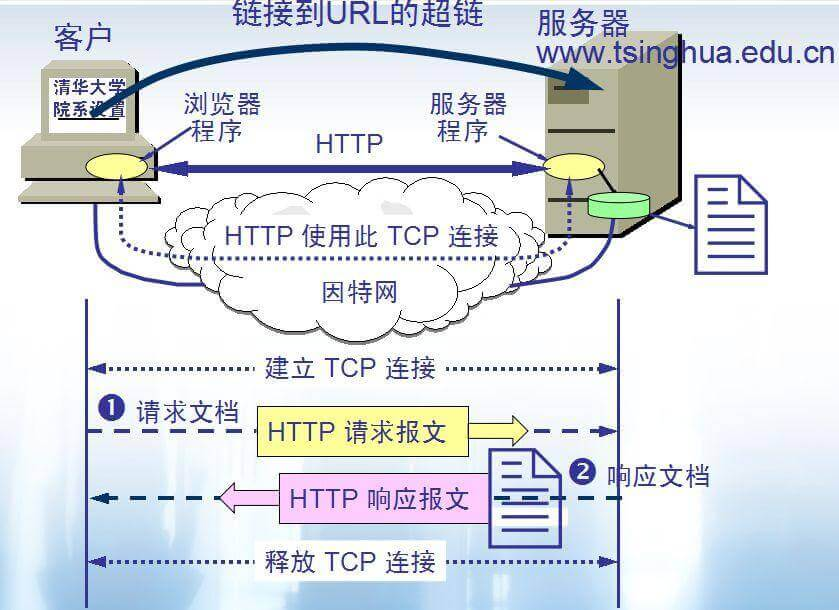

7. **URL (Uniform Resource Locator):** A compact representation of a resource's location and access method. A URL contains information about where a resource is and how a browser should access it.
8. **HTTP (Hypertext Transfer Protocol):** A widely used protocol for communication between Web clients and servers. It was designed to publish and retrieve HTML pages. HTTP defines the message format used by clients and servers. The diagram below shows a basic request-response exchange:

   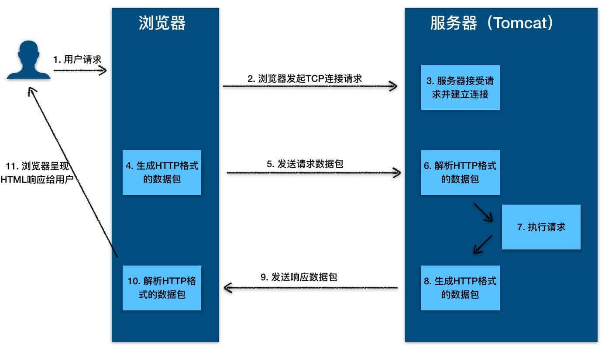

9. **Proxy server:** A network intermediary that can act as a Web cache. It stores recent requests and responses locally. If a new request matches a cached one, the proxy can return the stored response instead of fetching the resource again. Proxies can be deployed at the client, server, or an intermediate point.
10. **SMTP (Simple Mail Transfer Protocol):** A protocol for sending and relaying email from a sender to a recipient's mail server. SMTP servers follow this protocol to deliver or forward messages.

    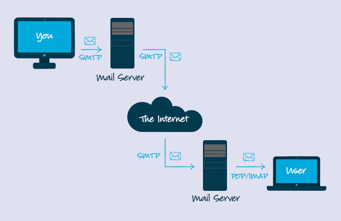

    
https://www.campaignmonitor.com/resources/knowledge-base/what-is-the-code-that-makes-bcc-or-cc-operate-in-an-email/

11. **Search engine:** A system that collects, organizes, and processes information from the Internet, then presents relevant results to users. Types include full-text, directory, metasearch, vertical, and portal search engines.
12. **Vertical search engine:** Focuses on a specific industry, audience, or need. It extracts and organizes information from a particular domain, returning more focused results than a general search engine.
13. **Full-text index:** An indexing technique used by search engines to find terms efficiently across large collections of documents. It is often implemented with an inverted index.
14. **Directory index:** Organizes websites into categories so users can browse a hierarchy or search by keyword.

### 6.2. Key Concepts

1. FTP uses TCP and a client-server model. An FTP server can serve multiple clients. File transfer uses two parallel TCP connections: a control connection and a data connection.
2. Web clients and servers use HTTP. Traditionally, HTTP uses TCP for reliable transport, but HTTP itself is stateless. HTTP/1.1 supports persistent connections, with pipelined and non-pipelined request modes.
3. Email is delivered to a recipient's mail server and stored in the recipient's mailbox, where it can be retrieved later.
4. An email system has three main components: user agents, mail servers, and mail protocols. SMTP is commonly used to send mail; POP3 and IMAP are used to retrieve it.

### 6.3. Additional Review Topics

Review these topics in particular:

1. Common application-layer protocols, especially HTTP.
2. DNS and how a domain name resolves to an IP address.
3. The steps involved in loading a website.
4. System calls and application programming interfaces.

<!-- @include: @article-footer.snippet.md -->
