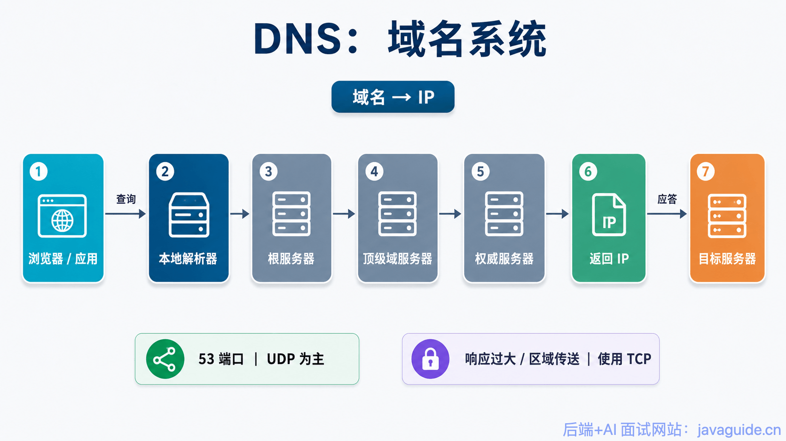
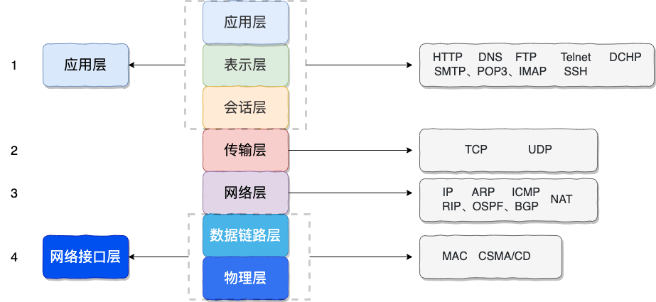
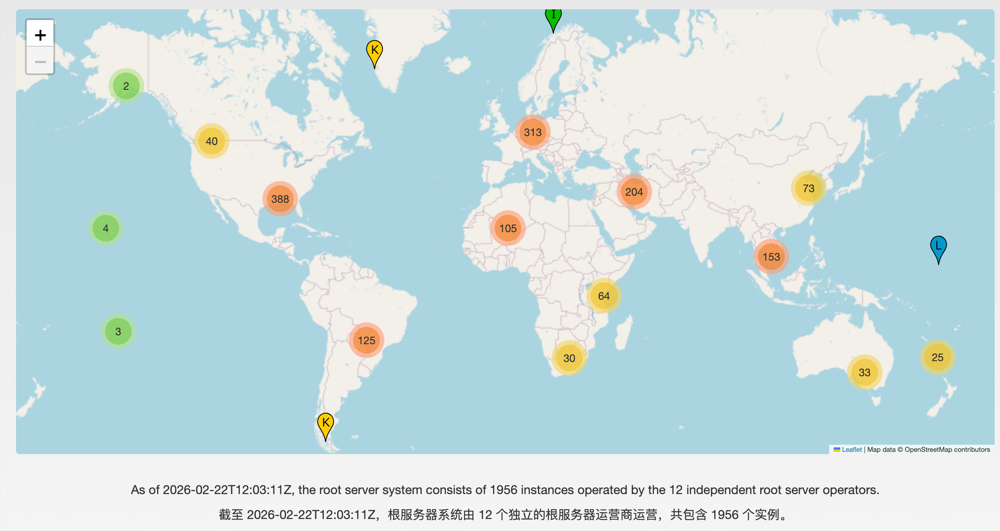
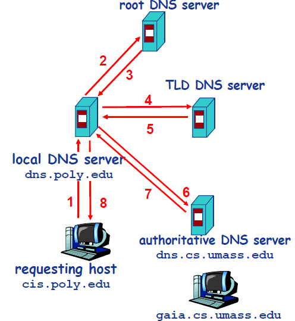
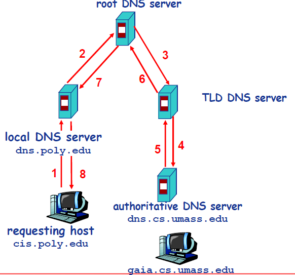
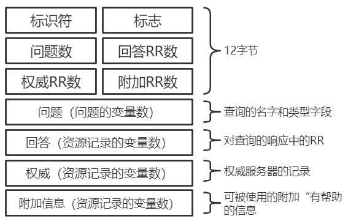
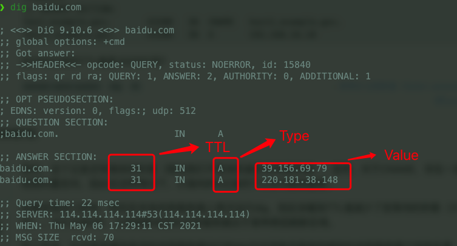
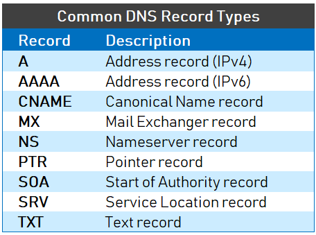

After you enter a domain name in a browser, DNS resolution usually happens before the browser sends an HTTP request.

DNS maps **domain names to IP addresses**. It may look like a simple translation, but it relies on a hierarchy of servers, local caches, recursive and iterative queries, and both UDP and TCP.

This article answers four questions:

1. Why is DNS organized hierarchically?
2. What happens during a complete domain name lookup?
3. How do recursive and iterative queries differ?
4. Why does DNS usually use UDP, and when does it use TCP instead?



In some cases, a browser can find a domain's IP address without using DNS. The operating system maintains a local `hosts` file, which the system resolver checks first. If the file contains a matching entry, the resolver can use that address directly. Otherwise, it queries DNS.

DNS uses a distributed, hierarchical database. **DNS is an application-layer protocol that usually uses UDP on port 53.** It may use TCP when a response exceeds the traditional UDP message size limit of 512 bytes (EDNS(0) allows larger messages) or for a zone transfer, which needs reliable delivery.



## DNS Servers

DNS servers can be described from two perspectives. The authoritative hierarchy includes root servers, top-level domain servers, and authoritative servers for specific zones. Query-side roles include stub resolvers, recursive resolvers, and forwarders. One server or software package can perform more than one role, so these categories aren't mutually exclusive or exhaustive server types.

- **Root DNS servers** refer resolvers to top-level domain servers.
- **Top-level domain (TLD) servers** handle suffixes such as `com`, `org`, `net`, and `edu`. Countries and regions also have TLDs, such as `uk`, `fr`, and `ca`. TLD servers usually refer resolvers to the authoritative servers for a domain.
- **Authoritative DNS servers** store data for one or more DNS zones and provide authoritative answers for names in those zones.
- **Recursive resolvers** are commonly provided by a local network, an ISP, or a public DNS service. A resolver checks its cache and, if needed, queries root, TLD, and authoritative servers. This is a query-side role, not a layer of the authoritative DNS hierarchy.

**Are there really only 13 root servers in the world?** This is a long-standing misconception. Outdated articles still claim that there are only 13 root servers worldwide and that they are all controlled by the United States.

**That isn't the case.**

The root server system has 13 named identities, from `a.root-servers.net` to `m.root-servers.net`, operated by 12 independent organizations. The number is related to early DNS message-size limits when DNS used UDP. It doesn't mean that only 13 physical servers exist worldwide.

Each identity can be deployed at multiple physical locations using **IP anycast**. BGP routing directs queries to a suitable instance along the network path; it doesn't necessarily choose the geographically closest one. The number and locations of instances change over time. See the live data at [Root-Servers.org](https://root-servers.org/).



## How DNS Resolution Works

The following example combines two query styles:

- **Iterative queries**
- **Recursive queries**

In a common setup, the query from the requesting host to its local DNS resolver is recursive, while the resolver's queries to other servers are iterative.



Suppose host `cis.poly.edu` needs the IP address of `gaia.cs.umass.edu`. Its local DNS server is `dns.poly.edu`, and the authoritative DNS server for `gaia.cs.umass.edu` is `dns.cs.umass.edu`.

1. Host `cis.poly.edu` sends a DNS query for `gaia.cs.umass.edu` to its local DNS server, `dns.poly.edu`.
2. The local server checks its cache. It has no answer and doesn't know where to find the address, so it queries a root server.
3. The root server sees that the name uses the `edu` TLD and refers the local server to an `edu` TLD server.
4. The local server queries the `edu` TLD server for the address of `gaia.cs.umass.edu`.
5. The TLD server doesn't have that address, but sees the `umass.edu` zone and refers the local server to its authoritative server.
6. The local server queries the authoritative server `dns.cs.umass.edu`.
7. The authoritative server has a record for `gaia.cs.umass.edu` and returns its IP address to the local server.
8. The local server returns the IP address to the requesting host.

A fully recursive query is another possible setup. The steps are similar, but the server contacted by the client performs the resolution on the client's behalf.



Recursive resolvers cache referrals and resource records from previous queries. As long as a cached entry remains within its TTL, a resolver can contact a known TLD or authoritative server directly instead of starting at a root server. This shortens lookup paths and reduces load on upstream servers.

## DNS Message Format

DNS messages use the following format:



Queries and responses have the same overall structure.

- **Identifier:** A 16-bit value that identifies the query. The response copies it so the client can match the response to its request.
- **Flags:** These include a 1-bit query/response flag (`0` for a query, `1` for a response), an authoritative-answer flag, a recursion-desired flag, and a recursion-available flag. The authoritative flag is set in a response when the responding DNS server is authoritative for the requested name. The recursion-desired flag asks the server to perform recursive resolution; the recursion-available flag in a response indicates whether the server supports recursion.
- **Question, Answer, Authority, and Additional counts:** These fields indicate how many entries appear in each of the four following sections.
- **Question section:** The host name being queried and the query type.
- **Answer section:** Resource records answering the original query. **A response can contain multiple records here, so one host name can have multiple IP addresses.**
- **Authority section:** Records pointing to other authoritative servers.
- **Additional section:** Other useful records.

## DNS Records

When a DNS server responds to a query, it looks up entries in its database called **resource records (RRs)**. A resource record contains four fields: `Name`, `Value`, `Type`, and `TTL`.



`TTL` is the record's lifetime and determines when it should be removed from a cache.

The values of `Name` and `Value` depend on `Type`:



- For `Type=A`, `Name` is a host name and `Value` is its IP address. An A record maps a host name to an IPv4 address.
- `Type=AAAA` works similarly, but maps a host name to an IPv6 address.
- For `Type=CNAME` (Canonical Name), `Value` is the canonical host name corresponding to the alias in `Name`. A CNAME record maps one host name to another. It can create an alias for a name that has an A record; an example follows.
- For `Type=NS`, `Name` is a domain and `Value` is the host name of an authoritative DNS server for that domain. TLD servers commonly publish these records.
- For `Type=MX`, `Value` is the canonical host name of a mail server associated with the alias in `Name`. A mail server can share an alias with other servers when an MX record is used. Query an MX record to find the mail server's canonical name; query a CNAME record for the canonical name of another server.

A `CNAME` record points to another domain name, not an IP address. For example, consider this DNS zone:

```plain
NAME                    TYPE   VALUE
--------------------------------------------------
bar.example.com.        CNAME  foo.example.com.
foo.example.com.        A      192.0.2.23
```

When a user queries `bar.example.com`, DNS follows the CNAME and returns the IP address for `foo.example.com`.

## References

- [Types of DNS Servers](https://www.cloudflare.com/learning/dns/dns-server-types/)
- [DNS Message Resource Record Field Formats](http://www.tcpipguide.com/free/t_DNSMessageResourceRecordFieldFormats-2.htm)
- [Understanding Different Types of Records in a DNS Server](https://www.mustbegeek.com/understanding-different-types-of-record-in-dns-server/)

<!-- @include: @article-footer.snippet.md -->
