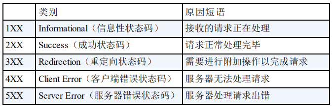
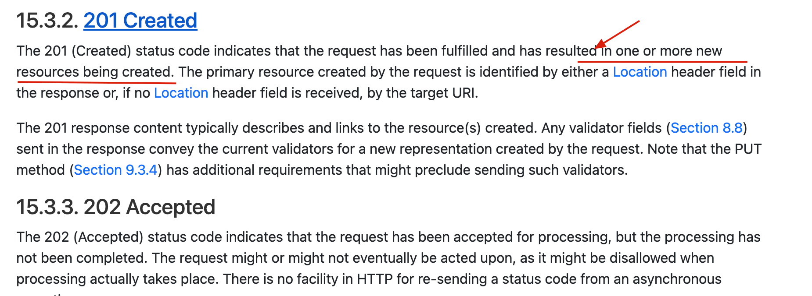

An HTTP status code summarizes how the server handled a request. It tells you whether the request succeeded, was redirected, failed because of the client, or failed because of the server.

Some codes are easy to confuse, including 301 and 302, 401 and 403, 500 and 502, and 201 and 204.

This article answers four questions:

1. What kinds of outcomes do the 1xx, 2xx, 3xx, 4xx, and 5xx classes represent?
2. How do successful responses such as 200, 201, and 204 differ?
3. How should you interpret common client errors such as 400, 401, 403, and 404?
4. What do common server errors such as 500, 502, 503, and 504 usually mean?

### 1xx Informational

You probably won't encounter 1xx responses often in everyday development, so we'll skip them here.

### 2xx Success

- **200 OK:** The request was handled successfully. For example, the server returns the requested user data. This is the HTTP status code you'll see most often.
- **201 Created:** The request succeeded and created one or more resources on the server. For example, a POST request creates a user.
- **202 Accepted:** The server accepted the request but hasn't finished processing it. For example, a report-generation or spreadsheet-export request may take a long time to complete.
- **204 No Content:** The server handled the request successfully and has no response content to return. For example, a server may successfully delete a user without returning a response body.

🐛 **Correction** (see [issue #2458](https://github.com/Snailclimb/JavaGuide/issues/2458)): More precisely, `201 Created` indicates that one or more resources were created. See [RFC 9110](https://httpwg.org/specs/rfc9110.html#status.201).

It's worth taking a closer look at `204`, which many developers don't encounter often.

[RFC 2616's description of 204](https://tools.ietf.org/html/rfc2616#section-10.2.5) says:

> The server has fulfilled the request but does not need to return an
> entity-body, and might want to return updated metainformation. The
> response MAY include new or updated metainformation in the form of
> entity-headers, which if present SHOULD be associated with the
> requested variant.
>
> If the client is a user agent, it SHOULD NOT change its document view
> from that which caused the request to be sent. This response is
> primarily intended to allow input for actions to take place without
> causing a change to the user agent's active document view, although
> any new or updated metainformation SHOULD be applied to the document
> currently in the user agent's active view.
>
> The 204 response MUST NOT include a message-body, and thus is always
> terminated by the first empty line after the header fields.

In short, `204` is useful when the client only needs to know whether an action succeeded. The response communicates an outcome without returning a body.

### 3xx Redirection

- **301 Moved Permanently:** The resource has moved permanently, such as when a website changes its URL.
- **302 Found:** The resource is temporarily available at another URL.

### 4xx Client Error

- **400 Bad Request:** The request is invalid, perhaps because its parameters are malformed or its method isn't supported for that request.
- **401 Unauthorized:** The client hasn't authenticated but is requesting a resource that requires authentication.
- **403 Forbidden:** The server understood the request but refuses to fulfill it, often because the client isn't allowed to access the resource.
- **404 Not Found:** The server couldn't find the requested resource, such as a user record that doesn't exist.
- **409 Conflict:** The request conflicts with the current state of the resource and can't be processed as submitted.

### 5xx Server Error

- **500 Internal Server Error:** The server encountered an unexpected condition, such as an unhandled exception.
- **502 Bad Gateway:** A gateway or proxy received an invalid response from an upstream server.

### References

- <https://www.restapitutorial.com/httpstatuscodes.html>
- <https://developer.mozilla.org/en-US/docs/Web/HTTP/Status>
- <https://en.wikipedia.org/wiki/List_of_HTTP_status_codes>
- <https://segmentfault.com/a/1190000018264501>

<!-- @include: @article-footer.snippet.md -->
