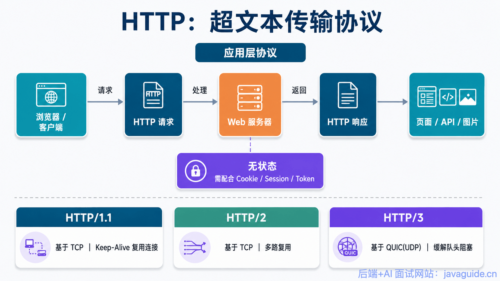
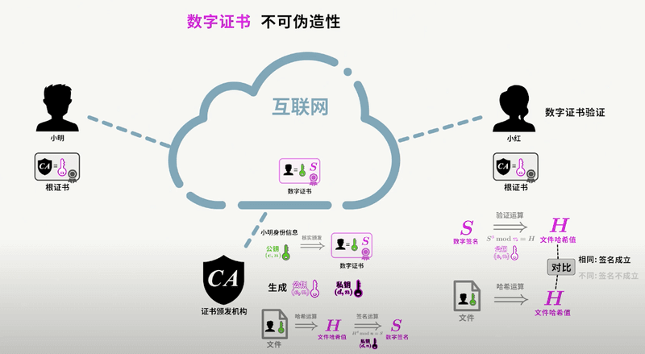

HTTP can transfer web content, but it sends data in plaintext unless another security layer is used. HTTP alone doesn't adequately protect requests and responses from eavesdropping, tampering, or impersonation.

HTTPS isn't a new application-layer protocol. It uses TLS to protect HTTP communication. HTTP/1.1 and common HTTP/2 deployments usually run TLS over TCP. HTTP/3 maps HTTP semantics onto QUIC, which is built on UDP and integrates TLS 1.3.

This article answers four questions:

1. What are the key differences between HTTP and HTTPS?
2. How does HTTPS protect against eavesdropping, tampering, and impersonation?
3. What happens during an SSL/TLS handshake?
4. Why do certificates, mixed content, and performance still matter when using HTTPS?

## HTTP

### What Is HTTP?

HTTP stands for **Hypertext Transfer Protocol**. It defines how hypertext and other messages are transferred, and specifies the behavior of browsers and servers that exchange them.

HTTP is also a **stateless** protocol: the server doesn't inherently maintain a record of the client's past requests. This keeps the protocol simpler. Stateful protocols need to track history and can face inconsistent state when a client or server fails, which can be costly to resolve.

### How HTTP Communication Works

HTTP is an application-layer protocol. This example uses HTTP/1.1 over TCP. An `http` URL uses port 80 by default:

1. The server waits for requests on port 80.
2. The browser opens a TCP connection to the server, creating a socket.
3. The server accepts the TCP connection.
4. The browser (HTTP client) and web server (HTTP server) exchange HTTP messages.
5. The TCP connection closes when the exchange is done, unless it is kept open for reuse.

### Benefits of HTTP

HTTP is extensible, fast, and widely supported across platforms.

## HTTPS

### What Is HTTPS?

HTTPS (Hypertext Transfer Protocol Secure) uses TLS to provide confidentiality, integrity, and authentication for HTTP communication. Its default port is 443. HTTP/1.1 and HTTP/2 usually use TLS over TCP; HTTP/3 uses QUIC, which integrates TLS 1.3 and runs over UDP.

After the TLS handshake, algorithms such as AES-GCM and ChaCha20-Poly1305 protect application data using symmetric authenticated encryption with associated data (AEAD). The handshake can establish a shared secret with (EC)DHE or, for session resumption, use a pre-shared key (PSK). Older TLS versions also supported RSA key transport. ECDH and ECDHE are key-agreement algorithms; they don't encrypt a pre-generated symmetric key with a public key.

### Benefits of HTTPS

HTTPS protects data in transit and helps users verify the identity of the service they're connecting to.

## SSL and TLS

HTTPS security comes from TLS. TLS protects communication confidentiality and integrity and authenticates the peer using certificates or other mechanisms. The sections below explain the main ideas.

### SSL vs. TLS

**SSL and TLS are related protocol versions, but SSL is obsolete.** Secure Sockets Layer (SSL) 3.0 was published in 1996. SSL 1.0 was never released, and SSL 2.0 had serious weaknesses, including the DROWN attack (Decrypting RSA with Obsolete and Weakened eNcryption). In 1999, the next version was published as **TLS 1.0**. People still sometimes say “SSL/TLS,” but modern HTTPS uses TLS; SSL has been retired. TLS 1.2 and TLS 1.3 are the versions used by modern HTTPS.

### How SSL/TLS Works

#### Asymmetric Cryptography

TLS uses asymmetric cryptography for authentication and/or key agreement, then uses symmetric keys to protect application data. Asymmetric cryptography has more than one use: digital signatures use a private key to sign and a public key to verify, while ECDHE lets two parties agree on a shared secret using temporary key pairs. The mailbox analogy below illustrates basic public-key encryption, such as RSA; it doesn't describe every TLS handshake.

> Imagine a self-service post office where each communication channel is a mailbox. The owner displays a public key and invites anyone to put a letter in the mailbox and lock it with that key.
>
> The public key can lock the mailbox but can't unlock it. Only the owner can unlock it because only the owner has the private key.
>
> The message is protected as long as the private key remains secret.

Public and private keys are generated with mathematical algorithms. Don't invent your own cryptographic scheme. Key-pair generation relies on one-way trapdoor functions.

> **One-way function:** Given a function `f` and an input `x`, it's easy to compute `y = f(x)`. Given `y`, it is difficult to find an `x` such that `f(x) = y`.
>
> **Trapdoor one-way function:** It's easy to compute `y = f(x; h)` for an input `x` and trapdoor `h`. Given `y`, recovering `x` is difficult without the trapdoor, but possible when the trapdoor is known.

The figure illustrates a one-way function, not a trapdoor one-way function. Imagine a secret method that turns apple juice into apples. Anyone who knows the method can reverse the process; the secret method is the trapdoor.

Here, the public function `f` is analogous to the public key, and the trapdoor `h` is analogous to the private key. Anyone can use the public key for its intended operation, but reversing the operation requires the private key.

#### Symmetric Encryption

TLS doesn't use asymmetric cryptography to encrypt large amounts of application data. After the handshake authenticates the peer and establishes keys, the record layer uses symmetric AEAD algorithms to protect HTTP requests and responses.

> **Symmetric encryption:** Both parties share a secret key `k`. The encryption and decryption algorithms are known; confidentiality depends on keeping `k` secret.

The parties need to establish shared traffic keys over an insecure network. With static RSA key exchange in TLS 1.2, the client generated a `PreMasterSecret` and encrypted it with the server's RSA public key. Modern TLS commonly uses ECDHE: the parties exchange temporary public keys and independently derive the same shared secret. TLS 1.3 removed static RSA key exchange. It allows key establishment using (EC)DHE, PSK, or PSK+(EC)DHE. In each case, symmetric traffic keys are derived to protect subsequent data. No cryptographic scheme should be described as absolutely secure.

#### Trusting the Server's Public Key

There is another security problem: how can a client trust that a public key really belongs to the server?

> Suppose client C and server S want to communicate using SSL/TLS. C needs S's public key, which must be delivered over the network. Assume that anyone can capture packets, that confidentiality depends on the sender's design, and that the algorithms are public while the keys are secret.
>
> If S sends its public key without authentication, an attacker A could send C a forged packet containing the public key of a server controlled by A (AS). C might accept AS's key as S's key. C would then encrypt data with AS's public key and send it over the network. A could decrypt it with AS's private key, while C and S remain unaware of the attack.
>
> Encrypting the public key alone doesn't solve this trust problem. C could still be tricked into trusting AS.

Certificate authorities (CAs) address this key-authentication problem. A CA is a third party trusted by the client. It issues certificates to servers, which store and present those certificates. A certificate includes the CA's **digital signature**, described below.

When a server authenticates with a certificate, the client receives a certificate chain and verifies that the signatures lead to a locally trusted root. It also checks the host name, validity period, key usage, and path constraints. Only if these checks pass can the client associate the certificate's public key with the server's identity. PSK authentication and other certificate-free methods are separate cases.

#### Digital Signatures

Digital signatures help prevent certificate forgery and tampering. CAs are trusted in part because of this mechanism.

A digital signature detects changes to certificate content and demonstrates that the signature was produced by a party holding the CA's private key. The accurate description is **sign with the private key and verify with the public key**, not “encrypt with the private key and decrypt with the public key.” The process is:

> After validating an application, the CA uses its private key to sign the certificate's signed data and attaches the signature to the certificate.
>
> The server sends its certificate chain to the client. The client uses the issuer's public key to verify each certificate's signature, then continues up the chain to a locally trusted root.
>
> Signature verification is only one part of certificate validation. The client must also check the host name, validity period, key usage, basic constraints, and name constraints.

The public-key delivery process with certificates works like this:

1. Server S, client C, and a trusted CA are involved.
2. The CA verifies S's application and signs a certificate containing S's public key and identity.
3. S obtains the certificate and sends it to C.
4. C receives S's certificate chain, verifies signatures with issuer public keys, and confirms the chain ends at a locally trusted root.
5. C checks the domain name, validity period, key usage, and certificate constraints. Only then does C accept the binding between the certificate's public key and the server's identity.

For a simpler explanation of digital signatures and certificates, see this [video on digital signatures and certificates](https://www.bilibili.com/video/BV18N411X7ty/).

## Summary

- **Port:** HTTP defaults to port 80; HTTPS defaults to port 443.
- **URL scheme:** HTTP uses `http://`; HTTPS uses `https://`.
- **Security and transport:** HTTP without TLS doesn't provide confidentiality, integrity, or peer authentication by default. HTTPS uses TLS to protect HTTP. HTTP/1.1 and HTTP/2 usually run TLS over TCP; HTTP/3 uses QUIC with integrated TLS 1.3. The handshake authenticates the peer and establishes traffic keys, and symmetric AEAD algorithms protect later data. Certificates help authenticate identity; it isn't accurate to say that a certificate “encrypts the symmetric key.”

<!-- @include: @article-footer.snippet.md -->
