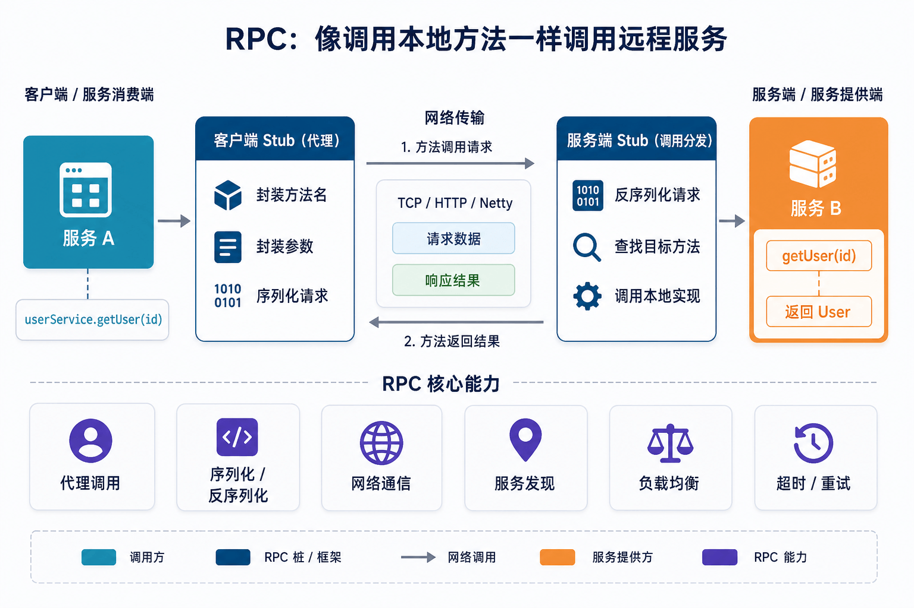
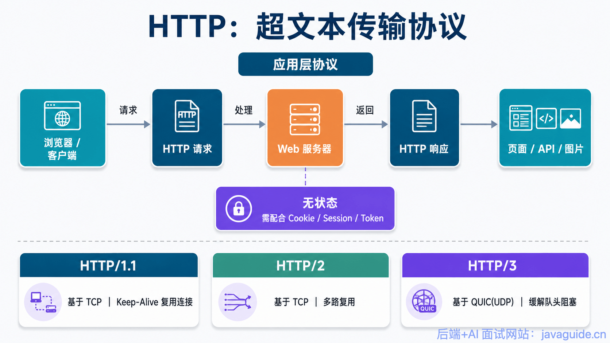
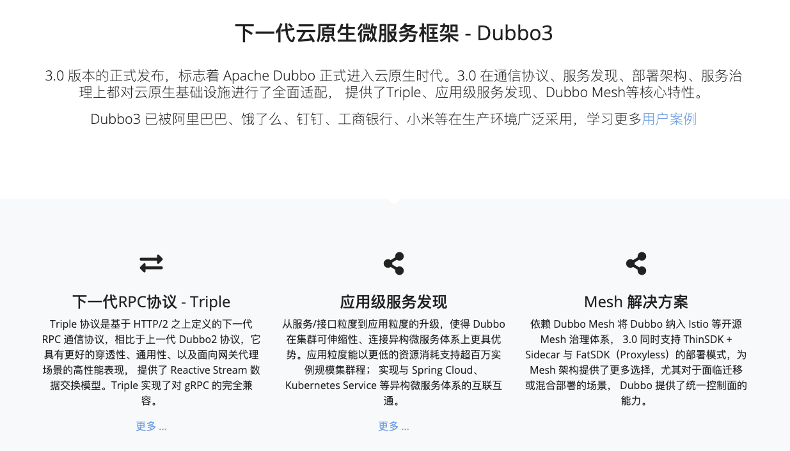
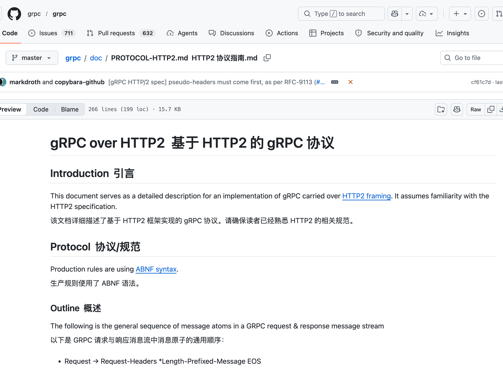
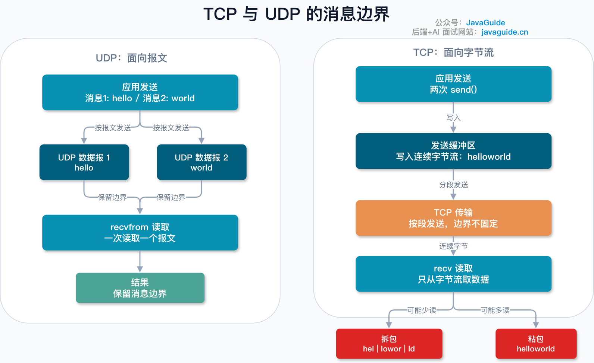
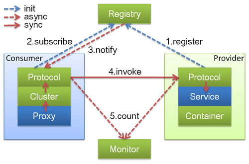

Hi, I'm Xiao G. I first came across RPC in a free course during my second year of college, and I found it confusing.

Couldn't we already call HTTP APIs?

The frontend can call the backend over HTTP, and one server can call another the same way. An endpoint such as `/user/getById` could accept a user ID and return user information. Isn't that already a remote call?

Why add RPC and another thing to learn? It can seem unnecessary.

It is even more confusing when articles compare HTTP and RPC as if they were protocols at the same layer. You may come away remembering claims like: **HTTP is resource-oriented, RPC is method-oriented; HTTP is for external APIs, RPC is for internal services; RPC is faster.**

These claims are not entirely wrong, but they oversimplify the subject.

In a real project, you still have to ask: **Is HTTP enough? Is RPC overengineering? If gRPC uses HTTP/2, why is it called RPC?**

This article explains how to think about these questions.

## RPC Is Not a Specific Protocol

This is a common misconception, so let's clear it up first.

**HTTP is a protocol. RPC is not a specific protocol; it is a model for making remote calls.**

RPC stands for Remote Procedure Call. Its goal is simple: **make calling a remote service feel as much like calling a local method as possible.**



For example, local code might call a user service like this:

```java
User user = userService.getUser(1001);
```

If `userService` is in the current process, this is an ordinary method call.

But if the user service runs on another machine, the call becomes more involved. You need to send a network request, transmit the method name and arguments, serialize data, handle timeouts, failures, and retries, then deserialize the response.

An RPC framework aims to hide as much of this complexity as possible. The caller's code can still look like this:

```java
User user = userService.getUser(1001);
```

Under the hood, it handles network communication, serialization, service discovery, and returning the result.

So the more accurate comparison is not “Which is more powerful, HTTP or RPC?” but:

**HTTP is an application-layer protocol; RPC is a model for remote calls.**



RPC can be implemented in many ways. Dubbo, Thrift, and gRPC are all RPC frameworks. The gRPC documentation describes its model directly: a client can call a method on an application running on another machine as if it were a local object, while the server defines the remotely callable methods, their parameters, and return types.



This explains a point that often causes confusion: **gRPC is RPC, but it is built on HTTP/2.**

It is not the opposite of HTTP; it provides RPC calls over HTTP/2.

The gRPC project describes this in detail in [gRPC over HTTP/2](https://github.com/grpc/grpc/blob/master/doc/PROTOCOL-HTTP2.md):



## **TCP Alone Is Not Enough**

To understand the difference between HTTP and RPC, it helps to look one layer lower.

HTTP uses TCP, and RPC often does too. So why not use TCP directly?

You can, in theory, but it is inconvenient in practice.

TCP provides reliable delivery of a continuous byte stream. It does not know where one application message ends and the next begins.

For example, the client sends two requests in a row:

```text
getUser:1001
getOrder:8888
```

The server may receive one byte stream rather than two neatly separated messages. The application must determine where the first message ends and the second begins, and handle partial reads, combined messages, encoding, timeouts, error codes, request IDs, and more.



That is why application-layer protocols need to define message formats.

HTTP defines a general format with a request line, headers, body, and status codes. MDN describes HTTP as an application-layer protocol originally designed for communication between browsers and web servers, but also used for machine-to-machine communication and APIs.

RPC frameworks also define message formats, usually organized around services, methods, arguments, and return values rather than URLs and resources.

In short, HTTP and RPC both address the same question:

**How can two processes communicate a business call over a network?**

They model the interaction differently.

## **HTTP Models Resource Access; RPC Models Method Calls**

A typical HTTP/REST API might look like this:

```http
GET /users/1001
POST /orders
PUT /orders/888/status
DELETE /comments/9527
```

Its mental model is a resource.

`/users/1001` identifies a user resource, and `GET` reads it. `POST /orders` creates an order, while `PUT /orders/888/status` updates an order's status.

This model works well for public APIs.

HTTP is widely understood and easy to debug. Browsers can access it, Postman can call it, `curl` can test it, and gateways can handle it. Third parties can integrate with an API using standard HTTP documentation, so the barrier to entry is low.

An RPC call looks more like this:

```java
userService.getUser(1001);
orderService.createOrder(request);
inventoryService.deductStock(skuId, count);
```

Its mental model is a method call.

The caller focuses on which service and method to call, what arguments to pass, and what object to expect in return.


This is closer to how Java backend developers write code. In microservices, services often collaborate through business operations such as creating orders, deducting inventory, checking balances, or validating permissions. RPC expresses these calls directly.

The main difference is not that one can make a call and the other cannot.

Both can make remote calls.

The difference is in the model: **is the remote interaction a resource access or a method call?**

## **Why Is RPC Common for Internal Services?**

HTTP can certainly be used for internal service calls.

Many companies use HTTP for all their internal services successfully. It is simpler when there are few services and call chains are not complex.

As the number of services grows, RPC's advantages can become more apparent.

**First, callers should not need to know where the other service's machines are.**

Business code should only need to know “I need to call the user service,” not how many machines it has, their IP addresses, which one just went offline, or which one has a higher weight.

This requires service discovery.

The Dubbo documentation gives a typical example of service discovery: a provider registers its address with a registry, and a consumer reads and subscribes to the address list. The registry notifies consumers when addresses change. Dubbo supports registries such as Nacos, Consul, and ZooKeeper.



You can build these capabilities around HTTP too, using a service registry, gateway, load balancer, and SDK.

RPC frameworks usually integrate them into the service-call system.

The caller uses a service interface, while the framework handles service discovery, load balancing, connection management, and timeouts. Business code does not need to construct URLs everywhere.

**Second, interface contracts become more important.**

HTTP with JSON is flexible, but that flexibility can make contracts loose.

If a field name or type changes, or an enum gains a value, the caller may fail only at runtime. If the API documentation is not updated, integration becomes painful.

RPC frameworks often use stronger contracts. For example, gRPC commonly uses Protocol Buffers as an interface definition language and message format. Protocol Buffers is a language- and platform-neutral, extensible mechanism for serializing structured data. A `.proto` file defines the structures and can generate code for different languages.

This makes it easier for code generation and compilation to catch interface changes.

Of course, a strong contract does not prevent every problem.

You still need to design field compatibility, behavior for older clients, whether fields can be removed, and whether enum values can change. An IDL simply enforces the contract more strictly than an informal agreement about JSON fields.

**Third, frequent internal calls put more emphasis on processing efficiency.**

HTTP with JSON is readable and convenient for people, but it may not be the most efficient format for machines. Field names, text encoding, and parsing all add overhead.

RPC frameworks often use binary serialization such as Protobuf or Thrift. These formats are smaller and can be more efficient for machines to parse.

But this is not a universal rule.

“RPC is always faster than HTTP” is too broad. HTTP/2, connection reuse, compression, JSON libraries, and network conditions all affect performance. gRPC itself uses HTTP/2, so its advantages cannot be explained simply by saying “it is not HTTP.”

A more accurate way to put it is:

**For frequent service-to-service calls, RPC frameworks often provide serialization, connection reuse, timeouts, retries, load balancing, and tracing that are tailored to internal service communication.**

That is why RPC is common inside companies.

## **RPC Is About More Than Faster Calls**

RPC is often discussed mainly in terms of performance.

Performance matters, but RPC's larger value is service governance.

Once an internal call goes into production, there is more to it than sending a request and receiving a response. Soon you will have questions such as:

- What timeout should this call use? Should it retry on failure, and could a retry charge the customer twice?
- If a downstream service fails, should the upstream service use a fallback?
- Which API has had a higher error rate recently?
- How many services did a user request pass through?

If every business service handles these concerns itself, the code quickly becomes messy.

RPC frameworks often integrate governance features such as timeout control, load balancing, service discovery, circuit breaking, fallback, tracing, and call metrics. The gRPC documentation also describes pluggable support for load balancing, tracing, health checks, and authentication.

HTTP can support these features too.

Many companies provide them through API gateways, service meshes, HTTP SDKs, interceptors, and tracing components. That works when implemented well.

Do not think of RPC as “more advanced than HTTP.” It is a way to organize common internal service-call concerns around the remote method call model.

## **Is HTTP Unsuitable for Internal Calls?**

Not at all. HTTP may be simpler when the system and team are small.

For example, an admin system split into a few services with low call volume may work well with Spring Boot REST APIs, OpenAPI documentation, standard error codes, gateway authentication, and tracing.

Adding RPC may only add cost without a clear benefit.

You may need to add a registry, maintain an IDL, handle code generation, train the team, and solve local debugging and gateway routing issues. These costs may not be worthwhile when there are few services and simple call chains.

HTTP is a good fit when:

- Exposing APIs to web clients, mobile apps, or third-party partners.
- The team values interoperability and easy debugging.
- Service calls are not frequent.
- There is no mature RPC infrastructure.
- The organization already has a shared HTTP gateway, SDK, rate limiting, authentication, and monitoring.

Here is a simple rule of thumb:

**If your system runs reliably on HTTP and has no clear service-governance problems, do not switch to RPC just to make it look more like a microservice architecture.**

Technology choices are not labels.

What matters is solving the problem reliably.

## **Why Is gRPC Confusing?**

gRPC can be confusing because it combines two concepts.

**First, it is an RPC framework.**

You define services and methods, generate client and server code, and call the remote service like a method.

**Second, it uses HTTP/2 for transport.**


So it is not simply “the opposite of HTTP.”

More precisely: **gRPC uses HTTP/2 for transport, commonly uses Protobuf as its IDL and message serialization format, and organizes calls using the RPC model.**

Note that Protobuf is the most common default for gRPC, but it does not define gRPC itself. The protocol allows `application/grpc+proto`, `application/grpc+json`, and custom encodings.

Another often-overlooked detail: a normal gRPC response usually has HTTP `:status: 200`; the actual RPC result is carried in HTTP/2 trailers such as `grpc-status` and `grpc-message`.

This matters when troubleshooting.

For an HTTP API, we often start with the HTTP status code: `200` usually means success, `404` means the resource was not found, and `500` indicates a server error.

For gRPC, the HTTP status alone is not enough. HTTP `200` does not guarantee the RPC call succeeded; check `grpc-status` too.

This creates an operational concern: gateways, load balancers, proxies, and service meshes must correctly support HTTP/2 trailers. If an intermediary mishandles them, the failure can be hard to spot.

So gRPC is more than “HTTP/2 + Protobuf.”

At the transport level, it runs over HTTP/2.

It commonly uses Protobuf encoding, but the protocol allows others.

For developers, it makes remote services feel like local method calls.

For call status, it carries the RPC result in HTTP/2 trailers.

The combination of these pieces is what makes it confusing.

## **Choose Based on the Use Case, Not Which Is “More Advanced”**

Choose based on the relationship between caller and service:

- For browsers, mobile clients, and third-party systems, prefer HTTP. It is widely supported, easy to integrate, and has many debugging tools. External APIs should be easy for others to use.
- For frequent internal microservice calls, consider RPC, especially when there are many services and interfaces, complex call chains, and strong needs for timeouts, retries, service discovery, tracing, and load balancing.
- If the team already has mature HTTP infrastructure, there may be no reason to switch. A shared gateway, service discovery, SDKs, tracing, rate limiting, and circuit breaking can all work well with HTTP.

If you choose gRPC, consider:

- Browsers cannot use standard gRPC directly like backend services; gRPC-Web or a proxy is usually needed.
- Do the gateway and load balancer support it? Is local debugging convenient?
- Is the team comfortable with `.proto` files and generated code?
- Will binary messages make production troubleshooting harder?

gRPC is capable, but it is not free of operational costs.

Account for these costs before adopting it.

## Common Misconceptions

### Which Performs Better, HTTP or RPC?

There is no universal answer.

In frequent internal calls, gRPC over HTTP/2 with Protobuf will often use fewer resources than HTTP/1.1 with JSON.

But different implementations can produce different results.

Message size, serialization, connection reuse, compression, framework implementation, and network conditions all affect performance. Benchmark your own APIs, payloads, and deployment instead of relying on “RPC is faster.”

### Does RPC Have to Use TCP?

No.

RPC is a call model, not a transport protocol. It can use TCP or HTTP/2; gRPC is a common example.

### Are REST and RPC Mutually Exclusive?

No.

REST focuses on resource modeling, while RPC focuses on method calls. Projects often use both: REST for external APIs and RPC for internal services.

### Do We Still Need RPC If We Have HTTP/2?

HTTP/2 adds frames, streams, multiplexing, and header compression, improving concurrent use of a single TCP connection.

But it does not define service interfaces, generate client code, or solve service discovery, timeout and retry policies, call governance, or versioned contracts for you.

Another often-overlooked difference is the call pattern.

Most HTTP APIs use a request-response pattern. Besides the common unary call, gRPC natively supports server streaming, client streaming, and bidirectional streaming. The gRPC documentation lists these four call types: unary, server streaming, client streaming, and bidirectional streaming.

Streaming can be a natural fit for log subscriptions, long-running task progress, bulk uploads, and real-time synchronization. You can also use SSE, WebSocket, or build on HTTP/2 yourself, but then you are implementing capabilities that an RPC framework already provides.

HTTP/2 is important, but it is not the whole RPC framework.

### Is gRPC Just HTTP/2 + Protobuf?

No.

That phrase can help beginners form a quick mental model, but it is not a precise definition.

A more accurate description is that gRPC carries RPC calls over HTTP/2 and uses Protobuf by default to describe interfaces and messages, while also allowing JSON or custom encodings. It defines a complete set of rules for request paths, content types, length-prefixed messages, and trailer fields such as `grpc-status`.

gRPC is not just a different serialization format; it is an RPC protocol and a set of engineering conventions.

## In Closing

HTTP and RPC do not replace one another, and one is not inherently more advanced than the other.

Both can call services. The key difference is whether you model a remote call as “resource access” or “method invocation.”

For external APIs used by websites, apps, or third-party systems, HTTP is often a better fit. It is widely supported, easy to debug, and inexpensive to adopt; clients can test it with Postman or `curl`.
For internal service calls, especially with many services, long call chains, frequent requests, and needs for discovery, timeouts, retries, load balancing, and tracing, RPC may be more convenient. Its purpose is not just speed; it also handles many common problems in internal service communication.

Do not reduce the choice to “HTTP for external APIs, RPC for internal services.”

That rule of thumb can help beginners, but a real decision should account for the caller, team infrastructure, troubleshooting, performance needs, and long-term maintenance.

If the system is small and HTTP works reliably, do not add RPC just to make it look more like a microservice architecture.

If internal calls are getting more complex and require more HTTP SDKs, gateway features, monitoring, and retry logic, consider RPC.

In short: **HTTP is capable, and RPC is not magic. Choose the one that solves your current problem at lower overall cost.**
