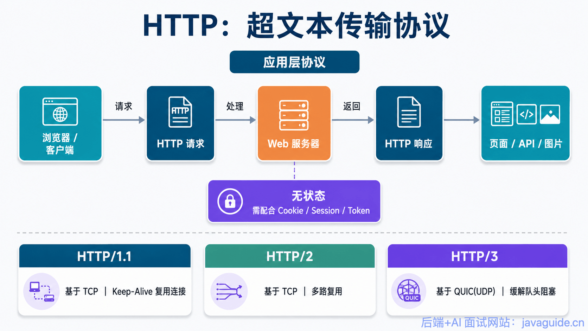

HTTP/1.0 and HTTP/1.1 differ by only a minor version number, but they introduced important changes to connection reuse, caching, the `Host` header, status codes, and bandwidth use.

These aren't just protocol details. They affect how browsers make requests, how servers reuse connections, how caching works, and how virtual hosting is implemented.

This article answers four questions:

1. Which common status codes did HTTP/1.1 add?
2. How do the caching mechanisms in HTTP/1.0 and HTTP/1.1 differ?
3. Why does HTTP/1.1 support persistent connections by default?
4. What problems do the `Host` header and bandwidth optimizations solve?

First, here's a quick overview of HTTP:



## Response Status Codes

HTTP/1.0 defined 16 status codes. HTTP/1.1 added many more, including 24 error-response codes. Examples include `100 Continue`, which lets a client check whether the server is willing to accept a large request body; `206 Partial Content`, used for range requests; `409 Conflict`, for a request that conflicts with the current state of a resource; and `410 Gone`, which indicates that a resource is no longer available and is likely to remain unavailable, with no known forwarding address.

## Caching

Caching reduces repeated communication between users and origin servers. This saves bandwidth and reduces the time users wait for a response.

### HTTP/1.0

HTTP/1.0 had a simple caching mechanism. A server could use the `Expires` header to specify when a response becomes stale. Requests made before that time could use the cached response.

The server could also include a `Last-Modified` header indicating when the requested resource was last changed. On a later request, the client could send `If-Modified-Since` with that timestamp to ask whether the resource had changed. This value was usually copied from the previous response's `Last-Modified` header.

If the resource hadn't changed, the server returned `304 Not Modified`, telling the client it could use its cached copy. If it had changed, the server returned `200 OK` with the updated content.


### HTTP/1.1

HTTP/1.1 made caching more flexible and extensible while keeping the same basic approach. One commonly used request directive is `Cache-Control`; see MDN's [Cache-Control documentation](https://developer.mozilla.org/en-US/docs/Web/HTTP/Headers/Cache-Control).

## Connection Management

**HTTP/1.0 used short-lived connections by default.** Each HTTP operation opened a connection, which was closed when the operation finished. If an HTML page referenced JavaScript, images, CSS, or other resources, the browser opened a new TCP connection for each resource. Repeated connection setup and teardown consumed bandwidth.

**HTTP/1.1 made persistent connections the default.** A request can tell the server to keep the connection open after the request succeeds. The same TCP connection can then carry more HTTP exchanges, including requests for additional resources on a page and later requests to the same server.

Keeping a connection open forever would also waste resources, so servers such as Apache can set an idle timeout. The connection closes if no new request arrives before the timeout.

HTTP/1.0 did offer persistent connections through the `Connection: Keep-Alive` request header. In HTTP/1.1, a client can request that the server close the connection after the exchange by sending `Connection: close`.

**HTTP persistent and non-persistent connections are implemented using TCP connections.**

**Both the client and the server must support persistent connections for them to work.**

## The Host Header

DNS allows multiple host names to resolve to the same IP address, but HTTP/1.0 didn't account for this well. For example, a request for `http://example1.org/home.html` would use a request line such as `GET /home.html HTTP/1.0`, which omitted the host name. The server couldn't determine which site the client wanted.

HTTP/1.1 added the `Host` header to the request:

```plain
GET /home.html HTTP/1.1
Host: example1.org
```

The server can now identify the requested host even when several host names share an IP address.

## Bandwidth Optimizations

### Range Requests

HTTP/1.1 introduced range requests to avoid transferring an entire resource when the client needs only part of it. A client can send a `Range` header to request part of a resource, such as when resuming an interrupted download. Byte ranges are the common form. A server can ignore the `Range` header or return one or more ranges.

The `206 Partial Content` status code lets clients and proxies recognize that the response contains only part of a resource, so they don't mistake it for the complete resource or cache it incorrectly.

For example, a client can request the first 1,024 bytes of a file:

```http
GET /z4d4kWk.jpg HTTP/1.1
Host: i.imgur.com
Range: bytes=0-1023
```

The server can respond with:

```http
HTTP/1.1 206 Partial Content
Content-Range: bytes 0-1023/146515
Content-Length: 1024
...
(binary content)
```

The response headers mean:

- **`Content-Range`:** The position of the returned bytes in the complete resource, including the start, end, and total length. `Content-Range: bytes 0-1023/146515` means the response contains bytes 0 through 1,023, or 1,024 bytes total, from a resource that is 146,515 bytes long.
- **`Content-Length`:** The number of bytes in this response. Here, `Content-Length: 1024` means the server sent 1,024 bytes.

A `Range` request can ask for more than one range. For example, a client can request bytes 0–499 and 1,000–1,499:

```http
GET /path/to/resource HTTP/1.1
Host: example.com
Range: bytes=0-499,1000-1499
```

The server returns each range as a separate part, divided by a boundary:

```http
HTTP/1.1 206 Partial Content
Content-Type: multipart/byteranges; boundary=3d6b6a416f9b5

--3d6b6a416f9b5
Content-Type: application/octet-stream
Content-Range: bytes 0-499/2000

(data for bytes 0 through 499)

--3d6b6a416f9b5
Content-Type: application/octet-stream
Content-Range: bytes 1000-1499/2000

(data for bytes 1000 through 1499)

--3d6b6a416f9b5--
```

### Status Code 100

HTTP/1.1 added the `100 Continue` status code. When a client is ready to send a large request body, it can send the headers first with `Expect: 100-continue`. If the server is willing to receive the body, it responds with `100 Continue`, and the client sends the body. The server can also send a final response immediately, so the client doesn't have to upload the body.


HTTP/1.0 didn't define `100 Continue` or this `Expect: 100-continue` exchange. An HTTP/1.0 server should ignore an `Expect` header it doesn't recognize.

### Compression

Many data formats are compressed before transmission. Compression can significantly improve bandwidth use. HTTP/1.0 offered few options for negotiating compression details and didn't distinguish end-to-end content compression from hop-by-hop transfer compression.

HTTP/1.1 distinguishes **content codings** from **transfer codings**. Content codings apply end to end; transfer codings apply one hop at a time.

HTTP/1.0 included the `Content-Encoding` header for end-to-end encoding. HTTP/1.1 added `Transfer-Encoding` for hop-by-hop encoding and `Accept-Encoding` for clients to indicate which content codings they can handle.

## Summary

1. **Connections:** HTTP/1.0 used short-lived connections by default; HTTP/1.1 made persistent connections the default.
2. **Status codes:** HTTP/1.1 added many status codes, including `100 Continue`, `206 Partial Content`, `409 Conflict`, and `410 Gone`.
3. **Caching:** HTTP/1.0 commonly used `If-Modified-Since` and `Expires`. HTTP/1.1 added more cache controls, including `ETag`, `If-Unmodified-Since`, `If-Match`, and `If-None-Match`.
4. **Bandwidth and connections:** HTTP/1.0 couldn't request only part of a resource or resume a partial download. HTTP/1.1 added the `Range` header and `206 Partial Content`, allowing clients to request specific parts and use bandwidth more efficiently.
5. **Host handling:** HTTP/1.1 added the `Host` header so a server can distinguish host names that share an IP address.

## References

- [Key Differences Between HTTP/1.0 and HTTP/1.1](http://www.ra.ethz.ch/cdstore/www8/data/2136/pdf/pd1.pdf)

<!-- @include: @article-footer.snippet.md -->
