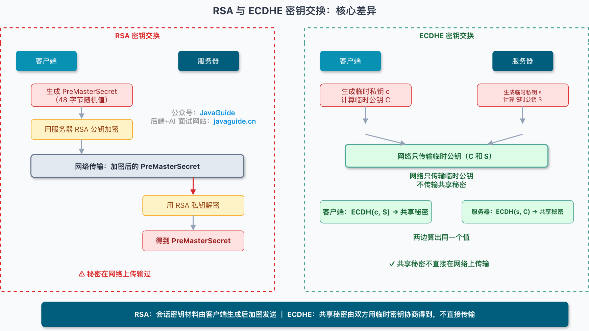
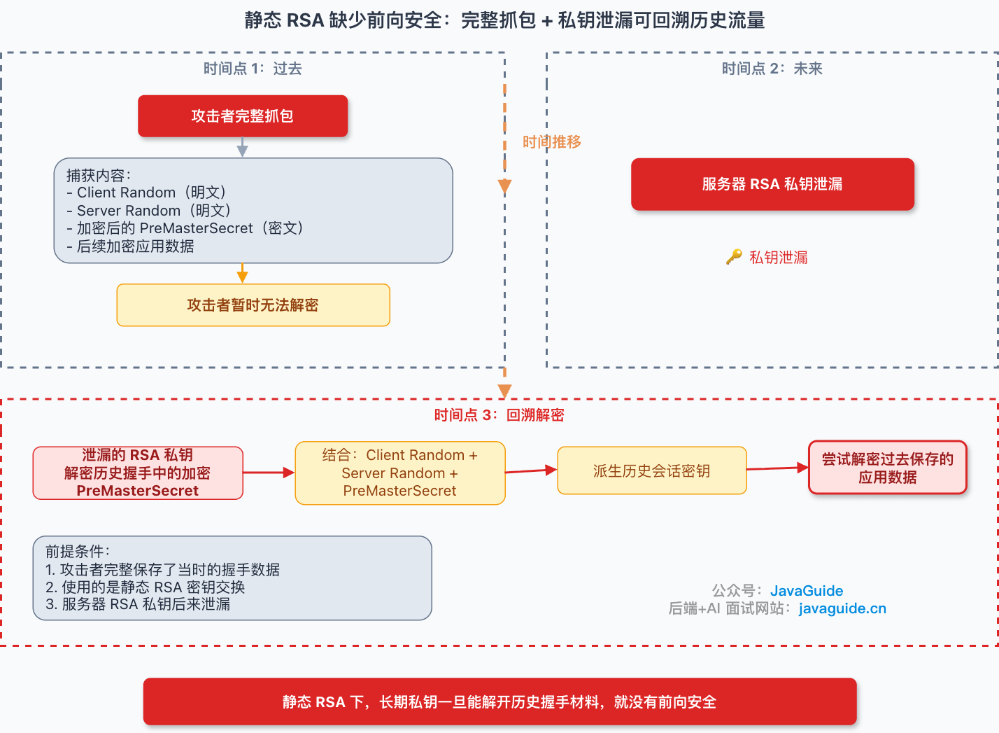
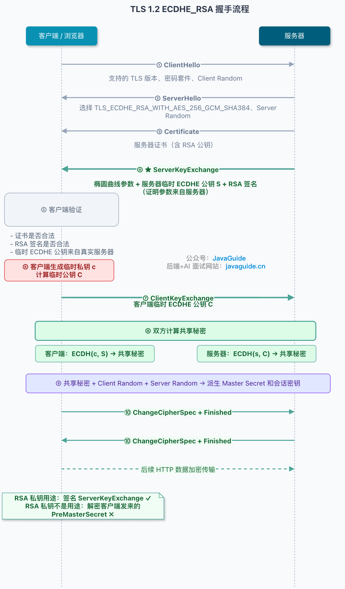
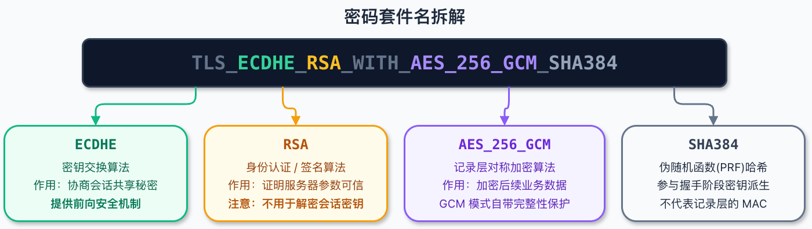
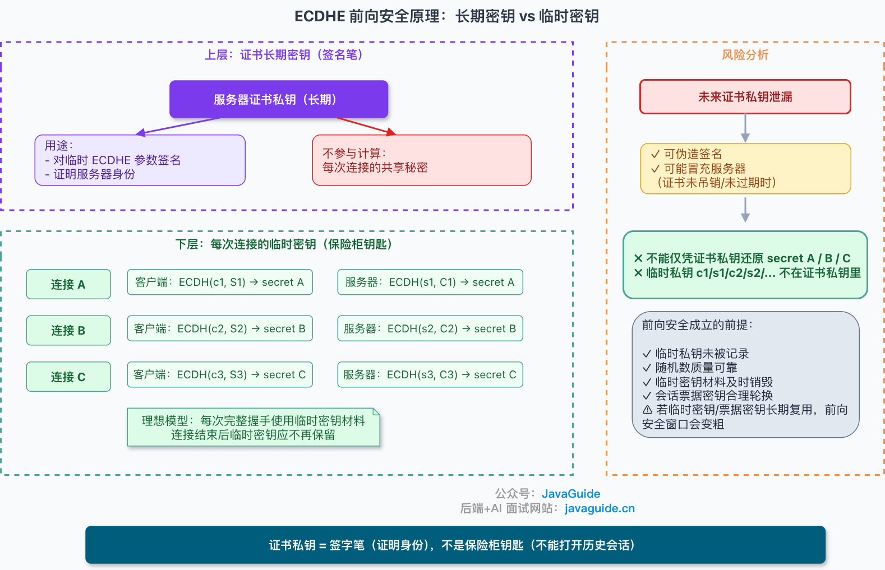
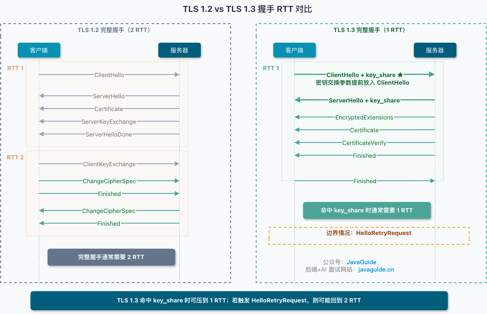
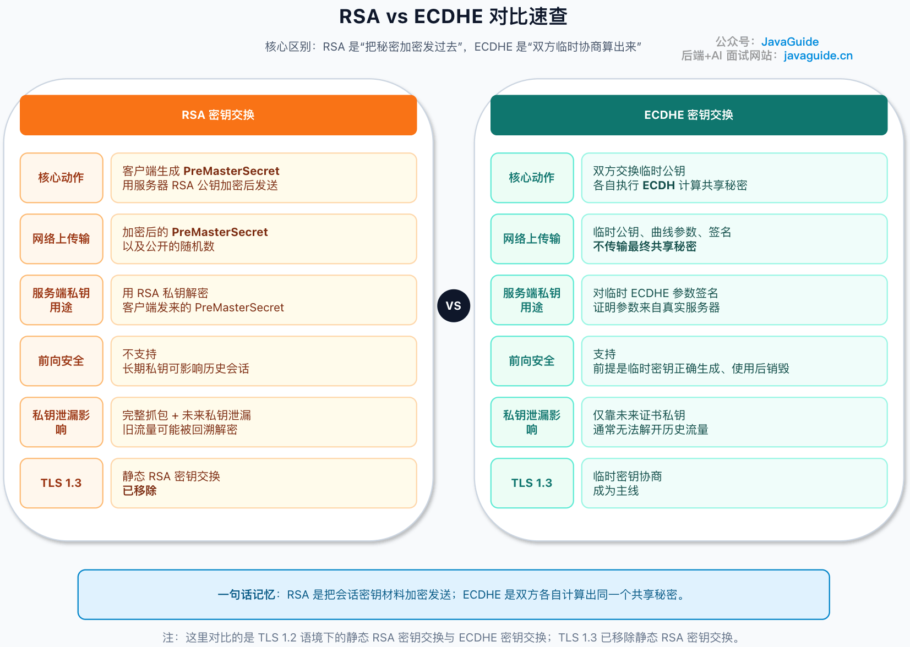

When people first learn HTTPS, they often come away with a rough idea:

**HTTPS = HTTP + encryption, encryption = RSA. So HTTPS = RSA encryption.**

This idea did not come from nowhere. Many early HTTPS deployments used RSA cipher suites, and introductory explanations often use RSA as an example.

Strictly speaking, HTTPS has never meant RSA encryption. Even in TLS 1.0 and TLS 1.1, RSA was only one option; the protocols also supported key exchange methods such as DHE. TLS 1.3 removed static RSA key exchange. RSA is now more commonly used for certificate signatures and authentication.

So this article is not about which is “more advanced,” RSA or ECDHE.

**In an RSA handshake, the client generates the session-key material, encrypts it, and sends it to the server. In an ECDHE handshake, the client and server derive the shared material locally instead of transmitting it.**

This article answers a few questions:

1. Why is HTTPS not the same as RSA encryption?
2. How does each handshake derive session-key material?
3. Why does ECDHE provide forward secrecy?
4. Why did TLS 1.3 remove static RSA key exchange?

Once these points are clear, it is easier to understand `PreMasterSecret`, `Server Key Exchange`, forward secrecy, and why TLS 1.3 removed static RSA.



## Two Core Problems Solved by the TLS Handshake

HTTPS still uses HTTP semantics. In the TLS 1.2 scenarios discussed here, HTTP messages travel over TLS over TCP. HTTP/3 runs over QUIC, which integrates TLS 1.3 and does not use TCP.

After the handshake, application data is usually protected by a symmetric cipher such as AES-GCM. RSA is not used to encrypt the entire request and response.

The handshake addresses two problems.

**First, the browser and server need to establish a session key.**

This key is used for symmetric encryption of HTTP requests, cookies, and response bodies. Symmetric encryption is better suited to large amounts of data; public-key encryption is more expensive and is not generally used to encrypt an entire web page.

**Second, the browser needs to verify that the server is the intended website.**

If the server simply sends a public key to the browser, an attacker in the middle could send their own key instead. The browser might mistake it for the website's key and encrypt secrets for the attacker. Certificates, CAs, and digital signatures address this by verifying that the public key is associated with the domain and was not substituted in transit.

Both RSA and ECDHE handshakes address these two problems. They differ in how they establish the session key.

## RSA Handshake: Encrypt and Send the Key Material

### Full Handshake Flow

First, consider RSA key exchange in TLS 1.2.

The browser sends `ClientHello`, which includes the TLS versions and cipher suites it supports, along with a random value called `Client Random`.

The server responds with `ServerHello`, selects a TLS version and cipher suite, provides another random value called `Server Random`, and sends its certificate to the client.

The client validates the certificate chain, domain name, validity period, and signatures. If validation succeeds, the client obtains the server's RSA public key from the certificate.

Next comes the key step: the client generates a random value called `PreMasterSecret`. In TLS 1.2 RSA key exchange, it is **48 bytes**. The client encrypts it with the RSA public key from the server's certificate and sends the encrypted result in `ClientKeyExchange`.

The server decrypts it with its RSA private key and obtains the same `PreMasterSecret`.

At this point, both client and server have three values:

```text
Client Random
Server Random
PreMasterSecret
```

Both sides derive the `Master Secret` from these values, then derive the session keys from it. The HTTP requests and responses are protected with these symmetric keys.

In short:

**In an RSA handshake, the client generates the session-key material, encrypts it, and sends it to the server.**

The server's RSA public key does the “wrapping.” Only a server with the matching RSA private key can decrypt it.

This seems straightforward: the client generates a secret, the server decrypts it, and both sides combine it with the two random values to derive the session keys.

But this is also where the problem begins.

### No Forward Secrecy: The Long-Term Private Key Is Too Valuable

Suppose an attacker captures HTTPS traffic today but cannot read it because they do not have the server's private key. They can save the traffic for later.

What happens if the server's RSA private key leaks a year later?

With RSA key exchange, the client encrypted `PreMasterSecret` using the server's RSA public key. If the attacker captured the handshake's plaintext random values (`Client Random` and `Server Random`) and the encrypted `PreMasterSecret`, the later-leaked private key could decrypt it. The attacker could then derive the session keys used for that connection.

Past data may then be exposed.

There are conditions: a private-key leak does not automatically expose all historical traffic. The attacker needs sufficiently complete handshake and application data. If only one direction was captured or the handshake is incomplete, the session may not be recoverable even with the key.

From a security-design perspective, this risk is serious. If the long-term private key can unlock past traffic, a compromise affects not only future connections but also previous communications.

This does not mean the RSA algorithm itself is unusable. RSA can still be used for signatures and certificates. The problem is using a long-term server private key to decrypt key material from past handshakes.

A leak of the server's private key has too high a cost.



### Another Historical Problem: Padding Oracle Attacks

RSA key exchange also had an implementation challenge: `PreMasterSecret` was not encrypted directly, but encoded using a format such as RSAES-PKCS1-v1_5 before encryption.

This detail led to padding oracle attacks such as Bleichenbacher's.

The general idea is that an attacker does not need to obtain the server's private key immediately. They repeatedly send different ciphertexts and observe how the server handles padding, version, or length errors. Differences in error codes, response times, logging, or connection closure can help the attacker gradually recover plaintext.

These attacks are difficult because they exploit implementation behavior, not just mathematics.

TLS 1.2 includes defenses for this class of issue: even if decryption fails, the server should not reveal the specific reason. It should continue with a random value to avoid giving the attacker different signals about whether the ciphertext was well-formed.

However, a specification requirement does not guarantee a correct implementation. The 2017 ROBOT attack showed that subtle behavior differences could still expose an RSA decryption oracle. Inconsistent error codes, timing, logs, or code paths can become side channels.

Static RSA key exchange was phased out not only because it lacks forward secrecy, but also because it places too much risk on implementation details.

### Can a Connection Be Downgraded to RSA?

One more point is easy to misunderstand.

In TLS 1.2, the client lists the cipher suites it supports in `ClientHello`, and the server selects one that both support. If the server still enables static RSA suites such as `TLS_RSA_*`, older clients may continue to use RSA key exchange.

This does not mean that an attacker can simply remove ECDHE from `ClientHello` and silently force an RSA downgrade. The final `Finished` message verifies the handshake transcript, so a simple `ClientHello` modification will usually fail validation and prevent the connection from being established.

Downgrade attacks such as FREAK and Logjam did occur. They exploited clients and servers that still supported weak export-grade cipher suites, along with implementation and configuration flaws, to force connections onto weaker RSA_EXPORT or DHE_EXPORT paths. They did not simply remove ECDHE and silently succeed. TLS 1.3 added downgrade protection values to `ServerHello.random`, reflecting the protocol's ongoing effort to address this class of attack.

The main thing to check is the server configuration. If very old clients do not need support, disable static RSA key-exchange suites and keep suites that provide forward secrecy. Otherwise, some clients or misconfigured systems may still use RSA handshakes.

That is why you should inspect the cipher suite actually negotiated when troubleshooting TLS. It is not enough to know that the server supports ECDHE; check whether it also enables old suites such as `TLS_RSA_*`.

## ECDHE Handshake: Both Sides Derive the Key Material

### The Core Idea Behind DH

In ECDHE, `DHE` stands for Diffie-Hellman Ephemeral. The `EC` prefix means Elliptic Curve, indicating that it uses elliptic-curve cryptography.

Do not let the name intimidate you. First, ignore the elliptic-curve part and look at what DH is designed to do.

DH lets two parties derive the same shared secret without sending the secret itself over the network.

The basic idea is:

The client generates a temporary private key, keeps it locally, calculates a temporary public key, and sends that public key to the server. The server does the same and sends its temporary public key to the client.

Both sides exchange public keys. An attacker can see these keys on the network but cannot see either temporary private key.

The client combines its temporary private key with the server's temporary public key to derive a shared secret. The server combines its temporary private key with the client's temporary public key and derives the same secret.

The shared secret is never transmitted over the network.

ECDHE performs this process using elliptic curves. The mathematics is more abstract, but at comparable security levels, elliptic curves generally use shorter keys and less computation and bandwidth than traditional finite-field DHE. For understanding TLS, remember this:

**With ECDHE, neither side generates and sends the session-key material; both sides derive it through ephemeral key exchange.**

### Full Handshake Flow

Now consider the common `ECDHE_RSA` handshake in TLS 1.2.

The client sends `ClientHello` with its TLS version, supported cipher suites, and `Client Random`. The server replies with `ServerHello` and selects a cipher suite, for example:

```text
TLS_ECDHE_RSA_WITH_AES_256_GCM_SHA384
```

Read the cipher-suite name carefully; seeing RSA does not mean it encrypts the session key.

- `ECDHE` is the key-exchange method.
- `RSA` is the authentication and signature algorithm.
- `AES_256_GCM` means record data is protected with 256-bit AES in GCM mode.
- `SHA384` is the hash used by the TLS 1.2 PRF and `Finished` message.

GCM already provides record-layer integrity, so `SHA384` here does not indicate a record-layer MAC. It is mainly used for handshake key derivation and verification.

The server then sends its certificate. In `ECDHE_RSA`, the RSA public key in the certificate is mainly used to verify the server's signature, not to encrypt a `PreMasterSecret`.

This is where the ECDHE and RSA handshakes differ.

In an ECDHE handshake, the server sends `ServerKeyExchange`, which contains the selected elliptic-curve parameters and the server's temporary ECDHE public key.

**How does the client know that a man-in-the-middle has not replaced this temporary ECDHE public key?**

**The answer is a signature.**

The server signs the handshake parameters with the private key corresponding to its certificate. The client verifies the signature with the public key in the certificate. If verification succeeds, the client knows the temporary ECDHE key came from the server holding that private key and was not replaced in transit.

The client then generates its own temporary ECDHE key pair and sends its temporary public key to the server in `ClientKeyExchange`.

At this point, both sides have the material needed to calculate the shared secret.

The client has:

```text
Client's ephemeral private key
Server's ephemeral public key
Client Random
Server Random
```

The server has:

```text
Server's ephemeral private key
Client's ephemeral public key
Client Random
Server Random
```

Each side calculates the same shared secret and derives the session keys from it.

To emphasize:

**In `ECDHE_RSA`, RSA does not encrypt or transport the session key. It proves that the ECDHE parameters came from the server.**

This is one of the most common misunderstandings about cipher-suite names.



### How to Read a Cipher-Suite Name

TLS 1.2 cipher-suite names can often be read using this pattern:

```text
TLS_<key exchange>_<authentication>_WITH_<symmetric cipher>_<hash>
```

For example:

```text
TLS_ECDHE_RSA_WITH_AES_128_GCM_SHA256
```

This breaks down as follows:

```text
ECDHE: key exchange
RSA: server authentication through signatures
AES_128_GCM: record-layer encryption
SHA256: hash used by the TLS 1.2 PRF and Finished message; with a GCM suite, it is not the record-layer MAC
```

Consider another example:

```text
TLS_RSA_WITH_AES_128_GCM_SHA256
```

Here, `RSA` appears before `WITH` and there is no `ECDHE`, which means RSA is used for both key exchange and authentication. This is a typical static RSA key-exchange suite.

TLS 1.3 changed the cipher-suite naming scheme. For example:

```text
TLS_AES_128_GCM_SHA256
```

The name no longer includes the key-exchange or authentication method. TLS 1.3 carries that information in other extensions and handshake messages; the cipher-suite name mainly describes the record-layer AEAD algorithm and the hash used by HKDF.

So do not assume that `TLS_AES_128_GCM_SHA256` means TLS 1.3 has no key exchange. Key exchange still happens; it is simply not encoded in the cipher-suite name as it was in TLS 1.2.



## Forward Secrecy and Performance Costs

### Why ECDHE Provides Forward Secrecy

The key is the `E` in ECDHE: `Ephemeral`, or temporary.

The private keys in an ECDHE handshake are temporary keys generated during the handshake, not the server's long-term certificate private key. They should no longer be needed after the connection ends.

As a result, if an attacker captures traffic today and later obtains the server's certificate private key, that key alone cannot recover the ephemeral shared secret from past handshakes. The key exchange used temporary ECDHE private keys, not the certificate key.

The certificate private key is more like a “signing pen” than a “safe key.”

In RSA key exchange, the server's private key decrypts the client's `PreMasterSecret`. In ECDHE, the server's private key signs temporary parameters to prove its identity; it does not directly calculate the shared secret for each connection.

This change in role explains the difference in how the methods protect past traffic.



Forward secrecy is not a cure-all.

ECDHE cannot help if the server's random-number generation is weak, temporary private keys are logged, or the implementation leaks memory. Some implementations may also reuse ephemeral DH/ECDH secrets briefly to reduce handshake costs: finite-field DH often calls this “exponent reuse,” while ECDH uses terms such as “ephemeral private-key” or “scalar reuse.” Reusing them for too long weakens the granularity of forward secrecy.

Another risk comes from parameter validation. If a server does not correctly check whether a client's elliptic-curve point is valid, it may be vulnerable to invalid-curve attacks. Most developers do not write this code themselves, but it is a reminder that choosing the right algorithm is not enough; the TLS library and its configuration matter too.

### How Session Resumption Affects It

Another easy-to-miss point is **session resumption**.

A full ECDHE handshake requires ephemeral key exchange, which has a cost. TLS supports session resumption to reduce handshake overhead. When a client returns to the same site, it can reuse prior session state instead of performing the full handshake again.

Session resumption has its own security boundaries.

For example, with TLS 1.2 session tickets, the server protects session state with a ticket-encryption key. When the client returns with a ticket, the server decrypts it and resumes the session. If the ticket key is not rotated for a long time and is later compromised, an attacker may decrypt captured tickets and recover key material for the resumed sessions.

In this case, the forward-secrecy window is tied not only to one connection but also to the lifetime of the ticket-encryption key.

Production configuration should consider more than whether ECDHE is enabled. It should also account for how ticket keys are generated and rotated, whether they are shared across machines, and the impact of a key leak.

### Performance Has a Cost

ECDHE provides forward secrecy, but it also has a cost.

In RSA key exchange, the server mainly uses its long-term RSA private key to decrypt the client's `PreMasterSecret`. `ECDHE_RSA` performs an ephemeral ECDH exchange and signs the server's temporary parameters.

TLS handshakes consume CPU on high-concurrency services, especially when there are many short-lived connections and session resumption rarely succeeds.

It is not accurate to say “ECDHE is always slower than RSA.” Costs depend on RSA key size, the selected curve, signature algorithm, TLS library, CPU instruction set, and session-resumption rate. X25519, P-256, RSA 2048, and RSA 3072 can perform differently across CPUs and TLS libraries.

To assess the cost, benchmark on the target machines instead of relying on fixed numbers from elsewhere. At minimum, distinguish:

```text
1. Time for an individual cryptographic operation.
2. Time for a complete TLS handshake.
3. End-to-end time for a business request.
```

Use `openssl speed` to get a rough idea of individual operations such as RSA, ECDH, and X25519. The second measure depends on the TLS library and server configuration. The third also depends on the network, connection reuse, and application logic.

Production systems do not solve every performance problem simply by switching to ECDHE. Common approaches include using TLS 1.3, session resumption, suitable certificate algorithms and curves, and hardware acceleration when needed.

Security and performance are not mutually exclusive, but security choices still have costs.

## What Changed in TLS 1.3?

In TLS 1.2, RSA and ECDHE can be compared as two key-exchange methods.

TLS 1.3 removed static RSA key exchange and changed the handshake structure.

A full TLS 1.2 handshake usually takes 2 RTTs. The client sends `ClientHello`; the server responds with `ServerHello`, its certificate, and other handshake messages; then the client sends key-exchange data and `Finished`, and the server sends its `Finished` message.

TLS 1.3 puts key-exchange parameters in the `key_share` extension in `ClientHello`. The server can return its own `key_share` in its first response, so a full handshake usually takes 1 RTT.

The time saved by reducing 2 RTTs to 1 depends on the network. It may be only a few milliseconds within one data center, but the improvement is more noticeable across regions, mobile networks, or high-loss links.

TLS 1.3 does not guarantee 1 RTT in every case. If the client's `key_share` does not match a curve supported by the server, the server sends `HelloRetryRequest` and asks the client to try another set of parameters. The handshake may then take close to 2 RTTs.

In production, align the client's and server's support for common key-exchange groups such as `X25519` and `secp256r1`. Otherwise, TLS 1.3 may not achieve its 1-RTT advantage.



Post-quantum hybrid key exchange, 0-RTT, PSK-only, and mTLS are related topics, but are outside this article's scope.

## RSA vs. ECDHE: Quick Comparison

The differences are easier to see side by side:

| Aspect                            | RSA key exchange                                                                    | ECDHE key exchange                                                                                    |
| --------------------------------- | ----------------------------------------------------------------------------------- | ----------------------------------------------------------------------------------------------------- |
| **Common versions**               | Seen in TLS 1.2 and earlier                                                         | Common in TLS 1.2; TLS 1.3 continues using ephemeral key exchange                                     |
| **How key material is derived**   | Client generates `PreMasterSecret` and encrypts it with the server's RSA public key | Both sides generate ephemeral key pairs and derive a shared secret with ECDHE                         |
| **Role of server's private key**  | Decrypts the client's `PreMasterSecret`                                             | Signs temporary ECDHE parameters to prove they came from the server                                   |
| **What is sent over the network** | Encrypted `PreMasterSecret`                                                         | Both sides' ephemeral public keys and signed parameters                                               |
| **Forward secrecy**               | No                                                                                  | Yes, if ephemeral keys are generated correctly and not retained                                       |
| **Impact of a private-key leak**  | Past traffic may be decrypted if the full handshake was captured                    | The certificate private key alone usually cannot decrypt past traffic                                 |
| **Typical concerns**              | High value of long-term private key; history of PKCS#1 v1.5 padding-oracle attacks  | Additional handshake computation; security depends on parameter validation and ephemeral-key handling |
| **TLS 1.3**                       | Static RSA key exchange removed                                                     | Ephemeral key exchange is the main approach                                                           |



### Common Misreading: ECDHE_RSA Does Not Mean Both Algorithms Encrypt Data

The name `ECDHE_RSA` can make it seem as if both algorithms encrypt data. Consider this cipher suite:

```text
TLS_ECDHE_RSA_WITH_AES_256_GCM_SHA384
```

The roles are: ECDHE handles key exchange, RSA signs for authentication, AES-256-GCM protects record data, and SHA384 is used by the TLS 1.2 PRF and `Finished` verification. RSA certificate signatures and RSA key exchange are different things. The former remains common in modern HTTPS; the latter was removed in TLS 1.3.

## Interview Answer: RSA vs. ECDHE in the HTTPS Handshake

The core difference is whether session-key material is sent to the other side or derived by both sides.

In a TLS 1.2 static RSA handshake, the client generates `PreMasterSecret`, encrypts it with the RSA public key in the server certificate, and sends it to the server. The server decrypts it with its RSA private key. If an attacker saves the handshake traffic and later obtains the server's private key, they may recover past session keys, so static RSA does not provide forward secrecy.

ECDHE does not transmit the shared secret. The client and server generate ephemeral key pairs, exchange public keys, and independently derive the same shared secret. The server's certificate private key is mainly used to sign and authenticate the parameters, not to decrypt the session key.

In an interview, you can say: TLS 1.2 static RSA has the client generate `PreMasterSecret` and encrypt it with the server's RSA public key. If an attacker records the full handshake and later obtains the server's private key, past sessions may be decrypted, so static RSA lacks forward secrecy. ECDHE does not transmit the shared secret; both sides exchange ephemeral public keys and derive the same secret locally. The certificate private key is used mainly for signature-based authentication, not to decrypt the session key. TLS 1.3 removed static RSA key exchange and establishes keys using (EC)DHE, PSK, or a combination.
