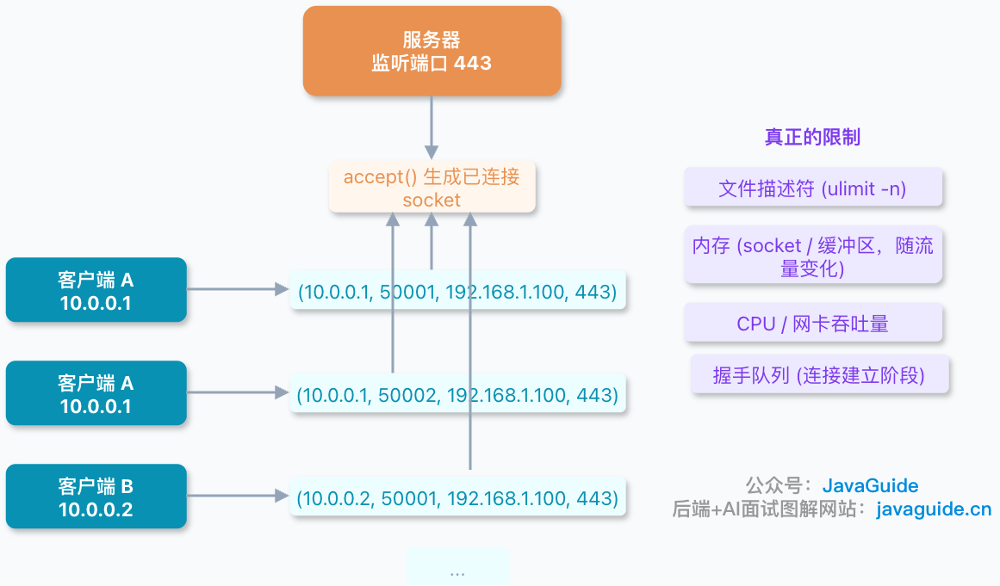
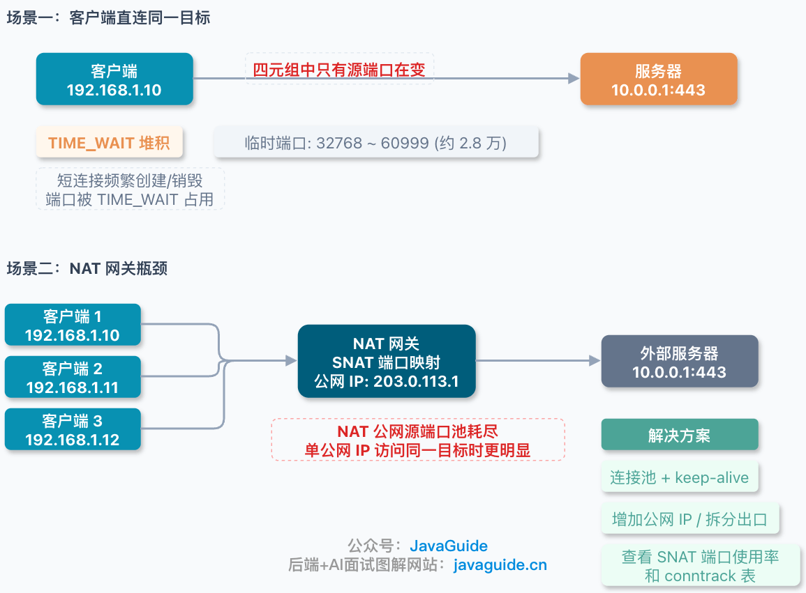
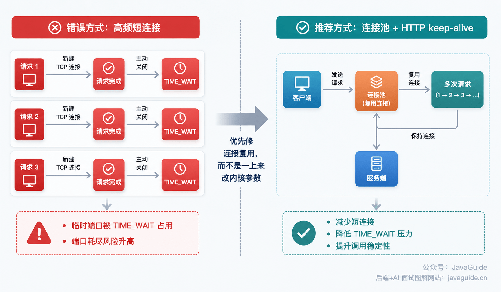
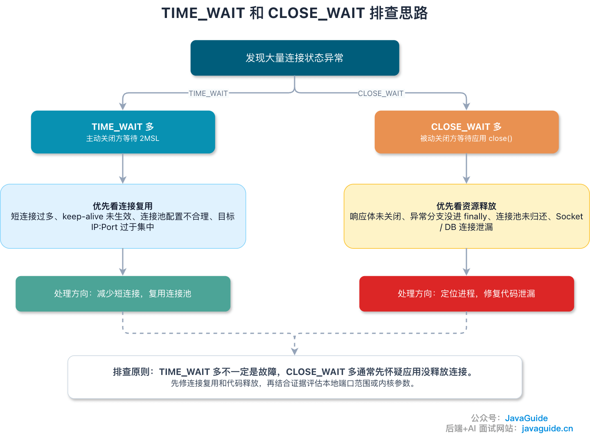

Is a host limited to 65,535 TCP connections? The short answer is **no**.

The number `65,535` comes from the port-number range. The source and destination port fields in a TCP header are both 16 bits, so each can represent values from `0` to `65,535`—a total of 2^16 = 65,536 values. **65,535 is the highest port number, not the maximum number of connections.**

The number of TCP connections is not the same as the number of port numbers. To understand why, start with how TCP identifies a connection.

## TCP Connections Are Identified by a Four-Tuple

TCP connections are identified by a four-tuple, not by the local port alone:

```text
Source IP, source port, destination IP, destination port
```

As long as the four-tuples differ, the kernel can identify them as separate connections.

To avoid confusion, the examples below use the **client's perspective when it initiates the connection**: `(client IP, client port, server IP, server port)`.

Suppose a server at `192.168.1.100` listens on port `8080`:



- Client A (`10.0.0.1:50000`) connects → `(10.0.0.1, 50000, 192.168.1.100, 8080)`
- Client A (`10.0.0.1:50001`) opens another connection → `(10.0.0.1, 50001, 192.168.1.100, 8080)`
- Client B (`10.0.0.2:50000`) connects → `(10.0.0.2, 50000, 192.168.1.100, 8080)`

These are three separate connections. The server IP and port are the same, but each four-tuple differs because the client IP or port differs.

One detail can be confusing: the server has **one listening socket** on port `8080`, but each call to `accept()` returns a new **connected socket**, identified by its four-tuple. Many connections can therefore share the same server port without conflicting.

## Why Can a Server Have More Than 65,535 Connections?

Suppose a web server listens on `192.168.1.100:443`. The server IP and port stay fixed, but client IPs and ports can vary. For example, `(10.0.0.1, 50001, 192.168.1.100, 443)` and `(10.0.0.2, 50001, 192.168.1.100, 443)` are different TCP connections because their four-tuples differ, even though both use server port `443`.

Considering IPv4 four-tuples alone, once the server IP and port are fixed, there are theoretically `2^32` possible client IPs and `2^16` client ports. That makes for a very large number of possible combinations.

In practice, resource limits and system configuration set the limit.

## What Actually Limits the Connection Count?

**1. File descriptors (FDs) and memory**

On Linux, a socket is also a file. Each established connection returned by `accept()` usually has a socket FD in the application process; **the listening socket also uses an FD**. Connections that have not yet been accepted remain in kernel queues, so they should not all be counted as FDs already held by the application.

When a process reaches its open-file limit, a common error is `Too many open files`.

For every TCP connection, the kernel maintains a socket, TCP control block, send and receive buffers, and other state. Idle connections use less memory; active connections and their application objects and buffers use more.

There is no useful fixed number of kilobytes per connection to memorize. Memory use depends on the kernel version, socket options, buffer sizes, and traffic patterns.

**2. Handshake queues and accept rate**

Linux maintains two relevant queues:

- **SYN queue (half-open queue)**: Connections that have received a SYN and sent a SYN-ACK but have not completed the handshake. The queue is limited by `tcp_max_syn_backlog`; its effective size also depends on `somaxconn` and the `listen()` backlog.
- **Accept queue (completed-connection queue)**: Connections that completed the handshake and are waiting for the application to call `accept()`. Its limit is `min(listen(fd, backlog), net.core.somaxconn)`.

These queues affect **queuing and drops while connections are being established**. They are not simple limits on the total number of `ESTABLISHED` connections.

When the SYN queue overflows, Linux can use SYN cookies. The server encodes the necessary information in the SYN-ACK sequence number instead of storing full half-open state, then reconstructs the connection information after receiving a valid ACK. SYN cookies are a defense mechanism, not a way to increase capacity.

When the accept queue overflows, behavior depends on `tcp_abort_on_overflow`. At the default value `0`, the server drops the client's ACK, prompting a retry and giving the server a chance to retransmit its SYN-ACK. At `1`, it replies with an RST and fails immediately. Production systems usually keep the default to avoid rejecting valid connections too readily. Use `ss -ltn` to investigate: if `Recv-Q` stays close to `Send-Q`, the application may not be accepting connections quickly enough. Check whether its thread pool is blocked or the backlog is too small.

**3. CPU, network interfaces, and application capacity**

Idle persistent connections mainly use memory, file descriptors, kernel connection-table space, and keepalive resources. Active connections also add system calls, encryption and decryption, protocol parsing, thread scheduling, and network interrupt load.

## Why Do Clients Hit Port Limits More Easily?



Servers are not limited to 65,535 connections, but a client's ephemeral ports may run out when it connects repeatedly to the same destination.

Suppose a client at `192.168.1.10` repeatedly connects to `10.0.0.1:443`. The destination IP, destination port, and source IP are fixed, leaving only the source port to vary. Once the available source ports are used, the client cannot create new four-tuples for that destination.

On Linux, check the range used for automatically assigned ephemeral ports with:

```bash
sysctl net.ipv4.ip_local_port_range
```

On macOS, use:


Many Linux systems default to the ephemeral port range `32768 60999`, about 28,000 ports. Check the output of `sysctl net.ipv4.ip_local_port_range` for the actual range; the entire `0–65535` range is not automatically used for ephemeral ports.

If you see `Cannot assign requested address` / `EADDRNOTAVAIL` or many failed `connect` calls while traffic is concentrated on one destination `IP:Port`, check for ephemeral port exhaustion or a buildup of `TIME_WAIT` sockets.

## The NAT Gateway May Become the Bottleneck

One often-overlooked case is that many private network hosts reach the public internet through a NAT gateway.

NAT translates private addresses to public ones. For example, when `192.168.1.10:50000` accesses an external service, the NAT gateway may translate it to `203.0.113.1:40000` and store the mapping. When a response arrives, the gateway uses that mapping to forward it to the original host.

If many private hosts share one public IP and connect to **the same external `IP:Port`**, the NAT gateway's available public source ports can become a limit. Connections to different destinations allow more port reuse. Port exhaustion is only one possible issue; the NAT device's connection-tracking table, CPU, or memory may become a bottleneck first.

When investigating connection limits, check the NAT gateway between the client and server as well.

Useful NAT metrics include connection-tracking table usage, SNAT port usage, connections from one public IP to one destination, and the device's CPU, memory, packet loss, and connection creation rate. If NAT is the bottleneck, consider adding public IPs, splitting outbound traffic across gateways, or reusing connections.

## How Does TIME_WAIT Affect the Connection Count?



Typically, **the side that actively closes the connection enters `TIME_WAIT`**. It waits after sending the final ACK to handle a lost ACK and prevent old packets from affecting a later connection. (If both sides close simultaneously, both can enter `TIME_WAIT`, but the active-close case is more common.)

While a connection is in `TIME_WAIT`, it cannot be freely reused. For a client making frequent short-lived connections to the same destination, many sockets in `TIME_WAIT` consume ephemeral ports and make port exhaustion more likely.

That is why high-concurrency clients should **prefer connection pools and HTTP keep-alive** to reduce short-lived connections at the source.

Connection reuse is also where TCP keepalive and HTTP Keep-Alive are often confused, even though they solve different problems.

In short, HTTP Keep-Alive controls how long a connection stays open and how many requests it serves. TCP keepalive checks whether a peer has disappeared after a long idle period. They do not interfere with each other and cannot replace one another. See [TCP Keepalive vs. HTTP Keep-Alive](./tcp-keepalive-vs-http-keepalive.md) for details.

Do not rush to change kernel settings just because you see many `TIME_WAIT` sockets.

Consider `tcp_tw_reuse` only in light of the kernel version, workload, and evidence of port exhaustion; it is not a universal optimization. Do not use `tcp_tw_recycle`, which was removed in Linux 4.12.

Do not try to clear `TIME_WAIT` sockets. They are a normal part of TCP, not junk.

If there are many `TIME_WAIT` sockets, first inspect the application: Is it continually creating short-lived connections? Is the connection pool working? Is HTTP keep-alive enabled? Does the client close the connection after every request?

One common production problem is **a misconfigured connection pool that eventually exhausts ephemeral ports**.

For example:

- The HTTP client has no keep-alive or connection pool, so it opens and closes a connection for every request. `TIME_WAIT` sockets quickly accumulate.
- The pool's maximum connection count or per-destination limit is too low, causing connections to be created and closed repeatedly.
- DNS resolves the service to a single IP, concentrating requests on one destination. The source port is then the main changing part of the four-tuple, making port exhaustion more likely.

For this problem, fix connection reuse first. After checking the pool, keep-alive, timeouts, and close behavior, consider expanding the ephemeral port range or adding source IPs. Do not start by changing kernel settings.



Use `ss -ant` to count sockets by TCP state. Run `ss -ant state time-wait | awk 'NR>1 {print $5}' | sort | uniq -c | sort -nr | head` to see which destinations have the most `TIME_WAIT` sockets, and `ss -ltn` to inspect accept queues. If `TIME_WAIT` sockets cluster around one remote service, check short-lived connections and the pool. If `CLOSE_WAIT` sockets cluster in one local process, check whether the application closes connections correctly.

## The Short Answer

Is a host limited to 65,535 TCP connections?

No. That is not what the number means.

`65,535` is the maximum port number, not a limit on TCP connections. TCP connections are distinguished by a four-tuple: source IP, source port, destination IP, and destination port. A server can accept more connections on the same listening port as long as the client IP or port differs.

However, being able to distinguish connections does not mean a machine can handle them all. File descriptors, memory, CPU, network interfaces, application capacity, and handshake queues can all limit the count. A client making frequent short-lived connections to one destination may also run into ephemeral-port and `TIME_WAIT` limits. If traffic passes through NAT, the gateway's capacity matters too.

In short: **Server connection counts mainly depend on machine resources; a client connecting to one destination is mainly limited by ephemeral ports; and traffic through NAT is also limited by the gateway. `65,535` is the maximum port number, not the maximum number of TCP connections.**
