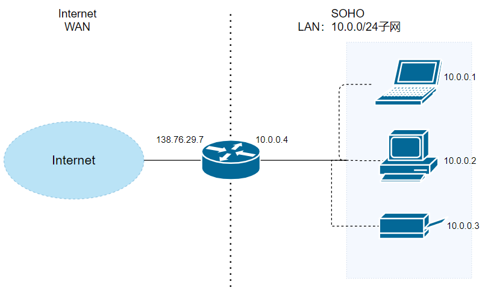
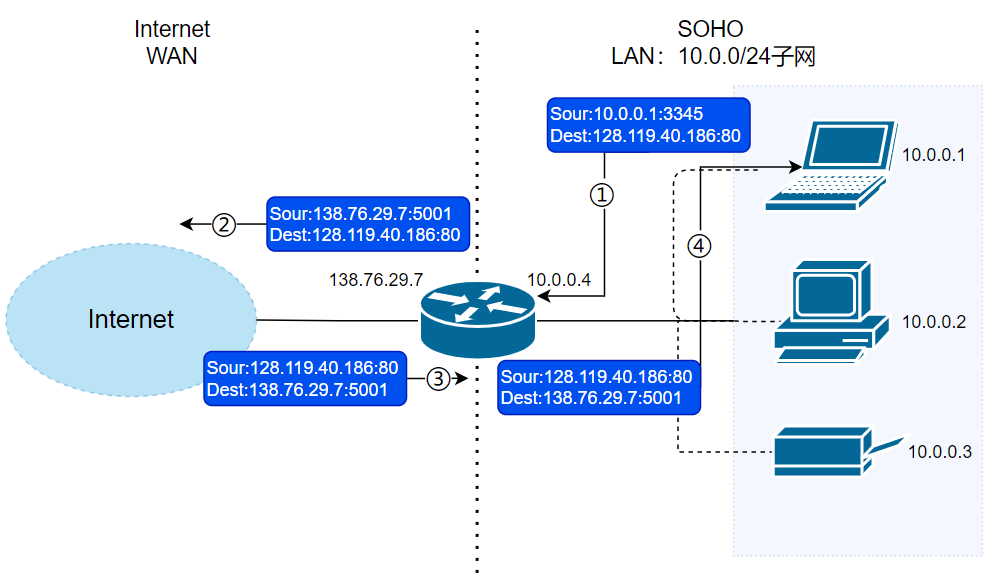

Devices on home and corporate networks often use private IP addresses such as `192.168.x.x` and `10.x.x.x`. These addresses aren't routed directly over the public internet, but devices on private networks can still access the internet.

NAT usually makes this possible. It translates between private and public addresses so multiple devices can share one or a small number of public IP addresses when communicating externally.

This article answers four questions:

1. What problem does NAT solve?
2. How does a NAT mapping table record address and port mappings?
3. What happens to a source IP address and port when a host accesses the internet?
4. What limitations does NAT introduce, and why is it harder for an external host to initiate a connection to a private host?

## Use Cases

**Network Address Translation (NAT)** translates addresses between an internal network and an external network. Within a small subnet, or **local area network (LAN)**, hosts use addresses that are meaningful on that LAN. Outside the LAN, on a **wide area network (WAN)**, a shared public IP address identifies the network's connection to the internet.

This is easy to understand in the context of small offices and home offices (SOHOs). A subnet lets an organization manage its local devices, while also avoiding the need to assign a globally unique IPv4 address to every host. IPv4 has only $2^{32}$ addresses, so private addressing helps reduce demand for public addresses.

A router usually acts as the SOHO network's gateway. Its LAN interface connects to the private subnet, while its WAN interface connects to the ISP and uses a public address. NAT translates addresses as hosts on the LAN communicate with systems outside it.

## How It Works

Suppose the diagram shows a router with a LAN on its right and a WAN on its left. The LAN uses network `10.0.0.0/24`, and the router's LAN interface is `10.0.0.4`. At least three hosts are on the subnet: `10.0.0.1`, `10.0.0.2`, and `10.0.0.3`. The router's WAN interface has address `138.76.29.7`.

Keep these details in mind:

1. The LAN's network address is `10.0.0.0/24`: the prefix is 24 bits, leaving 8 bits for host addresses. DHCP assigns addresses to the three hosts and the router's LAN interface. The router often runs a small DHCP server for the subnet.
2. DHCP also assigns the router's WAN address, but the router obtains it from the ISP. That DHCP service is usually provided by a server in the ISP's network.

The router also runs NAT to translate addresses for LAN-to-WAN communication. A key component is the **NAT mapping table**. Suppose the following request is sent:

1. Host `10.0.0.1` sends an HTTP request to a web server at `128.119.40.186` on port 80. Host `10.0.0.1` selects a source port, such as `3345`, and sends the request to the router. The destination IP remains `128.119.40.186`; the packet first reaches the router's LAN interface at `10.0.0.4`.
2. The router receives the request on `10.0.0.4`, assigns a new source port such as `5001`, and forwards the packet through its WAN interface at `138.76.29.7`. It records the mapping **138.76.29.7:5001 — 10.0.0.1:3345** in the NAT table.
3. The packet leaves the WAN interface and continues to `128.119.40.186`.

The response follows this path:

1. The server at `128.119.40.186` sends its response to `138.76.29.7:5001`.
2. The response reaches the router's WAN interface. The router finds `138.76.29.7:5001` in its NAT table, translates the destination to `10.0.0.1:3345`, and forwards the packet toward its LAN interface at `10.0.0.4`.
3. The router forwards the translated response from its LAN interface to host `10.0.0.1`.

🐛 **Correction** (see [issue #2009](https://github.com/Snailclimb/JavaGuide/issues/2009)): In step 4 of the diagram above, the destination should be `10.0.0.1:3345`, not ~~`138.76.29.7:5001`~~. The original diagram contained a typo.

## Key Points

Keep these points in mind:

1. A 16-bit port field doesn't mean a NAT can support only about 65,500 hosts. Port space limits the number of simultaneous mappings available for a particular external address, transport protocol, mapping behavior, and mapping lifetime. A host can create multiple mappings, and a NAT can use multiple public addresses.
2. The destination server sees a request from the router's public endpoint, such as `138.76.29.7:5001`, rather than the original private host. **The router therefore hides internal addresses from external hosts.** Outbound requests share the public IP address and use different ports; responses are forwarded to internal hosts using the NAT mappings.
3. Whether NAT can reuse a mapping can't be determined from the private IP address alone. A mapping must at least distinguish the transport protocol, internal IP, and internal port. Whether the remote address and port also matter depends on the NAT's mapping behavior. NAT can reuse an external address and port only when the packet matches an existing mapping.

NAT has several practical benefits:

1. By hiding LAN addresses from the WAN, NAT helps conserve IPv4 addresses.
2. Changing a LAN host's IP address doesn't require notifying the WAN.
3. When the ISP changes the router's WAN address, LAN hosts don't need to be notified.
4. NAT hides internal addresses and topology. Filtering behavior on many NAT devices also makes it difficult for unsolicited external traffic to reach an internal host. However, filtering policy—not address translation itself—determines which inbound packets are allowed. NAT isn't a replacement for a stateful firewall, access controls, or host security.

NAT also has tradeoffs. **Outside the LAN, the router uses port numbers to distinguish internal hosts that share the same public IP address.** This can make ports appear to serve as host identifiers. NAT also modifies packet headers, including source addresses and ports, even though routers are network-layer devices. Despite these concerns, NAT has remained widely used as a practical way to address IPv4 scarcity and connect private networks to the internet.

<!-- @include: @article-footer.snippet.md -->
