> This article is adapted and expanded from [Common TCP/IP Attacks - Nuanlan Notes (2021)](https://mp.weixin.qq.com/s/AZwWrOlLxRSSi-ywBgZ0fA).

The TCP/IP suite was designed to enable interoperability, but many of its mechanisms predate today's scale and intensity of attacks.

IP spoofing, SYN floods, DDoS, ARP spoofing, and DNS hijacking look different, but each exploits assumptions of trust, resource limits, or name-resolution paths in network protocols.

This article covers four questions:

1. Which mechanisms do common TCP/IP attacks exploit?
2. How do attacks such as IP spoofing, SYN floods, and DDoS work?
3. What impact can common network attacks have?
4. What basic defenses can help?

## IP Spoofing

### What Is an IP Address?

An IP address can be compared to a street address: the network portion identifies the network, and the host portion identifies an interface on that network. Together, they form an **IP address**.

### What Can an IP Address Tell Us?

IP addresses help routers forward packets toward their destination. A packet typically passes through routers along a route until it reaches the destination network. An IP address does not necessarily reveal a server's precise physical location.

**IP packet header:**

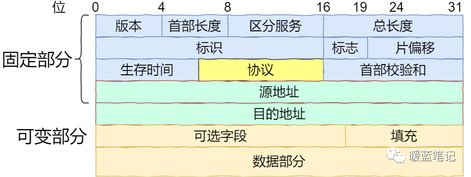

### What Is IP Spoofing?

IP spoofing forges the source IP address in a packet, making it appear to come from another host. The attacker may try to impersonate a host that is trusted by the target or has special access.

Suppose a legitimate user at **1.1.1.1** has established a TCP connection with a server. An attacker might try to interrupt it by forging an RST segment with source IP **1.1.1.1**. Spoofing the source IP alone is not enough: the segment must match the connection's four-tuple and pass the receiver's sequence-number checks. An on-path attacker can observe sequence numbers; an off-path attacker must guess an acceptable one. Modern TCP implementations may also use Challenge ACKs to mitigate blind RST attacks.

If a forged RST passes validation, the server closes the connection, and the legitimate user must establish a new one to continue. Because the attacker must also obtain or guess the connection parameters, simply spoofing many source IP addresses and sending arbitrary RST segments is not guaranteed to work.

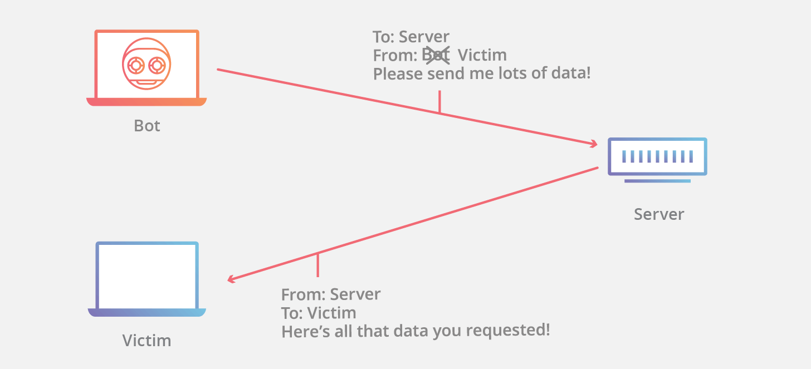

### How Can IP Spoofing Be Mitigated?

IP spoofing cannot be prevented everywhere, but networks can filter forged packets. **Ingress filtering**, described in BCP 38, is commonly applied at [network edges](https://www.cloudflare.com/learning/serverless/glossary/what-is-edge-computing/). It checks whether an incoming packet's source address is plausible for the network it arrived from and drops suspicious packets. Some networks also use egress filtering to check source addresses on outgoing packets and reduce spoofing from inside the network.

## SYN Flood

### What Is a SYN Flood?

A SYN flood is a classic denial-of-service attack that aims to exhaust server resources and prevent the server from handling legitimate traffic.

It exploits TCP's three-way handshake. Attackers may send a large number of SYN segments, sometimes from spoofed addresses or compromised devices. The server responds with SYN-ACK and retains state for connections that have not completed the handshake. If resources are exhausted, the server may be unable to serve legitimate clients. Adding capacity alone may not be enough; defenses aim to limit the cost of incomplete handshakes while allowing legitimate connections.

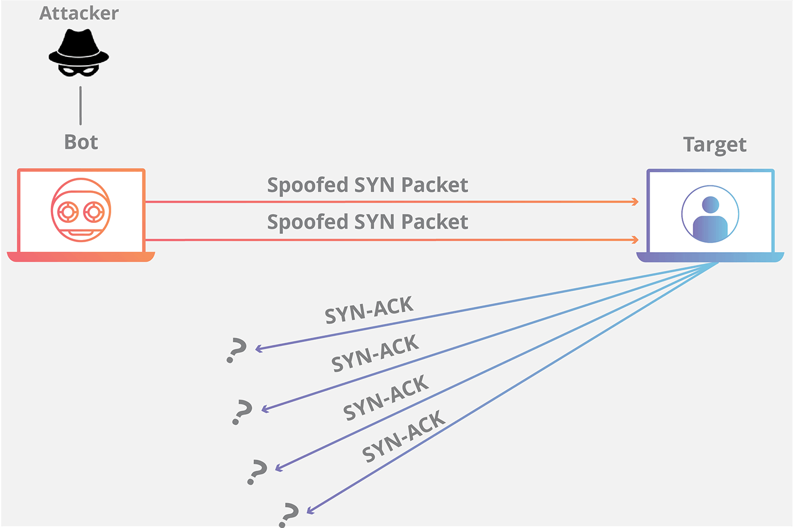

### How Does a TCP SYN Flood Work?

A TCP SYN flood exploits the **TCP three-way handshake** (**SYN → SYN/ACK → ACK**). Assume A initiates a connection and B listens for connections on a port, as shown below.

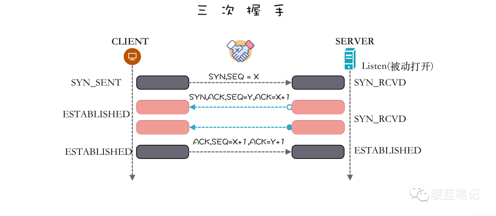

A first sends a **SYN** segment to B. B responds with **SYN-ACK**, which serves two purposes:

- It acknowledges A's SYN and indicates that B is ready to receive data.
- It also sends B's initial sequence number and asks A to acknowledge it. B then waits for A's ACK, leaving the connection **half-open**. A sends the final **ACK**, completing the handshake and establishing the connection.

The handshake lets both sides confirm that they are ready to communicate and exchange initial sequence numbers. TCP uses sequence numbers to deliver bytes in order to the receiving application.

TCP is **full-duplex**, so both sides can send data. The SYN and SYN-ACK exchange communicates A's initial sequence number to B; SYN-ACK and ACK communicate B's initial sequence number to A.

This describes a normal handshake between cooperative peers.

In practice, packets can be lost, or a peer may deliberately delay or omit the final handshake message.

When B receives A's SYN, it responds with SYN-ACK and enters the **half-open state**. Since B cannot know whether SYN-ACK or A's ACK was lost, it keeps state and starts a timer. If the ACK does not arrive, B may retransmit SYN-ACK and eventually abandon the connection after a retry limit.

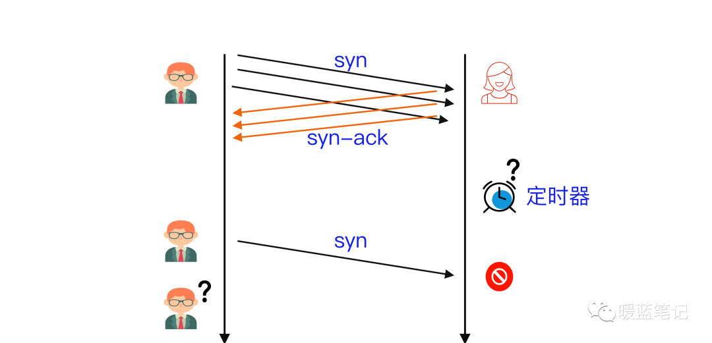

B allocates kernel resources to maintain half-open connections. An attacker can use compromised devices to send many SYNs without completing the handshake, or spoof source IP addresses so B's SYN-ACK responses never reach a real client. The server can then accumulate incomplete connections and run out of resources.

### What Are Common Types of SYN Floods?

SYN floods are commonly categorized as:

1. **Direct attack:** The attacker uses a real source IP and prevents the source from responding to SYN-ACK, leaving connections half-open. Since the source is visible, it may be easier to block, although attacks can also come from botnets such as [Mirai](https://www.cloudflare.com/learning/ddos/glossary/mirai-botnet/).
2. **Spoofed-source attack:** The attacker forges the source IP in SYN packets, making attribution and source-based filtering harder. Tracing spoofed traffic is difficult, but upstream providers may help.
3. **Distributed attack (DDoS):** A botnet can generate traffic from many devices, making mitigation and attribution more difficult. Attackers may also spoof the source addresses.

### How Can SYN Floods Be Mitigated?

#### Increase the Backlog Queue

Operating systems limit the number of half-open connections. One option is to increase that limit, but doing so requires additional memory. If the system cannot support the larger queue, performance may suffer; even so, it may be preferable to refusing all connections.

#### Reclaim Older Half-Open Connections

Another strategy is to replace older half-open connections when the backlog fills. This works only if legitimate connections complete faster than the attacker fills the queue; it may fail under heavier attacks or when the queue is too small.

#### SYN Cookies

With SYN cookies, the server encodes connection state in its SYN-ACK instead of storing it in the backlog. It can discard the original SYN state and reconstruct it when a valid ACK arrives, subject to implementation limits. Some connection information may be lost, but this can help preserve resources for legitimate clients.

## UDP Flood

### What Is a UDP Flood?

A **UDP flood** is a denial-of-service attack that sends a large volume of UDP packets to overwhelm a server's ability to process and respond. Firewalls protecting the server can also be exhausted, preventing legitimate traffic from getting through.

### How Does a UDP Flood Work?

A UDP flood exploits the work a server may perform when it receives packets on a UDP port. Under normal conditions:

- The server checks whether an application is listening on the destination port.
- If not, the IPv4 stack usually returns **ICMP Destination Unreachable** (type 3, code 3: **Port Unreachable**). This is not the ICMP Echo message used by ping, and firewalls may drop or rate-limit these errors.

Imagine a hotel receptionist who checks whether a guest is available before transferring each call. If all phone lines ring at once, the receptionist can quickly become overwhelmed.

The server uses resources to process each UDP packet. Attackers may spoof the source IP address to hide the source and cause response traffic to be sent elsewhere.

If the target must process and respond to a large volume of UDP packets, its resources may be exhausted and legitimate traffic may be denied.

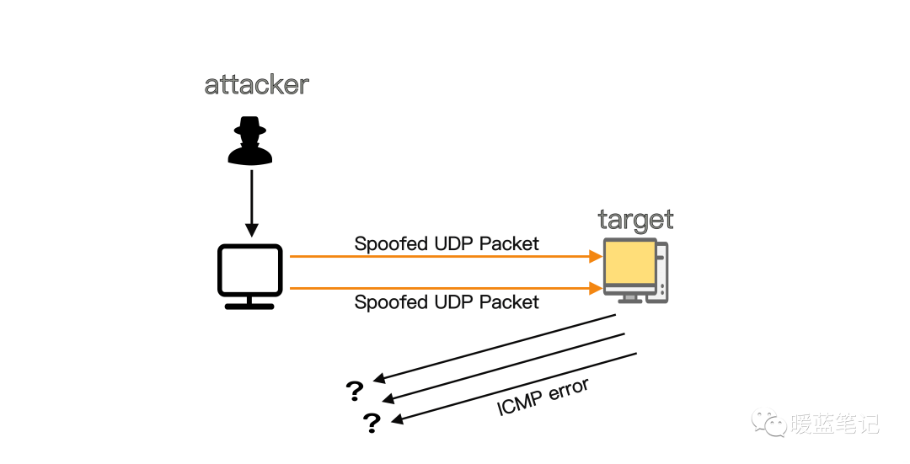

### How Can UDP Floods Be Mitigated?

Many operating systems rate-limit ICMP responses, which can reduce attacks that depend on those responses. However, legitimate packets may also be affected. If a UDP flood saturates an upstream link or firewall state table, mitigation on the server alone may not be enough.

## HTTP Flood

### What Is an HTTP Flood?

An HTTP flood is a denial-of-service attack that overwhelms a server with HTTP requests. If the server cannot handle legitimate traffic because it is saturated, users experience a denial of service.

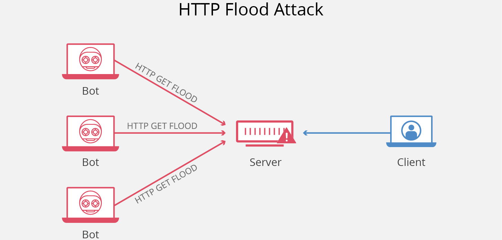

### How Does an HTTP Flood Work?

An HTTP flood is a Layer 7 DDoS attack. Layer 7 is the application layer of the OSI model, which includes protocols such as HTTP. HTTP is used for browser requests, including loading pages and submitting forms. Application-layer attacks can be difficult to mitigate because malicious requests may resemble legitimate traffic.

Attackers may use a botnet of malware-infected devices to generate a high volume of traffic.

Two common forms are:

- **HTTP GET flood:** Multiple devices coordinate requests for images, files, or other resources. The volume of requests and responses can prevent the server from handling legitimate users.
- **HTTP POST flood:** Form submissions may require significant application and database work. Attackers send many POST requests to consume those resources and saturate the server.

### How Can HTTP Floods Be Mitigated?

Layer 7 attacks often require several defenses. One approach is to challenge request sources to determine whether they are automated, for example with CAPTCHA or JavaScript challenges.

Other defenses include a Web Application Firewall (WAF), IP reputation data to identify and selectively block malicious traffic, and real-time analysis by security engineers. Large providers can analyze traffic from many sources and update WAF rules and other protections to mitigate application-layer DDoS traffic.

## DNS Flood

### What Is a DNS Flood?

DNS servers act like an Internet directory, helping devices find the addresses for web servers. A DNS flood is a DDoS attack that sends enough traffic to overwhelm a domain's DNS servers and disrupt name resolution. Websites, APIs, and web applications may then be unreachable to legitimate users. DNS floods can be difficult to distinguish from legitimate high traffic because requests may come from many addresses and ask for real records.

### How Does a DNS Flood Work?

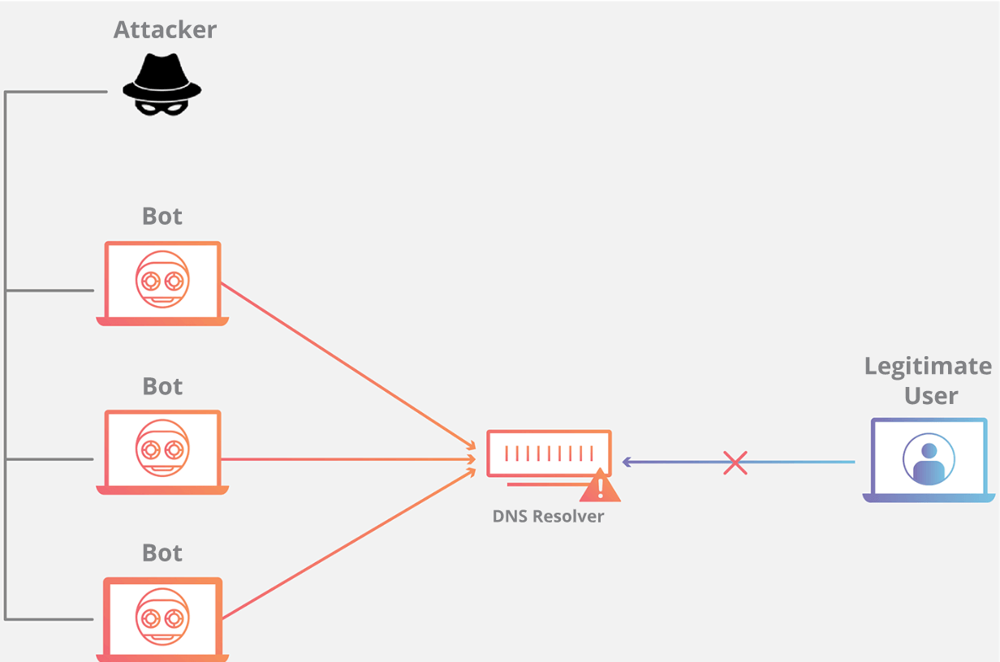

DNS maps readable names such as `example.com` to server addresses such as `192.168.0.1`. An attack on DNS infrastructure can therefore make many services unreachable. High-bandwidth [Internet of Things (IoT)](https://www.cloudflare.com/learning/ddos/glossary/internet-of-things-iot/) [botnets](https://www.cloudflare.com/learning/ddos/what-is-a-ddos-botnet/), such as [Mirai](https://www.cloudflare.com/learning/ddos/glossary/mirai-botnet/), can use compromised cameras, DVRs, and other devices to send large numbers of requests directly to DNS providers, preventing legitimate users from reaching their resolvers.

A DNS flood differs from a [DNS amplification attack](https://www.cloudflare.com/learning/ddos/dns-amplification-ddos-attack/). Amplification attacks reflect traffic through misconfigured DNS servers to hide the source and increase the volume of traffic sent to a victim. Attackers send small requests for large DNS records with a spoofed source address, causing the servers to send larger responses to the target.

### How Can DNS Floods Be Mitigated?

High-bandwidth botnets can target even large organizations. Mitigation often relies on a large, distributed DNS service that can monitor, absorb, and filter attack traffic. Infected IoT devices should also be updated or replaced.

## TCP Reset Attack

In a **TCP reset attack**, an attacker sends forged RST segments to one or both endpoints, attempting to make them close a connection early. Whether an endpoint accepts an RST depends on the connection state and fields such as the sequence and acknowledgment numbers. For an established connection, the receiver closes it only if the RST passes sequence-number validation. RSTs outside the receive window are discarded; endpoints implementing RFC 5961 also send a challenge ACK for an in-window RST that does not match exactly.

The attack attempts to exploit this behavior by sending a forged reset segment. If accepted, the receiver closes the TCP connection and further data cannot be exchanged on it. The client and server can establish a new connection, although that connection may also be targeted. Because crafting and sending a valid segment takes time, long-lived connections are generally more exposed than short-lived ones.

TCP does not cryptographically authenticate its headers, so TLS does not protect TCP-layer RST segments. IPsec or TCP-AO can authenticate traffic at a lower layer, but require support from both endpoints and the network environment.

## Demonstration in a Controlled Environment

> The original experiment was performed on macOS. Behavior may differ on other systems. Run network security experiments only on systems and connections you own or are authorized to test.

At a high level, a forged **TCP** reset requires:

- Observe traffic between the endpoints.
- Identify a segment with the `ACK` flag set and inspect its acknowledgment number.
- Construct an RST segment with a sequence number that may pass the receiver's checks. The exact conditions depend on the TCP implementation and connection state.
- Send it to one or both endpoints, potentially interrupting the connection.

For a controlled demonstration, use a local TCP connection between processes on the same computer. The experiment involves:

- Establishing a TCP connection between two terminal windows.
- Observing packets exchanged over the local interface.
- Studying how a reset segment can interrupt the connection.

The following commands create a local TCP connection for the demonstration.

> Establish a TCP connection

Use `netcat`, which is preinstalled on many systems. In the first terminal, run:

```bash
nc -nvl 8000
```

This starts a TCP server listening on port `8000`. In a second terminal, run:

```bash
nc 127.0.0.1 8000
```

This connects to the server. Text entered in either window is sent over the TCP connection and displayed in the other window.

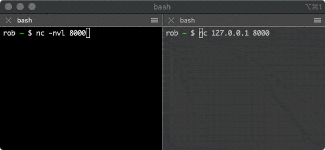

> Observe traffic

The original demonstration uses the Python networking library `scapy` to observe packets exchanged by the two terminal windows. The following image shows part of the code, which uses Scapy's packet-sniffing function:

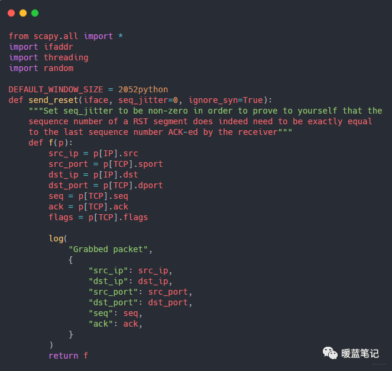

This code tells `scapy` to observe packets on the `lo0` loopback interface and record details about TCP connections.

- **iface:** The network interface on which to observe packets, here `lo0` (localhost).
- **lfilter:** A filter that ignores packets outside the specified TCP connection between localhost and port `8000`.
- **prn:** A function that processes packets matching `lfilter`. In this example it prints them to the terminal.
- **count:** The number of packets to observe before Scapy returns.

> About forged reset segments

The original experiment then modifies the packet-processing function to construct and send a forged TCP reset. This demonstrates why TCP sequence validation matters; do not run such code against systems or connections without authorization.

For an observed segment from (`src_ip`, `src_port`) to (`dst_ip`, `dst_port`) with the ACK flag set and acknowledgment number `100,000`, the demonstration would:

- Reverse the source and destination addresses and ports.
- Set the `RST` flag.
- Use the observed acknowledgment number as the candidate sequence number.
- Send the segment to one endpoint using Scapy.

In the original program, enabling the send call and running it alongside the local test connection interrupts that connection. This behavior is specific to the test setup and TCP implementation.

> Further observations

1. In an isolated lab, observe how changing the candidate sequence number affects whether the endpoint accepts a reset.
2. Use `Wireshark` on the loopback interface with the filter `ip.src == 127.0.0.1 && ip.dst == 127.0.0.1 && tcp.port == 8000` to inspect the test connection.
3. Observe how the timing and rate of data exchange affect the demonstration.

## Man-in-the-Middle Attacks

Imagine that an attacker intercepts and alters a letter sent between two people. In network communication, this is the basic idea behind a man-in-the-middle attack.

### What Is a Man-in-the-Middle Attack?

In a **man-in-the-middle (MITM) attack**, an attacker creates separate connections with both parties and relays data between them. Each party may think it is communicating directly over a private connection, while the attacker can observe or alter the traffic.

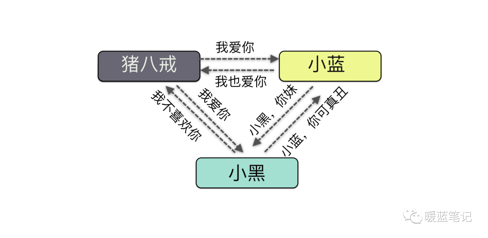

The attacker is the “middle” party. A network security product may also inspect traffic and warn users about unsafe sites, but that alone does not mean a MITM attack is taking place.

### How Does a MITM Attack Work?

Suppose two parties sign copies of a contract, but later cannot tell whether one copy was altered. They need a way to verify that the document is authentic.

Security controls cannot eliminate every attack, but they can raise the cost of carrying one out. The following sections introduce the cryptographic mechanisms used to protect authenticity and privacy.

The parties might ask a trusted third party to store the original contract. This helps as long as that party remains trustworthy.

**What if the third party is not sufficiently secure?**

The parties also need a way to detect changes made by someone with access to the stored contract.

One approach is to use a **hash function**. It maps data of any length to a fixed-size digest. Hashing is not encryption and cannot be reversed; different inputs can produce the same digest, so a digest is not an absolutely unique identifier. A secure cryptographic hash is designed so that even a small input change is likely to change the digest.

#### What Are Common Hash Algorithms?

Common hash families include Message Digest algorithms and the Secure Hash Algorithm (**SHA**). **MD5** produces a 128-bit digest, but practical collision attacks have made it unsuitable for security-sensitive uses. A collision means two different inputs produce the same digest.

For new security-sensitive systems, use an appropriate modern hash from the SHA-2 or SHA-3 family.

**What if an insider can change both the contract and its digest?**

Storing a digest beside the contract is not enough if the same person can modify both. Separating them can make tampering harder, but does not completely solve the trust problem.

**How can the parties limit an employee's ability to change the contract?**

One option is for both parties to keep a copy of the contract while a third party stores the digest. This makes undetected changes more difficult.

**What if an employee colludes with one of the parties?**

Trusting a third party still has risks. **Digital signatures and certificates** provide a stronger way to establish authenticity.

#### What Are Digital Signatures and Certificates For?

Suppose Sum and Mike sign a contract. Sum uses a signature algorithm and a private key to create a digital signature, then gives Mike the contract, signature, and corresponding public key.

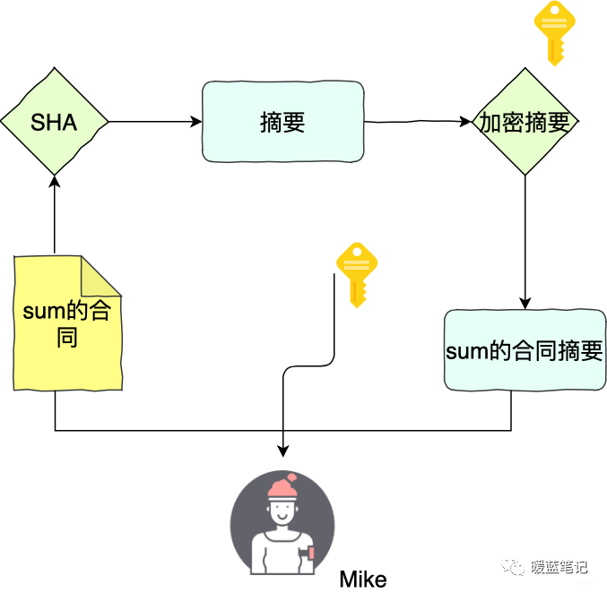

Mike uses Sum's public key to verify the signature. If verification succeeds, the signature matches the public key and the current contract contents, which helps detect changes and shows that it was produced by someone holding Sum's private key.

If Mike changes the contract, the original signature will fail verification. Without Sum's private key, he cannot create a valid replacement signature. Sum must protect the private key; the public key can be shared with verifiers.

Digital signatures are best described as **signing with a private key and verifying with a public key**, not as “private-key encryption and public-key decryption.” RSA, ECDSA, and EdDSA use different mathematical processes, but signing and verification are the accurate terms.

Signatures provide authenticity and integrity, not confidentiality. To keep message contents private, use encryption. The next sections introduce symmetric and asymmetric encryption.

#### What Is Symmetric Encryption?

With symmetric encryption, the sender and receiver use the same secret key. The sender encrypts the message with an encryption algorithm, and the receiver uses the same key to decrypt it.

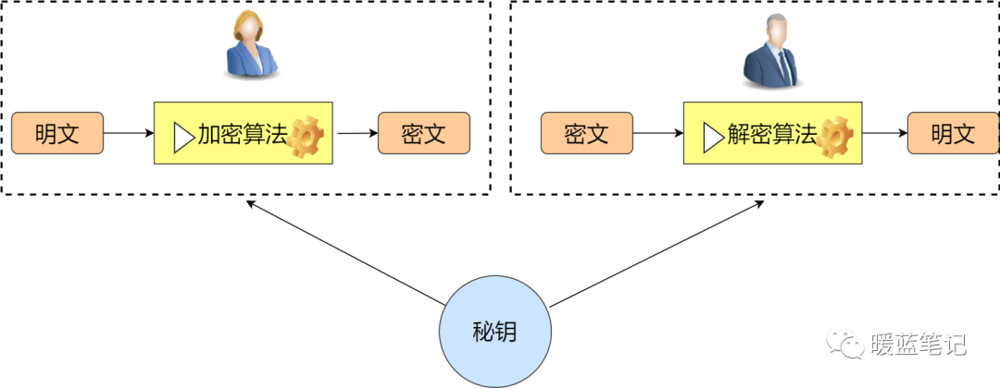

#### What Are Common Symmetric Encryption Algorithms?

**DES**

DES uses a 64-bit key format, but only 56 bits contribute to encryption; the remaining bits were used for parity. A 56-bit key is too short to be secure against brute-force search, so **DES is no longer considered secure**.

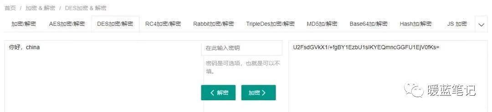

**IDEA**

The International Data Encryption Algorithm (IDEA) uses a 128-bit key and is not restricted by patents.

**AES**

The **Advanced Encryption Standard (AES)** replaced DES and supports 128-, 192-, and 256-bit keys. Choose a key size based on the application's security requirements and implementation guidance.

**SM1 and SM4**

**SM1 and SM4** are Chinese cryptographic standards. SM1's details are not public; SM4 is publicly specified.

**Summary:**

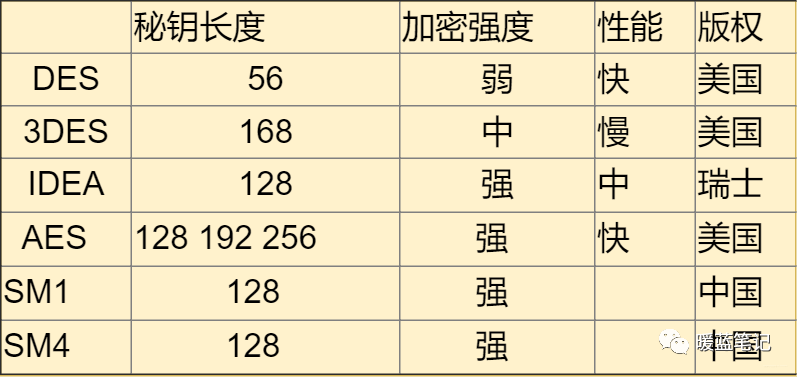

#### What Are Common Asymmetric Cryptographic Algorithms?

Symmetric encryption uses the same key at both ends. Asymmetric cryptography uses a public/private key pair and can help establish or protect keys without sending the private key over the network. The public key can be shared; the private key must remain secret. Asymmetric cryptography is commonly used for key establishment and signatures, while symmetric algorithms are generally used to encrypt bulk data.

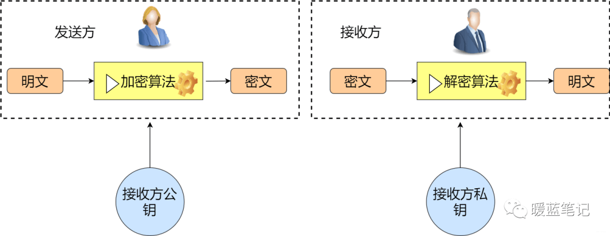

Asymmetric cryptography is used in systems such as SSH, where public keys can be distributed to allow secure login across multiple servers. It is also used in secure cluster communication.

Common asymmetric algorithms include:

- **RSA (Rivest–Shamir–Adleman):** Its security relies on the difficulty of factoring large integers. It is widely supported, but operations are relatively slow and computational cost increases with key size, such as 2048 or 4096 bits.
- ECC: A family of public-key cryptographic systems based on elliptic curves. Security and performance depend on the specific curve and algorithm.
- SM2: A Chinese public-key cryptographic standard based on elliptic-curve cryptography.

Summary:

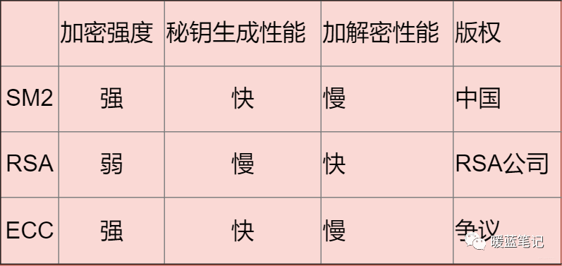

#### What Are Common Hash Algorithms?

Hash functions are commonly used for integrity checks and content addressing, but security requirements vary by use case. Password verifiers must not be treated like ordinary file digests: the server should generate a unique salt for each password and use a password-hashing scheme with a configurable cost. Store the salt, algorithm identifier, and cost parameters so the scheme can be strengthened or migrated later.

**MD5 (not recommended)**

MD5 produces a 128-bit digest, but no longer provides reliable collision resistance. Do not use it for digital signatures, certificates, security-sensitive integrity checks, or password storage. For detecting accidental errors in a non-adversarial setting, it is only a checksum and provides no security guarantee. MD5, SHA-1, and a single unkeyed SHA-256 hash are all unsuitable for direct password storage.

**SHA**

The Secure Hash Algorithm family includes **SHA-1**, **SHA-2**, and **SHA-3**. These algorithms map input data to a fixed-length digest. Hashing is not reversible, but a digest is neither ciphertext nor a message authentication code. SHA-1 is no longer suitable for security-sensitive use cases that require collision resistance; new systems generally choose a specific SHA-2 or SHA-3 algorithm.

**SM3**

**SM3** is a Chinese cryptographic hash standard with a 256-bit digest, similar in output size to SHA-256.

**Summary:**

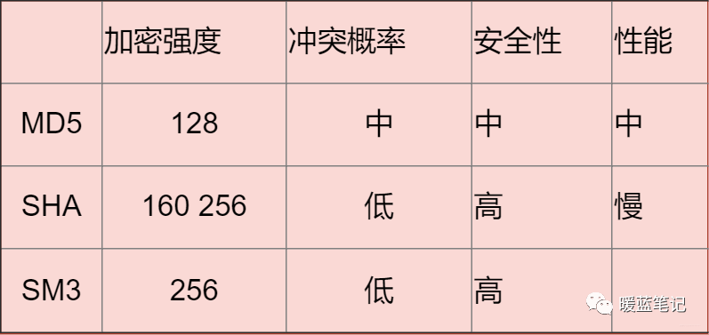

Symmetric encryption, asymmetric cryptography, and hash functions solve different problems. Symmetric encryption protects bulk data; asymmetric cryptography supports key establishment, encryption, and digital signatures; hash functions produce digests. Choose a method based on the goal—confidentiality, integrity, authentication, or password storage—not simply whether the operation is reversible.

#### What Are Certificate Authorities and Certificates For?

There is another problem: Sum could later deny that the public key or contract came from them.

This is where **certificate authorities and digital certificates** help establish trust in the binding between an identity and a public key.

A certificate is trusted because its issuer is trusted. Instead of giving Mike an unauthenticated public key, Sum can provide a certificate containing the key and signed by a trusted certificate authority (CA). Mike can then validate the certificate according to his trust store and the relevant policies.

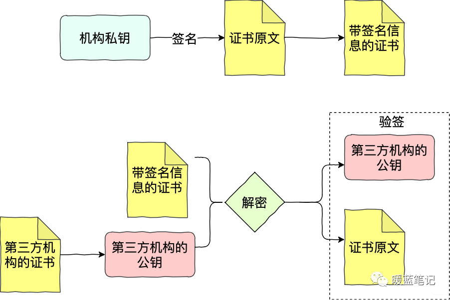

Sum submits a certificate request to a CA. After validating the request, the CA signs the certificate with its private key. Mike uses the CA's public key to verify the signature. Successful verification shows that the signed certificate data has not been changed and that the signature was made by someone holding the CA's private key.

This scheme relies on the CA to vouch for the association between an identity and a public key. If the CA is compromised or issues a certificate incorrectly, certificate validation may be affected.

In practice, Public Key Infrastructure (PKI) commonly uses a hierarchy of root CAs, intermediate CAs, and end-entity certificates. This helps isolate root keys, delegate issuance, and constrain certificate use. A longer chain does not by itself eliminate trust risks.

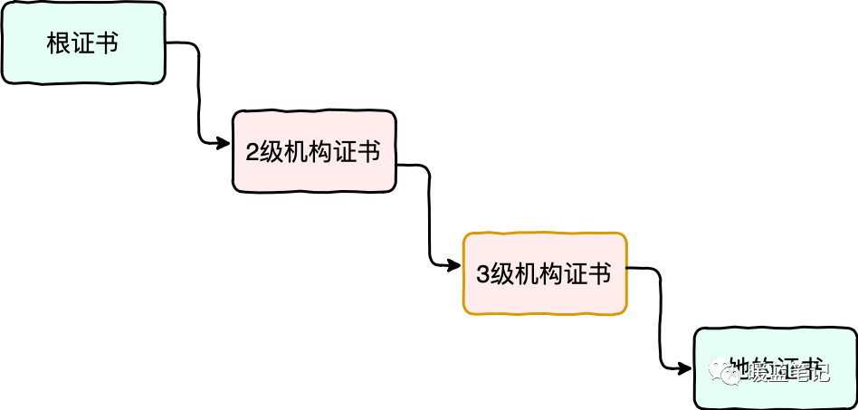

In the diagram, a trusted root CA issues a certificate to an intermediate CA, which may issue a certificate to another intermediate, which then issues Sum's certificate.

To validate Sum's certificate, verify its signature with the public key in the issuing intermediate's certificate.

To validate that intermediate's certificate, verify its signature with the public key in the parent intermediate's certificate.

To validate the parent intermediate, verify its signature with the trusted root's public key. The client must also check validity dates, names, intended use, path constraints, and whether the chain leads to a locally trusted root.

Together, these certificates form a trust chain. If a trusted CA is compromised or issues a certificate improperly, it may be able to issue fraudulent certificates within its authority; all CAs do not need to collude.

### How Can MITM Attacks Be Prevented?

Browsers may display certificate warnings such as the one shown below:

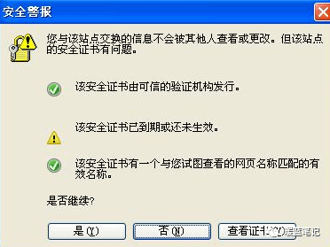

A browser certificate warning means certificate validation failed. Possible causes include an expired certificate, a hostname mismatch, an untrusted certificate chain, an incorrect system clock, a server configuration problem, or a MITM attack. The warning alone does not identify the cause; users should not bypass it and continue.

An application may use certificate or public-key pinning for a clearly defined threat model, but it must also plan for certificate rotation, backup keys, and recovery. Otherwise, certificate updates may prevent clients from connecting. For ordinary browser traffic, rely on the system trust store to validate the certificate chain, hostname, and validity period; do not manually trust an unknown certificate.

## DDoS

Several attacks described above can be used as DDoS attacks. This section summarizes the concept and some common defenses.

Many major Internet companies have experienced **DDoS** attacks.

In 2018, GitHub experienced a DDoS attack that peaked at about 1.35 Tbps. Similar attacks have targeted other large Internet services.

### What Is a DDoS Attack?

**DDoS** stands for **Distributed Denial of Service**. Multiple sources coordinate traffic against one or more targets. A single-source DoS attack may exploit protocol or operating-system weaknesses, or simply consume bandwidth and system resources with a large volume of requests, preventing normal service.

> For example:

Imagine a restaurant with 50 seats. A competitor sends 50 people to occupy every seat without ordering, so real customers cannot get a table.

This illustrates a DDoS attack: an attacker uses compromised devices (a botnet) to send many requests in a short time, consuming the target's resources and disrupting service. Online games and financial services are among the sectors that may be targeted.

Common forms include **ICMP floods**, **UDP floods**, **NTP floods**, **SYN floods**, **HTTP floods**, and **DNS query floods**.

### How Can DDoS Attacks Be Mitigated?

#### DDoS-Protection Services

Using the restaurant analogy, a DDoS-protection service is like adding security staff to identify and turn away disruptive visitors.

These services provide network capacity and filtering designed to absorb or mitigate DDoS traffic. Their effectiveness depends on the attack and the provider's capacity and configuration.

#### Blocklists

Blocklists can block known malicious sources, but overly broad rules may also block legitimate users. They should be applied carefully and reviewed as traffic changes.

#### Traffic Scrubbing

Traffic scrubbing monitors requests in real time and filters traffic identified as abnormal, while attempting to preserve legitimate service.

#### CDN

A content delivery network (CDN) serves traffic from distributed edge nodes. This can reduce exposure of the origin server and distribute traffic during an attack, although CDN protection depends on configuration and does not guarantee that an origin cannot be reached directly.

## References

- HTTP flood attack - Cloudflare: <https://www.cloudflare.com/learning/ddos/http-flood-ddos-attack/>
- SYN flood attack: <https://www.cloudflare.com/learning/ddos/syn-flood-ddos-attack/>
- What is IP spoofing?: <https://www.cloudflare.com/learning/ddos/glossary/ip-spoofing/>
- What is a DNS flood? DNS flood DDoS attack: <https://www.cloudflare.com/learning/ddos/dns-flood-ddos-attack/>

<!-- @include: @article-footer.snippet.md -->
