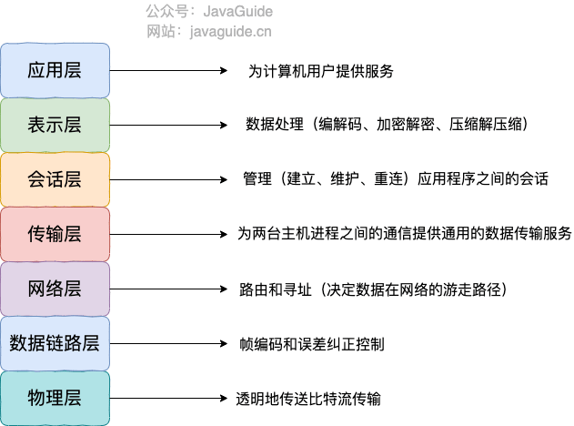
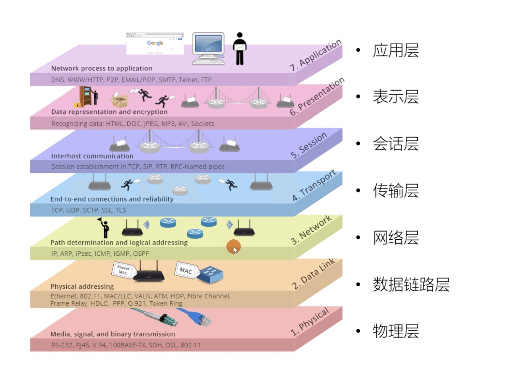
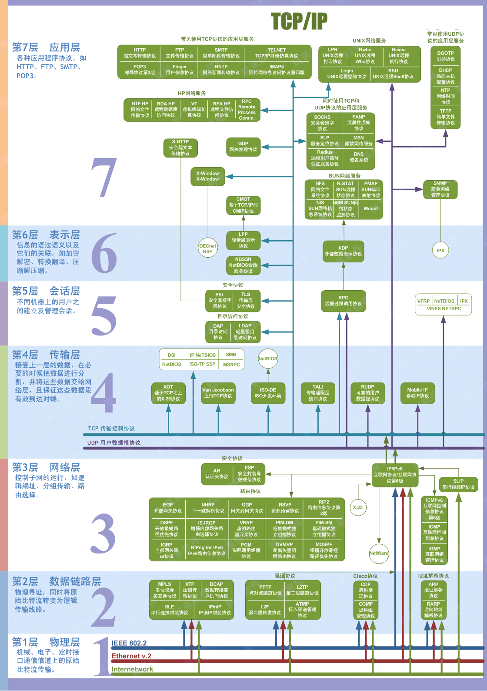
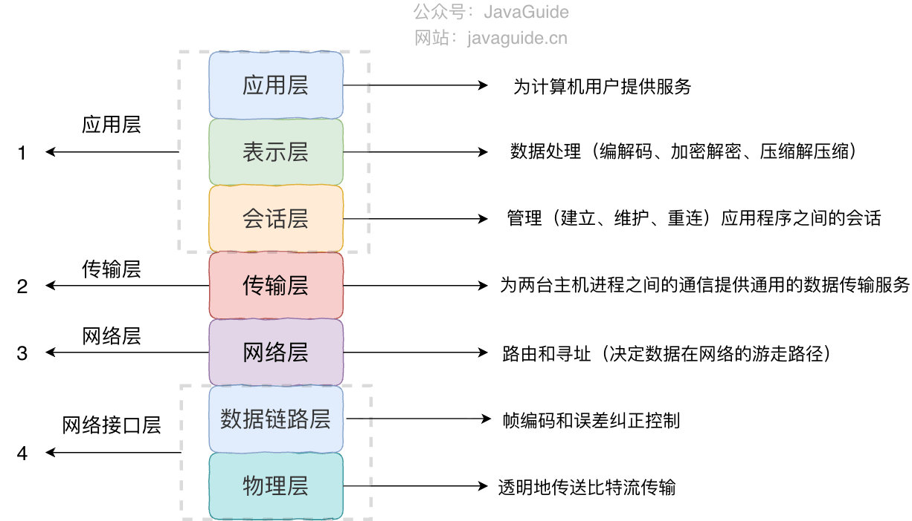
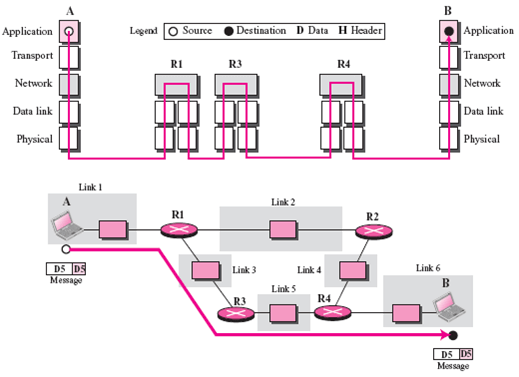
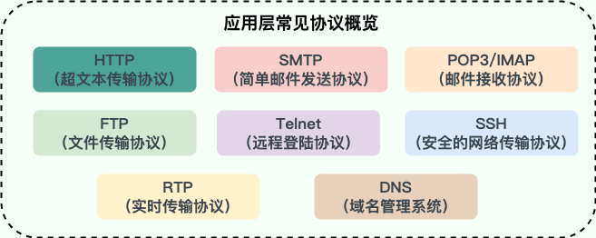
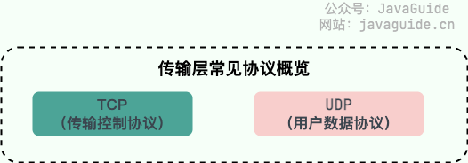
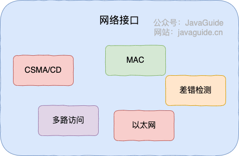
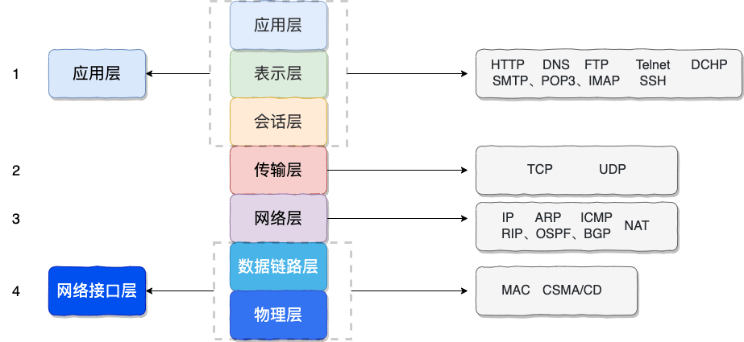

Network layers provide a map for learning computer networking. Without it, concepts such as HTTP, TCP, IP, Ethernet, and DNS can blur together, making it hard to see what depends on what and which layer handles each responsibility.

Two common models are the seven-layer OSI model and the four-layer TCP/IP model. OSI is useful for building a conceptual framework; TCP/IP is closer to how the internet is implemented.

This article answers a few questions:

1. What does each layer of the OSI model do?
2. How do the TCP/IP and OSI models correspond?
3. Why did the theoretically complete OSI model not become the internet's dominant implementation?
4. Why is it useful to know a protocol's layer when studying networking?

## The OSI Seven-Layer Model

The **OSI seven-layer model** is a network model proposed by the International Organization for Standardization (ISO). The diagram below shows its structure and the functions of each layer:

Each layer has a focused responsibility and uses services provided by the layer below it. For example, the transport layer relies on the network layer for routing and addressing so data can reach its destination.

**The OSI model has a clear structure and a complete theory, but it is complex and impractical, and some functions are repeated across layers.**

That diagram may feel abstract. Here is another illustration that makes the model easier to visualize:

**If the OSI model is so comprehensive, why did the TCP/IP model prevail?**

The OSI model had the support of major companies and even some governments. Why did it fail to become the dominant model? There are several reasons:

1. OSI experts lacked practical experience and commercial incentives while developing the standards.
2. Its protocols were overly complex to implement and inefficient to run.
3. Standards took too long to develop, delaying products based on them. By the early 1990s, when the OSI standards were complete, the TCP/IP-based internet was already operating successfully across much of the world.
4. Its layer boundaries were not always practical, and some functions appeared in multiple layers.

Although the OSI model did not become the dominant implementation, it provided a useful theoretical foundation. It is still worth learning to understand network layering.

Here is another useful summary of the OSI model:

## The TCP/IP Four-Layer Model

The **TCP/IP four-layer model** is widely used today. It can be viewed as a simplified version of the OSI model, with these four layers:

1. Application layer
2. Transport layer
3. Network layer
4. Network interface layer

The TCP/IP and OSI models do not map to each other exactly, but they can be roughly aligned as shown below:

### Application Layer

**The application layer sits above the transport layer and provides services for exchanging information between applications on two end systems. It defines the format of that information and passes messages to the transport layer for delivery.** The data units exchanged at this layer are called messages.

Application-layer protocols define rules for network communication. Different applications use different protocols. Examples include HTTP for web applications and SMTP for email.

**Common application-layer protocols:**

- **HTTP (Hypertext Transfer Protocol)**: Usually based on TCP, HTTP transfers hypertext and multimedia content. It was designed mainly for communication between web browsers and servers. Browsers load web pages through HTTP requests.
- **SMTP (Simple Mail Transfer Protocol)**: Based on TCP and used to send email. Note ⚠️: SMTP sends email; it does not retrieve it. Use POP3 or IMAP to receive messages from a mail server.
- **POP3/IMAP (email retrieval protocols)**: Both use TCP to receive email. IMAP is newer and offers more features, including search, labels, folders, archiving, and synchronization across devices. Nearly all modern email clients and servers support IMAP.
- **FTP (File Transfer Protocol)**: Based on TCP and used to transfer files between computers independently of their operating systems or storage methods. Note ⚠️: FTP does not encrypt data in transit. Use a more secure protocol such as SFTP for sensitive data.
- **Telnet**: A TCP-based protocol for remote terminal access. It sends all data, including usernames and passwords, in plaintext, creating security risks. This is a major reason it is rarely used today; SSH is a secure alternative.
- **SSH (Secure Shell)**: Based on TCP and uses encryption and authentication for secure access and file transfers.
- **RTP (Real-time Transport Protocol)**: Usually based on UDP, though it can also use TCP. It provides end-to-end real-time data transfer, but does not reserve resources or guarantee real-time delivery quality; WebRTC provides broader real-time communication capabilities.
- **DNS (Domain Name System)**: Usually uses UDP on port 53 to map domain names to IP addresses. It uses TCP when responses are too large or for zone transfers.

For details, see [Common Application-Layer Protocols](./application-layer-protocol.md).

### Transport Layer

**The transport layer provides general-purpose data delivery between processes on end systems.** Applications use this service to send application-layer messages. It is general-purpose because many different applications can use the same transport service.

**Common transport-layer protocols:**

- **TCP (Transmission Control Protocol)**: Provides **connection-oriented**, **reliable** data delivery.
- **UDP (User Datagram Protocol)**: Provides **connectionless, best-effort** delivery without guaranteeing reliability. It is simple and efficient.

### Network Layer

**The network layer provides communication between hosts on a packet-switched network.** When sending data, it encapsulates transport-layer segments or datagrams into packets. In the TCP/IP architecture, the network layer uses IP, so these packets are also called IP datagrams, or simply datagrams.

⚠️ **Do not confuse a UDP user datagram at the transport layer with an IP datagram at the network layer.**

**Another network-layer task is selecting routes so packets from the source host can pass through routers and reach the destination host.**

Here, “network” refers to the third layer of the computer networking architecture, not to a specific network as it is commonly used in conversation.

The internet consists of many heterogeneous networks interconnected by routers. Its network layer uses the connectionless Internet Protocol (IP) and various routing protocols, so this layer is also called the **internet layer** or **IP layer**.

**Common network-layer protocols:**

- **IP (Internet Protocol)**: One of the core TCP/IP protocols. It defines packet formats and handles addressing and routing so packets can cross networks and reach their destinations. IPv4 and IPv6 are both in use; IPv6 was designed as IPv4's successor.
- **ARP (Address Resolution Protocol)**: Maps network-layer addresses to link-layer addresses. To send an IP datagram over a local link, a host needs the next hop's MAC address. ARP helps resolve an IP address to a MAC address.
- **ICMP (Internet Control Message Protocol)**: Carries network status and error messages and is commonly used for diagnosis and troubleshooting. For example, Ping uses ICMP to test reachability.
- **NAT (Network Address Translation)**: Translates addresses between networks, commonly between private and public networks. Hosts in a local area network (LAN) use private IP addresses; NAT allows them to communicate through public addresses on a wide area network (WAN) and the internet.
- **OSPF (Open Shortest Path First)**: An interior gateway protocol (IGP) and widely used dynamic routing protocol. It uses a link-state algorithm and considers factors such as bandwidth and delay when selecting routes.
- **RIP (Routing Information Protocol)**: An IGP and dynamic routing protocol based on a distance-vector algorithm. It uses hop count as its metric and selects a route with the fewest hops.
- **BGP (Border Gateway Protocol)**: A routing protocol that exchanges Network Layer Reachability Information (NLRI) between routing domains. It is flexible and extensible.

### Network Interface Layer

The network interface layer can be viewed as a combination of the data link and physical layers.

1. The **data link layer**, often called the link layer, sends data between two hosts over individual links. **It packages network-layer IP datagrams into frames and sends them between adjacent nodes. Each frame contains data and control information such as synchronization, addressing, and error detection.**
2. **The physical layer transparently transmits bit streams between adjacent nodes while abstracting differences in the physical media and devices.**

The diagram below shows key network interface layer functions and protocols:

### Summary

Here is a brief summary of the protocols and core technologies in each layer:

**Application-layer protocols:**

- HTTP (Hypertext Transfer Protocol)
- SMTP (Simple Mail Transfer Protocol)
- POP3/IMAP (email retrieval protocols)
- FTP (File Transfer Protocol)
- Telnet (remote terminal protocol)
- SSH (Secure Shell Protocol)
- RTP (Real-time Transport Protocol)
- DNS (Domain Name System)
- ……

**Transport-layer protocols:**

- TCP
  - Segment structure
  - Reliable data transfer
  - Flow control
  - Congestion control
- UDP
  - Datagram structure
  - RDT (reliable data transfer protocol)

**Network-layer protocols:**

- IP (Internet Protocol)
- ARP (Address Resolution Protocol)
- ICMP (Internet Control Message Protocol)
- NAT (Network Address Translation)
- OSPF (Open Shortest Path First)
- RIP (Routing Information Protocol)
- BGP (Border Gateway Protocol)
- ……

**Network interface layer:**

- Error detection
- Multiple-access protocols (channel sharing)
- CSMA/CD
- MAC protocols
- Ethernet
- ……

## Why Are Networks Layered?

To close, let's return to the question: Why are networks layered?

When building a backend application with a framework, we often divide it into layers with different responsibilities (complex systems may have more):

1. Repository (database operations)
2. Service (business logic)
3. Controller (communication between the frontend and backend)

**Complex systems use layers so each one can focus on a particular responsibility. Network layering follows the same idea.**

There are three main reasons to layer a network:

1. **Layers are independent**: Each layer can use the services below it without needing to know how those services are implemented. This is similar to calling an interface in a layered application.
2. **Layers improve flexibility**: Each layer can use the technology best suited to its job, as long as its services and interfaces remain consistent. This is similar to high cohesion and loose coupling in application design.
3. **Layers break large problems into smaller ones**: Clear boundaries make complex networking systems easier to design, implement, and standardize. This is similar to decomposing application features into smaller tasks with well-defined goals and interfaces.

There is a well-known saying in computer science:

> Any problem in computer science can be solved by adding a layer of indirection. The computer system as a whole is designed around a strict hierarchy of layers.

## References

- TCP/IP model vs OSI model：<https://fiberbit.com.tw/tcpip-model-vs-osi-model/>
- Data Encapsulation and the TCP/IP Protocol Stack：<https://docs.oracle.com/cd/E19683-01/806-4075/ipov-32/index.html>

<!-- @include: @article-footer.snippet.md -->
