Networking interviews often probe details of **TCP, UDP, IP, ARP, NAT, and IPv4/IPv6**. Why is TCP reliable? Why does it use a three-way handshake and a four-way teardown? Why does HTTP/3 use QUIC over UDP? These questions test both concepts and your understanding of network communication.

This article reviews common backend interview topics, including TCP and UDP, TCP connection management, reliable delivery, IP addressing, ARP, and NAT.

## TCP and UDP

### ⭐️ How Do TCP and UDP Differ? (Important)

1. **Connection setup:**
   - TCP is connection-oriented. It establishes a connection with a three-way handshake before data transfer and releases it with a connection teardown afterward.
   - UDP is connectionless. It sends datagrams without first establishing a connection.
2. **Reliability:**
   - TCP provides reliable delivery using sequence numbers, acknowledgments (ACKs), retransmission, flow control, and congestion control. It delivers data in order without duplication to the receiving application.
   - UDP provides best-effort delivery. It does not guarantee delivery or ordering and does not retransmit packets automatically.
3. **State:**
   - TCP maintains connection state at both ends, including sequence numbers and window sizes.
   - UDP does not maintain connection state, so it has less overhead.
4. **Efficiency:** TCP has more overhead for connection setup, acknowledgments, and retransmissions. UDP has a simpler structure and lower overhead.
5. **Data model:** TCP is a byte stream and may split or combine application writes. UDP preserves datagram boundaries.
6. **Header size:** A TCP header is at least 20 bytes and can be up to 60 bytes with options. A UDP header is 8 bytes.
7. **Communication modes:** TCP supports point-to-point unicast. UDP supports unicast, multicast, and broadcast.
8. ……

The table below summarizes the differences:

| Feature           | TCP                        | UDP                                          |
| ----------------- | -------------------------- | -------------------------------------------- |
| **Connection**    | Connection-oriented        | Connectionless                               |
| **Reliability**   | Reliable                   | Best effort                                  |
| **State**         | Stateful                   | Stateless                                    |
| **Efficiency**    | More overhead              | Less overhead                                |
| **Data model**    | Byte stream                | Datagrams                                    |
| **Header size**   | 20–60 bytes                | 8 bytes                                      |
| **Communication** | Point-to-point unicast     | Unicast, multicast, broadcast                |
| **Common uses**   | HTTP/HTTPS, FTP, SMTP, SSH | DNS, DHCP, SNMP, TFTP, VoIP, streaming video |

### ⭐️ When Should You Choose TCP or UDP?

Choose based on **how much the application values reliable delivery, low latency, and efficiency**.

Choose TCP when **data accuracy and completeness are essential**. Its handshake, acknowledgments, retransmission, and flow control help deliver data reliably and in order. Common use cases include:

- **Web browsing (HTTP/HTTPS):** Pages, images, and scripts must arrive intact.
- **File transfer (FTP, SCP):** Files must not lose or reorder bytes.
- **Email (SMTP, POP3, IMAP):** Messages must arrive intact.
- **Remote login (SSH, Telnet):** Commands and responses must be delivered accurately.
- ……

Choose UDP when **low latency and efficiency matter more and the application can tolerate some loss or reordering**. UDP has less overhead and does not include connection setup or reliability mechanisms. Common use cases include:

- **Real-time audio and video (VoIP, video calls, livestreaming):** A small amount of loss may be preferable to the delay caused by waiting for retransmissions. The application may provide its own recovery mechanisms.
- **Online games:** Player positions and state need low-latency updates, and stale data may no longer be useful.
- **DHCP (Dynamic Host Configuration Protocol):** A client requesting an IP address may not yet have one, and DHCP uses broadcast and has its own reliability mechanisms.
- **IoT telemetry:** Some applications can tolerate occasional missing sensor readings.
- ……

### Does HTTP Run over TCP or UDP?

~~**HTTP runs over TCP**, so a TCP connection and three-way handshake are required before an HTTP request can be sent.~~

🐛 Correction (see [issue #1915](https://github.com/Snailclimb/JavaGuide/issues/1915)):

Versions before HTTP/3 run over TCP. HTTP/3 uses **QUIC over UDP** instead:

- **HTTP/1.x and HTTP/2:** Both run over TCP, which provides reliable, ordered delivery. A TCP connection must be established before sending an HTTP request.
- **HTTP/3:** HTTP/3 uses QUIC, which runs over UDP, instead of TCP.

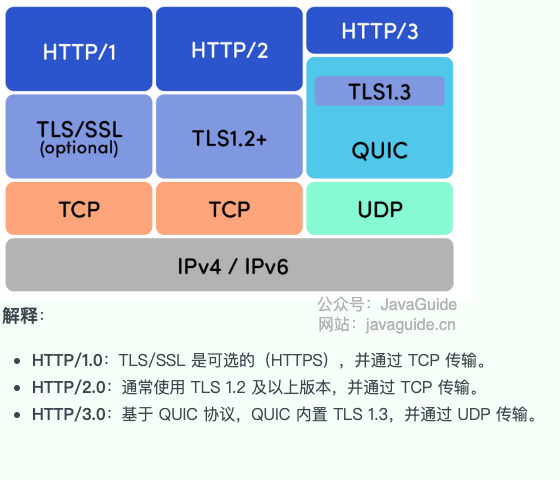

**Why did HTTP/3 make this change? The main reasons are:**

1. Reduce head-of-line (HOL) blocking.
2. Reduce connection setup latency.

The sections below explain these improvements.

HTTP/2 can multiplex several request and response streams over one TCP connection. However, because TCP guarantees ordered delivery, a lost or delayed TCP segment blocks delivery for the entire connection until retransmission. This affects every HTTP/2 stream on that connection, even if their data has arrived. **QUIC, which runs over UDP, avoids connection-wide transport-level blocking.** It provides independent streams with reliable, ordered delivery, so loss on one stream does not usually block other streams on the same QUIC connection.

HTTP/3 also reduces connection setup latency. An HTTPS connection using HTTP/2 requires a TCP handshake followed by a TLS handshake:

RTT is the time for a message to travel to the other endpoint and back, not the one-way delay. Handshake latency depends on the measurement endpoint: after sending SYN, the client receives SYN-ACK in about 1 RTT, then can send the final ACK and an application request. The server needs another one-way delay to receive them. When comparing HTTP/2 and HTTP/3, use the same metric, such as when the client can send its first request or receive the first byte.

An HTTPS connection using HTTP/2 first establishes TCP, then performs a TLS handshake. HTTP/3 combines transport negotiation with the TLS 1.3 handshake during QUIC connection setup. A new QUIC connection usually takes 1 RTT. 0-RTT is only available when resuming with prior connection state; it can carry early data in the first packet, but has replay risks and should only be used for requests that are safe to replay.

For more details, see:

- <https://zh.wikipedia.org/zh/HTTP/3>
- <https://datatracker.ietf.org/doc/rfc9114/>

### Why Is TCP a Byte Stream While UDP Is Message-Oriented?

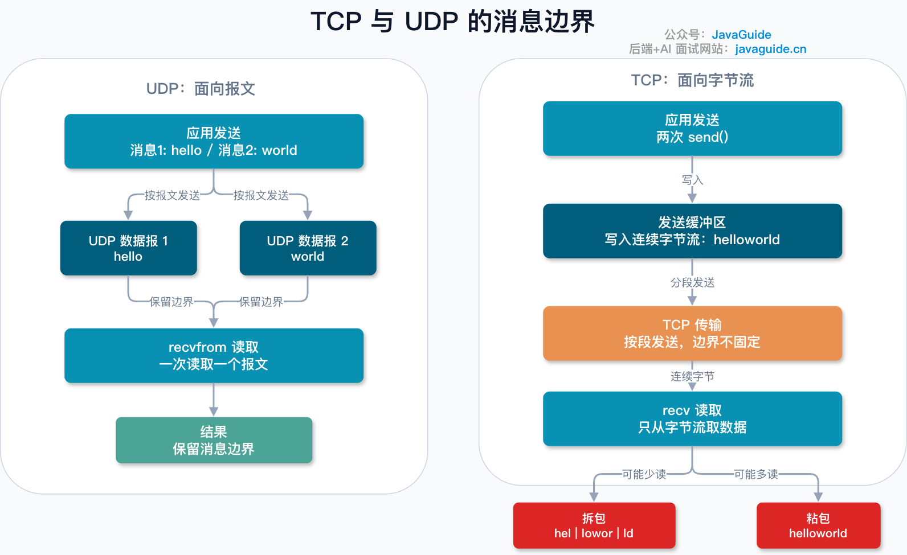

TCP is a byte stream. Data written by an application enters the kernel buffer, and TCP ensures the bytes arrive reliably and in order. It does not guarantee that one `send()` corresponds to one `recv()`, nor does it preserve application message boundaries. A receiver may read several messages at once or only part of one message. This is often called the sticky-packet or packet-splitting problem.
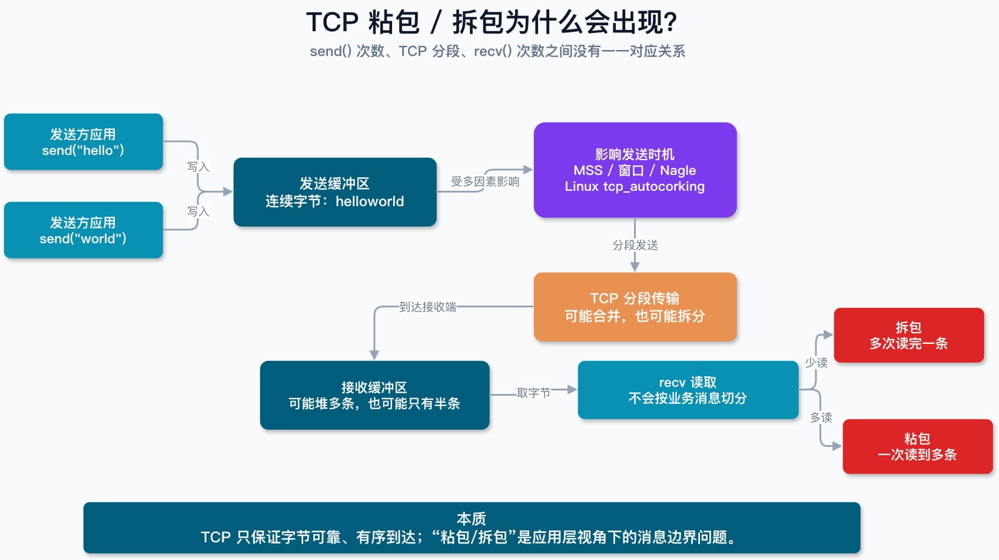

UDP is message-oriented. Each application write is sent as a UDP datagram, and the receiver reads datagrams, so message boundaries are preserved. UDP does not guarantee delivery or ordering.

To handle message boundaries over TCP, the application protocol must define them. Common approaches include fixed-length messages, delimiters, and length prefixes. Length prefixes are common in binary protocols and variable-length messages, but require handling byte order, maximum lengths, partial data, and malformed connections.

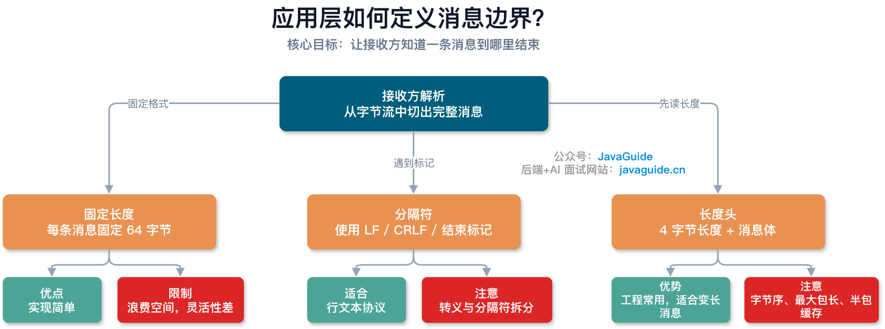

For details, see [Why Is TCP a Byte Stream While UDP Is Message-Oriented?](./tcp-byte-stream-udp-datagram.md).

### Which Protocols Run over TCP or UDP?

TCP (Transmission Control Protocol) and UDP (User Datagram Protocol) are the Internet's two core transport protocols. They provide communication services for application-layer protocols. Common examples include:

**Protocols that run over TCP (reliable, ordered delivery):**

| Protocol | Full name                          | Main use                               | Notes                                                                                                             |
| -------- | ---------------------------------- | -------------------------------------- | ----------------------------------------------------------------------------------------------------------------- |
| HTTP     | HyperText Transfer Protocol        | Web pages and media                    | **HTTP/1.x and HTTP/2 run over TCP**. Earlier versions are unencrypted.                                           |
| HTTPS    | HyperText Transfer Protocol Secure | Secure web traffic                     | Uses TLS to protect HTTP. HTTP/1.1 and HTTP/2 usually use TLS over TCP; HTTP/3 uses QUIC with integrated TLS 1.3. |
| FTP      | File Transfer Protocol             | File transfer                          | Traditional FTP sends data in plaintext. Prefer **SFTP (SSH File Transfer Protocol)** or **FTPS (FTP over TLS)**. |
| SMTP     | Simple Mail Transfer Protocol      | Sending email                          | Sends mail from clients to servers and between mail servers. STARTTLS can upgrade the connection to TLS.          |
| POP3     | Post Office Protocol version 3     | Receiving email                        | Usually downloads mail to a device; retaining server copies can be configured. POP3S uses TLS.                    |
| IMAP     | Internet Message Access Protocol   | Receiving and managing email           | Keeps mail on the server and supports synchronization across devices. IMAPS uses TLS.                             |
| Telnet   | Teletype Network                   | Remote terminal access                 | Sends all data, including passwords, in plaintext. SSH is the secure alternative.                                 |
| SSH      | Secure Shell                       | Secure remote access and file transfer | Provides encrypted login, command execution, and file transfer such as SFTP.                                      |

**Protocols that run over UDP (low overhead and fast delivery):**

| Protocol | Full name                             | Main use                          | Notes                                                                                                                                     |
| -------- | ------------------------------------- | --------------------------------- | ----------------------------------------------------------------------------------------------------------------------------------------- |
| HTTP/3   | HyperText Transfer Protocol version 3 | Web traffic                       | Runs over QUIC, which uses UDP. It aims to reduce latency and TCP-level head-of-line blocking. Resumed sessions can use 0-RTT early data. |
| DHCP     | Dynamic Host Configuration Protocol   | Network configuration             | Automatically assigns IP addresses, subnet masks, gateways, and DNS servers.                                                              |
| DNS      | Domain Name System                    | Domain name resolution            | Usually uses UDP. It may use TCP for large responses and zone transfers (AXFR).                                                           |
| RTP      | Real-time Transport Protocol          | Real-time audio/video             | Common in VoIP, video calls, and streaming. It prioritizes low latency and may tolerate some loss; often used with RTCP.                  |
| RTCP     | RTP Control Protocol                  | RTP monitoring and control        | Reports packet loss, latency, and jitter to support stream management.                                                                    |
| TFTP     | Trivial File Transfer Protocol        | Simple file transfer              | Used for tasks such as booting diskless workstations and updating network-device firmware.                                                |
| SNMP     | Simple Network Management Protocol    | Network monitoring and management | Allows administrators to query and update device state.                                                                                   |
| NTP      | Network Time Protocol                 | Clock synchronization             | Synchronizes clocks on networked computers.                                                                                               |

**In summary:**

- **TCP** suits applications that need reliable, complete, ordered delivery, such as web browsing, file transfer, and email.
- **UDP** suits latency-sensitive applications that can tolerate some data loss, such as DNS, real-time media, games, and network management.

### ⭐️ How Do TCP Keepalive and HTTP Keep-Alive Differ?

| Comparison                      | HTTP Keep-Alive                                                                            | TCP Keepalive                                                                                 |
| ------------------------------- | ------------------------------------------------------------------------------------------ | --------------------------------------------------------------------------------------------- |
| **Layer**                       | Application (HTTP)                                                                         | Transport (TCP)                                                                               |
| **Purpose**                     | Reuse a TCP connection and avoid repeated setup and teardown                               | Probe an idle TCP connection and release resources if the peer is unreachable                 |
| **Default**                     | HTTP/1.0 uses short-lived connections by default; HTTP/1.1 uses persistent connections     | Disabled by default; applications enable it with `SO_KEEPALIVE`                               |
| **Control**                     | Configured by HTTP clients, servers, or proxies                                            | Controlled by the OS kernel, with per-socket tuning on some platforms                         |
| **Common settings**             | `Connection`, `Keep-Alive: timeout/max`, and server timeouts                               | `tcp_keepalive_time/intvl/probes` or platform equivalents                                     |
| **When it closes**              | On idle timeout, request limit, or explicit close                                          | After probes go unanswered or a reset (RST) is received                                       |
| **If the peer is online**       | The server can still close an idle connection according to its policy                      | The connection usually remains as long as the peer's kernel responds with ACKs                |
| **Can it replace a heartbeat?** | No. It manages HTTP connection reuse, not application health                               | No. It cannot determine whether application threads, event loops, or dependencies are healthy |
| **Effect of intermediaries**    | Proxies and gateways can manage each side's HTTP/TCP connection separately                 | NAT, load balancers, and reverse proxies may mean the probe covers only one TCP segment       |
| **HTTP/2/3**                    | HTTP/2 disallows connection-specific headers; HTTP/3 over QUIC does not use this mechanism | Applies only to TCP, not an HTTP/3/QUIC connection                                            |

**Keep-Alive behavior differs across HTTP versions:**

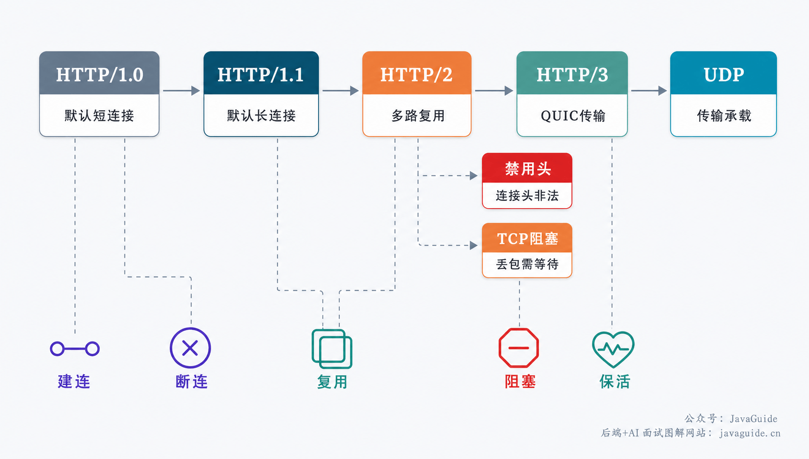

The two mechanisms differ in who decides to close a connection:

HTTP Keep-Alive supports **active cleanup**: when a timeout or request limit is reached, the server can close the connection without first checking whether the peer is online.

TCP Keepalive supports **peer detection**: it sends probes to check whether the peer is still reachable. If the peer responds with ACKs, the connection remains open. Resources are released only after the peer is determined to be unreachable.

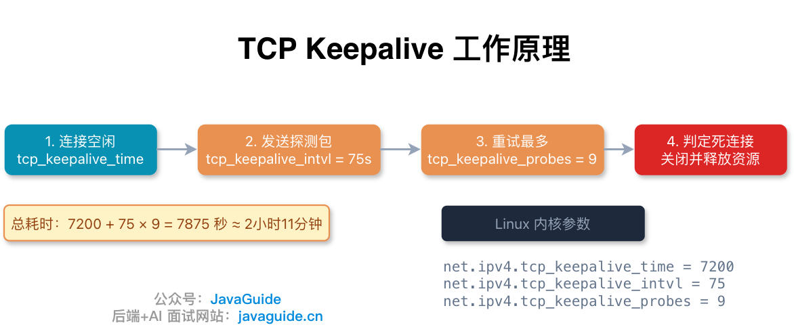

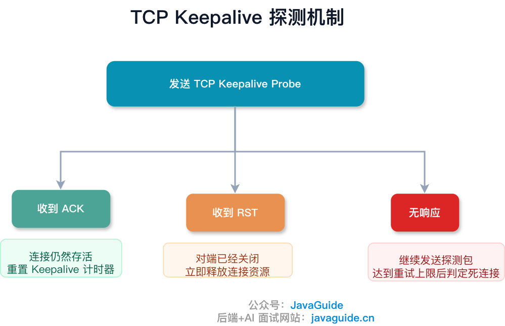

Both mechanisms may be enabled in the same application. HTTP Keep-Alive controls how long a connection is reused and how many requests it serves; TCP Keepalive checks whether an idle peer is still reachable. They serve different purposes and do not replace each other.

For details, see [How Do TCP Keepalive and HTTP Keep-Alive Differ?](./tcp-keepalive-vs-http-keepalive.md).

### ⭐️ TCP Three-Way Handshake and Four-Way Teardown (Very Important)

**Related interview questions:**

- Why is a three-way handshake needed?
- Why does the server send SYN as well as ACK in the second step?
- Why does connection teardown usually take four segments?
- Why can't the server combine its ACK and FIN into a three-way teardown?
- What happens if the server's ACK in the second teardown step does not reach the client?
- Why does the client wait 2 × MSL (Maximum Segment Lifetime) before entering `CLOSED` after the fourth step?

**Answers:** [TCP Three-Way Handshake and Four-Way Teardown (Transport Layer)](https://javaguide.cn/cs-basics/network/tcp-connection-and-disconnection.html).

### What Is TCP TIME_WAIT Waiting For, and Why?

**Related interview questions:**

1. What does `TIME_WAIT` wait for?
2. Can a large number of `TIME_WAIT` sockets cause problems?
3. Is it safe to enable `tcp_tw_reuse` without checking first?
4. How do `TIME_WAIT` and `CLOSE_WAIT` differ?

**Answers:** [TCP TIME_WAIT: Why It Waits, Possible Problems, and Socket Reuse](./tcp-time-wait.md).

### ⭐️ How Does TCP Provide Reliable Delivery? (Important)

[TCP Reliable Delivery (Transport Layer)](https://javaguide.cn/cs-basics/network/tcp-reliability-guarantee.html)

### Can TCP and UDP Use the Same Port Number?

**Yes.** TCP and UDP have separate port namespaces, so the same port number can be used by both protocols.

When the kernel receives an IP packet, it checks the IP protocol number (`6` for TCP, `17` for UDP) and dispatches the packet to the corresponding protocol stack. Each stack then routes it by address and port. Thus, `TCP/8080` and `UDP/8080` can coexist.

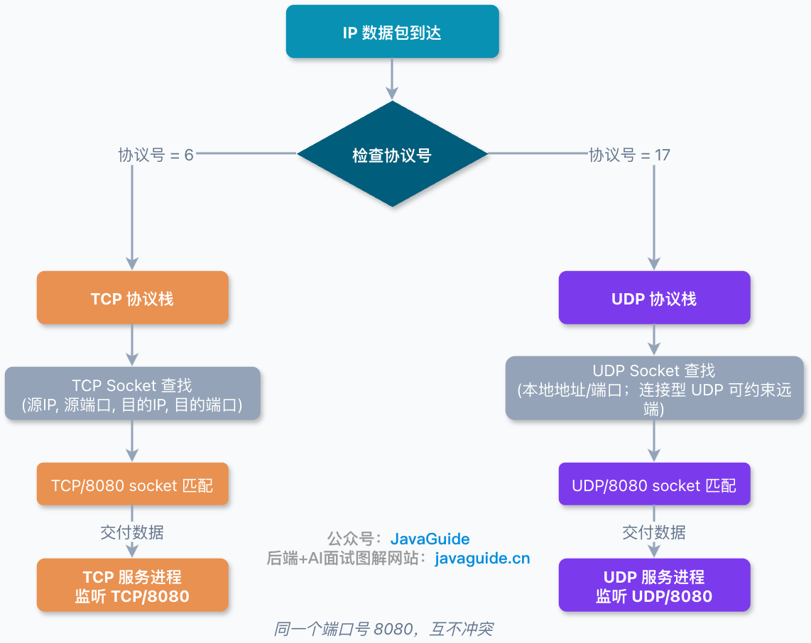

Conflicts are more likely when two services bind the same address and port **under the same protocol**. Socket options such as `SO_REUSEADDR` and `SO_REUSEPORT` affect these cases.

A common example is DNS, which uses `UDP/53` for many queries and `TCP/53` for large responses and zone transfers. HTTP/3 commonly uses `UDP/443` for QUIC and can coexist with HTTPS over `TCP/443`.

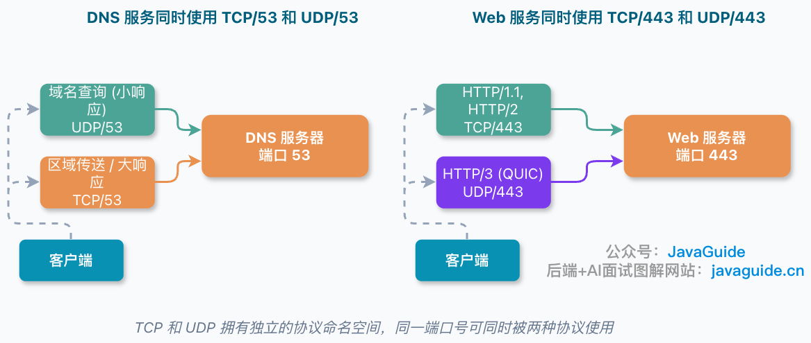

For details, see [Can TCP and UDP Use the Same Port Number?](./can-tcp-and-udp-use-the-same-port.md).

### ⭐️ Can a Host Have at Most 65,535 TCP Connections?

**No.** `65,535` is the maximum port number, not the maximum number of connections.

TCP connections are identified by a four-tuple: source IP, source port, destination IP, and destination port. Different four-tuples represent different connections. A server can accept more connections on one listening port as long as the client IP or port differs.

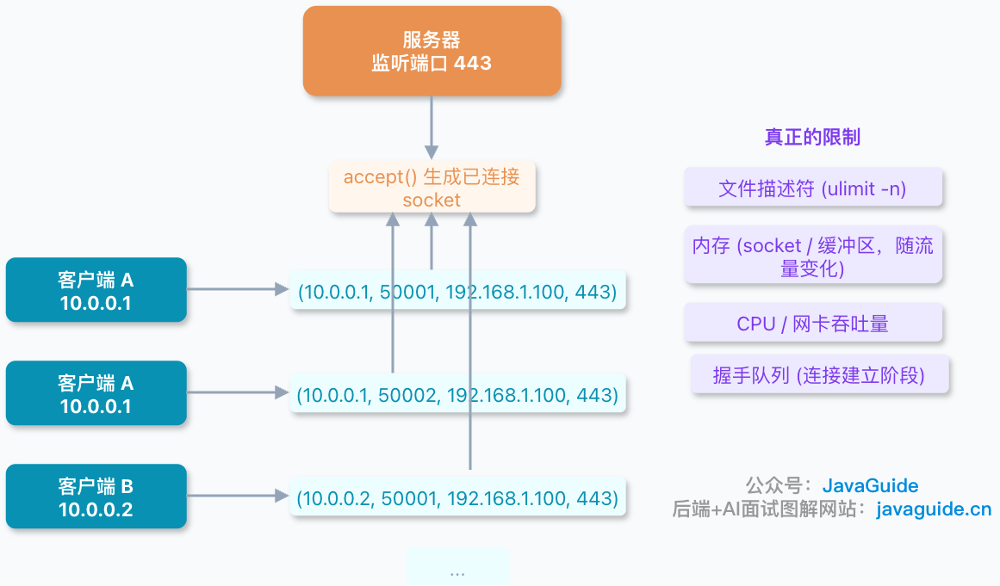

The actual limits depend on:

- **Server:** File descriptors, memory, CPU, network interfaces, and application capacity, rather than the number of ports.
- **Client:** When connecting to one target, the source IP and destination IP:port are fixed, so the client has fewer source ports available. Linux's default ephemeral port range often has about 28,000 ports. Many `TIME_WAIT` sockets can make this constraint worse.
- **NAT gateway:** Public source ports can become a bottleneck when many internal hosts share one public IP to reach the same external target.

In production, a common cause is a poorly configured connection pool that creates and closes short-lived connections rapidly, exhausting ephemeral ports. Check the connection pool and keep-alive behavior before changing kernel settings.

For details, see [Can a Host Have at Most 65,535 TCP Connections?](./maximum-number-of-tcp-connections-per-host.md).

## IP

### What Does the IP Protocol Do?

**IP (Internet Protocol)** is a core network-layer protocol in the TCP/IP suite. It defines packet formats and provides addressing and routing so packets can travel across networks to their destinations.

The two main versions are IPv4 and the newer IPv6. Both are in use, and IPv6 was designed to address limitations of IPv4.

### What Is an IP Address, and How Does IP Addressing Work?

An IP address is usually assigned to a network interface to identify an endpoint within a particular scope and routing context. An interface can have multiple addresses, and addresses may change dynamically. Private addresses can be reused on different networks, and an Anycast address can be assigned to multiple interfaces. Example IPv4 and IPv6 addresses are `192.168.1.1` and `2001:0db8:85a3:0000:0000:8a2e:0370:7334`.

An IP packet contains a **source IP address** and a **destination IP address**. These identify the addresses used for that communication, not permanent identities of the devices.

Network devices use the destination IP address to forward the packet toward the destination network or subnet.

IP addressing enables packets to travel between networks. Whether an address is unique or globally routable depends on its type and scope; an IP address is not necessarily a globally unique identity for a device.

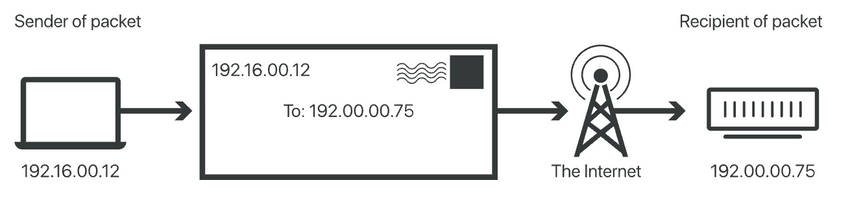

### What Is IP Address Filtering?

**IP address filtering** allows or blocks traffic from specific IP addresses or ranges. For example, if one IP address is attacking an image service, an access rule can block it.

IP filtering is a basic security measure. It is usually combined with authentication, authorization, encryption, and other controls; by itself, it cannot secure a network.

### ⭐️ How Do IPv4 and IPv6 Differ?

**IPv4 (Internet Protocol version 4)** is widely used. Its addresses are four dot-separated numbers, such as `123.89.46.72`. IPv4 uses 32-bit addresses, providing about 4.3 billion possible values.

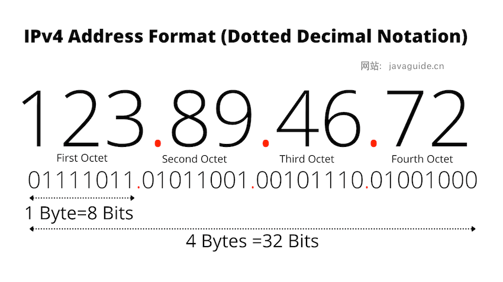

To address IPv4 exhaustion, **IPv6 (Internet Protocol version 6)** provides a much larger address space. IPv6 addresses use hexadecimal groups separated by colons, for example `2001:0db8:85a3:0000:0000:8a2e:0370:7334`. IPv6 uses 128-bit addresses, allowing 2^128 possible values.

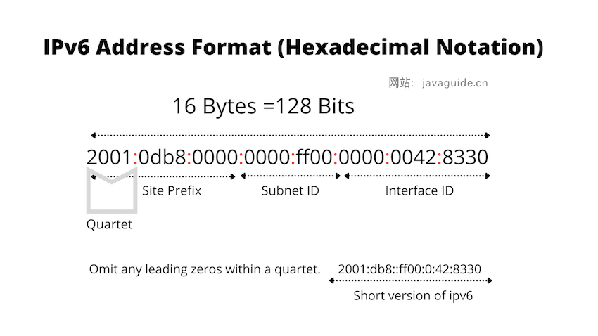

In addition to a larger address space, IPv6 offers:

- **Stateless Address Autoconfiguration (SLAAC):** Hosts can form IPv6 addresses from router-advertised prefixes and interface identifiers, without relying on DHCPv6. Duplicate Address Detection (DAD) usually checks for duplicates on the local link, but it is not infallible and does not guarantee global uniqueness.
- **NAT is optional:** The large address space can provide globally routable addresses without requiring address translation, though IPv6 networks may still use NAT.
- **A revised header:** The IPv6 base header simplifies some common forwarding operations, but actual performance depends on hardware, extension headers, network policies, and implementation.
- **Extension headers:** Optional headers provide additional functions and options.
- **ICMPv6 (Internet Control Message Protocol for IPv6):** Supports functions such as Neighbor Discovery and Path MTU Discovery.
- ……

### How Can You Obtain the Client's Real IP Address?

There are several approaches at the application, transport, and network layers.

**Application layer:**

`X-Forwarded-For` is widely used in HTTP proxy deployments but is not standardized. The IETF-standardized equivalent is the HTTP `Forwarded` header. Both are HTTP mechanisms and do not apply directly to other application protocols such as SMTP. An application must not blindly trust a client-supplied `X-Forwarded-For` value: trusted reverse proxies should overwrite or normalize external values, and the application should parse only values added by known proxies.

**Transport layer:**

One option is to carry the source IP in a TCP option. This could work for any TCP-based protocol, but it is not a standard TCP feature and requires changes at both ends: the sender must insert the address and the receiver must read it.

The Proxy Protocol can also carry the client's IP address and port. A reverse proxy such as Nginx can send it, and the application server can parse it.

**Network layer:**

Tunneling with Direct Server Return (DSR) can work with different protocols, but it is more difficult to deploy and has limitations, so it is uncommon.

### What Does NAT Do?

**NAT (Network Address Translation)** translates IP addresses between networks. It can map private addresses used on a local network to public addresses, allowing multiple internal devices to access the Internet through one public IP address.

NAT can conserve IPv4 addresses and hide internal addressing and topology. Many NAT devices also filter unsolicited inbound traffic, but that behavior comes from their filtering policy, not address translation itself. NAT does not replace stateful firewalls, access controls, or host security.

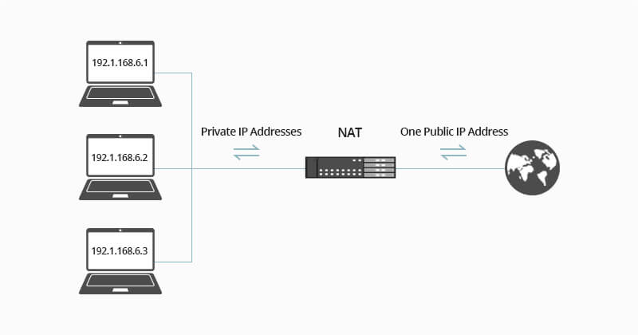

Related reading: [NAT Explained (Network Layer)](https://javaguide.cn/cs-basics/network/nat.html).

## ARP

### What Is a MAC Address?

**MAC** stands for **Media Access Control**. A MAC address identifies a link-layer interface for frame delivery on a local network. It belongs to a network interface, not permanently to a whole device; a device can have multiple interfaces with different MAC addresses.

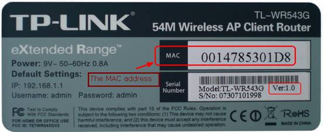

MAC addresses are also called LAN, physical, or Ethernet addresses. Unlike IP addresses, which are used for network-layer routing, MAC addresses are mainly used on the local link or broadcast domain.

> Network devices such as routers also have IP addresses. Routers connect networks and commonly use private addresses on internal interfaces. When devices on a private network communicate outside it, NAT may be used.

The common Ethernet MAC address format is 6-byte (48-bit) EUI-48. IEEE allocates address blocks of different sizes, such as MA-L, MA-M, and MA-S, for vendors to assign globally administered addresses. Locally administered addresses also exist and do not require global IEEE allocation. Operating systems can change or randomize MAC addresses, so they are not necessarily permanent, and the same address may appear on different networks.

The special MAC address `FF-FF-FF-FF-FF-FF` (all bits set to 1) is the Ethernet broadcast address.

### ⭐️ What Problem Does ARP Solve?

**ARP (Address Resolution Protocol)** maps a network-layer address to a link-layer address. To send an IP datagram over a local link, a host needs the MAC address of the next hop. ARP resolves an IPv4 address to a MAC address on the local network.

### How Does ARP Work?

[ARP Explained (Network Layer)](https://javaguide.cn/cs-basics/network/arp.html)

## Study Suggestions

_Illustrated HTTP_ is a concise, useful introduction to networking, whether you want a structured overview or are preparing for interviews. The references below can help with further study. A more theory-heavy textbook is _Computer Networks_, 7th edition, by Xie Xiren.

## References

- _Illustrated HTTP_
- _Computer Networking: A Top-Down Approach_, 7th edition
- What Is the Internet Protocol (IP)?: <https://www.cloudflare.com/learning/network-layer/internet-protocol/>
- Methods for Passing Through the Original Source IP Address (GeekTime): <https://time.geekbang.org/column/article/497864>
- What Is NAT and What Are the Benefits of NAT Firewalls?：<https://community.fs.com/blog/what-is-nat-and-what-are-the-benefits-of-nat-firewalls.html>

<!-- @include: @article-footer.snippet.md -->
