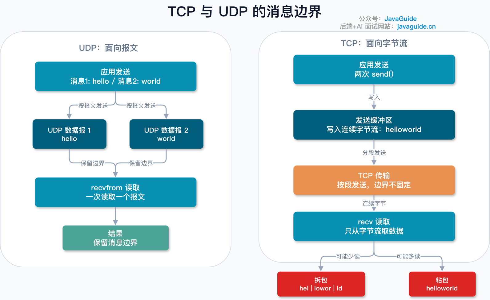
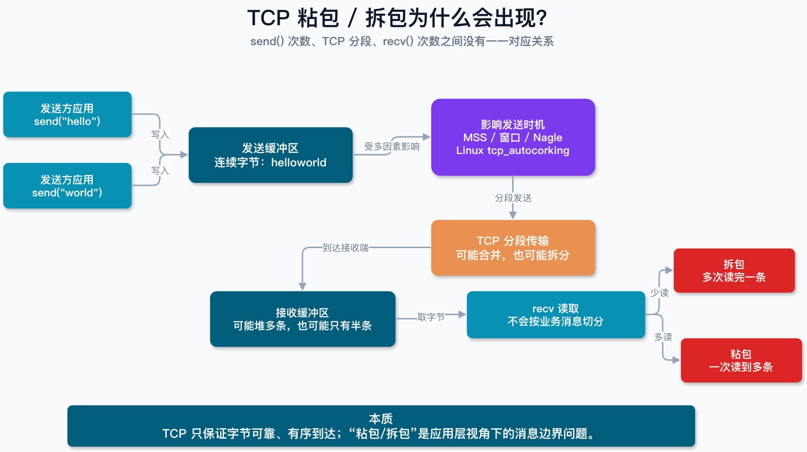
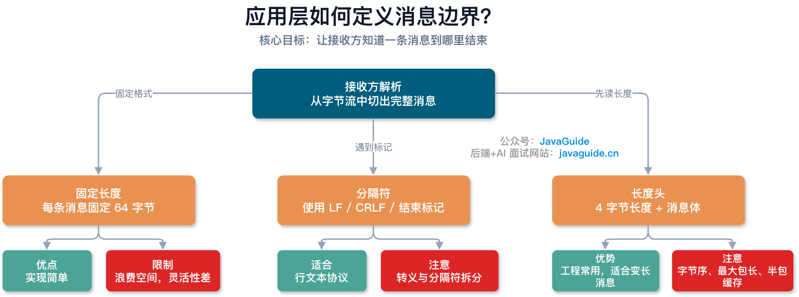
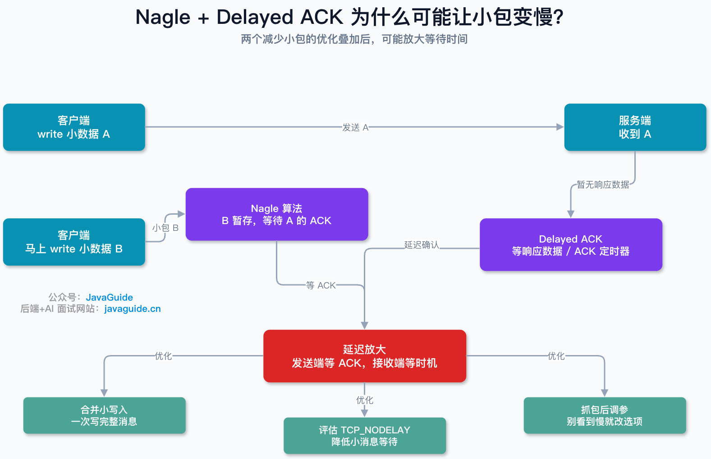

TCP is a byte-stream protocol, while UDP is message-oriented. This sounds like a simple definition, but it explains many framing problems in network applications.

The key difference is: **TCP delivers bytes reliably and in order, but doesn't preserve application message boundaries. UDP preserves the boundaries of the datagrams given to it by the application.**

This article answers four questions:

1. Why is TCP called a byte stream and UDP message-oriented?
2. How do TCP framing issues occur?
3. How should an application define message boundaries?
4. Why can Nagle and Delayed ACK make small messages slower?

Suppose the application sends two messages:

```text
Message 1: hello
Message 2: world
```

With UDP, these are normally two UDP datagrams. A call to `recvfrom()` reads one datagram; it doesn't combine multiple datagrams into a stream. The UDP receive queue stores each datagram as a separate item, preserving its boundary.

There is one important caveat: preserving datagram boundaries doesn't make UDP suitable for arbitrarily large messages. Large datagrams may be fragmented at the IP layer, and a small receive buffer may truncate a datagram. “Message-oriented” means UDP doesn't turn application data into a continuous byte stream like TCP does. RFC 768 defines UDP as operating in datagram mode and providing a minimal protocol mechanism without guaranteed delivery or duplicate protection.

TCP works differently. Two application calls to `send()` write two sequences of bytes to the kernel's send buffer. Those calls don't determine when the bytes are transmitted, how many TCP segments carry them, or how many bytes a single `recv()` returns to the receiving application.

The receiving application might read both messages at once:

```text
helloworld
```

Or it might read them in pieces:

```text
hel
lowor
ld
```

This isn't a TCP error; it's how TCP works. TCP handles a continuous byte stream and ensures that bytes arrive reliably and in order. It doesn't know where the application considers one message to begin or end. RFC 9293 also explains that TCP segments don't generally correspond one-to-one with application `send()` or socket-write calls. TCP doesn't guarantee that application read/write boundaries match network segment boundaries.



“TCP sticky packets” and “packet splitting” describe symptoms from the application's perspective. Strictly speaking, TCP doesn't have application messages; it carries a continuous byte stream. The application must define **where each message ends**.

#### Why Do These Framing Issues Occur?

Common causes include:

**1. TCP is a byte-stream protocol with no application message boundaries.**

TCP delivers bytes reliably and in order, but doesn't record that one group of 20 bytes is the first message and another group of 30 bytes is the second.

**2. One `send()` doesn't equal one network transmission.**

Success from `send()` usually means the data was copied from the application process to the kernel's send buffer. When it is transmitted and how many TCP segments it uses depend on factors such as the MSS, send window, congestion window, Nagle algorithm, and NIC queues.

**3. One `recv()` doesn't equal one complete message.**

The receiver reads bytes from the TCP receive buffer. That buffer may contain multiple messages or only part of one. `recv()` copies currently available bytes to the application; it doesn't split them according to application message boundaries.

**4. Small-packet optimizations can change when data is sent.**

Nagle, Delayed ACK, and Linux mechanisms that combine small writes can affect transmission timing. For example, Linux has used `tcp_autocorking` since version 3.14 to combine consecutive small writes where possible and reduce the number of packets. An application can also use `TCP_CORK` to control when buffered data is sent.

This is why protocol framing matters in Netty, Dubbo, custom RPC frameworks, IM gateways, and game servers. Any application using TCP needs to define message boundaries at the application layer.



#### How Can an Application Handle TCP Framing?

The core idea is simple: **make it possible for the receiver to identify where each message ends.**



Common approaches include:

**1. Fixed-length messages**

Give every message the same size, such as 64 bytes. When the receiver has read 64 bytes, it has one complete message.

This is simple but inflexible. Short messages must be padded, wasting space; long messages need additional splitting. Fixed-length framing works when the message format is stable, but is less suitable for general-purpose protocols.

**2. Delimiters**

Place a special delimiter between messages, such as `\n`, `\r\n`, or a custom end marker:

```text
hello\n
world\n
```

The receiver reads from its buffer until it finds a delimiter, then extracts a complete message. Many text protocols use this approach.

It has two caveats. The delimiter may appear inside the message body, in which case it needs to be escaped. Also, a delimiter itself may be split across two reads, so the receiver can't assume that one `recv()` returns the complete delimiter.

**3. Length prefixes**

This is common in production protocols. A fixed-size field in the header gives the length of the message body:

```text
| 4-byte length | message body |
```

The receiver first reads the fixed-size header and parses the body length. It then reads that many bytes. If it hasn't received the whole body, it waits for more data. If it has received extra bytes, it keeps them in the buffer as the beginning of the next message.

Many binary and RPC protocols use this approach. A real header may also contain a magic number, version, message type, sequence number, or serialization format.

Length prefixes have risks too. Specify the byte order, usually network byte order, and limit the maximum body size so an oversized length can't exhaust memory. A production parser must handle partial messages, invalid lengths, a connection closing mid-message, and malformed or malicious requests.

#### Why Can Nagle and Delayed ACK Slow Small Messages?

Nagle is often discussed alongside TCP framing. It aims to reduce the number of small packets. On early networks with limited bandwidth, an application sending one byte at a time could produce packets with headers dozens of bytes long. RFC 896 discusses this small-packet problem. Nagle's algorithm can hold new small data while previously sent data is unacknowledged, then send it after an ACK arrives.

Delayed ACK is a receiver-side optimization. Instead of acknowledging data immediately, the receiver may wait briefly to combine the ACK with data it needs to send, reducing the number of standalone ACK packets. RFC 9293 describes delayed ACK as a policy that sends fewer than one ACK per segment.

Each mechanism can be useful, but together they can increase latency. For example:

```text
Client writes small message A
Client immediately writes small message B
Client waits for the server's response
```



Message A is sent. Nagle may hold message B in the send buffer while waiting for A's ACK. If the server has no application response to send immediately, Delayed ACK may also postpone that ACK. The sender waits for the ACK while the receiver waits for more data or its delayed-ACK timer, increasing latency.

This is more noticeable with small RPC calls, interactive protocols, game synchronization, and remote terminals.

The solution isn't to disable Nagle without investigation. Better approaches include:

- Combine small writes into a complete application message, then call `write()` once.
- In request/response protocols, avoid making several small writes and immediately waiting for a response.
- For latency-sensitive connections carrying small messages, evaluate `TCP_NODELAY` to send small data sooner.
- For throughput-focused cases where buffering is desirable, evaluate Linux's `TCP_CORK`; it isn't suitable for portable code.
- Capture packets before changing socket options. Don't change them based on slowness alone.

Many Java networking frameworks expose `TCP_NODELAY`, including Netty's `ChannelOption.TCP_NODELAY`. It can reduce waiting time for small messages, but may increase the number of small packets. For high-QPS services, consider message size, RTT, throughput, CPU, and NIC packet rate together. Linux `tcp(7)` documents that `TCP_NODELAY` disables Nagle, while `TCP_CORK` delays transmission until the application indicates that it has a complete frame.

#### How to Answer in an Interview

TCP is a byte-stream protocol. Application writes enter the kernel buffer, and TCP delivers the bytes reliably and in order, but doesn't guarantee that one `send()` corresponds to one `recv()` or preserve application message boundaries. The receiver may read several messages at once or only part of one. These are commonly called sticky-packet and packet-splitting issues.

UDP is message-oriented. Each application write is sent as a UDP datagram, and the receiver reads datagrams, preserving their boundaries. UDP doesn't guarantee delivery or ordering.

To handle TCP framing, the application protocol must define message boundaries. Common approaches are fixed-length messages, delimiters, and length prefixes. Length prefixes are common for binary and variable-length messages, but require handling byte order, maximum lengths, partial messages, buffered extra data, and connection failures.

<!-- @include: @article-footer.snippet.md -->
