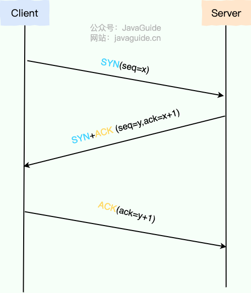
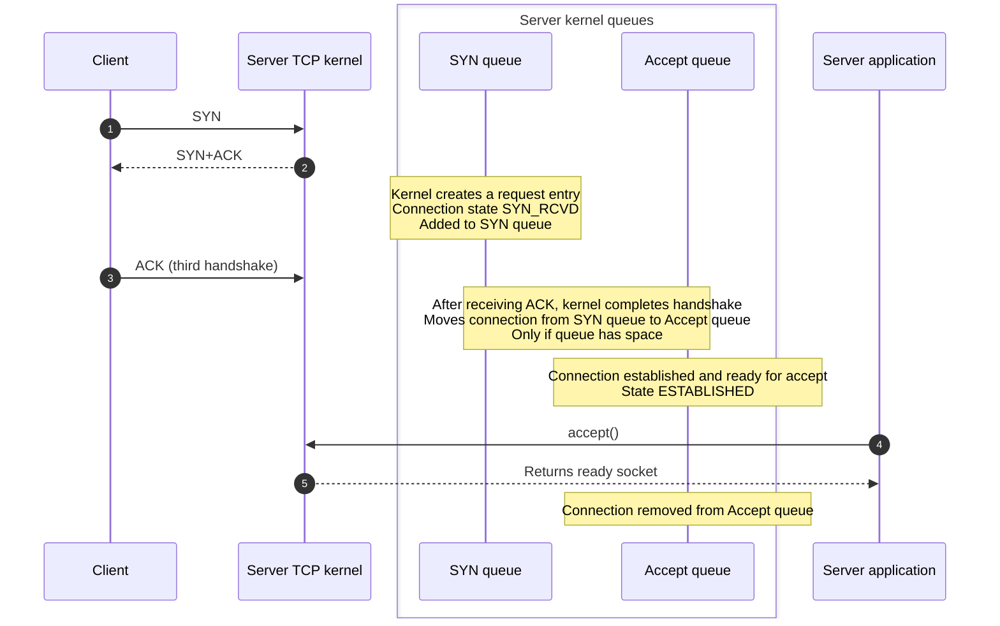
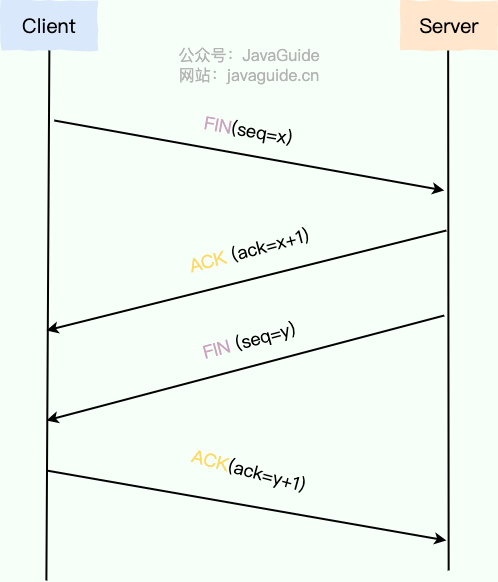
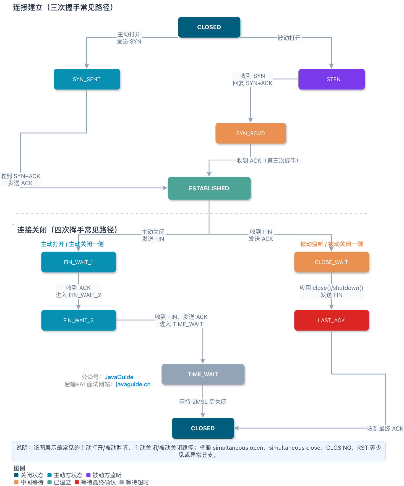
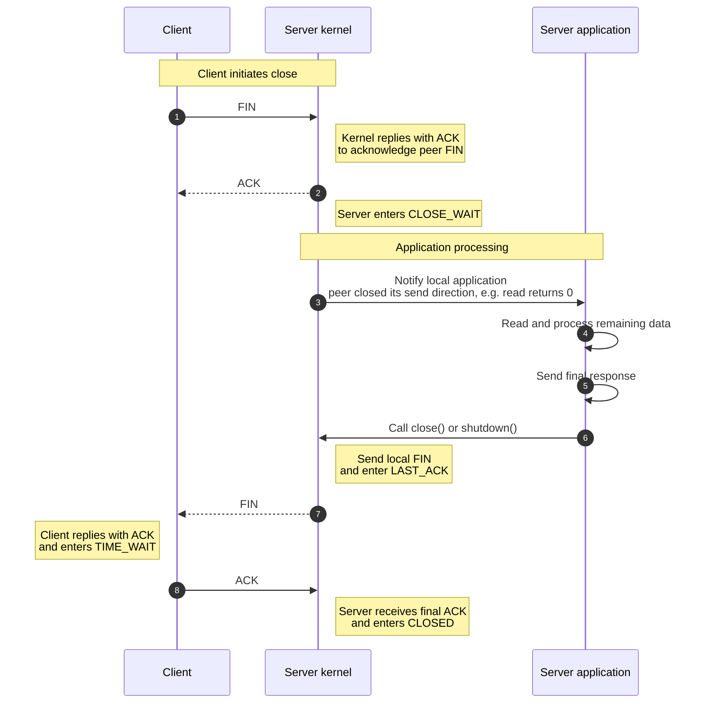
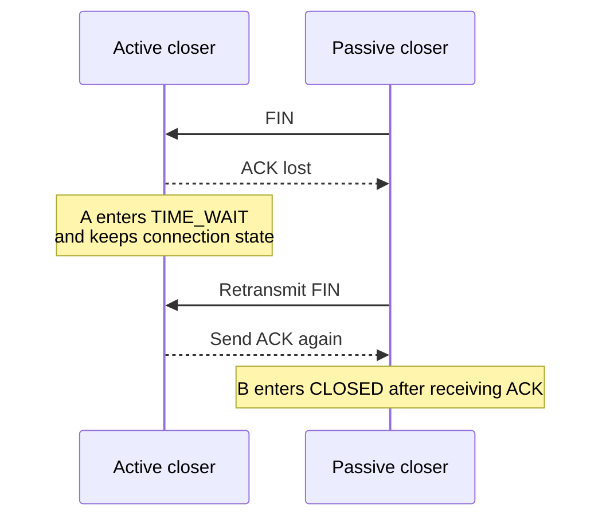

It is easy to memorize TCP's three-way handshake and four-way teardown as diagrams: the client sends `SYN`, the server replies with `SYN+ACK`, and the client sends `ACK`; to close the connection, the two sides exchange `FIN`, `ACK`, `FIN`, and `ACK`.

But memorizing the order is not enough when troubleshooting, inspecting packet captures, or answering interview questions. Why does connection setup need three handshakes? Which queue holds a connection after the server receives the third handshake? Why are ACK and FIN usually sent separately during teardown, and when can they be combined into three exchanges?

This article explains TCP connection setup and teardown and answers these questions:

1. What happens in each step of the TCP three-way handshake?
2. Why does connection setup use three handshakes instead of two or four?
3. What do the SYN and accept queues store?
4. What happens in each step of the TCP four-way teardown?
5. How should you understand details such as `TIME_WAIT`, `CLOSE_WAIT`, and three-way teardown?

> **Terminology:** This article uses underscore forms such as `SYN_RCVD` and `TIME_WAIT`. RFCs often use `SYN-RECEIVED` and `TIME-WAIT`, while Linux `ss` commonly displays `syn-recv` and `time-wait`. These names refer to the same TCP states in different contexts.

## Connection Setup: The TCP Three-Way Handshake



In the common case where one side initiates a connection and the other listens, TCP establishes a connection with a three-way handshake:

1. **First handshake (SYN):** The client sends a SYN segment containing its initial sequence number (ISN), such as `seq=x`. It then enters `SYN_SENT` and waits for the server.
2. **Second handshake (SYN+ACK):** If the server accepts the connection, it replies with a SYN+ACK segment containing two key values:
   - **SYN:** The server includes its own ISN, such as `seq=y`.
   - **ACK:** The acknowledgment number confirms receipt of the client's SYN: `ack=x+1`.
   - After sending this segment, the server enters `SYN_RCVD`.
3. **Third handshake (ACK):** After receiving the server's SYN+ACK, the client sends the final acknowledgment. The client's SYN consumes one sequence number, so this segment usually has `seq=x+1`; it acknowledges the server's SYN with `ack=y+1`. The client then enters `ESTABLISHED`. When the server receives this ACK, it also enters `ESTABLISHED`.

At this point, both sides have synchronized their initial sequence numbers and confirmed that they can exchange data in both directions.

### What Are the SYN Queue and the Accept Queue?



During the TCP handshake, the server kernel typically uses two queues to manage connection requests. The description below reflects common Linux behavior; details can differ by operating system, kernel version, socket options, and deployment.

1. **SYN queue:**
   - Holds requests whose handshakes are incomplete. After the server receives a SYN and replies with SYN+ACK, the connection enters `SYN_RCVD` and waits for the client's final ACK.
   - If the ACK never arrives, the kernel retransmits SYN+ACK according to its retry policy and eventually removes the request after a timeout.
   - Related settings include `net.ipv4.tcp_max_syn_backlog` and, during SYN floods, `net.ipv4.tcp_syncookies`.
2. **Accept queue:**
   - Holds connections whose handshakes are complete but that the application has not yet accepted. After the final ACK, the connection enters `ESTABLISHED` and waits for the application to call `accept()`.
   - Its capacity depends on both `listen(fd, backlog)` and the system limit `net.core.somaxconn`. A common approximation for the effective limit is `min(backlog, somaxconn)`, though behavior depends on the kernel and application configuration.

In summary:

| Queue        | Purpose                                                                  | State         | Removed when                     |
| ------------ | ------------------------------------------------------------------------ | ------------- | -------------------------------- |
| SYN queue    | Holds connections with incomplete handshakes                             | `SYN_RCVD`    | ACK arrives or retries time out  |
| Accept queue | Holds established connections waiting for the application to accept them | `ESTABLISHED` | The application calls `accept()` |

When the accept queue is full, `net.ipv4.tcp_abort_on_overflow` affects how Linux handles new connections:

- `0` (default): Linux usually does not immediately return an RST. It may drop the third-handshake ACK, leaving the server's handshake incomplete and causing it to retransmit SYN+ACK. After sending the third ACK, the client usually considers `connect()` successful, but the server has not placed the connection in the accept queue. Later client data may receive no response, resulting in a stalled first request, a read timeout, or a retry.
- `1`: Reply to the client with an `RST` so the connection fails quickly.

Use `ss -ltn` to inspect listening sockets. For a `LISTEN` socket, `Recv-Q` usually shows the number of connections waiting in the backlog for the application to accept; `Send-Q` shows the socket's backlog limit. If `Recv-Q` stays close to `Send-Q`, check whether the application is accepting connections promptly, the backlog is too small, a thread pool is blocked, GC pauses are occurring, or there has been a sudden connection spike.

When the SYN queue is full and `tcp_syncookies=1`, Linux can enable SYN cookies. The server encodes the necessary information in its SYN+ACK instead of storing full half-open state for every request. While SYN cookies are in use, the server does not allocate a normal SYN-queue entry for each SYN; after receiving a valid final ACK, the kernel validates the cookie and reconstructs the connection state.

SYN cookies are a defense, not a capacity upgrade. They can reduce the impact of a SYN flood on the SYN queue, but still consume CPU. They cannot restore service if attack traffic saturates the network bandwidth. Some TCP extensions may also be limited while cookies are in use, which can reduce performance on high-latency, high-bandwidth links. `tcp_syncookies=2` is mainly for testing and is not recommended as a production default.

### Why Is the Handshake Three-Way?

The TCP three-way handshake has two main goals: **synchronize both sides' initial sequence numbers** and **confirm that data can travel in both directions**. Reliable delivery of actual data also depends on acknowledgments, retransmission, window management, and congestion control during the connection.

#### 1. Confirm Both Directions and Synchronize Initial Sequence Numbers

```mermaid
sequenceDiagram
  autonumber
  participant C as Client
  participant S as Server

  Note over C,S: Goal: synchronize both ISNs and confirm bidirectional reachability

  C->>S: SYN seq=ISN_C
  Note right of S: Server knows C-to-S is reachable<br/>Client can send; server can receive
  Note right of S: Server state SYN_RCVD

  S->>C: SYN+ACK seq=ISN_S ack=ISN_C+1
  Note left of C: Client knows S-to-C is reachable<br/>and that the server received its SYN

  C->>S: ACK seq=ISN_C+1 ack=ISN_S+1
  Note left of C: Client state ESTABLISHED
  Note right of S: Server knows client received SYN+ACK<br/>Handshake complete; both ISNs synchronized
  Note right of S: Server state ESTABLISHED

  Note over C,S: Connection established; data transfer can begin
```

TCP uses sequence numbers (SEQ) and acknowledgment numbers (ACK) to order data, detect duplicates, and support retransmission. By exchanging and acknowledging both ISNs, the handshake gives both sides a shared starting point for sending and receiving data and prevents a connection from being established based on one-way information alone.

This table summarizes the steps:

| Step | Segment      | What it confirms                                                                                           |
| ---- | ------------ | ---------------------------------------------------------------------------------------------------------- |
| 1    | C→S: SYN     | The server knows the client can send, the server can receive, and C→S is reachable.                        |
| 2    | S→C: SYN+ACK | The client knows the server can send, the client can receive, and the server received its SYN.             |
| 3    | C→S: ACK     | The server knows the client received SYN+ACK; the handshake is complete and both directions are confirmed. |

Note that after step 2, only the client has confirmed bidirectional reachability. The server does not yet know whether its SYN+ACK reached the client. It confirms the full exchange only after receiving the third handshake's ACK. This is the main reason two handshakes are insufficient.

#### 2. Prevent Stale Connection Requests from Being Established

```mermaid
sequenceDiagram
    participant C as Client
    participant S as Server

    Note over C,S: Scenario: an old SYN is delayed in the network

    C->>S: 1. Send SYN; old request delayed
    Note over C: Client times out and abandons the request

    C->>S: 2. Send SYN for a new request
    S-->>C: 3. Establish and close connection normally

    rect rgb(255, 240, 240)
        Note right of S: The old SYN finally reaches the server
        S->>C: 4. Send SYN+ACK for the old request

        alt With a two-way handshake
            Note right of S: Server assumes connection is established<br/>after replying with SYN+ACK
            Note right of S: Connection established by mistake<br/>and resources are wasted
        else With a three-way handshake
            Note left of C: Client has no matching state<br/>or treats this as an unexpected segment
            C->>S: 5. Send RST or drop the segment
            Note right of S: Clean up on RST<br/>or time out while waiting for ACK
        end
    end
```

Suppose the client's first connection request, SYN1, is delayed in the network. The client times out, sends SYN2, successfully establishes a connection, transfers data, and closes it. Only then does the delayed SYN1 reach the server.

- **With a two-way handshake:** After receiving the stale SYN1, the server might mistake it for a new request and allocate resources for a connection. The client no longer intends to connect, so the server would maintain an invalid connection on its own.
- **With a third handshake:** After replying to the stale SYN1 with SYN+ACK, the server still waits for the client's final ACK. Since the client has no matching connection state, it may drop the segment or send an RST. Without a valid ACK, the server eventually removes the invalid connection.

The third handshake is not just an extra packet. It completes the exchange and prevents delayed or duplicate old requests from interfering with new connections.

### Why Does the Second Handshake Include SYN as Well as ACK?

The ACK in the second handshake confirms that the server received the client's SYN—that the request traveled from C to S.

The server also sends a SYN to share its own ISN with the client and ask the client to acknowledge it. Reliable transfer needs both sides to agree on their sequence-number starting points.

In short, ACK means “I received your SYN,” and SYN means “Here is my initial sequence number; please acknowledge it.”

> SYN (Synchronize Sequence Numbers) is the signal used to synchronize sequence numbers during TCP connection setup. The client sends SYN, the server replies with SYN+ACK, and the client confirms with ACK. This synchronizes both initial sequence numbers and establishes a TCP connection for reliable data transfer.

### Can the Handshake Carry Data?

In ordinary TCP, the third-handshake ACK can carry data. RFC 9293 also permits data-bearing segments during connection synchronization, but the receiver cannot deliver that data to the application until it is validated. The application can usually read it after the connection enters `ESTABLISHED`.

If the third-handshake ACK is lost, but the client then sends a data segment with the ACK flag set, the server can treat it as a valid third-handshake acknowledgment. Once the connection is considered established, the server can process the data.

This is different from TCP Fast Open (TFO), which allows application data in the initial SYN. TFO requires support and configuration on both client and server; it is not the default behavior of ordinary TCP.

## Connection Teardown: The TCP Four-Way Exchange



TCP is full-duplex, so each endpoint's sending direction is independent. To close a connection, both directions usually need to signal “I am done sending” and acknowledge the other side. This is why teardown is commonly described as a four-way exchange.

The four-way exchange describes logical steps; a packet capture will not always show four separate segments. In some cases, ACK and FIN can be combined in one segment.

The typical sequence is:

1. **First exchange (FIN):** When the client or either endpoint decides to close its sending direction, it sends a FIN segment to indicate that it has no more data to send. The segment contains a sequence number such as `seq=u`. The active closer enters `FIN_WAIT_1`.
2. **Second exchange (ACK):** The server receives FIN and replies with ACK, using `ack=u+1`. The server enters `CLOSE_WAIT`; after receiving ACK, the client enters `FIN_WAIT_2`. The connection is now **half-closed**: the client can no longer send to the server, but the server can still send remaining data to the client.
3. **Third exchange (FIN):** After sending its remaining data, the server sends FIN to close its sending direction. The segment contains a sequence number such as `seq=v` and usually the current acknowledgment number, such as `ack=u+1`. The server enters `LAST_ACK` and waits for the client's final acknowledgment.
4. **Fourth exchange (ACK):** The client receives the server's FIN and replies with the final ACK, `ack=v+1`. The client enters `TIME_WAIT`; the server enters `CLOSED` after receiving this ACK. The client waits 2MSL in `TIME_WAIT`, then enters `CLOSED`.

The client is shown as the active closer for simplicity. In practice, whichever endpoint actively closes the connection enters `TIME_WAIT`; this is not inherently tied to being the client or server.

> Note the difference: **half-close** means one direction has sent FIN while the other can still send data. A **half-open connection** usually means one endpoint crashed, restarted, or lost its connection state while the other still believes the connection exists. These are different concepts.

The diagram below shows common TCP state transitions during connection setup and teardown. It omits less common or abnormal paths such as simultaneous open, simultaneous close, RST, and `CLOSING`.



### Why Are There Four Teardown Steps?

Because TCP is full-duplex. If A has nothing more to send, that does not mean B is also done.

Imagine A and B are on a phone call that is about to end:

1. A says, “I have nothing else to say.” (A sends FIN.)
2. B replies, “I understand,” but may still have more to say. (B sends ACK.)
3. B finishes what it has to say, then says, “I'm done too.” (B sends FIN.)
4. A replies, “Understood.” (A sends ACK.)

In TCP, each direction is closed and acknowledged separately.

### Why Are the Server's ACK and FIN Usually Separate?



The key reason is that **the ACK reply** and **the FIN segment** are usually triggered at different times.

- When the server receives the client's FIN, its TCP stack replies with ACK to confirm that it received the request to close the client's sending direction. The server enters `CLOSE_WAIT` while its application handles remaining data.
- The kernel sends its own FIN only after the server application is done and calls `close()` or `shutdown()`.
- The kernel's automatic ACK and the application's decision to close are therefore decoupled and usually cannot be combined. A FIN+ACK segment is possible if the server is also ready to close immediately.

### Why Do CLOSE_WAIT Connections Accumulate?

`CLOSE_WAIT` is the state entered by the passive closer after receiving FIN and replying with ACK. Normally, it is temporary: the application detects that the peer has closed its sending direction, processes remaining data, and calls `close()` or `shutdown()`. The connection then moves to `LAST_ACK`.

If a machine has many `CLOSE_WAIT` connections, the cause is usually that the application has not closed them promptly, not a kernel setting. Common causes include missing `close()` calls on error paths, mismatches between returning a connection to a pool and actually closing it, or a business thread stuck on a slow query or external call before it reaches the socket cleanup code.

Use `ss -tan state close-wait` to find connections stuck in `CLOSE_WAIT`, then use application logs, thread dumps, and connection-pool metrics to locate the code path. `CLOSE_WAIT` means the local application has not closed the socket, so changing TCP settings usually does not fix the root cause.

### When Can Teardown Take Three Exchanges?

Three exchanges do not mean a teardown step was skipped. Instead, **the ACK from the second exchange and the FIN from the third are combined into one segment**.

This can happen when the passive closer has no more data to send after receiving FIN and its application decides to close the connection immediately.

TCP delayed ACKs give the stack a chance to combine an ACK with a window update, application response, or another outgoing segment, reducing standalone ACKs. RFC 1122 says ACKs must not be excessively delayed; the exact delay is implementation-dependent. In Linux and other implementations, if the ACK for the peer's FIN is still pending and the local application quickly calls `close()` or `shutdown()`, the kernel can send FIN+ACK: it acknowledges the peer's FIN and signals that it has no more data to send.

The packet capture then shows:

1. The active closer sends FIN.
2. The passive closer sends FIN+ACK.
3. The active closer replies with ACK and enters `TIME_WAIT`.

Two details are easy to confuse:

- Three exchanges do not violate TCP's full-duplex close semantics. Both directions still close; the passive closer simply combines its acknowledgment and close request into one TCP segment.
- Whether they can be combined depends on the TCP implementation, delayed-ACK policy, and when the application closes the socket. Once the kernel sends ACK separately, it cannot combine it with a later FIN. A quick-ACK policy such as `TCP_QUICKACK`, which sends ACK sooner, also makes a full four-way exchange more likely.

### What If the Server's ACK Is Lost?

After sending its first FIN, the client enters `FIN_WAIT_1` and starts a retransmission timer. If it does not receive an ACK for FIN before the timeout, it retransmits FIN.

If the server receives a duplicate FIN, it usually sends another ACK. If network problems keep the ACK from reaching the client, the client may report an error or give up after a retry or timeout limit. Behavior depends on the implementation and settings. On Linux, retries for a socket that the application has closed (an orphaned socket) are more directly affected by `tcp_orphan_retries`; RTO retransmission timeouts for an active connection are related to `tcp_retries2`.

### Why Wait 2MSL After the Fourth Exchange?

The final ACK sent by the active closer may be lost. If the passive closer does not receive it, it retransmits FIN. The active closer can reply with another ACK while it remains in `TIME_WAIT`.

If the active closer entered `CLOSED` immediately after sending the final ACK, it might have no matching connection state when the retransmitted FIN arrives and could reply with RST, making the peer see an abnormal close or reset.



**MSL (Maximum Segment Lifetime)** is the maximum time a segment can remain in the network. 2MSL is not the maximum request-response RTT; it is a conservative wait that allows a retransmitted FIN to be handled if the final ACK is lost and gives delayed segments from the old connection time to disappear.

The MSL in RFCs is a protocol concept; implementations can differ. Linux commonly keeps `TIME_WAIT` sockets for 60 seconds, corresponding to the `TCP_TIMEWAIT_LEN` kernel constant. This is not a “2 × MSL” value dynamically calculated from current network conditions. Another common misconception is that `tcp_fin_timeout` controls `TIME_WAIT`; it actually controls the `FIN_WAIT_2` timeout for orphaned connections. To reduce port pressure from `TIME_WAIT`, first consider connection reuse, the port range, which side actively closes, and whether `tcp_tw_reuse` is appropriate. Do not use `tcp_fin_timeout` to shorten `TIME_WAIT`.

## Common TIME_WAIT Questions: Why Wait, Is It a Problem, and Can It Be Reused?

This topic is covered in [TCP TIME_WAIT Explained: Why Wait, Is It a Problem, and Can It Be Reused?](./tcp-time-wait.md).

## Summary

The point of TCP's three-way handshake is not simply to send three packets. By exchanging `SYN`, `ACK`, and initial sequence numbers, both client and server confirm that the connection can carry data in both directions. Without the final exchange, the server may not know whether the client received its `SYN+ACK`, and delayed connection requests can interfere with newer ones.

During the handshake, the server uses a SYN queue for connections whose handshakes are incomplete and an accept queue for established connections waiting for the application to call `accept()`. These queues are useful places to investigate slow connections, intermittent timeouts, SYN floods, or delayed accepts.

The four-way teardown closes each sending direction independently. The active closer's FIN means “I have no more data to send,” not that the peer is also done. ACK and FIN are therefore usually sent separately. They may be combined into FIN+ACK when the passive closer has no data left, its application closes immediately, and the ACK can still be delayed for combining. `CLOSE_WAIT` usually means the passive side's application has not closed the connection yet.

Finally, `TIME_WAIT` is not wasted time. It allows the peer to retransmit FIN if the final ACK is lost and helps keep delayed packets from an old connection from affecting a new one. Understanding these states and what triggers each segment is more useful than simply memorizing the number of handshakes and teardown steps.

## References

- _Computer Networks_ (7th edition)
- _Illustrated HTTP_
- TCP and UDP Tutorial：<https://www.9tut.com/tcp-and-udp-tutorial>
- TCP SYN and accept queues explained through a production incident: <https://mp.weixin.qq.com/s/YpSlU1yaowTs-pF6R43hMw>
- RFC 9293: Transmission Control Protocol（TCP）：<https://www.rfc-editor.org/rfc/rfc9293>
- RFC 1122: Requirements for Internet Hosts - Communication Layers：<https://www.rfc-editor.org/rfc/rfc1122>
- RFC 1337: TIME-WAIT Assassination Hazards in TCP：<https://www.rfc-editor.org/rfc/rfc1337>
- tcp(7) - Linux manual page：<https://www.man7.org/linux/man-pages/man7/tcp.7.html>
- Linux kernel ip-sysctl documentation: <https://www.kernel.org/doc/Documentation/networking/ip-sysctl.txt>
- Linux kernel `include/net/tcp.h`: <https://codebrowser.dev/linux/linux/include/net/tcp.h.html>
- SoByte - Why TCP Needs the TIME_WAIT State: <https://www.sobyte.net/post/2022-10/tcp-time-wait/>

<!-- @include: @article-footer.snippet.md -->
