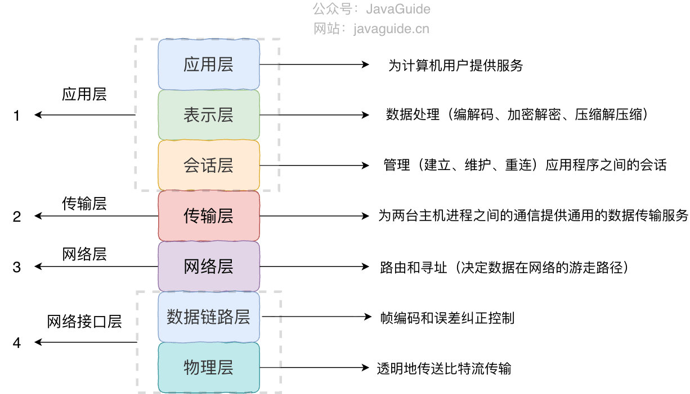
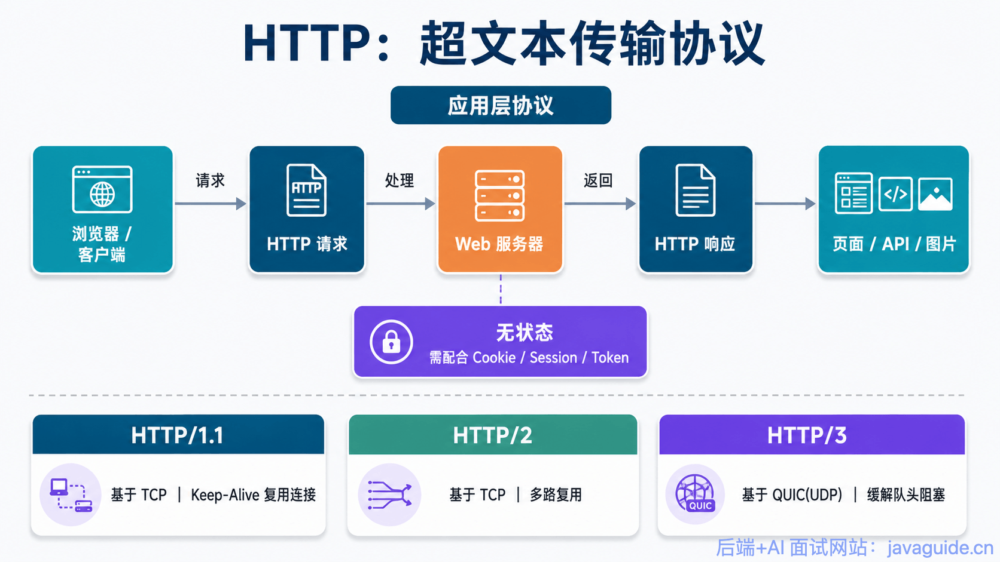
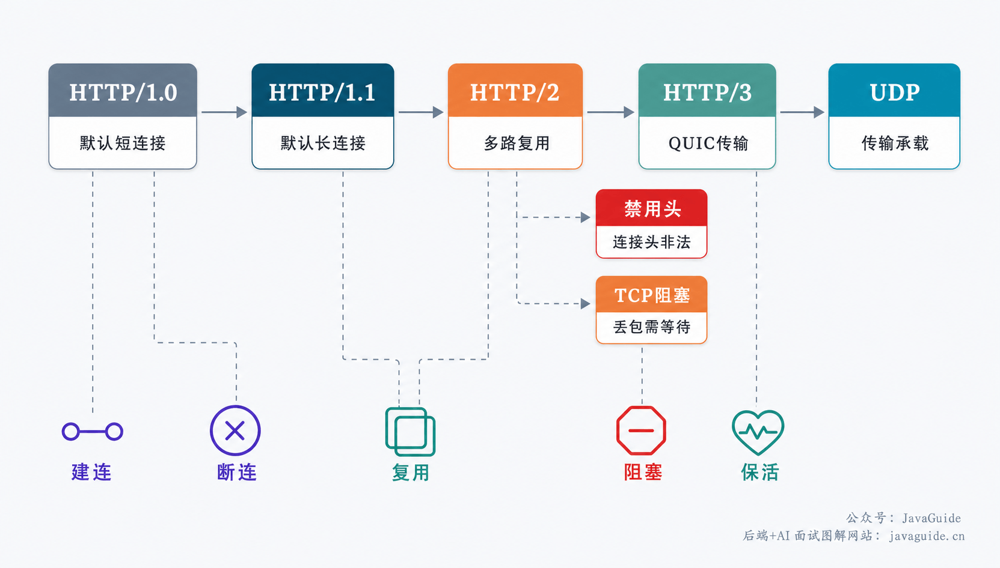
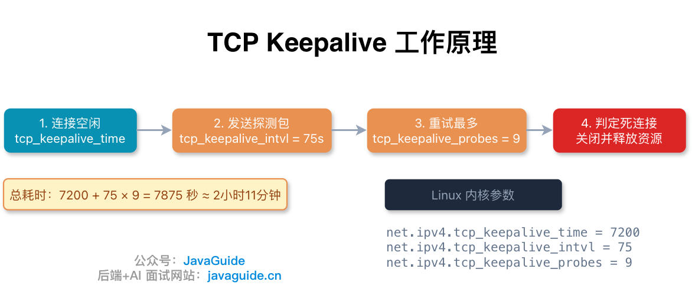
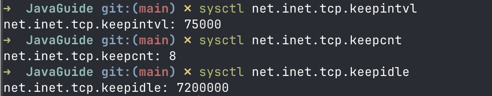
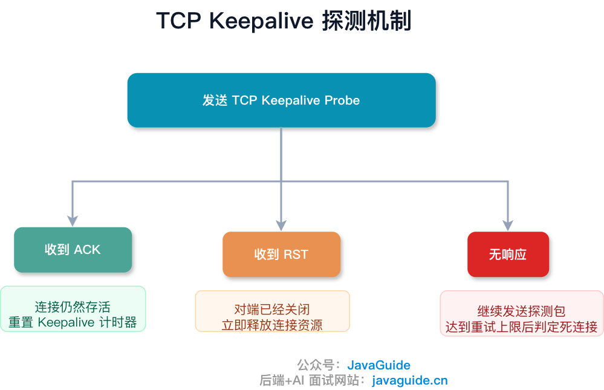

Hi, I'm Xiao G. The difference between TCP keepalive and HTTP Keep-Alive often comes up in technical interviews. Let's take a closer look.

The names look similar, but the mechanisms are different. One works at the application layer and the other at the transport layer:

- **HTTP Keep-Alive** is an application-layer mechanism. It lets multiple HTTP requests reuse one TCP connection instead of performing a new handshake for every request.
- **TCP keepalive** is a transport-layer mechanism. It checks whether the peer is reachable after a TCP connection has been idle for a long time, so the system can reclaim resources if the peer is gone.



One controls whether a connection can be reused; the other checks whether it is still alive. They have different purposes and happen to have similar names.

Let's look at them separately.

## What Is HTTP Keep-Alive?

In HTTP/1.0, each TCP connection typically carries one HTTP request and response. After sending the response, the server initiates connection closure, and the client closes its side too.



When you open a web page, the browser may need to load dozens of HTML, CSS, JavaScript, and image resources. Creating and closing a separate connection for each one adds the cost of TCP handshakes and teardown, and makes poor use of connections.

That raises an obvious question: **Why can't one TCP connection carry multiple HTTP requests?**

HTTP introduced the `Connection` header to address this. For example, an HTTP/1.0 client can include:

```
Connection: Keep-Alive
```

If the server confirms this in its response, both sides agree to use a **persistent connection**. They keep the TCP connection open after the request and response so later HTTP requests can reuse it. The connection remains open until it times out while idle, reaches a request limit, or either side closes it.

**Keep-Alive behaves differently across HTTP versions:**



- **HTTP/1.0**: Connections are short-lived by default. To use a persistent connection, the client must send `Connection: Keep-Alive`, and the server must confirm it in its response.
- **HTTP/1.1**: Connections are persistent by default. To close a connection after a request, send `Connection: close`. This reduces the cost of repeatedly establishing and closing TCP connections compared with HTTP/1.0.
- **HTTP/2**: HTTP/2 adds multiplexing, so multiple streams can be active on one TCP connection and their data can be interleaved. This removes HTTP/1.1's application-layer head-of-line blocking. However, HTTP/2 still uses a single TCP connection, so packet loss can make later data wait for retransmission, causing transport-layer head-of-line blocking. HTTP/1.x connection-control headers no longer apply. More precisely, connection-specific headers such as `Connection`, `Keep-Alive`, and `Transfer-Encoding` are prohibited in HTTP/2, and messages containing them are invalid.
- **HTTP/3**: HTTP/3 runs over QUIC, which uses UDP rather than TCP. It does not use HTTP/1.x's `Connection: Keep-Alive` mechanism. QUIC handles connection management, keepalive, and multiplexing, and avoids TCP-level head-of-line blocking.

In short: HTTP/1.0 requires an explicit Keep-Alive header, HTTP/1.1 reuses connections by default, HTTP/2 multiplexes streams over one TCP connection, and HTTP/3 uses QUIC for connection management.

## How Are HTTP Persistent Connections Closed?

Persistent connections make better use of TCP, but they also create a new problem. A client may open a page and then leave its connection idle. A server cannot wait forever or rely on every client to close the connection promptly.

If many idle connections accumulate, they consume server resources for their TCP control blocks (TCBs).

HTTP can include two parameters in the `Keep-Alive` header:

```
Keep-Alive: timeout=5, max=10
```

- **timeout=5**: The server may close the connection after it has been idle for more than five seconds.
- **max=10**: The connection can serve up to ten HTTP requests before it is closed.

One detail is easy to miss: **once the timeout or request limit is reached, the server may close the connection whether or not the client is online.** If the client tries to reuse it, the request may fail and need to be retried.

Server settings usually control when idle HTTP Keep-Alive connections are reclaimed. A client can close a connection too, but the server does not have to wait for it.

In practice, the web server sets these limits. For example, Nginx defaults to 75 seconds for `keepalive_timeout` and 1,000 requests for `keepalive_requests` (the latter default was 100 before Nginx 1.19.10).

## What Is TCP Keepalive?

TCP keepalive solves a different problem. It does not care whether the connection carries HTTP requests; it checks **whether the peer is still there**.

Suppose a client and server have a TCP connection, but the client suddenly loses power, its network cable is unplugged, or its system crashes. The server may not know the peer is gone. TCP has no equivalent of a busy signal, so the connection becomes half-open and continues to consume server TCB resources.

TCP keepalive can detect this situation. It works as follows:



1. If no data passes over a TCP connection for a while (two hours by default), the kernel sends the peer a **probe**.
2. If the peer is online, it replies with an ACK. The timer resets, and the kernel waits another two hours.
3. If there is no reply, the kernel sends another probe every **75 seconds**, for up to **nine retries**.
4. If all nine probes go unanswered, the kernel treats the connection as dead, sends an RST, closes it, and releases its resources.

On Linux, these settings are:

| Parameter              | Meaning                       | Linux default           |
| ---------------------- | ----------------------------- | ----------------------- |
| `tcp_keepalive_time`   | Idle time before probes start | 7,200 seconds (2 hours) |
| `tcp_keepalive_intvl`  | Time between probes           | 75 seconds              |
| `tcp_keepalive_probes` | Maximum number of probes      | 9                       |

macOS uses a BSD-style network stack. Its settings use `net.inet.tcp.*` rather than `net.ipv4.*`.



With these defaults, the connection can take up to **7,200 + 75 × 9 = 7,875 seconds**, or about 2 hours and 11 minutes, to be declared dead.

Use `sysctl` to view or change the settings:

```bash
sysctl net.ipv4.tcp_keepalive_time
sysctl net.ipv4.tcp_keepalive_intvl
sysctl net.ipv4.tcp_keepalive_probes
```

One easy-to-miss detail: **TCP keepalive is disabled by default.** An application must explicitly enable the `SO_KEEPALIVE` socket option, or the kernel will not send probes. RFC 1122 specifies that keepalive is optional and must be off by default.

TCP keepalive is a **gentle resource-reclamation mechanism**. It reclaims resources only after confirming that the peer is unreachable. As long as the peer is online and replies with ACKs, the connection stays open and the timer resets. TCP keepalive cannot close a connection just because the peer is still online.

That differs from HTTP Keep-Alive, where the server can close an idle connection when its limit is reached, regardless of whether the client is online.

## What Can Happen After a TCP Keepalive Probe?

The result depends on the peer's state when the kernel sends a probe:



**1. The peer is online**

The peer receives the probe and its TCP stack replies with an ACK. The sender resets the idle timer to `tcp_keepalive_time` and continues waiting. The connection stays open.

**2. The peer crashed and restarted**

The peer is online again, but its kernel no longer has the connection state. Its TCP stack replies to the probe with an RST because it does not recognize the connection. The sender receives the RST and closes the connection immediately.

**3. The peer has not recovered, or the network is unreachable**

The probes receive no replies. The sender retries every `tcp_keepalive_intvl` seconds. If all `tcp_keepalive_probes` attempts go unanswered, the kernel treats the connection as dead, closes it, and releases its resources.

The third case can also be caused by network devices. For example, a NAT gateway may remove an idle connection's mapping after a timeout. Later probes can no longer reach the peer, so they go unanswered and the connection eventually times out.

## What Are the Limits of TCP Keepalive?

Here, TCP keepalive means the transport-layer probe mechanism, not HTTP connection reuse. It can detect dead connections, but it is usually not enough on its own in production:

**The default probes are slow.** On Linux, the first probe is sent after two hours of idle time. Windows also defaults to a two-hour keepalive timeout. That is too long for many online services. Linux's `net.ipv4.tcp_keepalive_*` values are system defaults for connections without per-socket settings. Applications can set `TCP_KEEPIDLE`, `TCP_KEEPINTVL`, and `TCP_KEEPCNT` per socket on supported platforms. These options are not portable, so check what the target operating system and language runtime expose.

**It checks the connection, not application health.** The kernel sends TCP keepalive probes, and the peer's TCP stack replies with an ACK without involving the application. This only shows that the peer's kernel can receive packets and respond. It says nothing about the application's thread pool, event loop, database connection pool, or service dependencies. This is TCP keepalive's biggest blind spot.

**An intermediary can change what you are checking.** If a NAT, layer 4 load balancer, or reverse proxy sits between the client and server, first determine whether it terminates the TCP connection. If it only performs NAT or connection tracking, keepalive probes may preserve the mapping if their interval is shorter than the device's idle timeout. If it terminates TCP, the backend checks only the connection between itself and the intermediary, not whether the original client is still alive.

**Operating systems differ in their implementations and defaults.** Linux starts probing after 7,200 seconds, waits 75 seconds between probes, and sends up to nine. Windows also defaults to a two-hour timeout, but its default interval is one second; on Windows Vista and later, the probe count is fixed at ten. macOS uses BSD-style settings under `net.inet.tcp.*`, not Linux's `net.ipv4.*` sysctls. TCP keepalive is not a consistent cross-platform health check, so verify the parameter names, units, and defaults on the target system.

**It does not apply directly to HTTP/3/QUIC.** TCP keepalive does not check the liveness of an actual HTTP/3/QUIC connection. If a client falls back to HTTP/1.1 or HTTP/2 because UDP is blocked, the resulting TCP connection may use TCP keepalive. QUIC handles HTTP/3 connection liveness and timeouts. For example, QUIC has an idle timeout and can send PING frames to test liveness; HTTP/3 can use GOAWAY to help close a connection gracefully.

In practice, TCP keepalive is mostly a fallback for cleaning up connections that are clearly dead. For faster, more precise health checks that can observe application state, use application-layer heartbeats such as WebSocket Ping/Pong, gRPC keepalive pings, or a custom heartbeat protocol.

Application-layer heartbeats should not be sent too often. Short intervals increase traffic, timer load on the server, and false positives on poor networks; long intervals delay failure detection. Choose an interval based on connection volume, NAT or load balancer idle timeouts, and the acceptable failure-detection delay.

## TCP Keepalive vs. HTTP Keep-Alive

| Aspect                          | HTTP Keep-Alive                                                                            | TCP keepalive                                                                         |
| ------------------------------- | ------------------------------------------------------------------------------------------ | ------------------------------------------------------------------------------------- |
| **Layer**                       | Application layer (HTTP)                                                                   | Transport layer (TCP)                                                                 |
| **Purpose**                     | Reuses TCP connections to reduce connection setup, teardown, and slow-start overhead       | Probes idle TCP connections and releases resources if the peer is unreachable         |
| **Default**                     | Short-lived connections in HTTP/1.0; persistent connections in HTTP/1.1                    | Disabled by default; the application must enable `SO_KEEPALIVE`                       |
| **Control**                     | Configured per connection by HTTP clients, web servers, or proxies                         | Controlled by the operating system, with per-socket options on some platforms         |
| **Common settings**             | `Connection`, `Keep-Alive: timeout/max`, and server timeouts                               | `tcp_keepalive_time/intvl/probes` or platform equivalents                             |
| **When it closes**              | On idle timeout, request limit, or when either side closes it                              | After probes go unanswered or the peer returns an RST                                 |
| **When the peer is online**     | The server can still close an idle connection based on its settings                        | The connection usually remains open as long as the peer's kernel replies with ACKs    |
| **Can it replace a heartbeat?** | No; it manages HTTP connection reuse, not application health                               | No; it cannot check application threads, event loops, or dependencies                 |
| **Effect of intermediaries**    | A proxy or gateway can manage each HTTP/TCP connection independently                       | NAT, load balancers, and proxies may limit the check to one segment of the connection |
| **HTTP/2 and HTTP/3**           | HTTP/2 prohibits connection-specific headers; HTTP/3 over QUIC does not use this mechanism | Applies only to TCP, not to an actual HTTP/3/QUIC connection                          |

The two mechanisms differ in who decides to close a connection:

HTTP Keep-Alive is **proactive**: once the timeout or request limit is reached, the server can close the connection without checking whether the peer is online.

TCP keepalive is **reactive**: it sends probes to ask whether the peer is still there. As long as the peer is online and replies with ACKs, the server keeps the connection open and resets the timer. It releases resources only after the peer is confirmed unreachable.

Both mechanisms often run at the same time, each doing its own job. HTTP Keep-Alive controls how long a connection stays open and how many requests it serves. TCP keepalive checks whether an idle peer has disappeared. They do not interfere with each other and cannot replace one another.
