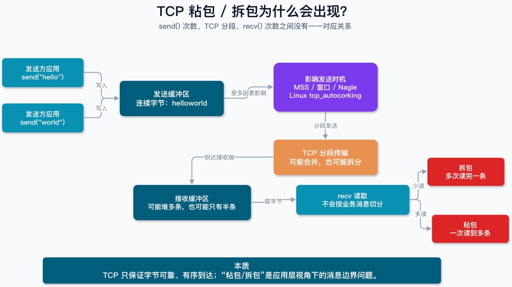
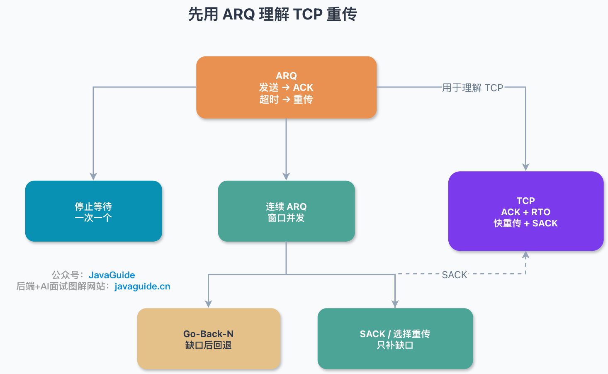
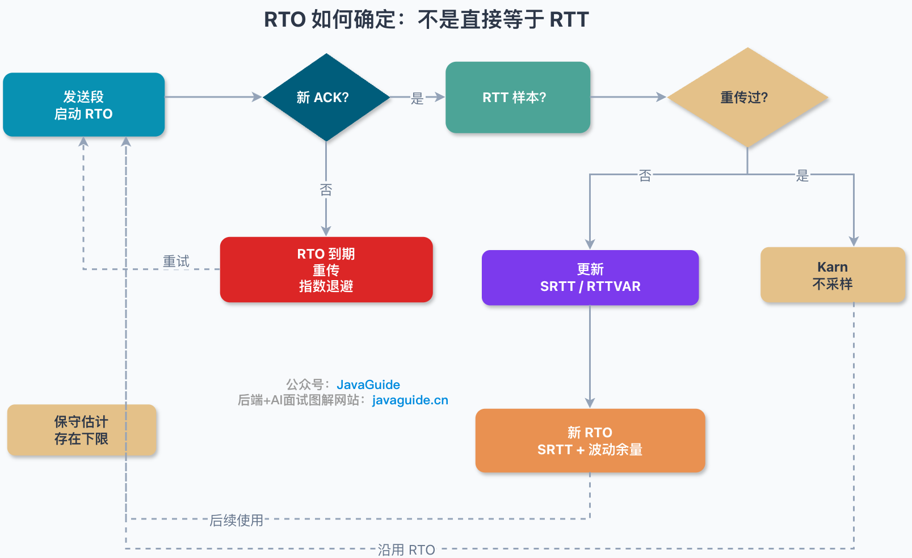
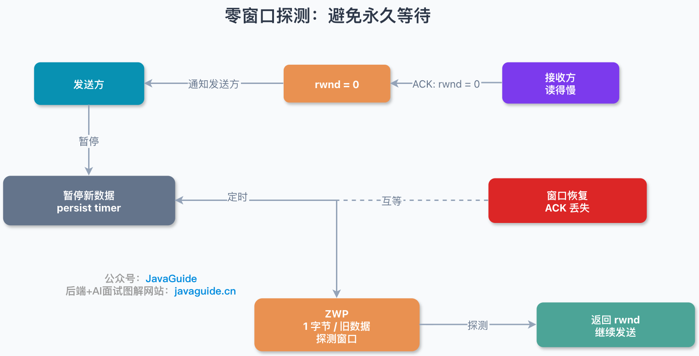
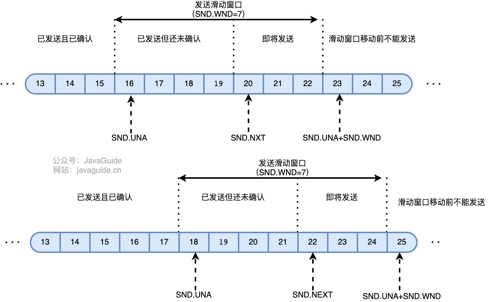
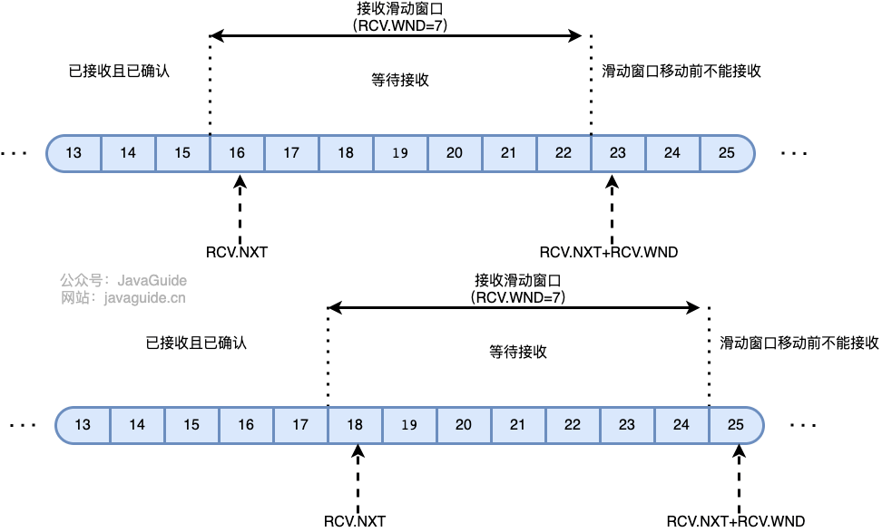
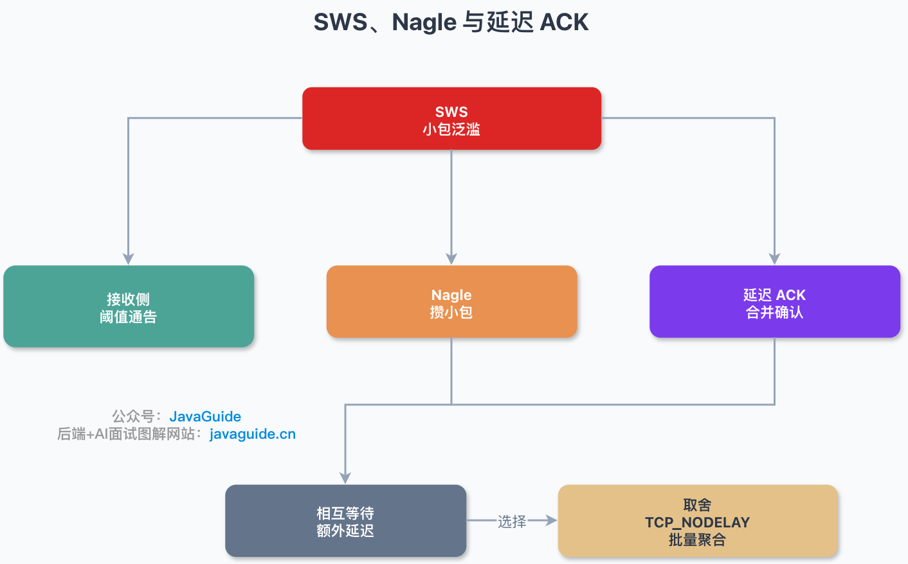
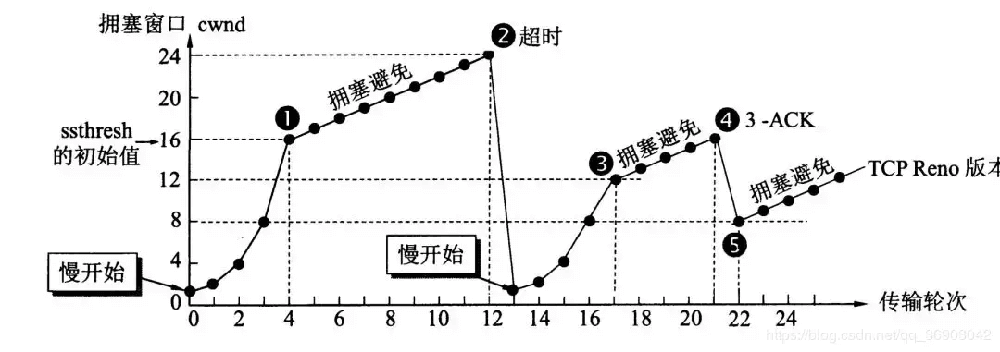

TCP is often called a reliable transport protocol, but reliability is not an abstract promise. It comes from several mechanisms working together.

Lost data must be retransmitted, out-of-order data reordered, and the sender slowed when the receiver or network cannot keep up. Together, these mechanisms let TCP provide reliable delivery over an unreliable IP network.

This article answers four questions:

1. Which mechanisms does TCP use for reliable delivery?
2. What problems do timeout retransmission, fast retransmit, SACK, and D-SACK solve?
3. How does TCP use sliding windows for flow control?
4. How do slow start, congestion avoidance, fast retransmit, and fast recovery work?

One point is easy to misunderstand: TCP reliably delivers a **byte stream**, not individual application-layer “messages.” It does not preserve message boundaries in HTTP, RPC, or other protocols. TCP numbers bytes and tries to deliver them in order without duplicates. The application protocol must define where a request starts and ends, for example with a length field, delimiter, or HTTP message format.

## How Does TCP Provide Reliable Delivery?

1. **Data segmentation:** TCP divides application data into segments that it considers suitable for transmission to the network layer.
2. **Reordering and deduplication:** TCP cannot prevent packet loss. It numbers bytes and uses ACKs, retransmission, reordering, and duplicate detection so the application receives an ordered byte stream without duplicates. Sequence numbers identify bytes, not segments. Each segment carries a contiguous byte range.
3. **Checksum:** TCP checksums its header, data, and the IP pseudo-header to detect transmission errors. A segment with an invalid checksum is discarded and not acknowledged. The 16-bit one's-complement checksum detects common errors, but is not a strong integrity check and does not prevent malicious modification. Systems may also rely on link-layer CRC, TLS AEAD, or application-level hashes.
4. **Retransmission:** TCP resends data when a segment appears lost or delayed. Mechanisms include timeout-based retransmission, fast retransmit based on receiver feedback, SACK (which reports ranges of data received out of order), and D-SACK (which reports duplicate data). D-SACK can help identify a possible spurious retransmission—for example, when the original data arrived but its ACK was lost, packets were reordered, or the timer fired too early. It provides a clue, not proof of a particular cause.
5. **Flow control:** Each side has buffers. The receiver advertises its receive window (`rwnd`) to tell the sender how much more data it can accept, limiting the sending rate so the receiver is not overwhelmed.
6. **Congestion control:** TCP reduces sending when the network is congested. The sender considers both the receiver's capacity (`rwnd`) and the network's congestion level (`cwnd`). The amount of unacknowledged data in flight is generally limited by `min(rwnd, cwnd)`.

## Understand TCP Retransmission Through ARQ

Retransmission is central to reliable delivery. To understand timeout retransmission, fast retransmit, and SACK, start with the abstract ARQ model.

**Automatic Repeat reQuest (ARQ)** is an error-control method used at the data link and transport layers. It combines acknowledgments and timeouts to provide reliable delivery over an unreliable service. If the sender does not receive an acknowledgment (ACK) in time, it retransmits, usually until it receives an ACK or reaches a retry limit.

ARQ is a useful way to understand TCP, but modern TCP is not one simple textbook ARQ variant. Its retransmission behavior combines cumulative ACKs, RTO, fast retransmit, SACK, congestion control, and flow control.

- By default, ACKs are **cumulative**: an ACK says that all data before the acknowledged sequence number has arrived.
- With SACK enabled, the receiver can also report which out-of-order ranges have arrived, allowing the sender to retransmit only missing data.

Stop-and-wait ARQ and Go-Back-N illustrate the basic ideas of reliable delivery. With SACK, modern TCP is closer to selective repeat.

ARQ includes stop-and-wait and continuous ARQ protocols.

### Stop-and-Wait ARQ

Stop-and-wait provides reliable delivery by making the sender wait for an ACK after each packet. If no ACK arrives before the timeout, the sender retransmits the packet and waits again before sending the next one.

If the receiver gets a duplicate packet, it discards it and sends another ACK.

**1) No errors:**

The sender transmits a packet. The receiver gets it within the timeout and sends an ACK. The sender then transmits the next packet.

**2) Error and timeout retransmission:**

If an ACK does not arrive within a specified time, the sender assumes the packet may have been lost and retransmits it. A timer is set after each packet; its timeout should be longer than the expected round-trip time. This is an **ARQ** mechanism. The receiver discards duplicate packets but still acknowledges them.

**3) Lost and delayed acknowledgments**

- **Lost ACK:** A sends message M1 and B receives it, but B's ACK is lost. A does not know this, so it retransmits M1 after the timeout. B discards the duplicate instead of delivering it again, then sends another ACK. A retransmitting is evidence that the earlier ACK did not arrive.
- **Delayed ACK:** A sends M1 and B acknowledges it, but the ACK arrives after A's timeout. A retransmits M1, so B receives a duplicate and sends another ACK. A may receive the newer ACK first and the earlier one later. A discards the duplicate ACK, and B discards the duplicate M1.

### Continuous ARQ

Continuous ARQ uses a sliding window to improve channel utilization. Common forms include Go-Back-N and selective repeat. The sender can transmit multiple packets within its window without waiting for each ACK. The receiver often uses cumulative acknowledgments to confirm all packets received in order up to a given point.

- **Advantage:** High channel utilization. A lost ACK does not always require retransmission.
- **Disadvantage:** Go-Back-N does not tell the sender which out-of-order packets the receiver already has. For example, if packet 3 is lost but packets 4 and 5 arrive, the receiver discards them and repeats its ACK for packet 2. The sender must retransmit starting from packet 3. SACK lets TCP report received ranges and avoid unnecessary retransmissions.

With this ARQ background, TCP's retransmission mechanisms are easier to follow.

## TCP Retransmission at a Glance

TCP retransmission has several triggers. The basic mechanism is **timeout retransmission**: if the sender waits too long for an ACK, it assumes the data may be lost and retransmits it. **Fast retransmit** uses repeated ACKs for the same old sequence number to detect a possible gap before the timeout. SACK and D-SACK carry additional information about received segments and possible spurious retransmissions.

The table below summarizes these mechanisms. The next section starts with the basic fallback, **RTO timeout retransmission**.

| Mechanism                    | Trigger                                                 | Purpose                                                                 |
| ---------------------------- | ------------------------------------------------------- | ----------------------------------------------------------------------- |
| Timeout retransmission (RTO) | No ACK arrives before the RTO expires                   | Fallback for lost data                                                  |
| Fast retransmit              | Three duplicate ACKs for the same cumulative ACK number | Retransmit likely lost data without waiting for the timeout             |
| SACK                         | ACK includes received data ranges                       | Show which data arrived so only missing data needs retransmission       |
| D-SACK                       | SACK reports duplicate data                             | Help identify spurious retransmissions, lost ACKs, or packet reordering |

## How Does Timeout Retransmission Work, and How Is the RTO Chosen?

Start with the first row: **timeout retransmission (RTO)**. It is TCP's fallback. Regardless of whether SACK is enabled or fast retransmit has run, the RTO determines when to stop waiting for an ACK and retransmit the data.

After sending data, the sender starts a timer and waits for the receiver's ACK. If the ACK does not arrive within the expected round-trip time (RTT), the segment may be considered lost and retransmitted.

- **RTT (Round-Trip Time):** The time from sending a TCP segment to receiving its ACK.
- **RTO (Retransmission Timeout):** The timeout after which the sender retransmits data if no ACK has arrived.

Choosing the RTO matters because it affects TCP performance. If it is too short, unnecessary retransmissions add load; if it is too long, recovery is delayed and throughput may drop. The RTO should adapt to network conditions.

RTT varies with network conditions, so TCP cannot use a single sample directly as the RTO. RFC 6298 describes maintaining a smoothed RTT (SRTT) and RTT variation (RTTVAR), then calculating the RTO. After a timeout, TCP also applies exponential backoff.

Karn's algorithm avoids ambiguous samples by excluding ACKs for retransmitted segments from RTT calculations. The ACK might correspond to the original transmission or the retransmission.

In short, RTO is not the same as RTT; it is based on a smoothed RTT plus a margin for variation. If RTT is around 100 ms but varies widely, the RTO needs a larger margin. If a timeout still occurs, the next RTO backs off to avoid adding retransmission load during congestion.

## How Does Fast Retransmit Work?

Timeout retransmission is reliable but can be slow because the sender waits for the RTO to expire. Fast retransmit avoids that wait by using duplicate ACKs from the receiver to detect a likely loss earlier.

TCP uses cumulative acknowledgments. Suppose the receiver has received bytes `[0, 1000)` in order and expects data starting at 1000. If it receives `[2000, 3000)` first, then `[1000, 2000)` is still missing. The receiver keeps sending `ACK = 1000` instead of advancing the ACK to 3000. Repeated ACKs for the same sequence number are called duplicate ACKs.

After three duplicate ACKs, the sender usually assumes that the data at the acknowledged sequence number was lost and retransmits it without waiting for the RTO. One duplicate ACK is not enough because packets can be temporarily reordered: a later packet arriving first does not prove that an earlier one was lost. Three duplicate ACKs balance faster recovery against false alarms from reordering.

Fast retransmit helps locate the earliest gap. If multiple segments in a send window are lost, cumulative ACKs alone do not show which later ranges arrived. SACK provides that information.

## How Does SACK Improve Retransmission Efficiency?

SACK (Selective Acknowledgment) provides information that cumulative ACKs cannot. A regular ACK says that all data before a sequence number has arrived, but cannot report later ranges that arrived out of order. SACK carries those non-contiguous byte ranges in TCP options so the sender can retransmit only missing data.

SACK is negotiated during the three-way handshake with the SACK-Permitted option. The ACK number remains cumulative; SACK options add one or more SACK blocks. Each block has a left and right edge and represents a received byte range `[Left Edge, Right Edge)`.

For example, the sender transmits `[0, 1000)`, `[1000, 2000)`, `[2000, 3000)`, and `[3000, 4000)`. If `[1000, 2000)` is lost but the later ranges arrive, the cumulative ACK remains at 1000. The receiver can use SACK to report `[2000, 4000)`, so the sender knows that only `[1000, 2000)` is missing.

TCP options have limited space. The SACK option uses 2 bytes and each SACK block uses 8 bytes, so a segment can carry at most four blocks; fewer fit when other options such as timestamps are present. SACK cannot record every out-of-order range, but it can substantially reduce unnecessary retransmissions when several segments are lost.

## What Is D-SACK For?

D-SACK (Duplicate SACK), defined in RFC 2883, extends SACK. SACK reports received non-contiguous ranges; D-SACK also reports ranges received more than once.

D-SACK does not introduce a new TCP option; it reuses SACK blocks. The first SACK block reports duplicate data when it describes a range already covered by the cumulative ACK or a range also described by a later SACK block.

Duplicate data is useful evidence because a retransmission does not always mean the original data was lost. Common causes include:

- The original data arrived, but its ACK was lost. The sender retransmitted after the RTO because it assumed the data was lost.
- The original data was delayed or heavily reordered. The sender triggered fast retransmit, then both the original and retransmitted data arrived.

After receiving D-SACK, the sender can infer that a retransmission may have been spurious and investigate lost ACKs, severe reordering, or an RTO that is too short. D-SACK cannot prove a specific cause, but it provides useful evidence for congestion control and troubleshooting.

## How Does TCP Implement Flow Control?

**TCP uses a sliding window for flow control, limiting the sender's rate so the receiver can keep up.** The sliding window tracks data that has been sent but not yet acknowledged and carries the flow-control state. The receiver advertises its receive window (`rwnd`) in ACKs, and the sender adjusts its send window accordingly. A window of 0 means the receiver has no buffer space available, so the sender must pause ordinary new data.

The TCP window field is 16 bits and can represent at most 65,535 bytes. The TCP Window Scale option extends the advertised window. You can check whether the peers negotiated it in the SYN and SYN-ACK packets of the three-way handshake.

**How does a zero window recover?** When the receiver advertises `rwnd = 0`, the sender pauses new data. If the receiver later frees buffer space and sends a window update, but that ACK is lost, both sides may wait: the sender waits for the window to open, and the receiver waits for new data.

TCP uses **zero-window probes** to avoid this deadlock. While the window is 0, the sender's persist timer periodically sends a small probe that prompts the receiver to report its current window. The sender can then learn whether the window has reopened, even if an earlier window update was lost.

Zero-window probing only prevents a deadlock caused by a lost window update; it is not an application health check. If the receiving application does not read from its socket for a long time, the connection may remain at a small or zero window while consuming resources on both ends. Production systems also need application read/write timeouts and idle-connection cleanup.

**Why is flow control needed?** The sender and receiver may process data at different rates. If the sender is faster, the receiver may not keep up, so data is buffered in the **receive buffer**, including out-of-order segments. Normally, the receiver reduces `rwnd` or advertises a zero window to stop new data. Data is more likely to be dropped if window updates arrive too late, an endpoint behaves incorrectly, buffers are exhausted, or network queues overflow. Flow control helps balance the sender and receiver.

Keep in mind:

- The sender is not necessarily the client.
- The receiver is not necessarily the server.

TCP is full-duplex, so both peers can send and receive data. The client and server can each act as either sender or receiver. Each endpoint has a send buffer and receive buffer, and maintains its own send and receive windows. The receive window depends on application, system, and hardware limits; the TCP data rate cannot exceed the application's processing rate. Both peers manage their windows in a similar way.

**The TCP send window can be divided into four regions:**

1. TCP segments that have been sent and acknowledged.
2. Segments that have been sent but not acknowledged.
3. Unsent segments that the receiver is ready to accept.
4. Unsent segments that the receiver cannot currently accept.

**TCP send window:**

- **SND.WND:** The send window.
- **SND.UNA (Send Unacknowledged):** The earliest unacknowledged sequence number and the left edge of the send window.
- **SND.NXT (Send Next):** Points to the first byte available to send.

Considering only the receiver's window, the **available send window** is approximately `SND.UNA + SND.WND - SND.NXT`. Actual sending is also limited by `cwnd`, MSS, and the send buffer.

**The TCP receive window can be divided into three regions:**

1. TCP segments that have been received and acknowledged.
2. Data that may be received but has not arrived yet.
3. Data beyond the receive window that cannot currently be accepted.

**TCP receive window:**

**The receive window changes dynamically.** It is affected by the application's read rate, receive-buffer usage, socket-buffer settings, and automatic tuning.

The sliding-window size in the diagram is illustrative; real windows are usually much larger.

**Silly Window Syndrome (SWS)** occurs when the sender or receiver repeatedly sends data or advertises windows in very small increments. This can fill the network with packets that have large headers and tiny payloads, reducing efficiency.

Common mitigations include:

- **Receiver-side SWS avoidance:** Wait until enough buffer space is available before advertising a larger window, instead of updating it after every small read.
- **Sender-side Nagle algorithm:** Buffer new small writes while earlier small packets remain unacknowledged, then send when an ACK arrives or enough data accumulates to fill an MSS.
- **Delayed ACK:** The receiver may wait briefly before acknowledging a segment, so it can combine the ACK with outgoing data or acknowledge multiple segments together. Delayed ACK is not specifically designed for SWS, but interacts with small-packet strategies.

Nagle's algorithm and delayed ACKs can wait on each other in some small-packet interactions, adding tens of milliseconds of latency. Latency-sensitive applications often disable Nagle with `TCP_NODELAY`, at the cost of sending more small packets and increasing header and interrupt overhead. For bulk responses or file transfers, batching writes is often preferable. Linux also provides platform-specific options such as `TCP_CORK` to control packet aggregation.

## How Does TCP Implement Congestion Control?

Congestion occurs when demand for a network resource exceeds its capacity. Queues grow, latency increases, and packets may be lost. Congestion control prevents too much data from entering the network and overloading routers or links. It is a network-wide process involving hosts, routers, and other factors that affect performance. Flow control, by contrast, is end-to-end: it limits the sender so the receiver can keep up.

For congestion control, the TCP sender maintains a **congestion window (`cwnd`)** that changes with network conditions. The effective send window is limited by the smaller of `cwnd` and the receiver's advertised window.

In the RFC 5681/Reno framework, TCP congestion control is often explained using four mechanisms: **slow start**, **congestion avoidance**, **fast retransmit**, and **fast recovery**. Modern algorithms such as CUBIC, BBR, and DCTCP use different implementations and state machines. Routers can also use packet-management strategies such as Active Queue Management (AQM) to reduce congestion.

- **Slow start:** A sender does not know the network's capacity when it begins. It probes by gradually increasing the send window and `cwnd` instead of injecting a large volume of data at once. Slow start does not mean the initial window must be one MSS. RFC 6928 proposed an initial window of up to 10 segments (IW10); many modern implementations use a similar default, but check the system configuration. With a common MSS of 1,460 bytes, 10 MSS is about 14 KB in the first RTT, which can matter for short HTTP connections and initial page loading. ACK feedback usually causes `cwnd` to roughly double each RTT during slow start.
- **Congestion avoidance:** The sender increases `cwnd` more slowly, approximately one MSS per RTT. Implementations usually achieve this through small increases per ACK. TCP enters congestion avoidance when `cwnd` reaches the slow-start threshold (`ssthresh`). The initial threshold is often large and is typically adjusted after loss is detected.
- **Fast retransmit:** After three duplicate ACKs for the same cumulative acknowledgment number, the sender usually assumes a segment was lost and retransmits it without waiting for the RTO.
- **Fast recovery:** In classic Reno, after the third duplicate ACK, set `ssthresh` to half the current congestion window, retransmit the lost segment, and set `cwnd` to `ssthresh + 3 × MSS`. Each additional duplicate ACK increases `cwnd` by one MSS. When a new ACK arrives, set `cwnd` back to `ssthresh` and enter congestion avoidance. Reno does not return directly to slow start because duplicate ACKs show that later data is still reaching the receiver. SACK, NewReno, CUBIC, and RACK/TLP use more complex recovery behavior, but Reno is a useful starting point.

Fast retransmit works well when one segment is lost. If multiple segments in a window are lost, duplicate ACKs alone may not show every gap. SACK lets the receiver explicitly report which segments arrived, so the sender can retransmit only missing data.

Slow start, congestion avoidance, fast retransmit, and fast recovery are the classic foundation for understanding TCP congestion control. Modern operating systems may use more advanced algorithms:

- **CUBIC:** RFC 9438 is the current standards-track specification, replacing the earlier CUBIC specification. CUBIC uses a cubic function to adjust the congestion window and is designed for high-bandwidth, high-RTT paths. It is a default algorithm in several major operating-system stacks, including Linux, Windows, and Apple platforms.
- **BBR:** Google's model-based congestion-control algorithm estimates bottleneck bandwidth and minimum RTT to control the sending rate. It aims for high throughput and low queueing delay and may perform well on links with bufferbloat. Results vary with version, queue management, competing traffic, RTT fairness, and deployment, so BBR is not a universal replacement for CUBIC.
- **DCTCP:** Primarily used in controlled data-center networks. It uses ECN marks to estimate congestion and reduce queueing delay on shallow-buffer switches; it is not intended as a general-purpose Internet algorithm.

Slow start, congestion avoidance, fast retransmit, and fast recovery remain useful foundations for understanding these algorithms.

One practical point: packet loss does not always mean congestion. Reno and CUBIC mainly treat loss as a congestion signal, but wireless errors, route changes, and queue overflows can also cause loss. ECN can signal congestion without dropping packets. When comparing algorithms, consider P95/P99 RTT, loss and retransmission rates, queue length, coexistence with CUBIC/Reno, and the kernel version and configuration—not just average throughput.

## Summary

TCP reliability does not mean that the network never loses packets. TCP uses several mechanisms on top of unreliable IP so the application sees an **ordered byte stream without duplicates, delivered as completely as possible**. The core ideas are:

1. **Sequence numbers and ACKs track data:** TCP numbers bytes, and the receiver acknowledges data it has received. The sender uses ACKs to track what is outstanding.
2. **Retransmission recovers lost data:** RTO provides a fallback; fast retransmit detects some losses sooner; SACK/D-SACK report received ranges and possible spurious retransmissions.
3. **Sliding windows provide flow control:** The receiver advertises `rwnd`, and the sender limits in-flight data so the receive buffer is not overwhelmed.
4. **Congestion control protects the network:** The sender uses `cwnd` to estimate network capacity and avoid injecting too much data, using mechanisms such as slow start, congestion avoidance, fast retransmit, fast recovery, CUBIC, and BBR.

In short, TCP does not make the network reliable. It combines **sequencing, acknowledgments, retransmission, reordering, deduplication, flow control, and congestion control** to provide applications with a relatively reliable byte stream over an unreliable network.

## References

1. _Computer Networking_, 7th edition
2. _Illustrated HTTP_
3. TCP and UDP Tutorial：<https://www.9tut.com/tcp-and-udp-tutorial>
4. Computer Network：<https://github.com/wolverinn/Waking-Up/blob/master/Computer%20Network.md>
5. TCP Flow Control：<https://www.brianstorti.com/tcp-flow-control/>
6. TCP Flow Control: <https://notfalse.net/24/tcp-flow-control>
7. TCP Sliding Window Explained: <https://cloud.tencent.com/developer/article/1857363>
8. RFC 9293 - Transmission Control Protocol：<https://www.rfc-editor.org/rfc/rfc9293>
9. RFC 6928 - Increasing TCP's Initial Window：<https://www.rfc-editor.org/rfc/rfc6928>
10. RFC 5681 - TCP Congestion Control：<https://datatracker.ietf.org/doc/html/rfc5681>
11. RFC 2018 - TCP Selective Acknowledgment Options：<https://www.rfc-editor.org/rfc/rfc2018>
12. RFC 2883 - An Extension to the Selective Acknowledgement（SACK） Option for TCP：<https://www.rfc-editor.org/rfc/rfc2883>
13. RFC 9438 - CUBIC for Fast and Long-Distance Networks：<https://www.rfc-editor.org/rfc/rfc9438>
14. RFC 8257 - Data Center TCP（DCTCP）：<https://www.rfc-editor.org/rfc/rfc8257>
15. BBR: Congestion-Based Congestion Control, ACM Queue, 2016：<https://queue.acm.org/detail.cfm?id=3022184>
16. RFC 1122 - Requirements for Internet Hosts - Communication Layers：<https://datatracker.ietf.org/doc/html/rfc1122>
17. RFC 6298 - Computing TCP's Retransmission Timer：<https://www.rfc-editor.org/rfc/rfc6298>
18. RFC 7323 - TCP Extensions for High Performance：<https://datatracker.ietf.org/doc/rfc7323/>
