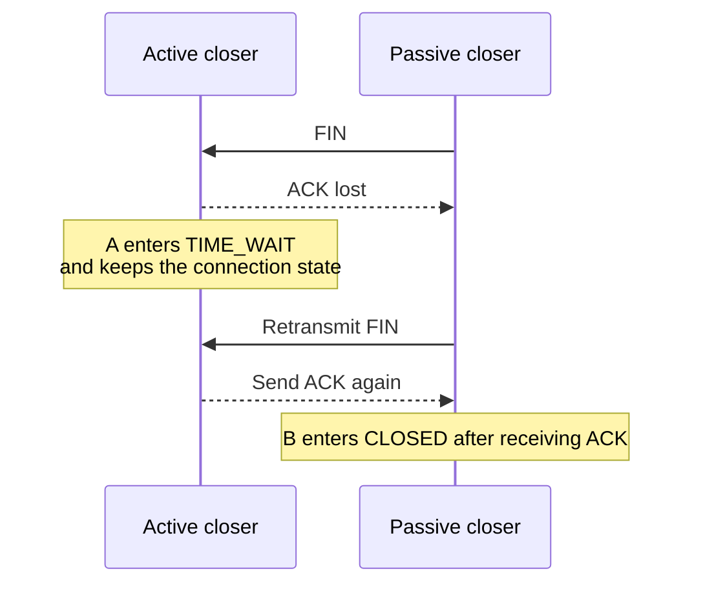
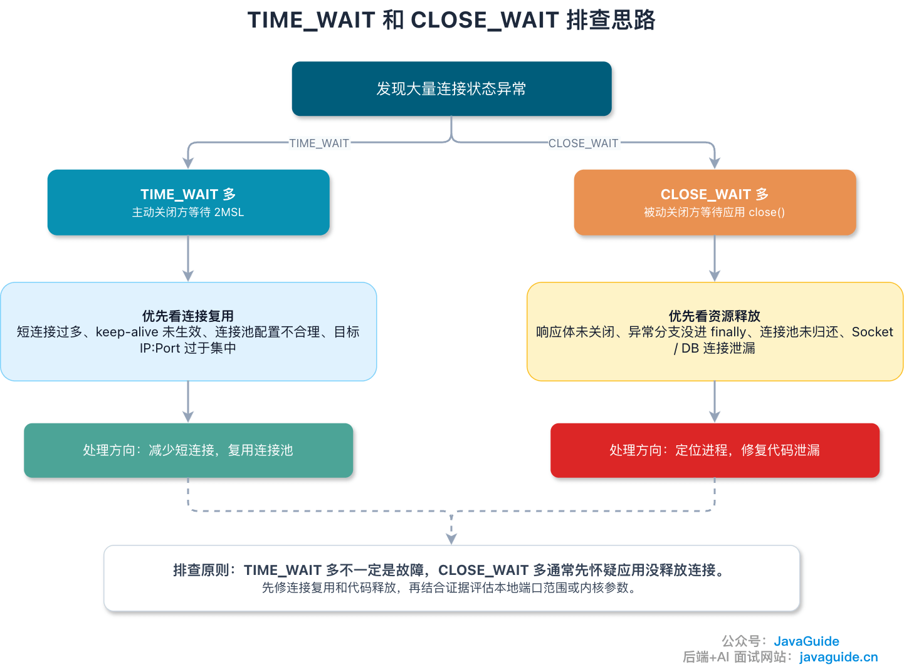
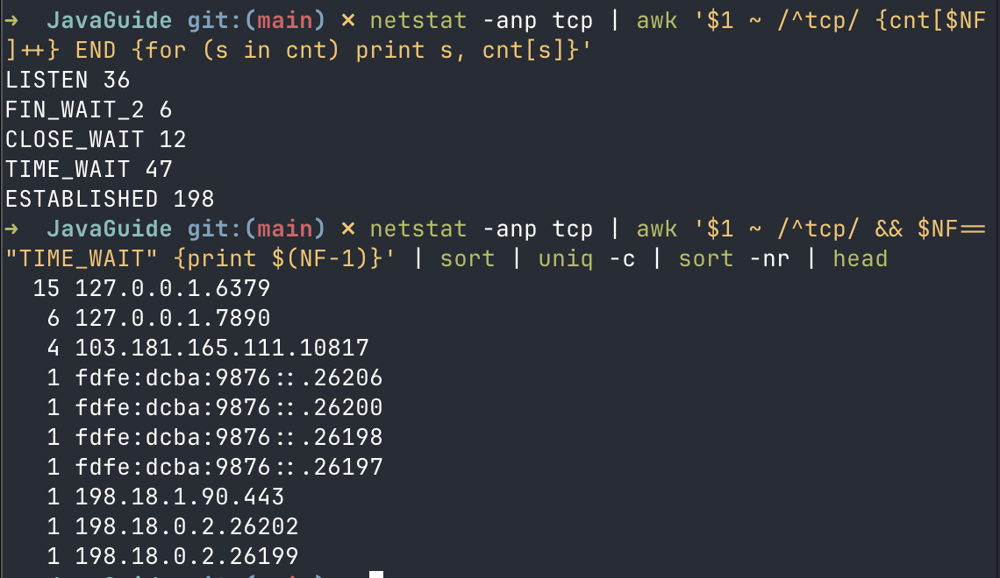

After sending the final ACK in TCP's four-way teardown, the active closer does not close immediately. It enters `TIME_WAIT`, which commonly lasts 60 seconds by default.

These 60 seconds are often misunderstood. Some consider them wasted resources, some try to disable them with kernel settings, and some confuse `CLOSE_WAIT` with `TIME_WAIT` during troubleshooting.

This article answers a few common production questions:

1. Why Does TCP Enter the `TIME_WAIT` State?
2. Can a large number of `TIME_WAIT` sockets cause problems?
3. Is it safe to enable `tcp_tw_reuse`?
4. How do you distinguish `TIME_WAIT` from `CLOSE_WAIT`?

## TIME_WAIT Is More Than “Wait a Bit Before Closing”

Why keep the port occupied for tens of seconds after the ACK has already been sent?

After sending the final ACK, the active closer does not release the connection immediately; it enters `TIME_WAIT`. RFC 9293's connection state diagram shows that the TCB is removed and the connection enters `CLOSED` after a 2MSL timeout.

One detail matters: receiving FIN does not always mean entering `TIME_WAIT`. The passive closer usually enters `CLOSE_WAIT` and waits for its application to handle remaining data and call `close()` or `shutdown()`. More commonly, the active closer enters `TIME_WAIT` after receiving the peer's final FIN and replying with the last ACK.

**The side that actively closes a connection is more likely to enter TIME_WAIT.** For example, if a client closes a short-lived HTTP connection, `TIME_WAIT` usually appears on the client. If the server closes the connection, the server can accumulate `TIME_WAIT` sockets too.

This extra wait addresses two problems.

## Reason 1: Allow the Final ACK to Be Retried

If the final ACK is lost, the passive closer may assume its FIN was not acknowledged and retransmit it. While the active closer remains in `TIME_WAIT`, it can send another ACK. If it has already entered `CLOSED`, it may reply with RST, making the peer see an abnormal close or reset.



**MSL (Maximum Segment Lifetime)** is the maximum time a segment can remain in the network. 2MSL is not the maximum request-response RTT. It is a conservative waiting period that allows for a retransmitted FIN if the final ACK is lost and gives delayed segments from the old connection time to disappear.

The MSL in RFCs is a protocol concept, and implementations can differ. Linux commonly keeps `TIME_WAIT` sockets for 60 seconds. Another common misconception is that `tcp_fin_timeout` controls `TIME_WAIT`; it controls the `FIN_WAIT_2` timeout for orphaned connections. To reduce port pressure from `TIME_WAIT`, first consider connection reuse, the port range, which side actively closes, and whether `tcp_tw_reuse` is appropriate. Do not use `tcp_fin_timeout` to shorten `TIME_WAIT`.

## Reason 2: Keep Old Connection Packets Out of New Connections

TCP connections are identified by a four-tuple: source IP, source port, destination IP, and destination port. If a new connection immediately reuses the same four-tuple after the old one closes, delayed packets from the old connection could fall within the new connection's receive window and be treated as new data.

For example:

```text
Old connection: client:50000 -> server:443
The server's SEQ=301 packet is delayed in the network.

After the old connection closes, the client quickly reuses the same source port:
New connection: client:50000 -> server:443

The old SEQ=301 packet then reaches the client.
If it falls within the new connection's receive window, it could be accepted by mistake.
```

TCP sequence numbers range from 0 to 2^32 - 1 and wrap modulo 2^32, so sequence numbers alone cannot distinguish old and new segments forever. Systems also use timestamps, PAWS (Protection Against Wrapped Sequences), and randomized ISNs. These are not universal replacements for `TIME_WAIT`. RFC 1337 also discusses risks from old duplicate segments.

## Are Many TIME_WAIT Sockets a Problem?

`TIME_WAIT` is a normal state. Problems usually arise when the active closer creates many connections to the same destination IP and port in a short time, occupying local ephemeral ports.

On Linux, inspect and adjust the local ephemeral port range with `net.ipv4.ip_local_port_range`. The upstream kernel documentation lists `32768 60999` as the default; check the local system for its actual range:

```bash
cat /proc/sys/net/ipv4/ip_local_port_range
```

If a client repeatedly connects to the same destination IP and port while old connections remain in `TIME_WAIT`, it may run out of local ephemeral ports and be unable to assign a source port to a new connection. A common error is:

```text
Cannot assign requested address
```

Use these observations to guide your investigation:

- **Many TIME_WAIT sockets on a server:** Check whether the server actively closes connections, such as short-lived connections, upstream connections closed by a gateway, or connections evicted by a pool.
- **Many TIME_WAIT sockets on a client or gateway:** Check for a surge of short-lived connections, ineffective connection pooling, disabled HTTP keep-alive, or frequent disconnects from the upstream service.

You can also make a rough estimate:

```text
Approximate short-lived connections per destination IP:port ≈ available ephemeral ports / TIME_WAIT duration
```

For example, the default port range `32768–60999` contains about 28,000 ports. If `TIME_WAIT` lasts about 60 seconds, the rough limit for continuously creating short-lived connections to one destination IP and port is a few hundred QPS. The actual limit also depends on connection reuse, reserved ports, NAT, kernel policy, and how four-tuples can be reused for different destinations. Do not draw conclusions from the total `TIME_WAIT` count alone.

## Why Shouldn't You Enable tcp_tw_reuse Casually?

`tcp_tw_reuse` allows a new active connection to reuse a `TIME_WAIT` socket when the protocol considers it safe. It may look like a shortcut for reducing port pressure, but it changes TCP's handling of packets from old connections and is not a general-purpose switch.

Consider three points:

1. **It uses timestamps and other conditions to decide whether a new segment is recent enough.** Timestamps filter some old segments, but they do not cover every failure mode. RFC 1337 discusses the risk of an old RST prematurely ending `TIME_WAIT`. An old data segment within a new connection's receive window could also cause confusion. The effects of an old ACK depend on sequence numbers, windows, and implementation details, so it should not be treated as the same reset risk as an old RST.
2. **Current upstream Linux documentation allows `tcp_tw_reuse` values of 0, 1, or 2, with a default of 2**, which permits reuse only for loopback traffic; `1` enables it globally. Older kernel documentation, distribution man pages, and historical sources may still say it is disabled by default. Check the actual system with `sysctl net.ipv4.tcp_tw_reuse`. The kernel documentation also advises against changing it without expert advice or a clear need.
3. **Do not confuse `tcp_tw_reuse` with the obsolete `tcp_tw_recycle`.** In NAT environments, `tcp_tw_recycle` could cause timestamp conflicts and drop many connections. It was removed after Linux 4.12. Older articles may still recommend enabling both settings; do not copy those configurations.

In short, evaluate `tcp_tw_reuse` based on the Linux version, whether traffic is loopback or passes through NAT, whether timestamps are enabled, and whether port exhaustion is actually occurring. If the problem can be solved in the application, start there.

## TIME_WAIT and CLOSE_WAIT: One Is Normal Waiting; the Other Often Points to Application Cleanup

When investigating connection states, `CLOSE_WAIT` is usually more concerning than `TIME_WAIT`.

After receiving the peer's FIN, the local kernel replies with ACK and enters `CLOSE_WAIT`, waiting for the application to process remaining data and call `close()` or `shutdown()`. In Java services, a buildup of `CLOSE_WAIT` often means connections are not being closed correctly. For example, a manually managed socket, an HTTP response body that is not closed, an early return from an error path, or a connection not returned to its pool can leave the kernel's ACK sent while the application never calls `close()`.

Use this distinction as a starting point:

- **TIME_WAIT:** The active closer is waiting for 2MSL, usually as part of normal protocol behavior.
- **CLOSE_WAIT:** The passive closer knows the peer has stopped sending, but the local application has not closed the socket. If many accumulate, check whether application code releases connections, threads are blocked, pool returns are failing, or execution skips cleanup in `finally` blocks.

| State      | Usually appears on | Meaning                                                           | Where to investigate                                   |
| ---------- | ------------------ | ----------------------------------------------------------------- | ------------------------------------------------------ |
| TIME_WAIT  | Active closer      | Waits for a retransmitted final ACK and for old packets to expire | Short-lived connections, pools, keep-alive, port range |
| CLOSE_WAIT | Passive closer     | Peer has closed; local application has not closed the socket      | Socket cleanup, blocked threads, connection-pool leaks |

## Check Which Side Closes First, Not Just the Count



If you see many `TIME_WAIT` or `CLOSE_WAIT` sockets, use these commands to narrow down the cause:

`ss` is provided by `iproute2` on Linux and is not included with macOS by default. On macOS, use `netstat` and `lsof` instead.

```bash
# Linux: count sockets in each TCP state
ss -ant | awk 'NR>1 {cnt[$1]++} END {for (s in cnt) print s, cnt[s]}'

# macOS: count sockets in each TCP state
netstat -anp tcp | awk '$1 ~ /^tcp/ {cnt[$NF]++} END {for (s in cnt) print s, cnt[s]}'

# Linux: find destinations with the most TIME-WAIT sockets
ss -ant state time-wait | awk 'NR>1 {print $5}' | sort | uniq -c | sort -nr | head

# macOS: find remote hosts with the most TIME-WAIT sockets
netstat -anp tcp | awk '$1 ~ /^tcp/ && $NF=="TIME_WAIT" {print $(NF-1)}' | sort | uniq -c | sort -nr | head

# Linux: find the process for CLOSE-WAIT sockets (sudo is needed to see process details)
sudo ss -tanp state close-wait

# macOS: find the process for CLOSE-WAIT sockets
sudo lsof -nP -iTCP -sTCP:CLOSE_WAIT

# Linux: inspect accept queues on listening sockets
ss -ltn
```



Use the results to guide your investigation:

- **TIME_WAIT sockets cluster around one remote service:** Check for too many short-lived connections, ineffective HTTP connection reuse, a pool that is too small or frequently destroyed, or frequent active closes by the peer.
- **CLOSE_WAIT sockets cluster in one local process:** Inspect the application, especially error paths that may fail to close response bodies, sockets, or connection objects.
- **Recv-Q stays close to Send-Q on a LISTEN socket:** Investigate accept-queue buildup, delayed application accepts, blocked thread pools, or a backlog that is too small.
- `TIME_WAIT` is more common on gateways, proxies, crawlers, and load-test clients. `CLOSE_WAIT` is more common when a Java service fails to release connections to its dependencies.

## Practical Tuning, in Order

Investigate in this order:

1. **Reduce unnecessary short-lived connections:** Enable HTTP keep-alive and reuse connection pools.
2. **Identify which side actively closes:** It could be the server, client, gateway, or connection pool.
3. **Check application resource cleanup:** Pay particular attention to HTTP response bodies, sockets, database connections, and returning connections to pools.
4. **Expand the local port range:** Consider changing `ip_local_port_range` only when a client has a high rate of short-lived connections and there is evidence of port exhaustion.
5. **Review kernel settings last:** Evaluate `tcp_tw_reuse`, `tcp_abort_on_overflow`, and `tcp_syncookies` based on the Linux version, connection model, NAT, possible attacks, and observed data. Do not copy configurations from the internet without checking them.

Many `TIME_WAIT` sockets do not necessarily indicate a fault; many `CLOSE_WAIT` sockets usually call for an application-code review. They can both look like connections that were not closed cleanly, but point to different causes.

## References

- RFC 9293: Transmission Control Protocol（TCP）：<https://www.rfc-editor.org/rfc/rfc9293>
- RFC 1337: TIME-WAIT Assassination Hazards in TCP：<https://www.rfc-editor.org/rfc/rfc1337>
- Linux kernel ip-sysctl documentation: <https://www.kernel.org/doc/Documentation/networking/ip-sysctl.txt>
- SoByte - Why TCP Needs the TIME_WAIT State: <https://www.sobyte.net/post/2022-10/tcp-time-wait/>

<!-- @include: @article-footer.snippet.md -->
