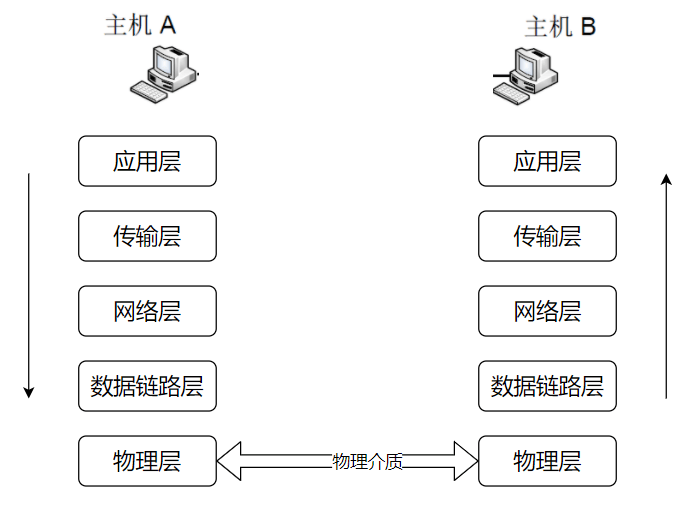
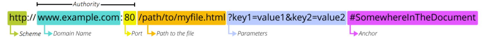
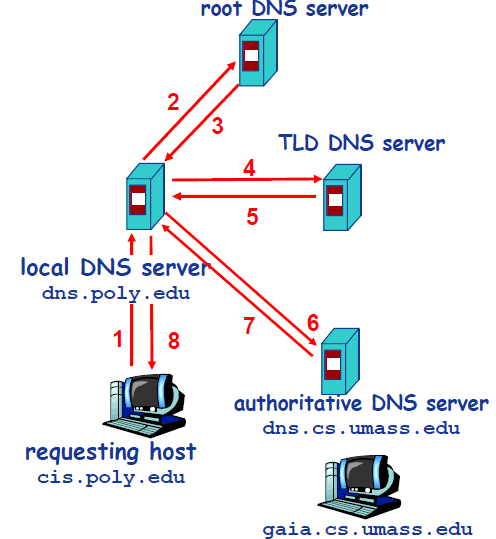
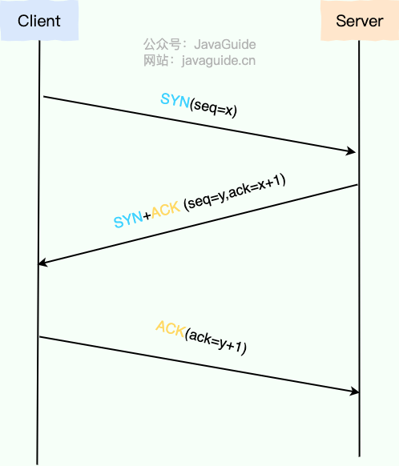
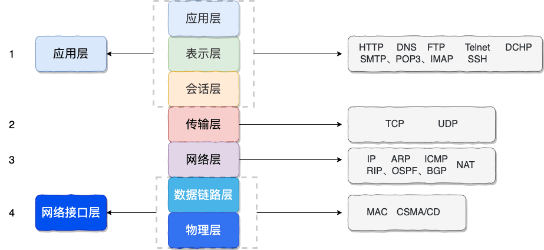

From entering a URL in the browser's address bar to seeing the page, several steps take place: DNS, TCP, TLS, HTTP, ARP, data encapsulation, and browser rendering.

This common interview question checks your overall understanding of networking because it connects concepts from the application, transport, network, and link layers. Following the full page-loading process helps connect the protocols instead of memorizing them in isolation.

This article answers a few questions:

1. What does the browser do locally after you enter a URL?
2. How does DNS resolve the domain name?
3. How is a TCP connection established, and what happens during the TLS handshake for HTTPS?
4. How do HTTP requests and responses work?
5. How are packets encapsulated and forwarded between the host and server?
6. After receiving HTML, how does the browser load CSS, JavaScript, images, and other resources and render the page?
7. How are connections reused or closed after the page loads?

The diagram below shows the network communication model. Loading a web page involves encapsulating data as it moves down the layers, transmitting it over the physical network, and then decapsulating it as it moves up the layers at the other end.



Here is a quick overview of the process:

1. **Parse the URL and check the cache:** The browser parses the URL and checks whether the HTTP cache has a valid copy of the resource.
2. **Resolve DNS:** The browser uses DNS to find the IP address for the domain.
3. **Establish a transport connection:** HTTP/1.1 and HTTP/2 usually establish TCP with a three-way handshake. HTTP/3 establishes QUIC over UDP.
4. **Establish a secure channel (HTTPS):** HTTP/1.1 and HTTP/2 usually perform a TLS handshake after TCP setup. HTTP/3 integrates TLS 1.3 into QUIC setup to negotiate keys and authenticate the server.
5. **Send the HTTP request:** The browser sends an HTTP request to the server over the connection.
6. **Process and return a response:** The server processes the request and returns an HTTP response.
7. **Parse and render the page:** The browser parses HTML and CSS, runs JavaScript, and loads other referenced resources such as images and fonts.
8. **Manage the connection:** After the page loads, the connection is reused or closed according to keep-alive settings.

Let's go through each step.

## Step 1: Parse the URL and Check the Cache

When you enter a URL in the browser and press Enter, the browser does not immediately send a request. First, it parses the URL and checks whether it can use a local cached copy.

### What Is a URL?

A URL (Uniform Resource Locator) is an address for a resource on the internet. In practice, multiple URLs can refer to the same resource, such as through redirects or a CDN.

### URL Components



A complete URL contains these components:

1. **Scheme:** The URL prefix identifies the protocol. Common schemes are `http` and `https`; `ftp:` is another example.
2. **Host:** Usually a domain name, though an IP address can be used directly. A domain name is a human-readable way to refer to an IP address.
3. **Port:** Follows the host after a colon. HTTP defaults to port 80 and HTTPS to port 443, so the default port can be omitted.
4. **Path:** Begins with the first `/` and identifies a resource on the server. A path once often referred to a physical file; today it is usually a virtual path mapped by backend routing.
5. **Query:** Follows `?` and contains `key=value` pairs separated by `&`. The server extracts these parameters when processing the request.
6. **Fragment:** Follows `#` and identifies a location within the page. The fragment is **not** sent to the server; the browser handles it locally.

### Browser Cache Check

After parsing the URL, the browser checks the HTTP cache for a valid copy of the resource:

1. **Freshness check:** The browser checks `Cache-Control` (such as `max-age`) or `Expires` to see whether the cached response is still fresh. If so, it uses the cache without another network request.
2. **Validation:** If the cached response is stale, the browser sends a validation request with `If-Modified-Since` or `If-None-Match`. If the resource has not changed, the server returns `304 Not Modified` and the browser uses its cached copy. If it has changed, the server returns `200 OK` with the updated resource.

If the HTTP cache can satisfy the request, the process ends here without a network request.

### Preparing to Resolve the Domain

If the HTTP cache misses, the browser needs the server's IP address before it can make a network request. Before querying DNS, it checks:

1. **Browser DNS cache:** The browser checks whether it already has a record for the domain.
2. **Operating system DNS cache:** If the browser cache misses, it checks the OS cache.
3. **hosts file:** The OS checks the local `hosts` file for a direct domain-to-IP mapping. If one exists, it uses that IP and skips DNS resolution.

If none of these checks finds an address, the browser performs a DNS lookup.

## Step 2: DNS Resolution

DNS (Domain Name System) maps **domain names to IP addresses**. Domain names are easier for people to remember, but network communication uses IP addresses.

### How DNS Resolution Works

DNS resolution usually follows these steps:

1. **Browser DNS cache:** The browser checks for a non-expired record for the domain.
2. **Operating system DNS cache:** If the browser cache misses, it asks the OS to resolve the name. The OS has its own DNS cache.
3. **Local DNS resolver:** The OS uses a configured resolver, often provided by an ISP or a public DNS service such as `8.8.8.8` or `114.114.114.114`. If the resolver has a fresh cached answer, it returns it.
4. **Recursive and iterative queries:** If the resolver cache misses, the resolver queries DNS on the client's behalf: first a root server, then a top-level domain server (such as `.com`), and finally the authoritative DNS server.
5. **Return and cache the result:** The resolver returns the answer to the client and caches it for later queries.

The diagram below shows a typical iterative DNS query:



In practice, local DNS resolvers often have many TLD server addresses cached. Most queries do not need to start at the root; querying a TLD server directly is common.

> For more on DNS server hierarchy, recursive vs. iterative queries, DNS record types, and why DNS usually uses UDP, see [DNS Explained](./dns.md).

## Step 3: Establish a Transport Connection

After getting the server's IP address, the browser establishes a transport connection. HTTP/1.1 and HTTP/2 usually use TCP. If HTTP/3 is negotiated, the browser establishes a QUIC connection over UDP instead.

### The TCP Three-Way Handshake

The TCP three-way handshake **synchronizes both sides' initial sequence numbers** and **confirms that both directions can carry data**.



1. **First handshake (SYN):** The client sends a SYN segment with its initial sequence number `seq=x` and enters `SYN_SENT`.
2. **Second handshake (SYN+ACK):** The server replies with its own initial sequence number `seq=y` and acknowledgment number `ack=x+1`, then enters `SYN_RCVD`.
3. **Third handshake (ACK):** The client replies with `ack=y+1`. Both sides enter `ESTABLISHED`, and the connection is ready.

The third handshake is not an unnecessary extra step. It lets both sides confirm that they can receive each other's data. Two handshakes are not enough: after the second one, the server does not know whether the client received its SYN+ACK.

> For a detailed explanation of the handshake, SYN and accept queues, and SYN flood defenses, see [TCP's Three-Way Handshake and Four-Way Teardown](./tcp-connection-and-disconnection.md).

### TLS Handshake for HTTPS

For HTTPS over TCP, a TLS handshake follows TCP connection setup. HTTP/3 integrates TLS 1.3 into QUIC connection setup. TLS has three main goals: **encryption** (to prevent eavesdropping), **authentication** (to prevent impersonation), and **integrity checks** (to detect tampering).

The following is a simplified TLS handshake using RSA key exchange in TLS 1.2:

1. **ClientHello:** The client sends the TLS versions and cipher suites it supports, along with a random value.
2. **ServerHello:** The server selects a cipher suite and returns its certificate and another random value.
3. **Key exchange:** The client validates the server certificate, including its CA signature, then generates a pre-master secret, encrypts it with the server's public key, and sends it to the server. Both sides use the pre-master secret and the two random values to derive a symmetric session key.
4. **Finish:** The handshake completes, and both sides use the session key to encrypt communication.

The flow above describes RSA key exchange in TLS 1.2. Modern HTTPS usually uses ECDHE; TLS 1.3 can also use PSK or PSK+(EC)DHE for session resumption. With ECDHE, both sides derive a shared secret using temporary keys rather than sending it over the network. A later leak of the server's certificate private key usually cannot decrypt past sessions that used ephemeral key exchange. TLS 1.3 further simplified the handshake, usually completing a full handshake in 1-RTT, and removed static RSA key exchange.

After the TLS handshake, HTTP requests and responses are encrypted with the negotiated symmetric keys. HTTPS security comes from TLS, not from a change to HTTP itself.

> For more on TLS encryption, digital signatures, and CA certificates, see [HTTP vs. HTTPS](./http-vs-https.md). For RSA and ECDHE key exchange, see [RSA and ECDHE in the HTTPS Handshake](./https-rsa-vs-ecdhe.md).

## Step 4: Send the HTTP Request

After the TCP connection (and, if applicable, TLS channel) is established, the browser can send an HTTP request.

### HTTP Request Structure

A typical HTTP/1.1 request looks like this:

```http
GET /index.html HTTP/1.1
Host: www.example.com
User-Agent: Mozilla/5.0 (Macintosh; Intel Mac OS X 10_15_7)
Accept: text/html,application/xhtml+xml
Accept-Encoding: gzip, deflate, br
Accept-Language: en-US,en;q=0.9
Connection: keep-alive
Cookie: session_id=abc123
```

The fields mean:

- **Request line:** `GET /index.html HTTP/1.1` contains the method (`GET`), resource path (`/index.html`), and protocol version (HTTP/1.1).
- **Host header:** Specifies the target hostname. HTTP/1.1 requires it because one server (one IP address) can host multiple websites.
- **Other request headers:** `User-Agent` (client information), `Accept` (acceptable response types), `Accept-Encoding` (supported compression), and `Cookie` (state information), among others.

### How the Server Processes the Request

The server processes the request and creates a response:

1. **Receive:** A web server such as Nginx or Tomcat receives and parses the HTTP request.
2. **Route:** The URL path determines which backend handler (such as a controller or servlet) receives it.
3. **Process:** The handler runs business logic, which may query a database, read a cache, or call another service.
4. **Build the response:** The result is packaged as an HTTP response.

### HTTP Response Structure

```http
HTTP/1.1 200 OK
Content-Type: text/html; charset=UTF-8
Content-Encoding: gzip
Content-Length: 1256
Cache-Control: max-age=3600
Set-Cookie: session_id=xyz789; Path=/

<!DOCTYPE html>
<html>
...
</html>
```

The response contains:

- **Status line:** `HTTP/1.1 200 OK` contains the protocol version, status code (`200`), and reason phrase.
- **Response headers:** `Content-Type` (body type), `Content-Encoding` (compression), `Cache-Control` (caching policy), and `Set-Cookie`, among others.
- **Response body:** The requested content, such as an HTML document, JSON data, or image bytes.

Common status codes:

| Status code | Category     | Common examples                                    |
| ----------- | ------------ | -------------------------------------------------- |
| 2xx         | Success      | 200 OK, 206 Partial Content                        |
| 3xx         | Redirection  | 301 Moved Permanently, 302 Found, 304 Not Modified |
| 4xx         | Client error | 400 Bad Request, 403 Forbidden, 404 Not Found      |
| 5xx         | Server error | 500 Internal Server Error, 502 Bad Gateway         |

> For more on HTTP status codes, see [Common HTTP Status Codes](./http-status-codes.md).

## Step 5: Packet Encapsulation and Forwarding

When the browser sends an HTTP request, the data does not travel directly to the server. It is encapsulated at each layer of the protocol stack and forwarded hop by hop across the physical network.

### Data Encapsulation

The application-layer HTTP message is encapsulated by the transport, network, and link layers until it becomes a bit stream that can travel over the physical medium:



Each layer adds its own header information and uses the layer below it to transmit data:

- **Transport layer (TCP):** Adds source and destination ports and uses sequence and acknowledgment numbers for reliable delivery.
- **Network layer (IP):** Adds source and destination IP addresses and handles addressing and routing to determine the packet's path.
- **Link layer:** Adds source and destination MAC addresses and carries frames between adjacent nodes.

### Network-Layer Routing and Forwarding

Packets usually pass through multiple routers between the source and destination. The network layer's main functions are **routing and forwarding**:

- **Routing:** Determines the path from source to destination, calculated by routing protocols such as OSPF and BGP.
- **Forwarding:** Moves a packet from a router's input port to the appropriate output port.

Each router maintains a routing table and uses the destination IP address to choose the next hop. Packets are like parcels: each stop only needs to know where to send them next, not the entire route.

### ARP: From IP Address to MAC Address

To transmit a frame over a link, a host needs the next-hop device's MAC address, not just its IP address. ARP (Address Resolution Protocol) resolves a known IP address to a MAC address.

ARP uses **a broadcast request and a unicast reply**:

1. The host checks its local ARP cache for the MAC address associated with the target IP.
2. On a cache miss, it broadcasts an ARP request on the LAN: “Who has IP xxx.xxx.xxx.xxx? Tell me your MAC address.”
3. The target device (or router interface) replies with its MAC address using unicast.
4. The requester stores the IP-to-MAC mapping in its ARP cache for later communication.

If the destination host is outside the local subnet, the sender does not need its MAC address. It only needs the **local gateway's (router's) MAC address**. The packet goes to the gateway, which forwards it hop by hop toward the destination network.

> For more on ARP, including same-subnet and cross-subnet addressing, ARP tables, and common attacks, see [ARP](./arp.md).

### Network Address Translation (NAT)

In most home and enterprise networks, internal hosts use private IP addresses (such as `192.168.x.x`) that are not routable on the public internet. NAT (Network Address Translation) translates addresses between private and public networks.

When an internal host sends a packet to the public internet, the NAT device (usually a router) replaces its private source IP with a public address and records the port mapping. When the response returns, NAT uses the mapping to translate the destination back to the host's private address.

## Step 6: Browser Parsing and Rendering

After receiving the HTML response, the browser parses it, builds the DOM tree, loads subresources, calculates styles, lays out the page, and renders it on screen.

### HTML Parsing and DOM Construction

The browser parses the HTML document from top to bottom:

1. **Build the DOM tree:** Parse HTML tags into a Document Object Model (DOM) tree representing the page structure.
2. **Build the CSSOM tree:** Download and parse CSS referenced by `<link>` or included in `<style>` tags into a CSS Object Model (CSSOM) tree of style rules.
3. **Build the render tree:** Combine the DOM and CSSOM trees. It includes only visible nodes and their styles (`display: none` elements are excluded).
4. **Layout:** Calculate each render-tree node's position and size.
5. **Paint:** Convert the laid-out render tree into pixels on screen.
6. **Composite:** Combine layers into the final image displayed on screen.

### Loading Subresources

HTML documents often reference many external resources:

- **CSS files** (`<link rel="stylesheet">`): Render-blocking stylesheets usually delay layout and painting until CSS is downloaded and parsed because styles can change element layout. The `media` attribute, dynamic loading, or `preload` can change this behavior.
- **JavaScript files** (`<script>`): By default, scripts block HTML parsing because they may modify the DOM. The `async` or `defer` attributes change how they are loaded.
- **Images, fonts, and other resources:** These do not block HTML parsing, but cannot be displayed until they finish loading.

Loading these resources triggers additional HTTP requests. With HTTP/1.1, browsers commonly use up to six concurrent TCP connections per domain to download resources in parallel. HTTP/2 multiplexes multiple resources over one TCP connection.

### JavaScript Execution

JavaScript execution can block HTML parsing. When the browser encounters a `<script>` tag, it pauses DOM construction to download and run the script. DOM operations may rebuild parts of the DOM and trigger reflow or repaint.

Common frontend optimizations include:

- Place `<script>` tags at the end of `<body>` or use `defer` to avoid blocking DOM parsing.
- Use `async` to load scripts asynchronously when they do not depend on DOM parsing.
- Use a CDN to serve static resources faster.
- Use browser caching to reduce repeated requests.

## Step 7: Connection Management

Connections usually remain open after the page and its resources load. How they are managed depends on the HTTP version and configuration. The sections on HTTP/1.0, HTTP/1.1, and HTTP/2 describe TCP connections; HTTP/3 manages QUIC connections and streams.

### HTTP/1.0 Short-Lived Connections

HTTP/1.0 uses short-lived connections by default: the TCP connection closes after each request and response. If a page references ten external resources, the browser may need ten separate TCP connections, each with a three-way handshake and four-way teardown. Much of the time is spent establishing and closing connections.

### HTTP/1.1 Persistent Connections (Keep-Alive)

HTTP/1.1 uses persistent connections by default (`Connection: keep-alive`). Once a TCP connection is established, it can carry multiple requests and responses without another handshake each time. CSS, JavaScript, images, and other page resources can reuse the same connection.

Persistent connections are not permanent. Servers usually have an idle timeout, such as Apache's `KeepAliveTimeout`, and close the connection if no new request arrives before it expires.

### HTTP/2 Multiplexing

HTTP/2 adds multiplexing to persistent connections. Multiple requests and responses can travel over one TCP connection at the same time. Data is split into frames and associated with streams. This solves HTTP/1.1's application-layer head-of-line blocking: a slow request does not hold up later requests. However, HTTP/2 still uses TCP, so packet loss affects every stream on the connection (TCP-level head-of-line blocking). HTTP/3 over QUIC (UDP) further reduces this problem.

### Closing Connections

When a connection needs to close, the active closer initiates the following exchange:

1. The active closer sends FIN to indicate that it has no more data to send.
2. The passive closer replies with ACK and enters `CLOSE_WAIT`, but can still send remaining data.
3. After sending its remaining data, the passive closer sends FIN.
4. The active closer replies with the final ACK and enters `TIME_WAIT`; it closes after waiting 2MSL.

`TIME_WAIT` gives the final ACK a chance to be retransmitted and lets old packets expire from the network so they do not interfere with a new connection.

> For TCP teardown, TIME_WAIT, and troubleshooting a buildup of CLOSE_WAIT sockets, see [TCP's Three-Way Handshake and Four-Way Teardown](./tcp-connection-and-disconnection.md).

## Summary of the Full Process

The full page-loading process can be summarized as follows:

1. **Enter a URL** → The browser parses its components and checks the HTTP cache; if it needs a network request, it also checks the hosts file.
2. **Resolve DNS** → The browser checks its cache, the OS cache, and the local DNS resolver. If needed, the resolver queries root, TLD, and authoritative servers to find the IP address.
3. **Establish a transport connection** → HTTP/1.1 and HTTP/2 usually establish TCP; HTTP/3 establishes QUIC.
4. **Establish a secure channel (HTTPS)** → HTTPS over TCP performs a TLS handshake; HTTP/3 completes a TLS 1.3 handshake during QUIC setup.
5. **Exchange HTTP messages** → The browser sends a request, and the server processes it and returns an HTML response.
6. **Encapsulate and forward data** → The request is encapsulated through TCP → IP → link layers and forwarded hop by hop through routers and switches. The response travels back to the browser.
7. **Render in the browser** → The browser parses HTML into a DOM tree, loads CSS, JavaScript, images, and other resources, builds the render tree, lays out, and paints the page.
8. **Manage the connection** → The connection is reused or closed based on the HTTP version and configuration.

Loading a web page may look simple, but it involves nearly all the core networking protocols. Following the process shows how DNS, TCP, TLS, HTTP, IP, and ARP fit together as steps in one complete flow.

## References

1. _Computer Networks_ (7th edition)
2. _Illustrated HTTP_
3. [What really happens when you navigate to a URL](https://stackoverflow.com/questions/2092527/what-really-happens-when-you-navigate-to-a-url)
4. [How browsers work](https://web.dev/howbrowserswork/)

<!-- @include: @article-footer.snippet.md -->
