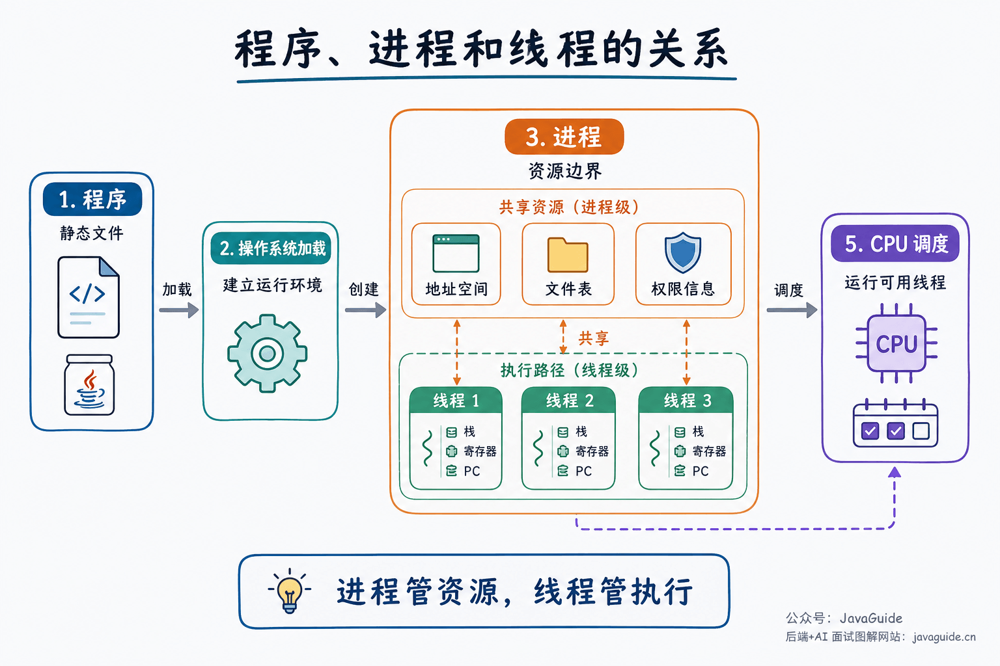
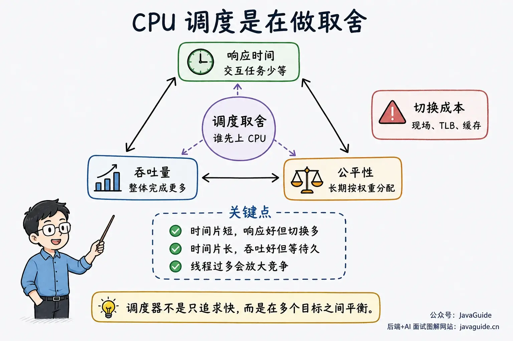
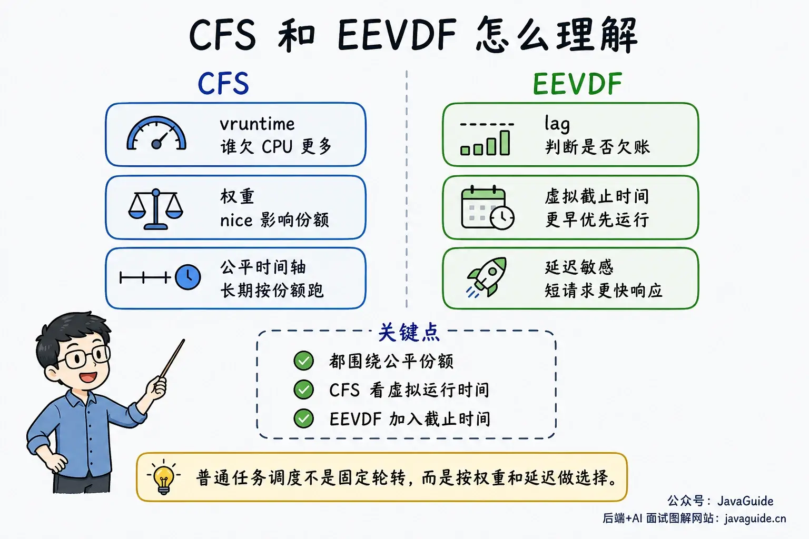
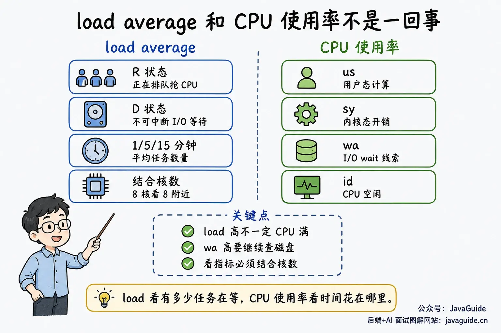
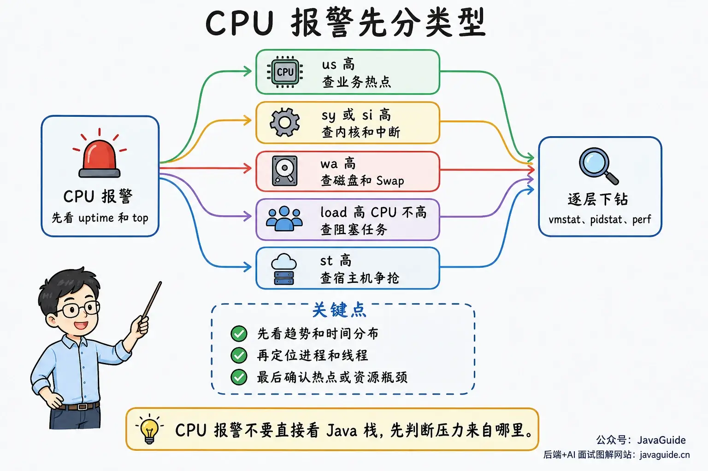

CPU scheduling is about more than algorithm names such as FCFS, RR, and CFS. When troubleshooting production issues, you also need to understand why a thread was preempted, where context-switching costs come from, and what it means when load average is high but CPU usage is not.

These questions share the same constraints: CPU cores are limited, tasks must wait in queues, and the scheduler decides what runs next. System metrics help determine whether tasks are competing for CPU, waiting for I/O, or stalled in the kernel, interrupt handling, or virtualization layer.

For example, a machine with 8 logical CPUs may have a load average of 40 while some CPU capacity remains idle and `%Cpu(s)` shows persistently high `wa`. Searching for CPU-hot functions may not help; the machine may instead have many tasks waiting for I/O. CPU usage and load average must be interpreted separately.

## Why Is CPU Scheduling Needed?

The number of CPU cores is limited, while many tasks may be runnable.

In a Java service, business, GC, JIT, and Netty event-loop threads may all need CPU time. The same machine may also run log collectors, monitoring agents, scheduled jobs, and database clients. With 8 logical CPUs, only about 8 runnable tasks can use a CPU at once; the rest must wait, sleep, or wait for I/O. In containers, check the CPU quota too; the host's physical core count is not enough.

Different systems use different names for the objects they schedule. For backend troubleshooting, think of a Linux scheduling entity as an execution unit the kernel can schedule on a CPU.

A process can contain multiple threads. They share the process's address space and file descriptors, but each has its own execution context, including a stack, registers, and program counter.



In the Linux kernel, both processes and threads are represented as tasks. The scheduler schedules tasks or scheduling entities; a thread visible in user space generally corresponds to a kernel-schedulable task.

Without scheduling, an infinite loop on a single-core machine could occupy the CPU indefinitely, leaving no time for other programs. Multiple cores increase the number of tasks that can run at once from one to N, but tasks still queue and switch when there are more runnable tasks than cores.

The scheduler must balance interactive response, fairness, throughput, priorities, real-time tasks, power use, and cache locality. These goals can conflict: longer time slices reduce context switches but may make interactive tasks wait longer; shorter slices improve responsiveness but increase switching overhead.



## Why Does a Task Leave the CPU?

There are several reasons a task may leave the CPU. Using up its time slice is only one of them.

The most common reason is that a task yields the CPU. For example, a thread calling `read()` may have to wait for disk data. A thread also leaves the running state while waiting for a lock, condition variable, or timer. The CPU should not sit idle while it waits, so the scheduler chooses another runnable task.

Another reason is preemption. General-purpose operating systems typically use preemptive scheduling. A clock interrupt gives the kernel a chance to check after a task has run for a while; if the task has used enough CPU time or a more suitable task becomes runnable, the kernel may switch it out.

Many textbooks simplify preemption as a timer that periodically generates clock interrupts.

This model explains the general idea. Modern Linux supports `NO_HZ` (tickless) operation and can reduce scheduler ticks on idle CPUs or with certain configurations. Timers and scheduler ticks are important opportunities for the kernel to check for preemption, but production machines do not necessarily receive ticks at a fixed rate at all times.

Priority also affects scheduling. Higher-priority tasks are scheduled sooner, so lower-priority tasks may wait. If the system always favors higher-priority tasks, lower-priority tasks may never get CPU time; this is starvation. Textbook algorithms use dynamic priorities, aging, or queue promotion to reduce starvation. Real systems vary by scheduling class and implementation.

A context switch occurs when the CPU changes tasks. The kernel saves the current task's registers, program counter, stack pointer, and other state, then restores the next task's state. Switching processes may also incur costs from page tables, the TLB, and cache locality. With many threads, heavy lock contention, and frequent sleeps and wakeups, the CPU may spend more time on scheduling and synchronization than on business code.

Choose the number of threads based on the workload and CPU count. Threads can overlap I/O waits and use multiple cores, but when thread count greatly exceeds the number of cores, run queues, context switches, cache misses, and lock contention all increase.

## Classic Scheduling Algorithms

Interviewers often ask about FCFS, SJF, RR, priority scheduling, and multilevel feedback queues.

These algorithms are easier to compare when considering how short, long, and interactive tasks queue. They are mostly simplified textbook models. Linux does not directly use one of them for ordinary task scheduling; it also involves CFS/EEVDF, real-time scheduling classes, cgroups, CPU affinity, NUMA, and other mechanisms.

| Algorithm                 | How it selects tasks                                            | Common follow-up questions                                                |
| ------------------------- | --------------------------------------------------------------- | ------------------------------------------------------------------------- |
| FCFS                      | First come, first served                                        | Short tasks wait behind long tasks.                                       |
| SJF                       | Run the task with the shortest estimated time first.            | Remaining run time is hard to know; long tasks may starve.                |
| RR                        | Give each task a time slice in turn.                            | Very short slices increase switching overhead; long slices approach FCFS. |
| Priority scheduling       | Run higher-priority tasks first.                                | Lower-priority tasks may wait indefinitely.                               |
| Multilevel feedback queue | Adjust task placement across priority queues based on behavior. | More rules and parameters make implementation more complex.               |

For example, if a thread pool has several large file-compression tasks ahead of many cache lookups, the short requests must wait and average response time suffers. SJF could improve this case, but only if the system knew how long each task would run. Real systems do not have that knowledge and can only estimate from past behavior, I/O waits, and interactive patterns.

RR is a basic model for time-sharing systems. Each task runs for one time slice and then returns to the queue. User input, mouse movement, and requests do not have to wait for a long task to finish. Context switches have a fixed cost, so shorter slices increase the share of time spent switching; longer slices amortize that cost but may increase interactive latency.

Multilevel feedback queues account for both short-task response time and long-task progress. New tasks usually enter a high-priority queue. If a task repeatedly uses its entire time slice, it is likely CPU-bound and may be moved to a lower-priority queue. If it often waits for I/O, it is more likely interactive or I/O-bound and may keep a higher priority. Queue count, time slices, and promotion/demotion rules all affect scheduling; real systems add other mechanisms too.

## From CFS to EEVDF

Linux has long used CFS (Completely Fair Scheduler) for ordinary task scheduling.

To understand CFS, start with `vruntime`.

`vruntime` tracks how much a task has run on a fair timeline. After a task runs for a while, the kernel accounts for that time as virtual runtime. Different nice values have different weights and therefore different accounting rates. The scheduler tends to choose the task with the smallest `vruntime`, so tasks receive CPU time according to their weights over time.

CFS does not use fixed time slices like older schedulers. Instead, it allocates CPU shares by weight over a period. With fewer runnable tasks, each can run longer; with more tasks, each receives a shorter interval. CFS uses a red-black tree to order runnable tasks by virtual runtime and usually selects the leftmost task, which has received relatively less CPU on the fair timeline.

Starting with Linux 6.6, ordinary task scheduling began adopting EEVDF (Earliest Eligible Virtual Deadline First).

EEVDF still aims to allocate CPU fairly, but uses lag and virtual deadlines when selecting tasks. Positive lag means a task is owed CPU time. Among eligible tasks, the one with the earliest virtual deadline runs first. Latency-sensitive tasks requesting shorter slices can get an earlier scheduling opportunity.

In Linux code and tool output, ordinary tasks still belong to the fair scheduling class. EEVDF changes task selection within that class; it does not rename every scheduling concept.

Whether a production machine uses EEVDF depends on its kernel version and whether the distribution backported or modified the relevant patches. Do not assume every machine uses the same scheduler implementation.

For backend interviews, explain CFS's `vruntime`, weights, and fair CPU shares, along with EEVDF's lag, virtual deadlines, and latency-sensitive tasks. More detail requires discussing the kernel implementation.



## Load Average Is Not CPU Usage

The three load-average values shown by `uptime` represent averages over 1-, 5-, and 15-minute time scales. They are exponentially damped averages, not simple arithmetic averages of samples from the last N minutes.

Load average counts runnable tasks in state R and uninterruptible sleep tasks in state D. D state is often related to I/O, but troubleshooting should not focus only on local disks; consider block devices, network storage, filesystems, Swap, and other uninterruptible waits.

So a high load does not necessarily mean the CPU is saturated. It may come from runnable tasks competing for CPU or many tasks stuck in uninterruptible waits.

Interpret load in relation to the number of logical CPUs. A load near 8 on a machine with 8 logical CPUs may mean the CPUs are fully occupied; a load of 40 usually means many tasks are queued or in uninterruptible sleep. A load of 8 is high on a 1-CPU machine but may be modest on a 64-CPU machine.

The fourth field in `/proc/loadavg` looks like `3/1024`. The value before the slash is the current number of runnable kernel scheduling entities; the value after it is the total number of scheduling entities in the system. This adds a snapshot of task counts alongside the three load averages.

CPU usage shows where CPU time is spent. Common fields in `top`'s `%Cpu(s)` line mean:

- `us`: User-mode time for processes with an unadjusted nice value. Business computation, JSON serialization, regular expressions, compression, and cryptography often appear here.
- `ni`: User-mode time for processes with an adjusted nice value, often lower-priority processes.
- `sy`: Kernel-mode time. System calls, the network stack, filesystems, and kernel lock contention can raise it.
- `wa`: I/O wait. This is time when the CPU is idle while the system has outstanding I/O requests. Treat it as a clue, not a precise attribution on its own.
- `id`: Idle time, when the CPU has no work or tasks are blocked on other resources.
- `hi` / `si`: Time spent on hardware and software interrupts. Watch these when packet volume is high, NIC interrupts are concentrated, or protocol-stack processing is under pressure.
- `st`: CPU time taken by the hypervisor in a virtualized environment. If this is high on a cloud VM, investigate the host before changing application code.



`wa` is especially easy to misread. I/O wait is not a reliable attribution: the CPU does not literally wait for I/O to finish, and on a multicore system an I/O-waiting task is not running on a CPU. High `wa` is a clue that I/O waits exist; it does not mean the CPU is busy doing I/O.

Next, inspect `b`, `bi/bo`, and `si/so` in `vmstat`, then use `pidstat -d` and `iostat -x` to identify processes and block devices.

## Troubleshooting a CPU Alert

Do not start by diving into Java stack traces. First identify the type of pressure, then narrow it down to a process, thread, CPU core, or hot function.



Start with `uptime` to check the load trend. A high 1-minute value with lower 5- and 15-minute values may indicate a brief spike; if all three are high, the pressure has lasted longer. Then open `top` and check whether `us`, `ni`, `sy`, `wa`, `si`, or `st` is elevated, along with process rankings and task states.

If `us` is high, look for application hotspots. For a Java process, press `H` in `top` to switch to thread view. Find a high-CPU thread, convert its ID to hexadecimal, then locate the corresponding stack in `jstack` or `jcmd Thread.print`. A single `jstack` is only a snapshot, so capture two or three in succession. If the same thread remains in the same application stack, the finding is more reliable. You can also use:

```bash
pidstat -u -t -p <pid> 1
```

This reports CPU usage by thread. Once you find a thread, check whether it is in an application loop, serialization, regular expressions, cryptography, GC, or JIT compilation. `jstack` shows current stack frames; sampling tools such as `perf top` and async-profiler are better for finding CPU hotspots.

If `sy` or `si` is high, do not focus only on Java stacks. Many short-lived connections, incoming packets, file I/O, system calls, or software interrupts can raise kernel CPU time. Use:

```bash
mpstat -P ALL 1
sudo perf top
```

Use `mpstat` to see whether a few cores are especially busy. Use `perf top` to determine whether hot symbols are in user functions, the kernel network stack, software interrupts, or lock-related paths. If one core is at 100% while others are idle, check for a single-thread bottleneck, software interrupts concentrated on one core, CPU affinity, or queue imbalance.

If load and `wa` are both high, start with:

```bash
vmstat 1
```

Focus on `r`, `b`, `wa`, `bi`, `bo`, `si`, and `so`. `r` is the number of runnable tasks. `b` is the number of tasks blocked waiting for I/O, not all sleeping threads. `bi/bo` are block-device read/write throughput, usually in KiB/s, not I/O request counts. `si/so` are Swap-in and Swap-out. If `wa`, `b`, and `bi/bo` are high, investigate disks. If `wa`, `si`, and `so` are high, memory pressure and Swap may be slowing the service.

Then use:

```bash
pidstat -d -p ALL 1
iostat -x 1
```

Check which processes are reading or writing and which block device has high latency. In `iostat -x`, focus on `await`, `aqu-sz`, read/write throughput, and request counts. `%util` can be useful for spinning disks, but RAID, SSD, and NVMe devices can process requests in parallel, so do not use it alone to determine saturation. The first `iostat` row is usually an average since startup; use later samples for current issues, or run `iostat -x -y 1` to skip the first row.

If application processes show little I/O but system `wa` is high, also check log compression, backups, databases, image pulls, and other containers on the same node.

If the system supports PSI, inspect:

```bash
cat /proc/pressure/cpu
cat /proc/pressure/io
cat /proc/pressure/memory
```

PSI measures how long tasks are stalled by CPU, memory, or I/O pressure. `some` means at least one task is stalled because the resource is insufficient. For memory and I/O, `full` means all non-idle tasks are stalled at the same time. System-level `full` in `/proc/pressure/cpu` is not diagnostically useful; focus on `some` when investigating CPU pressure. PSI directly indicates whether work is being stalled by resource pressure, which CPU usage alone cannot show.

In containers, check cgroup limits too. A container with a 2-CPU quota may have queued tasks even if the host has 64 cores. Use cgroup metrics such as `cpu.max`, `cpu.stat`, `cpu.pressure`, `memory.current`, `memory.events`, `memory.pressure`, `io.stat`, and `io.pressure`, rather than relying only on host-wide CPU. These are common cgroup v2 filenames; with cgroup v1, files are spread across different controller directories.

If load is high, `wa` is not, and `r` in `vmstat 1` stays well above the number of CPU cores, runnable tasks are queued. Next, check thread counts, thread pools, lock contention, and context switches:

```bash
vmstat 1
pidstat -w -p ALL 1
ps -eo pid,ppid,stat,ni,pri,psr,pcpu,comm --sort=-pcpu | head
```

`cs` in `vmstat` shows the system context-switch rate. In `pidstat -w`, focus on `cswch/s` and `nvcswch/s`. The first is voluntary context switching, often caused by waiting for I/O, locks, or condition variables. The second is involuntary context switching, often caused by preemption after a time slice expires. An oversized thread pool can raise `r`, `cs`, and CPU usage while worsening request latency; adding more threads may make the queue worse.

The `time` command helps show where a single command spends its time:

```bash
/usr/bin/time -p <command>
```

`real` is wall-clock time, `user` is user-mode CPU time, and `sys` is kernel-mode CPU time. Long `real` with low `user + sys` often means waiting for I/O, network, or locks. High `user` indicates CPU-intensive computation; high `sys` suggests investigating system calls and kernel paths.

## Common Troubleshooting Commands

These commands help identify the direction of most CPU and load issues:

| Command    | Example                                             | What to check                                                     |
| ---------- | --------------------------------------------------- | ----------------------------------------------------------------- |
| `uptime`   | `uptime`                                            | 1-, 5-, and 15-minute load averages                               |
| `top`      | `top`, then press `H`                               | Total CPU, process/thread CPU, task states, and load              |
| `vmstat`   | `vmstat 1`                                          | `r`, `b`, `us/sy/wa/id/st`, `cs`, `bi/bo`, `si/so`                |
| `pidstat`  | `pidstat -u -d -w -t -p <pid> 1`                    | Per-process/thread CPU, I/O, and context switches                 |
| `iostat`   | `iostat -x 1`                                       | Block-device throughput, queue length, wait time, and utilization |
| `mpstat`   | `mpstat -P ALL 1`                                   | Per-core usage, iowait, softirq, and steal                        |
| `ps`       | `ps -eo pid,stat,ni,pri,psr,pcpu,comm --sort=-pcpu` | Process state, priority, CPU core, and CPU usage                  |
| `perf top` | `sudo perf top`                                     | Live CPU hotspots in user and kernel space                        |
| `PSI`      | `cat /proc/pressure/{cpu,io,memory}`                | Task stalls caused by CPU, I/O, and memory pressure               |

`perf top` depends on perf permissions and whether kernel, user-space, and JIT symbols can be resolved. For Java, combine it with async-profiler when needed.

## Interview Notes

When explaining CPU scheduling, describe why tasks queue, when the kernel switches tasks, and what costs switching introduces. This is more complete than listing algorithm names.

### CPU Scheduling

> The number of CPU cores is limited, while many processes and threads may be runnable. The scheduler chooses tasks from the run queue. The kernel schedules and switches tasks when one blocks, uses up its time slice, changes priority, or a more suitable task appears. Scheduling balances response time, throughput, fairness, and switching overhead; too many threads can waste time in queues and context switches.

### How to Explain Classic Scheduling Algorithms

> FCFS is simple, but long tasks delay short ones. SJF can reduce average turnaround time, but task length is hard to know and long tasks may starve. RR uses time slices to improve responsiveness, though very short slices increase switching overhead. Priority scheduling expresses urgency but must address starvation among low-priority tasks. Multilevel feedback queues adjust task placement based on behavior to favor interactive tasks while still advancing long tasks.

### Linux Scheduling

> You cannot directly map Linux ordinary-task scheduling to a textbook algorithm. CFS uses virtual runtime and weights to allocate CPU, favoring tasks that have received less CPU. EEVDF also aims for fair shares; it uses lag to determine whether a task is owed CPU, then selects tasks by virtual deadline. This level of detail is usually sufficient for backend interviews.

### Load Average and CPU Usage

> Load average counts runnable tasks in state R and uninterruptible sleep tasks in state D, so interpret it alongside the number of CPU cores. CPU usage describes where CPU time goes: `us/ni/sy/wa/id/hi/si/st` mean user mode, nice user mode, kernel mode, I/O wait, idle, hardware interrupts, software interrupts, and virtualization steal. High load with low CPU usage often means many tasks are in uninterruptible sleep; high CPU with a moderate load may mean a few threads are saturating the CPU.

If asked how to troubleshoot, use `uptime` and `top` to identify the symptom, `vmstat` to distinguish run-queue, I/O, and context-switch issues, then `pidstat` and `mpstat` to find the process and CPU core. Use `perf top` to find hot functions when needed.
