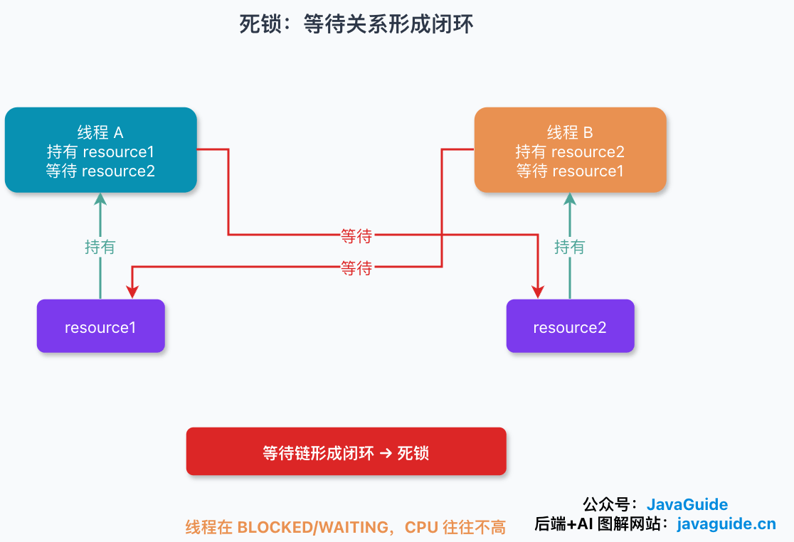
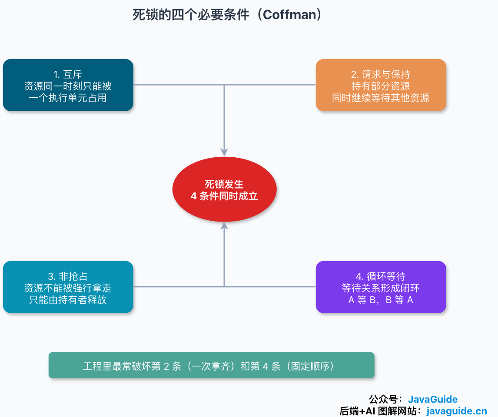
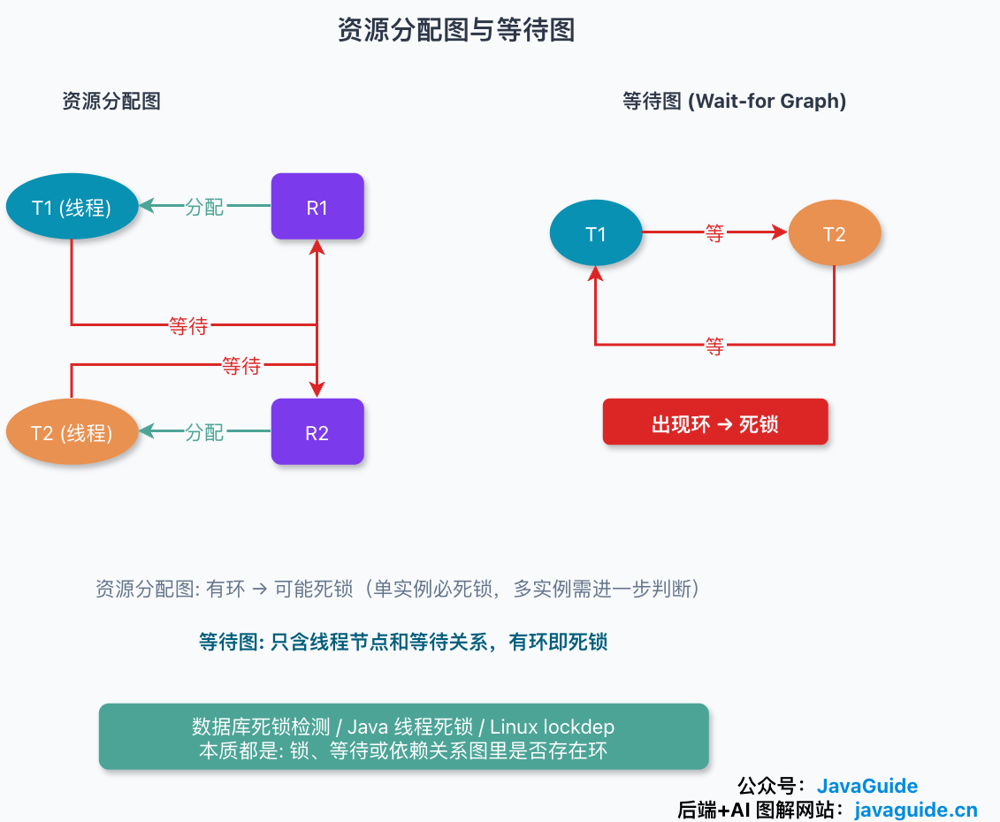
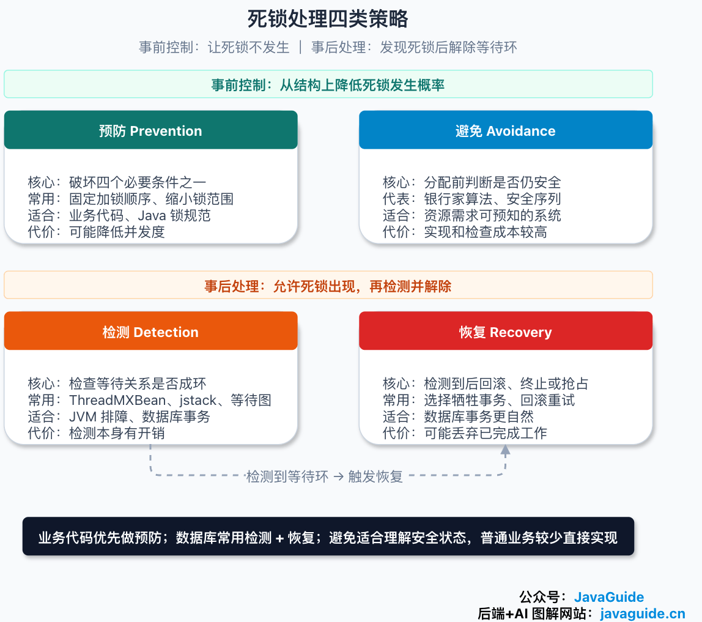
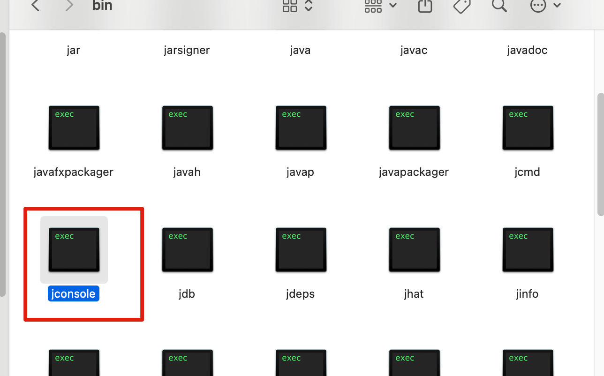
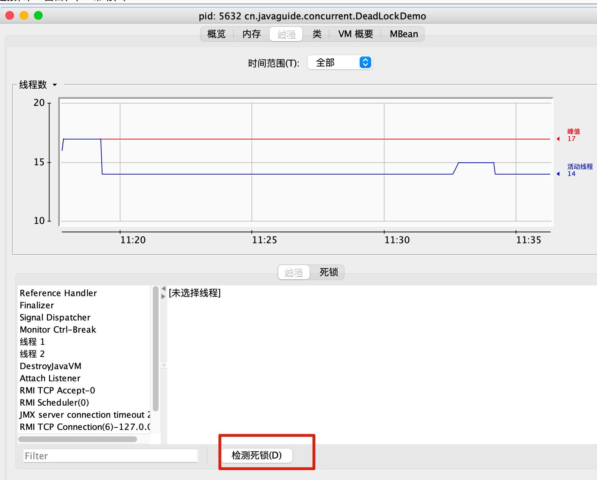
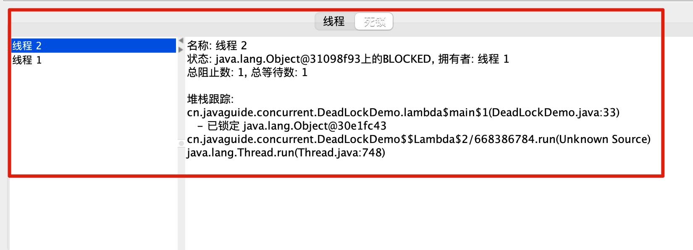
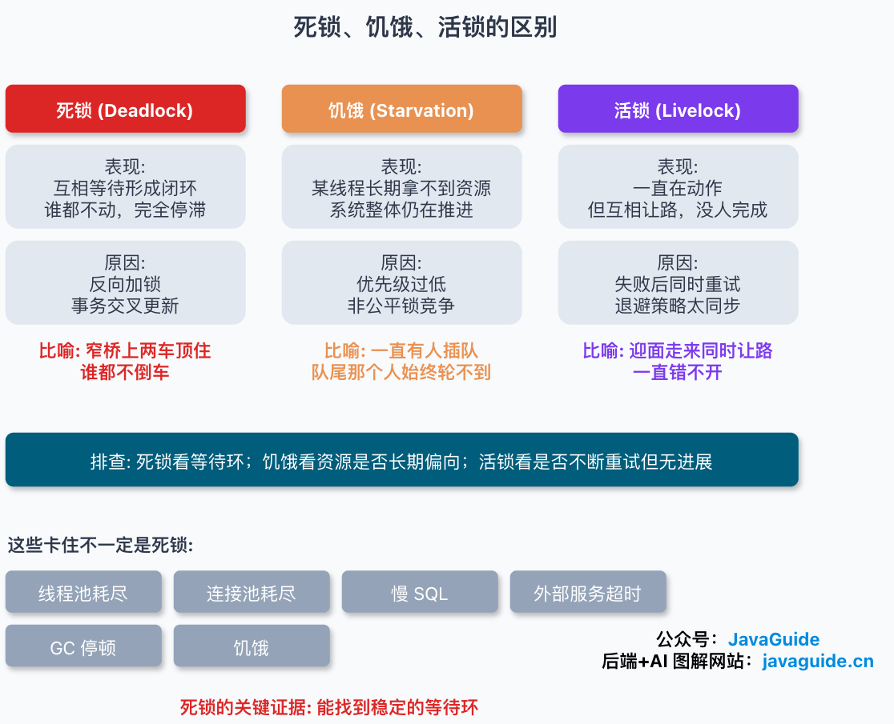

Thread A has acquired resource 1, and thread B has acquired resource 2. Now A needs resource 2 to continue, while B needs resource 1.

Neither thread has thrown an exception, and the CPU is not necessarily saturated. In production, the symptom may simply be that several requests never return and gradually occupy the thread pool.

That is what makes this problem difficult: the program is not computing the wrong result; it is stuck in a waiting chain that cannot resolve itself.

A **thread deadlock** occurs when a group of threads waits for one another to release resources, forming a cycle. None of the participating threads can make progress on its own.

If these threads handle important workflows such as orders, payments, or inventory, the effects can include request timeouts, growing queues, and a process that takes a long time to shut down.



Deadlocks are not limited to Java threads. Processes, database transactions, and distributed tasks can all deadlock when they hold resources while waiting for other resources. A resource does not have to be a printer or tape drive from an operating systems textbook. It can be a Java monitor, `ReentrantLock`, database row lock, distributed lock, connection-pool connection, thread-pool worker, or even a pipe buffer.

The Java example in this article is easy to reproduce, but deadlocks are not Java-specific. When exclusive resources, hold-and-wait, no preemption, and a cycle in the wait relationships occur together, threads, processes, and transactions can all get stuck.

For the roles of mutexes, semaphores, condition variables, and futexes, see [Operating System Locks and Synchronization](./os-lock-and-sync.md). This article focuses on how wait relationships form cycles and how to diagnose and recover from them in production.

The order follows a practical investigation: how a wait cycle forms, the four necessary conditions, a Java reproduction, resource-allocation graphs, handling strategies, and production diagnosis for Java and databases.

## How Does a Deadlock Form?

Consider a common concurrency scenario with two threads and two resources:

- Thread A acquires resource 1, then requests resource 2.
- Thread B acquires resource 2, then requests resource 1.

If their operations interleave, the system reaches this state:

- Thread A holds resource 1 and waits for resource 2.
- Thread B holds resource 2 and waits for resource 1.

A cannot continue until B releases resource 2, and B cannot continue until A releases resource 1. Both wait for the other to act, but neither can reach the code that releases its resource.

A deadlock is different from “waiting for a long time.” Ordinary blocking can resolve naturally: another thread releases a lock, a transaction commits, or network I/O returns. A deadlock adds a cycle in which every participant waits for another participant to release a resource.

One common diagnostic mistake is assuming a deadlock must cause high CPU usage. Often, the threads sit quietly in `BLOCKED` or `WAITING`, and CPU usage is low. CPU is only one clue when investigating request timeouts, full thread pools, or exhausted database connections; it is not a definitive test.

## The Four Necessary Conditions for Deadlock

Operating systems textbooks describe the Coffman conditions. All four must hold for a deadlock to occur:

| Condition        | Meaning                                                              | Java or database example                                             |
| ---------------- | -------------------------------------------------------------------- | -------------------------------------------------------------------- |
| Mutual exclusion | A resource can be held by only one execution unit at a time          | A `synchronized` monitor, exclusive row lock, or exclusive file lock |
| Hold and wait    | An execution unit holds some resources while waiting for others      | A thread holds `resource1` while requesting `resource2`              |
| No preemption    | A resource cannot be forcibly taken away; its holder must release it | Another thread cannot forcibly take a Java intrinsic lock            |
| Circular wait    | The wait relationships form a cycle                                  | Thread 1 waits for thread 2, which waits for thread 1                |



Do not treat this table as a checklist where any one condition means deadlock. It says that all four must hold for a deadlock to be possible. Breaking any one makes the cycle difficult to form.

In application code, the easiest conditions to address are usually hold and wait and circular wait.

Mutual exclusion is often necessary: multiple threads cannot arbitrarily modify the same inventory row, account balance, or shared-memory region. No preemption is also difficult to change because a lock protects state that may be only partially updated. It is usually more practical to acquire all needed resources at once or require every code path to acquire locks in the same order.

## Reproduce a Deadlock in Java

This code turns the example into Java. Two `Object` instances represent resources 1 and 2, and the threads enter `synchronized` blocks in opposite orders.

`Thread.sleep(1000)` does not cause the deadlock. It widens the timing window so the threads are more likely to interleave and reproduce it.

```java
public class DeadLockDemo {
    private static final Object resource1 = new Object();
    private static final Object resource2 = new Object();

    public static void main(String[] args) {
        new Thread(() -> {
            synchronized (resource1) {
                System.out.println(Thread.currentThread() + " get resource1");
                try {
                    Thread.sleep(1000);
                } catch (InterruptedException e) {
                    Thread.currentThread().interrupt();
                }
                System.out.println(Thread.currentThread() + " waiting to get resource2");
                synchronized (resource2) {
                    System.out.println(Thread.currentThread() + " get resource2");
                }
            }
        }, "thread-1").start();

        new Thread(() -> {
            synchronized (resource2) {
                System.out.println(Thread.currentThread() + " get resource2");
                try {
                    Thread.sleep(1000);
                } catch (InterruptedException e) {
                    Thread.currentThread().interrupt();
                }
                System.out.println(Thread.currentThread() + " waiting to get resource1");
                synchronized (resource1) {
                    System.out.println(Thread.currentThread() + " get resource1");
                }
            }
        }, "thread-2").start();
    }
}
```

A typical output is:

```text
Thread[thread-1,5,main] get resource1
Thread[thread-2,5,main] get resource2
Thread[thread-1,5,main] waiting to get resource2
Thread[thread-2,5,main] waiting to get resource1
```

The program stops here. `sleep()` eventually ends; the threads are actually blocked trying to enter the second `synchronized` block. Thread 1 cannot acquire `resource2`, and thread 2 cannot acquire `resource1`.

The four conditions are all present:

- **Mutual exclusion:** Only one thread can hold `resource1` or `resource2` at a time.
- **Hold and wait:** Thread 1 holds `resource1` while waiting for `resource2`; thread 2 does the reverse.
- **No preemption:** Java does not forcibly take `resource1` away from thread 1.
- **Circular wait:** Thread 1 waits for thread 2, and thread 2 waits for thread 1.

All four conditions are met; the remaining factor is scheduling. Because reproduction depends on timing, some deadlocks are intermittent in production. A stress test may hang only once in several runs.

**How can we change the code to avoid the deadlock?**

The simplest fix is to acquire locks in a fixed order. If every thread acquires `resource1` before `resource2`, the wait chain cannot cycle back to its starting point.

```java
public class OrderedLockDemo {
    private static final Object resource1 = new Object();
    private static final Object resource2 = new Object();

    public static void main(String[] args) {
        Runnable task = () -> {
            synchronized (resource1) {
                System.out.println(Thread.currentThread() + " get resource1");

                synchronized (resource2) {
                    System.out.println(Thread.currentThread() + " get resource2");
                }
            }
        };

        new Thread(task, "thread-1").start();
        new Thread(task, "thread-2").start();
    }
}
```

This breaks circular wait, provided that every code path follows the same order. That is easy to see in a small example with two locks, but business systems may spread locks across order, inventory, and payment modules. One path may acquire the order lock before the inventory lock, while another does the reverse. Each method can look reasonable in isolation, but their combination creates a deadlock.

These checks are useful in code reviews:

- Define a stable resource order. Sort by a stable business key such as an ID, database primary key, or account number. Avoid using object hashes to represent business ordering.
- Keep only necessary state changes inside the lock. Move RPCs, slow SQL, and file I/O outside the critical section so a slow call does not extend the wait chain.
- If all resources cannot be acquired, back out. Releasing A before retrying for B is safer than holding A while waiting indefinitely for B.
- When failure is acceptable, use `tryLock(timeout, unit)` to bound the wait.
- If two locks are always used together, consider replacing them with one coarser lock. This reduces concurrency but can make correctness easier to prove.

The last choice may seem like a step backward, but it is often useful in engineering. Splitting locks more finely is not automatically better; tightly coupled state can be safer under one lock.

## Resource-Allocation Graphs and Wait-for Graphs

Operating systems textbooks use resource-allocation graphs to illustrate deadlocks. They contain two kinds of nodes:

- Process or thread nodes.
- Resource nodes.

There are two kinds of edges:

- An edge from a thread to a resource means the thread is waiting for it.
- An edge from a resource to a thread means the resource has been allocated to it.

One useful rule: if the graph has no cycle, there is no deadlock.

If the graph has a cycle, check how many instances each resource has:

- If each resource type has one instance, a cycle means deadlock.
- If a resource type has multiple instances, a cycle means deadlock is possible; check whether some thread can finish and release resources first.

For example, database transaction T1 locks order `id=1` and then requests `id=2`. Transaction T2 locks `id=2` and then requests `id=1`. If we remove resource nodes and keep only which transactions wait for which others, we get:

```text
T1 -> T2
T2 -> T1
```

This simplified graph is called a **wait-for graph**. Java thread deadlock diagnosis, database deadlock detection, and Linux lockdep use similar graph reasoning, but at different times. A database usually checks for a cycle after transactions block. Lockdep records lock acquisition order and can identify combinations that may form a cycle before a deadlock occurs.



## Prevention, Avoidance, Detection, and Recovery

Deadlock handling is often grouped into four terms: prevention, avoidance, detection, and recovery. They differ in when they intervene.

Application code most often uses prevention, such as a consistent lock order or shorter lock hold times. Databases often detect and recover because transactions have rollback boundaries. The Banker's algorithm illustrates avoidance and safe states, but ordinary backend services rarely implement it directly.

| Approach   | Method                                                              | Cost                                                      | How common in practice                       |
| ---------- | ------------------------------------------------------------------- | --------------------------------------------------------- | -------------------------------------------- |
| Prevention | Break one of the four necessary conditions                          | May reduce concurrency or add coding constraints          | Very common                                  |
| Avoidance  | Check whether an allocation would put the system in an unsafe state | Requires advance resource estimates and has checking cost | Common in textbooks, rare in general systems |
| Detection  | Allow deadlocks, then check for cycles periodically or on demand    | Detection has a cost                                      | Common in databases and diagnostic tools     |
| Recovery   | Terminate, roll back, or preempt resources after detection          | May discard completed work                                | Natural for database transactions            |



### Deadlock Prevention

Prevention makes sure the four necessary conditions cannot all hold at once.

**Break mutual exclusion:** Make a resource shareable. Read-only data, immutable objects, lock-free structures, and append-only logs can reduce the need for mutual exclusion. This is not always possible: concurrent updates to the same inventory row, file position, or account balance must be controlled.

**Break hold and wait:** Acquire all needed resources at once, or acquire none. This avoids holding A while waiting for B, but can reduce resource utilization and requires callers to know their full resource needs in advance.

**Break no preemption:** If a new resource is unavailable, release the resources already held and try again later. Java intrinsic locks do not support timed acquisition or forced revocation. The `Lock` interface's `tryLock()` lets code give up if it cannot acquire a lock in time.

```java
boolean gotA = false;
boolean gotB = false;

try {
    gotA = lockA.tryLock(100, TimeUnit.MILLISECONDS);
    if (!gotA) {
        return;
    }

    gotB = lockB.tryLock(100, TimeUnit.MILLISECONDS);
    if (!gotB) {
        return;
    }

    // Update shared state only after acquiring both locks.
    updateSharedState();
} catch (InterruptedException e) {
    Thread.currentThread().interrupt();
    // Whether to return or throw depends on the application.
} finally {
    if (gotB) {
        lockB.unlock();
    }
    if (gotA) {
        lockA.unlock();
    }
}
```

This avoids waiting forever, but it converts waiting into a failed attempt. The application still needs to decide whether and how to retry, whether retries are allowed, and whether an idempotency key is needed. Otherwise, deadlock may be replaced by frequent failures or livelock.

**Break circular wait:** Give resources a stable order and require every thread to acquire them in that order. A common backend example is sorting database rows by primary key before updating several of them.

### Deadlock Avoidance

Avoidance does not break one of the four conditions. Before allocating a resource, the system checks whether there is still an order in which every process can eventually finish.

The classic textbook example is the Banker's algorithm. Each process declares its maximum resource needs in advance. Before each allocation, the system checks whether the resulting state is safe:

- If a safe sequence still exists after the allocation, grant it.
- If no safe sequence exists, make the requester wait.

A safe state is not deadlocked. An unsafe state is not necessarily deadlocked either; it means the system could enter a deadlock later.

The Banker's algorithm helps explain safe states, but ordinary services rarely use it. Most programs cannot declare their maximum resource needs in advance, request order changes with business logic, and checking the entire system before every allocation is expensive.

### Deadlock Detection

Detection takes a different approach: let the system run normally, then look for a wait cycle after threads or transactions are actually blocked.

Databases are well suited to this. A transaction has a rollback boundary, so the database can select one transaction to roll back and let the other continue. The application must identify the error and decide whether to retry the whole transaction.

Java processes can also be diagnosed with the JDK's `ThreadMXBean`:

```java
import java.lang.management.ManagementFactory;
import java.lang.management.ThreadInfo;
import java.lang.management.ThreadMXBean;

public class DeadlockDetector {
    public static void printDeadlocks() {
        ThreadMXBean bean = ManagementFactory.getThreadMXBean();
        long[] threadIds = bean.findDeadlockedThreads();

        if (threadIds == null || threadIds.length == 0) {
            System.out.println("No deadlock found");
            return;
        }

        ThreadInfo[] threadInfos = bean.getThreadInfo(threadIds, true, true);
        for (ThreadInfo threadInfo : threadInfos) {
            System.out.println(threadInfo);
        }
    }
}
```

`findDeadlockedThreads()` checks object monitors and ownable synchronizers from `java.util.concurrent`. It is better suited to a diagnostic tool or a temporary troubleshooting script than to a hot business path; the check itself has a cost.

Its limits matter: it can see only monitors and ownable synchronizers visible inside the JVM. If thread A holds a Java lock while waiting for a database row lock, and thread B holds that row lock while blocked on another application action, `ThreadMXBean` cannot show the full cross-system wait chain. Correlate thread dumps, database lock views, and application logs.

In production, it is more common to capture thread dumps directly:

```bash
jcmd <pid> Thread.print -l
jstack -l <pid>
```

If the output includes `Found one Java-level deadlock`, `waiting to lock`, or `which is held by`, follow the wait chain back to the business code. Include `-l`: many applications use JUC locks such as `ReentrantLock` and `ReentrantReadWriteLock`, and without `-l`, ownable synchronizer details may be incomplete.

For local reproduction, JConsole and VisualVM are useful. In JConsole, find the JDK `bin` directory and run `jconsole`.



Connect to the Java process, open the Threads page, and select **Detect Deadlock**.



If the process has deadlocked Java threads, JConsole lists them separately.



In production, prefer `jcmd` or `jstack`. They can be run over SSH, and their output is easy to archive. JConsole is more suitable for local reproduction, demonstrations, or quick checks in a test environment. Remote JConsole access in production also requires attention to permissions, network exposure, and runtime overhead. Many teams export a thread dump and analyze it offline instead.

For Java 21+ applications that use many virtual threads, traditional `jstack` or `Thread.print` output may be less direct because virtual threads are not permanently tied to OS threads. Export a virtual-thread dump with:

```bash
jcmd <pid> Thread.dump_to_file -format=text thread-dump.txt
jcmd <pid> Thread.dump_to_file -format=json thread-dump.json
```

Virtual-thread dumps do not contain exactly the same fields as traditional thread dumps. They may omit information commonly found in traditional dumps, such as object addresses, locks, JNI statistics, and heap statistics. Do not rely on a single dump; correlate it with application logs, JFR, database state, and external dependencies.

### Deadlock Recovery

Recovery is harder than detection because the system must decide which participant to sacrifice.

Common approaches include:

- Terminate all execution units involved in the deadlock.
- Terminate one at a time and check whether the deadlock is resolved.
- Preempt resources and roll back to a state where execution can continue.

Database transactions are easier to recover because they have clear boundaries and can be retried after rollback. Ordinary Java threads are harder: a thread may hold a lock after partially changing memory, writing a file, or sending a remote request. Killing it directly is usually unsafe. This is one reason Java deprecated `Thread.stop()`.

Application code should avoid reaching a state where process termination is the only recovery option.

## Deadlocks in Databases

Database deadlocks are common, especially when multiple transactions update several rows.

Suppose the database has an order table:

```sql
CREATE TABLE orders (
  id BIGINT PRIMARY KEY,
  status VARCHAR(32) NOT NULL
);
```

The transactions run in opposite row order:

```sql
-- Transaction T1
BEGIN;
UPDATE orders SET status = 'PAID' WHERE id = 1;
UPDATE orders SET status = 'PAID' WHERE id = 2;
COMMIT;
```

```sql
-- Transaction T2
BEGIN;
UPDATE orders SET status = 'CANCELLED' WHERE id = 2;
UPDATE orders SET status = 'CANCELLED' WHERE id = 1;
COMMIT;
```

If T1 locks `id=1` first and T2 locks `id=2` first, they can wait for one another.

Databases generally do not leave both transactions blocked forever. PostgreSQL has a `deadlock_timeout` setting, which defaults to `1s`; after a transaction has waited that long, PostgreSQL checks for deadlocks because building and scanning the wait graph has a cost. MySQL InnoDB enables deadlock detection by default and rolls back a transaction when it finds a cycle, usually preferring one that changed fewer rows.

The application should do two things:

1. Make transactions safe to retry. PostgreSQL reports deadlocks with SQLSTATE `40P01`; MySQL InnoDB rolls back the whole transaction on a deadlock. Retry the whole transaction, not just the final SQL statement.
2. Keep lock order stable. When updating several rows, sort by primary key or a unique business key and update them in the same order on every path.

Before retrying, confirm the business operation is idempotent. Common safeguards include a unique request ID, business transaction ID, or state-machine validation. Otherwise, the database may resolve the deadlock while an application retry causes a duplicate charge or shipment.

To reduce and investigate database deadlocks:

- Keep transactions short. Do not wait for user input, call a slow service, or process a large file inside a transaction.
- Use appropriate indexes; without them, an update to one row may scan and lock more records.
- Avoid unnecessary `SELECT ... FOR UPDATE` statements.
- In MySQL, use `SHOW ENGINE INNODB STATUS` to inspect the latest InnoDB deadlock. If deadlocks are frequent, consider enabling `innodb_print_all_deadlocks` to write every deadlock to the error log.
- In PostgreSQL, correlate error logs with `pg_locks` and `pg_stat_activity` to inspect blocking.

This PostgreSQL query shows sessions waiting for locks and the PIDs blocking them:

```sql
SELECT
    a.pid,
    a.usename,
    a.state,
    a.wait_event_type,
    a.wait_event,
    pg_blocking_pids(a.pid) AS blocking_pids,
    a.query
FROM pg_stat_activity a
WHERE a.wait_event_type = 'Lock';
```

This query shows current waits. To analyze a deadlock that already happened, inspect the database error log for its details, find the matching `traceId` or `requestId` in application logs, then reconstruct the SQL order in both transactions.

A database deadlock does not mean the database is broken. More often, it reveals that the application accesses the same resources in inconsistent orders.

## How Do Deadlock, Starvation, and Livelock Differ?

All three can look like “the program is not making progress,” but their symptoms differ.

| Problem    | Symptom                                                                         | Typical cause                                                                    |
| ---------- | ------------------------------------------------------------------------------- | -------------------------------------------------------------------------------- |
| Deadlock   | Execution units wait for one another in a cycle                                 | Locks acquired in opposite orders; transactions update rows in conflicting order |
| Starvation | One execution unit waits for a long time while the system as a whole progresses | Low priority or unfair lock competition                                          |
| Livelock   | Execution units keep acting but yield to one another, so none completes         | Synchronized retries or backoff                                                  |



Three images can help distinguish them. Deadlock is like two cars blocking each other on a narrow bridge. Starvation is like someone at the back of a line who is continually skipped. Livelock is like two people who keep stepping in the same direction to let each other pass, so neither gets by.

Do not diagnose based only on the word “stuck.” For deadlock, find a wait cycle. For starvation, check whether scheduling or lock competition consistently favors other tasks. For livelock, check whether retry logic keeps participants synchronized.

## What Can Look Stuck Without Being a Deadlock?

Several production problems resemble deadlocks but do not have a wait cycle:

- **Thread-pool exhaustion:** Every worker is running a slow task, so new requests wait in the queue.
- **Connection-pool exhaustion:** Threads are waiting for database connections, but are not waiting on one another in a cycle.
- **Slow SQL:** A thread is blocked in a JDBC call while the database continues executing.
- **External-service timeout:** A thread is waiting for an HTTP or RPC response.
- **GC or safepoint pause:** Java threads are temporarily paused.
- **Starvation:** Some threads rarely acquire resources, but the system as a whole continues to progress.

The key evidence for deadlock is not slowness or a pause; it is a stable wait cycle.

## How to Diagnose a Java Deadlock in Production

If production requests are stuck, do not restart immediately. If the process is still running, capture thread dumps and metrics first.

### 1. Check Whether the Service Is Stalled

Look for symptoms involving threads that are not releasing resources:

- Some requests time out while the process remains alive.
- CPU usage is low, while thread counts, connection counts, or request queues keep growing.
- Active thread-pool workers stay fully occupied, and the queue does not drain.
- Database connections remain checked out.

These symptoms show that the service is waiting, but do not prove a deadlock. Slow SQL, blocked external dependencies, or a poor thread-pool configuration can look similar.

### 2. Capture Two or Three Thread Dumps

Capture thread dumps several times, 10 to 30 seconds apart. A single dump can make a temporary block look like a deadlock:

```bash
jcmd <pid> Thread.print -l > thread-1.log
sleep 10
jcmd <pid> Thread.print -l > thread-2.log
sleep 10
jcmd <pid> Thread.print -l > thread-3.log
```

Comparing dumps helps distinguish a persistent wait from a temporary one. If several dumps show threads stopped at the same lock, connection pool, or business code, the evidence is stronger.

The JVM often prints deadlock information directly for deadlocks it can detect. If it does not, check whether many threads remain at the same locks, connection-pool acquisition, or business methods across dumps.

### 3. Follow `waiting to lock` to the Owner

When reading a thread dump, note:

- Thread name and state, such as `BLOCKED` or `WAITING`.
- The lock the thread is waiting for.
- Locks it already holds.
- The top business methods in its stack.
- The `Lock` or condition queue associated with `parking to wait for`.

If A waits for a lock held by B, and B waits for a lock held by A, the cycle is visible.

Deadlocks involving `synchronized` often show `waiting to lock <...>` and `locked <...>`. JUC locks such as `ReentrantLock` often show `parking to wait for <...>` and `Locked ownable synchronizers`. Include `-l` when capturing the dump.

### 4. Check Lock Order in the Code

After locating the business methods in the dump, check whether:

- Different entry points acquire the same locks in opposite orders.
- Code calls external services or databases while holding a lock.
- A lock protects an overly broad object, such as a global `Map`, singleton, or `Class` object.
- Java locks and database transaction locks are mixed, lengthening the wait chain.
- The code uses unfair locks, unbounded waits, or lock acquisition without a timeout.

Many deadlocks do not come from one line in isolation. They appear only when two call paths interact. Each path can look reasonable alone, but together they form a cycle.

## How Can You Reduce Deadlocks in Code?

Use these checks in code review, especially when code acquires multiple locks or updates multiple resources or rows.

### Acquire Locks in a Fixed Order

When operating on multiple users, orders, or accounts, sort them before locking. This transfer example assumes account IDs are globally unique and immutable after creation.

```java
public void transfer(Account from, Account to, long amount) {
    if (from == to) {
        return;
    }

    Account first;
    Account second;
    int compare = Long.compare(from.id(), to.id());
    if (compare < 0) {
        first = from;
        second = to;
    } else if (compare > 0) {
        first = to;
        second = from;
    } else {
        throw new IllegalStateException("Account id must be unique");
    }

    synchronized (first) {
        synchronized (second) {
            from.withdraw(amount);
            to.deposit(amount);
        }
    }
}
```

Whether A transfers to B or B transfers to A, this code locks the account with the smaller ID first. The fixed order removes one edge from a possible wait cycle.

### Avoid Slow Work While Holding a Lock

Avoid doing these things while holding a lock:

- RPC or HTTP calls.
- Slow SQL or long transactions.
- File uploads or downloads.
- Waiting for a message queue response.
- Calling third-party code that may acquire locks internally.

Locks should protect shared state, not wrap an entire business workflow. Calculate what you can outside the lock and keep the state transition inside it short.

### Use Timeouts and a Failure Policy

The intrinsic Java lock used by `synchronized` has no timed acquisition. When the business can fail or retry, consider `ReentrantLock.tryLock()`:

```java
try {
    if (!lock.tryLock(200, TimeUnit.MILLISECONDS)) {
        throw new IllegalStateException("System busy; try again later");
    }

    try {
        updateSharedState();
    } finally {
        lock.unlock();
    }
} catch (InterruptedException e) {
    Thread.currentThread().interrupt();
    throw new IllegalStateException("Interrupted while acquiring the lock", e);
}
```

A timeout bounds the wait but does not guarantee business correctness. Decide whether to retry, how many times, whether a request can be duplicated, and whether an idempotency key is needed. Otherwise, the timeout only makes the failure happen sooner.

### Avoid Mixing Locking Systems Unnecessarily

Cross-layer deadlocks are especially difficult to investigate. For example:

- A Java thread holds a JVM lock while waiting for a database row lock.
- Another request holds the database row lock while a callback waits for the JVM lock.

The wait chain then spans the JVM thread dump and database logs; neither shows the whole picture. Keep locks within one layer where possible. If a workflow must cross layers, use timeouts, logging, and a consistent order.

### Name Locks and Threads

Production diagnosis is harder when a dump shows only “Thread-17 waiting for Object@4afcd809.” Give thread-pool threads useful names, associate locks with business IDs, and log important resource order. A little work up front can save time during an incident.

For example, a thread factory can include the pool's business role in thread names:

```java
private static final AtomicInteger THREAD_INDEX = new AtomicInteger();

ThreadFactory factory = runnable -> {
    Thread thread = new Thread(runnable);
    thread.setName("order-worker-" + THREAD_INDEX.incrementAndGet());
    return thread;
};
```

`AtomicInteger` is in `java.util.concurrent.atomic`. A separate counter is more reliable than depending directly on thread IDs and works with common runtimes such as Java 8 and 11.

Naming does not prevent deadlocks, but it helps identify which business threads are stuck.

## How to Answer Deadlock Questions in an Interview

You do not need to start with a long definition. Use a two-lock example to explain the idea:

> A deadlock is a state where multiple threads or processes wait for one another to release resources, so none of them can continue. For example, thread A holds lock 1 and waits for lock 2, while thread B holds lock 2 and waits for lock 1.

Then name the four necessary conditions:

> A deadlock requires mutual exclusion, hold and wait, no preemption, and circular wait at the same time. Breaking any one of these conditions can prevent deadlock structurally.

Then explain the approaches:

> Common engineering practices prevent deadlocks by using a consistent lock order, reducing lock scope, acquiring all resources together, or using timed locks. Textbooks also describe the Banker's algorithm for avoidance, which requires advance knowledge of maximum resource needs. Databases commonly detect a wait cycle and roll back a transaction; the application can then retry it.

If asked how to diagnose a Java deadlock:

> Use `jcmd <pid> Thread.print -l` or `jstack -l <pid>` to capture thread dumps. `ThreadMXBean.findDeadlockedThreads()` can also diagnose deadlocks inside a program. Check the thread states, locks being waited on, and locks already held, then look for reverse lock order or slow work performed while holding a lock.

This covers the concept, conditions, handling, and diagnosis, rather than only listing four conditions.

## Summary

The most useful thing to remember about deadlocks is the wait relationship.

Whenever code holds some resources while waiting for others, ask whether the wait relationships can form a cycle. If they can, use a stable order, shorten lock hold times, allow timed retries, or rely on a system such as database transactions that can detect and roll back deadlocks.

It may not be possible to guarantee that complex database transactions, high-concurrency batch updates, or cross-service workflows can never deadlock. A practical goal is to reduce the likelihood, preserve enough information to diagnose the incident, and make failures safe to retry instead of requiring a process restart.

## References

- [JavaGuide: Common Operating System Interview Questions (Part 1)](https://github.com/Snailclimb/JavaGuide)
- [A Simple Example of Deadlock](https://zhuanlan.zhihu.com/p/26945588)
- [Yale CS: Deadlock](https://www.cs.yale.edu/homes/aspnes/pinewiki/Deadlock.html)
- [University of Wisconsin CS 537 Notes: Deadlock](https://pages.cs.wisc.edu/~bart/537/lecturenotes/s12.html)
- [Oracle Java Tutorials: Deadlock](https://docs.oracle.com/javase/tutorial/essential/concurrency/deadlock.html)
- [Oracle JDK API: ReentrantLock](https://docs.oracle.com/en/java/javase/17/docs/api/java.base/java/util/concurrent/locks/ReentrantLock.html)
- [Oracle JDK API: ThreadMXBean](https://docs.oracle.com/javase/8/docs/api/java/lang/management/ThreadMXBean.html)
- [Oracle Troubleshooting Guide: The jstack Utility](https://docs.oracle.com/javase/8/docs/technotes/guides/troubleshoot/tooldescr016.html)
- [Oracle Java Documentation: Virtual Threads](https://docs.oracle.com/en/java/javase/21/core/virtual-threads.html)
- [Linux Kernel Documentation: Runtime Locking Correctness Validator](https://docs.kernel.org/locking/lockdep-design.html)
- [PostgreSQL Documentation: Lock Management](https://www.postgresql.org/docs/current/runtime-config-locks.html)
- [PostgreSQL Documentation: Error Codes](https://www.postgresql.org/docs/current/errcodes-appendix.html)
- [PostgreSQL Documentation: pg_locks](https://www.postgresql.org/docs/current/view-pg-locks.html)
- [MySQL 8.4 Reference Manual: Deadlock Detection](https://dev.mysql.com/doc/refman/8.4/en/innodb-deadlock-detection.html)
- [MySQL 8.4 Reference Manual: InnoDB Error Handling](https://dev.mysql.com/doc/refman/8.4/en/innodb-error-handling.html)
