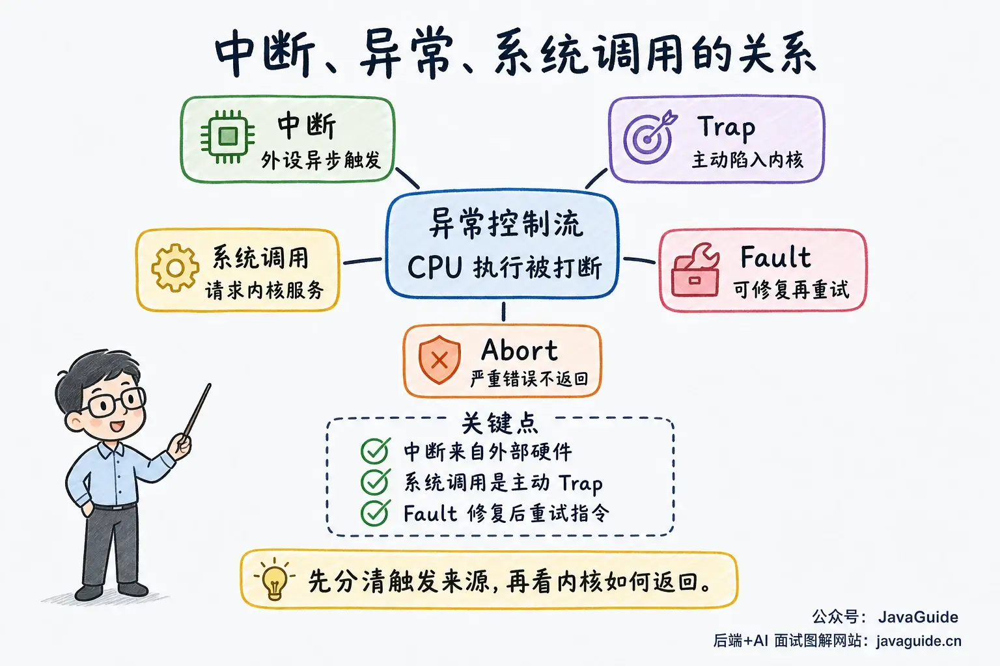
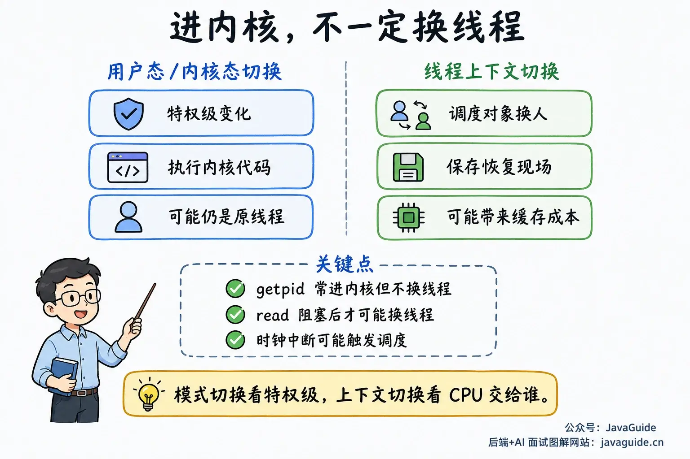
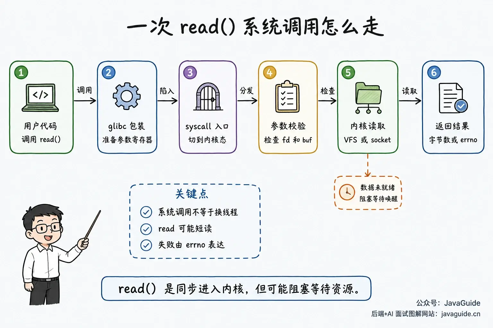
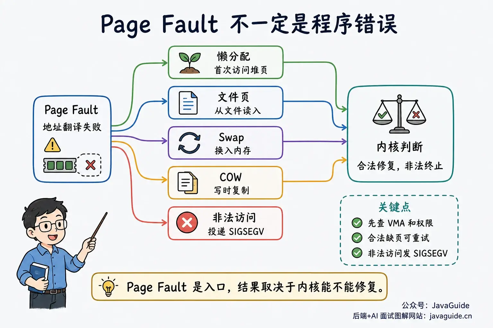

A system call takes a program from user mode into kernel mode, but that is only the start of the story. Following a `read()` call raises several related questions:

- How does `read()` enter the kernel?
- How can a clock interrupt stop a thread that is running?
- Why is a Page Fault sometimes normal and sometimes followed by `SIGSEGV`?
- Does entering the kernel for a system call always switch to another thread?

We can connect these questions by following `read(fd, buf, count)`. The user program calls `read()`. glibc puts the system call number and arguments in the designated registers, and the CPU executes `syscall` to enter the kernel. The kernel checks the file descriptor, buffer address, and file state, then decides whether to get data from the Page Cache, filesystem, socket buffer, or device driver.

If the data is ready, the kernel copies it to the user buffer and `read()` returns. If it is not ready, the current thread may sleep. When disk I/O completes or a network packet arrives, a hardware interrupt enters the kernel, which can then wake a thread waiting in a queue. The thread must be scheduled on a CPU again before `read()` can return.

A normal I/O operation can therefore involve system calls, interrupts, exceptions, and scheduling in sequence.

## Events That Enter the Kernel

While a CPU runs a user program, the program counter and branch logic determine the next instruction. A device event, an error in the current instruction, or a request from the program can redirect control to the kernel. CSAPP calls this exceptional control flow and distinguishes interrupts, traps, faults, and aborts.

Common entry events can be grouped by their source:

- **Interrupt:** Comes from external hardware and is unrelated to the current instruction. Network packet arrival, disk I/O completion, and timer expiration are examples.
- **Trap:** The program deliberately executes a special instruction to enter the kernel. A system call is the most common example.
- **Fault:** The current instruction encounters a problem that the kernel may be able to fix. A page fault is a typical example; after fixing it, the CPU retries the instruction that caused the fault.
- **Abort:** The processor detects a serious error that is difficult to recover from, so execution usually cannot return to the original instruction stream.



Different sources use the word `trap` differently. In CSAPP, it usually means a synchronous exception deliberately raised by a program, such as a system call. RISC-V uses `trap` for control transfers caused by either exceptions or interrupts. This article uses the narrower CSAPP meaning for “trap / system call” and calls out RISC-V usage separately.

## How Interrupts, Exceptions, System Calls, and Signals Relate

These terms are easy to confuse because they describe different layers.

Hardware interrupts, synchronous exceptions, and system calls describe why the CPU enters the kernel. A signal is a software notification delivered by the kernel to a process or thread. A signal may result from a hardware exception, or it may come from another process, a terminal, or a timer.

| Concept               | Trigger                                                                          | Sync or async                                      | Handler                                                     | Common outcome                                                    |
| --------------------- | -------------------------------------------------------------------------------- | -------------------------------------------------- | ----------------------------------------------------------- | ----------------------------------------------------------------- |
| Hardware interrupt    | Device or timer                                                                  | Asynchronous                                       | Kernel interrupt handler                                    | Handle a device event, wake a waiting task, or trigger scheduling |
| Synchronous exception | Current instruction                                                              | Synchronous                                        | Kernel exception handler                                    | Retry after repair, deliver a signal, or terminate the process    |
| System call           | A user program deliberately executes an instruction such as `syscall` or `ecall` | Synchronous                                        | Kernel system call entry point                              | Return a result or error, or wait for a resource                  |
| Signal                | Notification from the kernel or a process                                        | Usually asynchronous; may result from an exception | Target process's default action or user-mode signal handler | Ignore, terminate, stop, continue, or run a handler               |

For sync versus async, the question is whether the event was caused by the current instruction. Division by zero, an illegal instruction, a Page Fault, and a system call are synchronous. A hardware interrupt comes from a device or timer; for example, a network packet may arrive while the CPU is running a Java thread, independently of the user code it is executing. That makes it asynchronous.

Blocking versus nonblocking is a separate distinction. Entering the kernel with `read()` is synchronous, but if a resource is not ready, a blocking file descriptor can put the thread to sleep. A file descriptor opened with `O_NONBLOCK` may return `EAGAIN` instead.

A hardware interrupt is like a device alerting the CPU. Suppose the CPU is running your Java thread when a clock interrupt arrives. The CPU finishes the current instruction and enters the kernel's interrupt handler. The kernel updates the clock and runtime statistics, and may ask the scheduler to give the CPU to another thread. Your code does not need to yield explicitly for it to be preempted.

An exception is caused by the current instruction. Division by zero, an illegal instruction, or accessing an address without permission are examples. A page fault is also an exception: a process accesses a virtual address without a valid page-table mapping, so the CPU transfers control to the kernel. A synchronous exception is not necessarily recoverable. If the kernel cannot fix it, it may deliver a signal or terminate the process.

A system call is a program's explicit request for kernel services. User-mode code cannot read a disk directly, modify page tables, or operate a network card, so glibc functions such as `read()`, `write()`, `fork()`, and `mmap()` ultimately use system call interfaces provided by the kernel.

A signal is not a CPU entry mechanism. It is a notification from the kernel to a process or thread. An invalid memory access may first cause a Page Fault; if the kernel cannot fix it, the kernel can deliver `SIGSEGV`. When the user presses `Ctrl+C`, the terminal driver asks the kernel to send `SIGINT` to the foreground process group. Another process can also send a signal with `kill()`.

Keep these dimensions separate:

| Dimension                           | Question                                                  | Example                                                                |
| ----------------------------------- | --------------------------------------------------------- | ---------------------------------------------------------------------- |
| Synchronous or asynchronous event   | Was the event directly caused by the current instruction? | A Page Fault is synchronous; a network card interrupt is asynchronous  |
| Blocking or nonblocking I/O         | Does the thread wait when a resource is not ready?        | A blocking `read()` sleeps; a nonblocking `read()` may return `EAGAIN` |
| User-mode or kernel-mode transition | Does execution enter the kernel to run privileged code?   | `syscall`, a Page Fault, and a hardware interrupt all enter the kernel |
| Thread context switch               | Does the CPU switch from one thread to another?           | May happen during blocking, preemption, or scheduling                  |

A signal handler is not a kernel function. Before returning to user mode, the kernel usually checks for pending signals. To run a handler, it prepares the user stack, registers, and a trampoline, then returns to user mode so the thread can execute the handler. The handler is therefore not usually inserted immediately between arbitrary machine instructions; the kernel arranges it as the thread returns from the kernel or wakes from an interruptible wait. In a multithreaded program, a process-directed signal is not guaranteed to reach a particular thread: the kernel chooses a thread that has not blocked that signal.

Where execution resumes also depends on the event:

| Event              | Typical return point                                                                     |
| ------------------ | ---------------------------------------------------------------------------------------- |
| Interrupt          | Resume where execution was interrupted, or schedule another thread                       |
| Trap / system call | Resume after the trapping instruction in most cases; system call restart is an exception |
| Fault / page fault | Retry the instruction that caused the fault after it is fixed                            |
| Abort              | Usually does not return to the original program                                          |

These are the common paths. The kernel may also deliver a signal, restart a system call, switch to another thread, or terminate a process.

## User-Mode Transitions and Context Switches

The difference between user mode and kernel mode is the CPU privilege level. User-mode code cannot execute privileged instructions or freely access kernel address space. Kernel-mode code can manage page tables, devices, interrupt controllers, and the scheduler.

Entering the kernel from user mode is not an ordinary function call. The CPU and kernel must preserve enough state to know where to resume the user program.

On x86-64, 64-bit system calls usually use the `syscall` instruction. Exceptions and external interrupts more often use entries configured in the IDT. Some exceptions push an error code and others do not; special entries such as NMI and Double Fault may use an IST stack.

This article uses Linux on x86-64 as its example, so it focuses on `syscall`. Other architectures and older ABIs may use entry instructions such as `int 0x80`, `sysenter`, `ecall`, or `svc`, with different register conventions.

The `syscall` instruction does only part of the work. It places the return address and flags in `RCX` and `R11`, but does not save all registers as an ordinary function call would, or automatically switch to the kernel stack. Linux entry assembly does the remaining work, such as switching stacks, running `swapgs`, and saving registers.

User-mode/kernel-mode transitions and thread context switches are different:

- **Mode transition:** The CPU moves from a lower privilege level to a higher one, runs kernel code, and returns to user mode.
- **Context switch:** The scheduler switches the CPU from one thread or process to another execution entity.

A system call always enters the kernel, but it does not necessarily switch to another thread. A call such as `getpid()` usually returns quickly, and the same thread continues running. If `read()` must wait for data, the kernel may suspend the current thread and schedule another. Some time-related interfaces can use the vDSO to run in user mode; depending on the architecture and configuration, calls such as `clock_gettime()` and `gettimeofday()` can read data from a page mapped by the kernel without entering the kernel on every call.



## The `read()` System Call Path

Consider `read(fd, buf, count)` on Linux x86-64. Application code usually calls the glibc wrapper rather than writing assembly itself.



glibc puts the system call number in `rax` and the arguments in designated registers. On x86-64, system call arguments go in `rdi`, `rsi`, `rdx`, `r10`, `r8`, and `r9`, in that order.

After the CPU executes `syscall`, it jumps to the kernel entry point according to the architecture's rules. Linux entry code saves the registers it will need, then dispatches by system call number to the handler for `read`. The kernel checks the file descriptor, permissions, and other arguments. Copying data to the user buffer can still fail, for example with `EFAULT`.

For a regular file, the path goes through the VFS and the specific filesystem, and the kernel first tries the Page Cache. For a socket, it checks whether the receive buffer contains data. Once data is ready, the kernel copies it to the user-provided `buf`.

Accessing a user buffer in the kernel can itself cause a Page Fault. Linux records some user-memory access points that may fault in an exception table. If a fault occurs at a recoverable point, the kernel jumps to the associated fixup code and returns an error such as `-EFAULT` instead of crashing the kernel.

For example, if `read()` receives an obviously unwritable buffer address, the system call normally returns `-1` and sets `errno` to `EFAULT`; it does not crash the kernel.

```c
#include <errno.h>
#include <fcntl.h>
#include <stdio.h>
#include <unistd.h>

int main(void) {
    int fd = open("/dev/zero", O_RDONLY);
    char *p = (char *)1;
    ssize_t n = read(fd, p, 1); // n == -1, errno == EFAULT
    printf("n=%zd errno=%d\n", n, errno);
}
```

The `read(2)` documentation describes `EFAULT` as a buffer outside the accessible address space. In the kernel path, the failure happens while copying data back to the user buffer. The x86 exception table documentation also uses `get_user()` as an example: a potentially faulting user-memory instruction is paired with fixup code. When a Page Fault occurs, the kernel looks up the pair, sets the return value to `-EFAULT`, and jumps to the fixup path to finish handling the error.

On success, `read()` returns the number of bytes actually read, which may be less than `count` and is not an error. On failure, the kernel returns a negative error code; the glibc wrapper usually converts it to `-1` and sets `errno`. An inaccessible user buffer may produce `EFAULT`; a signal that interrupts a blocking wait may produce `EINTR`.

Production code should not assume that one `read()` either fills the buffer or fails. If a thread receives a signal and runs a handler while a blocking system call waits, the call may return `EINTR`. If some data was read before the signal arrived, `read()` may instead return the number of bytes already read. When a handler is installed with `SA_RESTART`, some blocking system calls restart automatically after the handler returns. Whether that happens depends on the interface and signal-handler settings.

## Clock Interrupts and Preemption

A preemptive operating system cannot rely on every program to yield the CPU voluntarily. Textbooks often simplify the mechanism as a timer configured by the kernel that periodically generates hardware interrupts. Modern Linux supports tickless operation, so a machine does not necessarily receive scheduler ticks at a fixed rate all the time, but timer interrupts remain a useful model for understanding preemption.

Suppose thread A is running in user mode. When the timer expires, the CPU enters the kernel's clock interrupt handler. The kernel updates A's runtime and checks whether to schedule. If not, it returns to A. If the scheduler chooses another thread, the kernel saves A's execution state, selects thread B, switches to B's kernel stack and register context, and eventually returns to B's user-mode execution point.

OSTEP explains Limited Direct Execution along similar lines: the timer interrupt first lets the hardware and kernel save the current process's user registers. The kernel then calls the context-switch routine to save the old process and restore the new one, before returning from the trap to the new process.

An interrupt always occurs on this path, but a context switch happens only if the scheduler chooses another thread.

Interrupt handlers should finish quickly; they cannot block and wait like ordinary process-context code. Heavier work is deferred to a softirq, workqueue, or kernel thread.

Network packet reception is a common example. In Linux NAPI, a device first notifies the host with a hardware interrupt. The driver schedules NAPI, and subsequent packet processing usually runs in softirq context. After scheduling NAPI, the driver typically keeps the IRQ masked until polling finishes, because more hard interrupts are not useful during that period. If the workload is heavy or softirq processing is deferred, a kernel thread such as `ksoftirqd` may continue the work. If `ksoftirqd` or `%si` stays high in production, investigate network packet processing, softirq pressure, and interrupt affinity. The hard interrupt schedules follow-up work; batch packet processing runs in a softirq or kernel-thread context.

## Recoverable and Invalid Page Faults

The name Page Fault can make it sound like a program error. It only means that the CPU could not complete an access because address translation or permission checks could not be satisfied by the current page table.

Common cases include:

1. The page has not been backed by physical memory yet, such as a lazily allocated heap page accessed for the first time.
2. The page is in a file or Swap and is not currently resident in memory.
3. A write to a copy-on-write (COW) page encounters a read-only page-table entry, so the kernel must copy the page.
4. The access violates permissions, such as user-mode access to a kernel page, writing to a read-only page, or executing a non-executable page.
5. The address does not belong to a valid virtual memory area for the process.



When handling a Page Fault, the kernel first checks whether the address falls within a valid VMA for the process, then checks whether the access type is allowed.

A valid fault can be fixed. The kernel may allocate a physical page, read a page from a file, swap a page in, or handle COW. It then updates the page table and returns. The CPU retries the instruction that caused the exception. These faults may be minor or major; the difference is whether actual I/O is needed.

If an address is outside every valid VMA or the access violates page permissions, the kernel usually sends `SIGSEGV` to the current thread. Accessing near `NULL` or writing to a read-only mapping are examples. An out-of-bounds access in C or C++ does not necessarily cause a Page Fault: if the target address is in a mapped page with suitable permissions, the program may simply corrupt adjacent data. The hardware raises a Page Fault only when the address is unmapped or violates page permissions.

xv6's COW fork and lazy allocation examples help explain this. Parent and child processes initially share read-only pages; the first process to write triggers a page fault, and the kernel copies the page so the write can continue. When a process expands its address space, the kernel can record the range first and allocate physical pages on first access. Both cases use Page Faults to defer work.

`userfaultfd(2)` is a more advanced example. After user space registers a memory range, missing, minor, or write-protect page faults can become events on a file descriptor. The thread that caused the fault blocks while another user-mode thread supplies a page, continues the fault, or removes write protection. This mechanism is used for virtual machine migration, lazy loading, and dirty-page tracking, but is uncommon in ordinary backend services.

## The Cost of System Calls

A system call costs more than an ordinary function call. A regular call stays in user mode and follows the ABI to pass arguments, preserve necessary state, jump, and return. A system call also enters kernel mode, saves state in the entry code, checks permissions, and may access page tables, file objects, device drivers, or wait queues. Before returning to user mode, the kernel may also check pending signals, preemption, and scheduling flags.

The cost varies by call. A call such as `getpid()` mainly pays for entering and leaving the kernel. If `read()` waits for disk I/O, most of its cost may come from waiting for the device and copying data. An uncontended futex-based lock usually uses only user-mode atomic operations and does not call `futex(2)`; the kernel is involved when contention requires a thread to sleep or wake.

Do not sacrifice correctness just to avoid a system call. More common optimizations batch work and avoid unnecessary waits: buffered I/O, larger reads and writes, I/O multiplexing, `sendfile()`, `mmap()`, and `io_uring` can reduce mode transitions, copying, or waiting in different situations.

## Interview Notes

For “How are interrupts, exceptions, and system calls related?”, start with the source of the kernel entry:

> The CPU normally follows its instruction stream. A device event, an error in the current instruction, or a program's request for a kernel service can transfer control to the kernel. Hardware interrupts come from external devices and are asynchronous. Synchronous exceptions are caused by the current instruction. A system call is a trap deliberately raised by the program with an instruction such as `syscall` or `ecall`, so it is synchronous. After handling the event, the kernel may resume the original program, schedule another thread, or deliver a signal.

For “What is the system call path?”, follow `read()`:

> The glibc wrapper puts the system call number and arguments in designated registers, then executes `syscall`. The CPU enters the kernel according to the architecture's rules. Linux entry code saves the registers it needs and dispatches to the handler for that system call, which checks arguments and permissions and runs the relevant VFS, network, or memory-management logic. The result is placed in a register on return; glibc usually converts an error into `-1` and `errno`. If the call must wait for I/O, the thread blocks and a later device interrupt can wake it.

For “How does a Page Fault differ from an invalid access?”, focus on what the kernel can fix:

> A Page Fault means the CPU could not complete address translation or a permission check. The kernel checks whether the address and access are valid. It can fix a valid fault, for example by allocating an anonymous page, loading a page from a file or Swap, or handling COW, then retry the instruction. An invalid access cannot be fixed and usually results in `SIGSEGV`, which terminates the process by default.

A user-mode/kernel-mode transition is different from a thread context switch. A system call enters the kernel, but the CPU switches threads only when the scheduler selects another execution entity, for example because the current thread blocks, yields, or is preempted.
