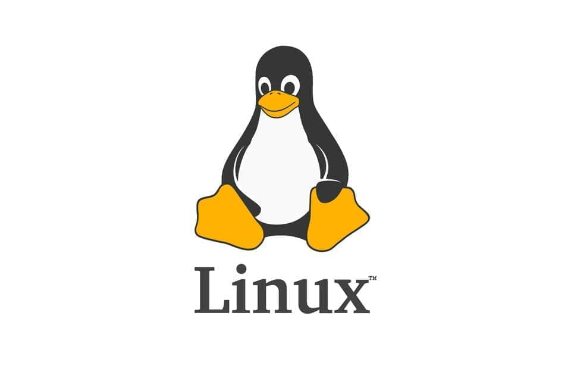
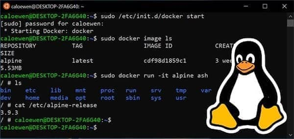
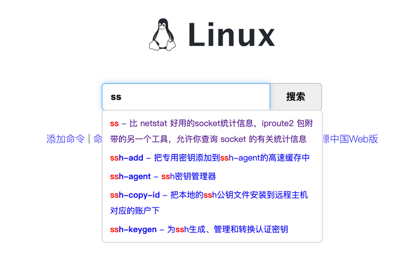
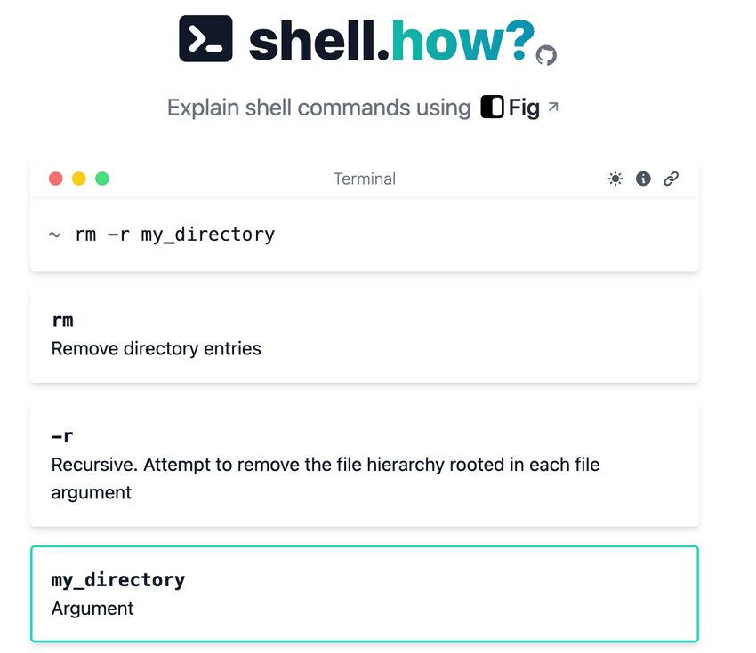

## A First Look at Linux

Linux is a free and open-source operating system kernel first released by Linus Torvalds in 1991. It is used in servers, embedded systems, mobile devices, and desktop computers. Strictly speaking, Linux is the kernel; the complete operating system combines it with user-space tools, libraries, and applications.


### The Origins of Linux

In 1989, Linus Torvalds began 11 months of compulsory military service in Finland, serving as a second lieutenant in the computer department and working on ballistic calculations. During this time, he bought a textbook by Andrew S. Tanenbaum along with MINIX source code and began studying operating systems. After leaving military service in 1990, he returned to university and began working with Unix.

> **MINIX** is a small Unix-like operating system created by Professor Tanenbaum for teaching. It uses a microkernel design and inspired the creation of the Linux kernel.

In 1991, Torvalds released the Linux kernel as open source. Linux uses a friendly penguin as its mascot.



### Common Linux Distributions



Torvalds released the Linux kernel, not a complete operating system. Organizations and vendors package the kernel with software, documentation, an installer, and tools for configuration and system management to create Linux distributions.

> The kernel primarily manages memory, hardware devices, filesystems, and processes.

Distributions are often grouped into two broad categories:

- **Vendor-maintained distributions:** For example, Red Hat Enterprise Linux (RHEL), maintained and supported by Red Hat.
- **Community-maintained distributions:** For example, CentOS, based on RHEL, and Ubuntu, based on Debian.

CentOS Linux 8 stopped receiving maintenance at the end of 2021, and CentOS Linux 7 reached end of life in June 2024. CentOS Stream is now a continuously delivered upstream branch of RHEL, with a different role from the former stable RHEL-compatible rebuild.

For a new learning environment:

- For enterprise server environments and the RHEL ecosystem, consider Rocky Linux or AlmaLinux.
- For an accessible system with extensive learning resources and common desktop and server use, consider Ubuntu LTS.
- For a stable, lightweight community distribution, consider Debian.

If your organization still uses CentOS, learn the version that matches its environment. For a new installation, choose a distribution that is still maintained.

## The Linux Filesystem

### Filesystem Overview

Linux presents many resources as files, including network interfaces, disk drives, printers, I/O devices, ordinary files, and directories. This “everything is a file” idea comes from Unix, which abstracts resources as files so they can be managed through a common interface. For example, network interfaces and device files can be accessed through file-like operations.

This file-centered design gives Linux a flexible and extensible way to manage different resources.

### Inodes

An inode is fundamental to Linux/Unix filesystems. These points summarize what it does:

1. A disk traditionally exposes sectors as its smallest physical storage units; operating systems and filesystems usually read and write blocks composed of multiple sectors. A common traditional sector size is 512 bytes, while modern disks may use 4 KB physical sectors (for example, 512e or 4Kn). Filesystem blocks are also commonly 4 KB, but sectors and blocks are not the same thing. File metadata such as permissions, size, modification time, and data-block or extent mappings is usually recorded in an inode. An inode number is unique only within its filesystem; multiple hard-link directory entries can refer to the same inode. SSDs do not have traditional mechanical-disk physical sectors, but still expose logical block interfaces.
2. On filesystems such as ext2, ext3, and ext4, the on-disk inode table is sized when the filesystem is created. Other Linux filesystems may organize metadata differently.
3. An inode can be found by its number without searching through every file's contents. A path still needs directory lookup; an inode number is not a globally stable file identifier.
4. ext2/ext3/ext4 set the available inode count when the filesystem is created. If the inodes are exhausted, new files cannot be created even if data blocks remain. Not every Linux filesystem uses a fixed inode table, so consider the filesystem implementation when diagnosing this.
5. Use `stat` to inspect an inode number, file type, permissions, owner, size, and modification time.

In short, an inode records information such as the file's blocks, owner, creation time, permissions, and size.

The distinction between inode and block is:

- **Inode:** Records file attributes and metadata; inspect it with `stat`.
- **Block/extent:** Stores file content or describes a contiguous range of data blocks. Allocation and sharing depend on the filesystem; a block does not always belong to exactly one file.


Linux/Unix filesystems use inodes to identify filesystem objects. Renaming a file within the same filesystem usually changes a directory entry without changing its inode number. After the last hard link is removed and no process has the file open, the inode can be freed and its number reused later.

Because users and applications usually work with paths rather than inode numbers, inode details are accessed through filesystem interfaces and system commands.

### Hard Links and Symbolic Links

Hard links and symbolic links work differently on Linux and Unix-like systems. A hard link is another directory entry pointing to the same inode. A symbolic link is a special file with its own inode that stores a target path.

**1. Hard links**

- A hard link has the same inode number as the original name; both names are equal from the filesystem's perspective.
- Removing one name does not affect the other. File data is removed only after the original name and all hard links are deleted and no open references remain.
- Ordinary hard links cannot be created for directories or nonexistent files, and they cannot cross filesystem boundaries.
- Use `ln` to create a hard link.

**2. Symbolic links (symlinks)**

- A symlink has its own inode and points to a path.
- If the target is removed, the symlink remains but points to an invalid path.
- A symlink is similar to a shortcut in Windows.
- Symlinks can point to directories and nonexistent paths, and can cross filesystems.
- Use `ln -s` to create a symlink.

**Why can't a hard link cross a filesystem boundary?** Each filesystem has its own inode namespace. A directory entry can refer only to an inode in its own filesystem, so it cannot directly point to an inode in another filesystem. This is not merely a risk of inode-number collisions.

### Linux File Types

Important Linux file types include regular files, directories, links, device files, pipes, and sockets.

- **Regular file (`-`):** Stores data such as images, audio, PDFs, text, video, or source code. Users can view, change, or delete it according to permissions.
- **Directory (`d`):** A file that organizes filenames and subdirectories. Opening a directory means opening its directory file.
- **Symbolic link (`l`):** Stores a target path. The kernel resolves that path when the link is accessed.
- **Character device (`c`):** Provides access to character devices such as a keyboard.
- **Block device (`b`):** Provides access to block devices such as disks.
- **Pipe (`p`):** A special file used for interprocess communication.
- **Socket (`s`):** Used for network communication between processes and for local IPC.

Use commands such as `ls` and `file` to inspect file types:

```bash
# Regular file (-)
-rw-r--r--  1 user  group  1024 Apr 14 10:00 file.txt

# Directory (d)
drwxr-xr-x  2 user  group  4096 Apr 14 10:00 directory/

# Socket (s)
srwxrwxrwx  1 user  group     0 Apr 14 10:00 socket
```

### The Linux Directory Tree

Linux organizes files and directories in a hierarchy called the directory tree. It starts at the root directory `/` and branches into directories and subdirectories. A directory can contain files and more directories.


Common directories include:

- **`/bin`:** Essential executable commands such as `ls`, `cat`, and `mkdir`.
- **`/etc`:** System administration and configuration files.
- **`/home`:** Home directories for ordinary users. For example, user `user` may have `/home/user`, also addressable as `~user`.
- **`/usr`:** User-space applications and related files.
- **`/opt`:** Optional, separately installed application packages; for example, Tomcat may be installed here.
- **`/proc`:** A virtual filesystem that exposes kernel and process information.
- **`/root`:** The root administrator's home directory.
- **`/sbin`:** System administration programs, traditionally intended mainly for root, such as `ifconfig`.
- **`/dev`:** Device files.
- **`/mnt`:** A conventional temporary mount point for filesystems.
- **`/boot`:** Files used to boot the system.
- **`/lib` and `/lib64`:** Libraries needed by system programs.
- **`/tmp`:** Temporary files, commonly shared by users.
- **`/var`:** Variable data such as service logs and other runtime files.
- **`/lost+found`:** On some filesystems, recovered files found after an unclean shutdown.

## Common Linux Commands

This section lists commonly used commands.

For quick command lookup, see [Linux Command](https://wangchujiang.com/linux-command/).



[shell.how](https://www.shell.how/) can explain common commands, including Linux commands, Git, and NPM.



### Changing Directories

- `cd usr`: Enter the `usr` directory under the current directory.
- `cd ..` (or `cd ../`): Move to the parent directory.
- `cd /`: Go to the filesystem root.
- `cd ~`: Go to the current user's home directory.
- `cd -`: Return to the previous working directory.

### Directory Operations

- `ls`: List files and subdirectories, for example `ls /home`.
- `ll`: Common alias for `ls -l`; shows detailed information about files and directories.
- `mkdir [options] directory`: Create a directory. For example, `mkdir -m 755 my_directory` creates a directory where the owner can read, write, and enter it, while the group and others can read and enter it but cannot create or delete entries. Use mode `777` if all users should have read, write, and execute permissions: `mkdir -m 777 my_directory`.
- `find [path] [expression]`: Search a directory tree. Examples: `find .` lists entries; `find /home -name "*.txt"` finds names ending in `.txt`; `find /home -iname "*.txt"` ignores case; `find . \( -name "*.txt" -o -name "*.pdf" \)` searches for either extension.
- `pwd`: Print the current working directory.
- `rmdir [options] directory`: Remove an empty directory. `rmdir -p my_directory` also removes empty parent directories until it reaches a nonempty directory or the root.
- `rm [options] file-or-directory`: Remove a file or directory. `rm -r my_directory` recursively removes the directory and its contents.
- `cp [options] source destination`: Copy a file or directory. `cp file.txt /home/file.txt` copies a file; `cp -r source destination` recursively copies a directory tree.
- `mv [options] source destination`: Move or rename a file or directory. Unlike `cp`, moving does not create another copy of the file.

### File Operations

Commands such as `mv`, `cp`, and `rm` apply to files and directories and are listed above.

- `touch [options] filename...`: Create files or update timestamps. `touch file1.txt file2.txt file3.txt` creates three files if they do not exist.
- `ln [options] source link`: Create a hard or symbolic link. For example, `ln -s file.txt file_link` creates a symbolic link; `-s` means symbolic.
- `cat`, `more`, `less`, `tail filename`: View file contents. `tail -f catalina-2016-11-11.log` follows a changing log file.
- `vim filename`: Edit a file. A common workflow is: open the file, press `i` to enter insert mode, edit it, press `Esc`, then enter `:wq` to save and exit or `:q!` to exit without saving. Vim is often used to edit configuration files.

### Archive and Compress Files

**1. Create a compressed archive**

Linux tar archives commonly use the `.tar` extension; gzip-compressed tar archives commonly use `.tar.gz`.

```bash
tar -zcvf archive.tar.gz files-or-directories
```

Options: `z` uses gzip, `c` creates an archive, `v` displays progress, and `f` specifies the archive filename. For example, archive files in `test` with `tar -zcvf test.tar.gz aaa.txt bbb.txt ccc.txt`, or archive the directory with `tar -zcvf test.tar.gz /test/`.

**2. Extract an archive**

```bash
tar -xvf archive.tar.gz
tar -xvf archive.tar.gz -C /usr
```

`x` extracts. The second command extracts into `/usr`; `-C` specifies the destination directory.

### Transfer Files

- **`scp [options] source destination`:** Securely copies files over SSH. For example, `scp -r my_directory user@remote:/home/user` uploads a directory. To download, use `scp -r user@remote:/home/user/my_directory .`. An SSH connection and suitable authentication and permissions are required.
- **`rsync [options] source destination`:** Efficiently copies files locally or remotely and can transfer only changes. For example, `rsync -r my_directory user@remote:/home/user` uploads a directory.
- **`ftp`:** Connects to an FTP server for file transfers. After logging in, commands include `put` to upload, `get` to download, and `delete` to remove a remote file. FTP should be used with an understanding of its security limitations.

### File Permissions

Files have permissions, an owner, and a group. Linux permissions generally grant read, write, and execute access separately to the owner, group, and other users.

Use `ls -l` to inspect permissions:


The first column shows the file type and permissions:

- `d`: Directory.
- `-`: Regular file.
- `l`: Symbolic link.
- `r`: Read permission; numeric value 4.
- `w`: Write permission; numeric value 2.
- `x`: Execute permission; numeric value 1.

Read, write, and execute have different meanings for files and directories:

| Permission | File                                  | Directory                                           |
| ---------- | ------------------------------------- | --------------------------------------------------- |
| `r`        | Read contents, for example with `cat` | List directory entries                              |
| `w`        | Modify contents                       | Create or remove entries, subject to other controls |
| `x`        | Execute as a program, if applicable   | Enter/search the directory                          |

Root commonly has capabilities that let it bypass ordinary discretionary access control (DAC) checks, but this does not bypass every restriction, such as capabilities, LSM policy, mount options, or immutable flags. Do not assume that root can always access or execute an object with mode `000`.

Every Linux user has a primary group, and files have an owner, group, and other-user permissions:

- **Owner (`u`):** Usually the user who created the file. Use `ls -ahl` to inspect ownership and `chown user filename` to change it.
- **Group (`g`):** The file's group, often the creator's primary group. Use `ls -ahl` to inspect it and `chgrp group filename` to change it.
- **Others (`o`):** Users who are neither the owner nor members of the file's group.

Use `chmod` to change permissions. For example, give the owner all permissions, the group read/write, and others read-only:

```bash
chmod u=rwx,g=rw,o=r aaa.txt
chmod 764 aaa.txt
```


### Managing Services at Startup

Most current Linux distributions use systemd to manage services. To configure a `zookeeper.service` unit to start at boot, use:

```bash
sudo systemctl enable zookeeper
sudo systemctl start zookeeper
sudo systemctl status zookeeper
```

After editing a service file, run `sudo systemctl daemon-reload` so systemd reloads the configuration. `chkconfig --add zookeeper` and `chkconfig --list` are from the SysV init era and are mainly relevant to older or compatibility environments.

### User Management

Linux is a multiuser, multitasking time-sharing system. Users generally need an account before using system resources. Accounts help administrators track users and control access, and provide users with organized files and protection.

Common user commands:

- `useradd [options] username`: Create a user account; account details are stored in system databases such as `/etc/passwd`.
- `userdel [options] username`: Delete an account.
- `usermod [options] username`: Change account properties such as username, user ID, or home directory.
- `passwd [options] username`: Set authentication information and password aging. `passwd -S username` shows password status; `passwd -d username` clears the password field, though whether empty-password login is allowed depends on PAM and the login service; `passwd -l username` locks password authentication but may leave other methods such as SSH keys available; `passwd username` changes the password.
- `su [options] username`: Switch to another user identity.

### Group Management

Groups let administrators manage permissions for multiple users together. Group behavior varies by distribution; many systems create a same-named primary group when creating a user.

Group management updates the system's group database, commonly `/etc/group`:

- `groupadd [options] group`: Create a group.
- `groupdel group`: Delete a group.
- `groupmod [options] group`: Modify a group's properties.

### System Status

- `top [options]`: View CPU and memory use and process information in real time.
- `htop [options]`: Interactive alternative to `top`, with color, scrolling, and mouse support.
- `uptime [options]`: Show system uptime and load averages.
- `vmstat [interval] [count]`: Report process, memory, I/O, and overall virtual-memory statistics.
- `free [options]`: Show memory use, including used, available, buffer, and cache figures.
- `df [options] [filesystem]`: Show filesystem capacity and usage. `df -a` includes all filesystems.
- `du [options] [file]`: Show disk space used by files or directories.
- `sar [options] [interval] [count]`: Collect and report performance statistics for CPU, memory, disk I/O, and networking. It can sample repeatedly and save data with relatively low overhead.
- `ps [options]`: Show process IDs, states, and resource use. `ps -ef` and `ps aux` use different output formats. For example, `ps aux | grep redis` searches for Redis; `pgrep redis -a` is another option.
- `systemctl [command] [unit]`: Inspect or manage services and systemd units.
- `journalctl [options]`: Read systemd logs. For example, `journalctl -u nginx -f` follows an Nginx service log, and `journalctl -xe` shows recent error context.

### Networking

- `ping [options] host`: Test network reachability.
- `ifconfig` or `ip`: Inspect network interfaces, addresses, and state. `ip` is the modern general-purpose tool.
- `netstat [options]`: Show connections and network statistics.
- `ss [options]`: A faster, more detailed tool for inspecting sockets and connections; generally preferred over `netstat`.
- `nload`: Display live network traffic in a terminal interface. `sar` can also monitor traffic and store historical samples; `nload` is more visual but does not save history and may need to be installed.
- `sudo hostnamectl set-hostname new-name`: Set a persistent hostname. `sudo hostname new-name` changes it temporarily and the change may be lost on reboot.

### Other Commands

- `sudo command`: Run a command with privileges granted by the sudo policy; this is not necessarily equivalent to unrestricted root access.
- `grep [options] "pattern" path`: Search files or command output using a string or regular expression. For example, `grep -i "error" /var/log/syslog` searches case-insensitively, and `ps -ef | grep "java"` searches process output.
- `kill -9 pid`: Forcefully terminate a process. Prefer a graceful signal first when possible; find the PID with tools such as `ps`.
- `shutdown -h now`: Shut down now. `shutdown +5 "System will shutdown after 5 minutes"` schedules shutdown in five minutes and sends a warning to logged-in users.
- `reboot`: Restart the system. `reboot -w` records a simulated reboot without actually restarting.

## Linux Environment Variables

Environment variables define parts of the process environment, such as a user's home directory (`HOME`).

### Environment Variable Scope

By scope, environment configuration commonly includes:

- User-level files such as `~/.bashrc` and `~/.bash_profile`.
- System-level files such as `/etc/bashrc`, `/etc/environment`, `/etc/profile`, and `/etc/profile.d`.

There is no single load order for every shell. It depends on whether the shell is a login shell, an interactive non-login shell, or a noninteractive shell. For Bash, a login shell usually reads `/etc/profile`, then the first existing readable file among `~/.bash_profile`, `~/.bash_login`, and `~/.profile`. An interactive non-login shell usually reads `~/.bashrc`. Many distributions load `~/.bashrc` from `~/.bash_profile`, so the effective chain depends on the default configuration.

Editing system-level environment files requires administrator write access. A common convention is to put user settings in `~/.bash_profile` and system settings in `/etc/profile.d`.

By lifetime, variables can be:

- **Persistent:** Stored in a configuration file and loaded in future sessions.
- **Temporary:** Exported in the current shell; they disappear when that shell exits.

### Read Environment Variables

Use `export -p` or `env` to list environment variables:

```bash
# List environment variables
export -p
```

Use `echo` to print a particular value:

```bash
# Print PATH
echo $PATH
# Print HOME
echo $HOME
```

### Change Environment Variables

Use `export` to change a variable in the current shell. The change takes effect immediately but is not persistent after the shell exits:

```bash
export JAVA_HOME="/path/to/jdk"
export PATH="$JAVA_HOME/bin:$PATH"
```

To make a change persistent, edit a configuration file. User-level settings affect the current user; system-level settings affect all users:

```bash
vim ~/.bash_profile
```

Reload the file with `source`, or log in again:

```bash
source ~/.bash_profile
```

<!-- @include: @article-footer.snippet.md -->
