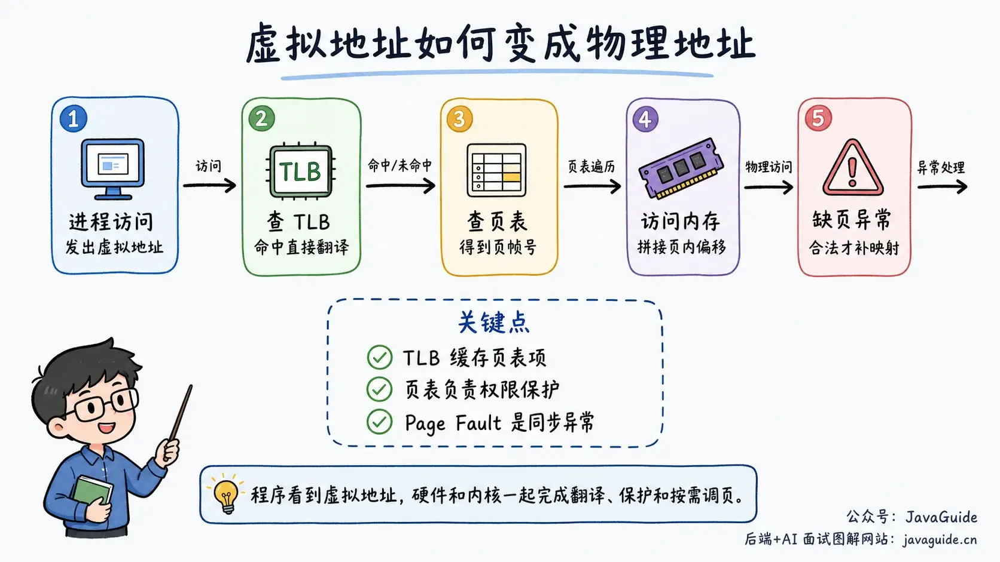
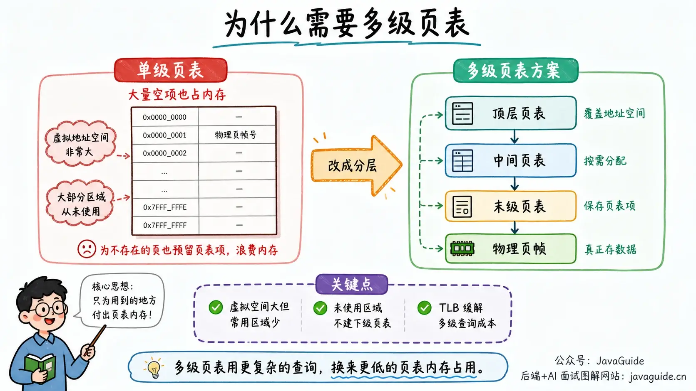
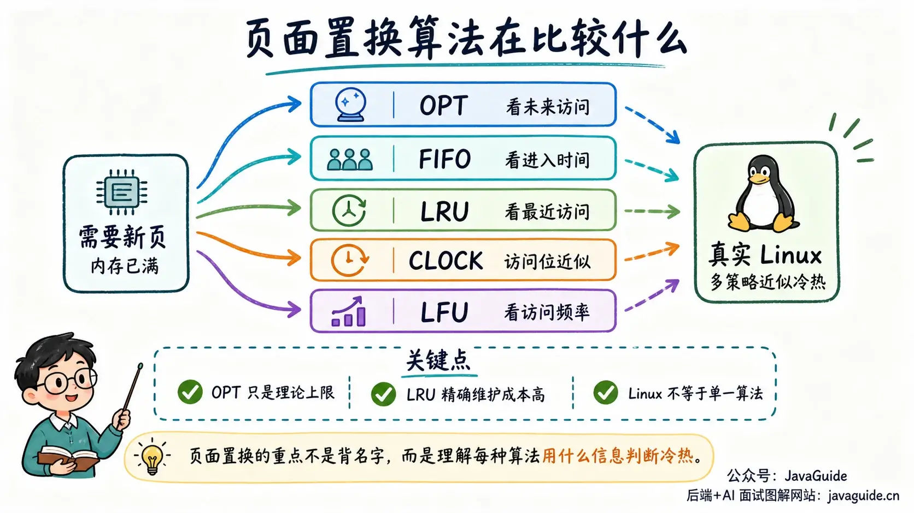

Inspect the memory information for an ordinary process and you will see numbers that can seem counterintuitive. Each process has its own virtual address space, which may be large; its actual physical memory use is a different matter. The same shared library may also be used by multiple processes.

Programs simply access addresses, but the operating system has to answer more specific questions: Who owns this memory? Can another process access it? Which pages should be evicted when physical memory is low? Can a free space left behind still be reused?

Memory management handles these questions. Rather than starting with terms such as paging, segmentation, and TLB, follow this idea: **the operating system separates the addresses a program sees from physical memory, then manages memory through allocation, mapping, protection, and reclaim.**

## What Do VSZ, RSS, and PSS Mean?

Process memory figures on Linux are easy to misread. VSZ in `ps` and `VmSize` in `/proc/<pid>/status` show the size of a process's mapped virtual address space. This may include anonymous and file-backed mappings that are not resident, shared libraries, and reserved address ranges. It is not the same as physical memory use.

RSS is the total amount of RAM currently resident and mapped into the process. Shared libraries, shared memory, and shared Page Cache pages are counted in the RSS of every process that maps them, so adding the RSS values of several processes can double-count memory.

PSS is more useful for estimating a process's proportional share. If four processes share one physical page, each process's PSS includes one quarter of that page. To see a summary, use:

```bash
grep -E 'VmSize|VmRSS|RssAnon|RssFile|RssShmem|VmSwap' /proc/<pid>/status
cat /proc/<pid>/smaps_rollup
```

`smaps_rollup` gives a process-level summary. To inspect individual mappings, use `/proc/<pid>/smaps`. Reading the full file traverses the process's VMAs and page tables, so avoid collecting it too frequently in production.

## What Does Memory Management Do?

From the operating system's perspective, memory management has at least five responsibilities.


**First, allocate and reclaim memory.** User-space `malloc()` and `free()` manage blocks in a process heap. For example, glibc may use interfaces such as `brk()` and `mmap()` to expand the available virtual address range. After the virtual range is created, physical pages are usually established on first access through the page-fault path. Inside the kernel, page allocators and object allocators such as SLAB/SLUB manage physical pages and kernel objects.

**Second, translate addresses.** Programs use virtual addresses, while physical addresses identify locations in RAM. The CPU's MMU works with page tables and the TLB to translate virtual addresses to physical addresses.

**Third, isolate processes and enforce permissions.** Each process has its own address space. Address `0x1000` in process A can map to a different physical page than `0x1000` in process B. Page-table entries can also mark pages as readable, writable, or executable; an access that violates these permissions raises an exception.

**Fourth, reclaim pages when physical memory is low.** Clean file-backed pages can be discarded and read from the file again when needed. Dirty file pages usually need to be written back first. Anonymous pages may need to be written to Swap before they can be reclaimed. Linux chooses pages using factors such as page activity, refaults, memory watermarks, cgroups, and `swappiness`; it does not always reclaim one fixed page type first.

**Fifth, support sharing and mappings.** Shared libraries, shared-memory IPC, file mappings with `mmap()`, and copy-on-write (COW) all rely on the ability to map multiple virtual addresses to the same physical pages.

## What If There Were No Memory Abstraction?

In early or very small systems, programs could access physical addresses directly. That can work with one program, but multiple programs quickly create problems.

Suppose program A writes data to physical address 1000, and program B also stores one of its variables at address 1000. Neither knows about the other, so whichever writes last overwrites the other's data. Worse, an ordinary user program could write into the operating system's own memory, making the system unstable.

The solution is an **address space**. Each process sees its own set of addresses, usually containing code, data, heap, stack, and memory-mapped regions. A process uses virtual addresses; the operating system and hardware decide which physical pages back them.

This provides a basis for process isolation, on-demand loading, shared memory, and COW.

## Contiguous Allocation and Fragmentation

The simplest allocation model is contiguous allocation: the operating system finds one continuous region of physical memory large enough for a process. Early systems often used fixed or variable-sized partitions.

The problem with contiguous allocation is fragmentation.


**Internal fragmentation** is allocated space that is not actually used. For example, if memory is allocated in 128-byte units and an object needs only 65 bytes, the remaining 63 bytes in that unit are wasted.

**External fragmentation** occurs when the total free space is large enough, but is split into noncontiguous pieces that cannot satisfy a large contiguous request. For example, two free regions of 128 MB provide 256 MB in total, but cannot satisfy a request for one contiguous 200 MB region.

Common variable-partition strategies include first fit, best fit, and worst fit. They change where and how quickly fragmentation appears, but do not eliminate external fragmentation. Compaction moves movable pages to bring scattered free pages together into a larger contiguous physical region. It is different from Swap I/O, but synchronous compaction can use CPU, migrate many pages, and cause latency spikes.

## What Does Linux's Buddy System Solve?

Linux uses the **buddy system** to manage physical pages. It organizes free memory into blocks sized as powers of two, such as 4 KB, 8 KB, 16 KB, and 32 KB. To satisfy an allocation, it finds the smallest suitable block. If the block is too large, it repeatedly splits it in two. On free, adjacent free buddies can be merged into a larger block.

The split and merge rules are simple. The system can find contiguous physical pages quickly and reduce external fragmentation.

It can still waste space: the buddy system allocates `2^order` contiguous physical pages. With 4 KB base pages, a kernel caller that needs at least 65 KB of contiguous physical memory may request 32 pages, or a 128 KB order-5 block, wasting some of it. This example concerns a kernel request for contiguous physical pages; it does not mean that user-space `malloc(65KB)` directly receives a 128 KB buddy block.

The buddy system manages physical memory in page-sized units. The kernel also needs many objects smaller than a page, such as file objects, inodes, and network buffer structures. Allocating a whole page for each would waste too much memory. Linux uses allocators such as SLAB/SLUB above the buddy system to cache and reuse objects by size, reducing the cost of frequent allocation, initialization, and freeing.

## How Do Segmentation, Paging, and Segmented Paging Differ?

An address space can be divided in several ways. Operating system textbooks commonly discuss segmentation, paging, and segmented paging.

| Method           | How it divides memory                                             | Address format                                       | Benefit                                                                                                              | Main problem                                                          |
| ---------------- | ----------------------------------------------------------------- | ---------------------------------------------------- | -------------------------------------------------------------------------------------------------------------------- | --------------------------------------------------------------------- |
| Segmentation     | By logical program regions such as code, data, and stack          | Segment number + offset                              | Matches program structure; supports sharing and protection                                                           | Variable segment sizes can cause external fragmentation               |
| Paging           | Virtual and physical memory are split into fixed-size units       | Page number + offset                                 | Physical memory can be allocated noncontiguously, reducing external fragmentation from contiguous process allocation | Page tables use memory; the last page may have internal fragmentation |
| Segmented paging | Divide into logical segments, then divide each segment into pages | Segment number + page number within segment + offset | Combines logical protection with noncontiguous allocation                                                            | More complex address translation                                      |

Modern general-purpose operating systems mainly use paging. x86 hardware historically supported both segmentation and paging. In x86-64 long mode, Linux's ordinary user address space mainly relies on paging, with traditional code and data segments mostly using a flat model. FS and GS still have practical uses; FS is often used for user-space thread-local storage (TLS).

One point that textbooks may simplify: paging reduces external fragmentation caused by requiring a process's address space to be contiguous, but it does not eliminate fragmentation in physical memory. DMA, huge pages, and some kernel allocations may still require contiguous physical pages. The system can have enough free memory in total and still fail to find a high-order contiguous block, so the kernel also uses buddy merging and compaction.

## How Does Paging Translate Addresses?

Paging divides virtual address space into fixed-size virtual pages and physical memory into page frames of the same size. A page is commonly 4 KB on Linux x86-64, though page sizes depend on the architecture and configuration.

A virtual address has two parts:

- **Virtual page number:** Used to look up the corresponding physical page frame in the page table.
- **Page offset:** Identifies a location within that page.

In broad terms, the CPU issues a virtual address, the MMU uses the virtual page number to look up a page-table entry, then combines the physical frame number with the page offset to form the physical address.



A page-table entry stores more than a physical frame number. It can include a present bit, read/write permissions, user/kernel permissions, a dirty bit, and an accessed bit. The present bit indicates whether the page is in physical memory; permission bits enforce protection; accessed and dirty bits can inform reclaim decisions.

## Why Use Multilevel Page Tables?

A single-level page table is easy to understand, but uses too much memory.

For a 32-bit address space with 4 KB pages, a process has 4 GB of virtual address space and needs `4 GB / 4 KB = 2^20` page-table entries. If each entry takes 4 bytes, its page table uses about 4 MB. With many processes, this memory adds up.

Most processes do not use their entire virtual address space. A single-level page table still needs entries for the whole range, many of them empty.

Multilevel page tables are hierarchical. The top level covers the whole virtual address space, and lower-level tables are created only when needed. If a virtual-address range is unused, the corresponding lower-level table need not exist. Linux's architecture-independent page-table code uses a five-level hierarchy; levels that are not supported by the architecture or machine are folded.



Traditional x86-64 configurations usually use four-level paging. Five-level paging is used only when the CPU, kernel, and configuration support LA57. Linux documentation says five-level paging can provide a 56-bit user-space virtual address range. To preserve compatibility with programs that use high pointer bits, the kernel does not normally allocate addresses above 47 bits unless an application explicitly requests a high address hint.

## Why Does the TLB Matter?

Multilevel page tables save memory, but address translation may require several memory accesses. Looking up every level of the page table for every data access would be too expensive.

The TLB (Translation Lookaside Buffer) is a cache of page-table entries, usually in the MMU. The CPU checks it first:

- **Hit:** The physical page frame is available immediately.
- **Miss:** The CPU walks the multilevel page table, then caches the result in the TLB.

Programs have locality: they are likely to reuse recently accessed pages, and nearby addresses are often accessed soon after one another. The TLB benefits from this locality.

This is one reason huge pages can help. With 4 KB pages, one TLB entry covers 4 KB; with a 2 MB huge page, one entry covers a larger address range, which may reduce TLB misses. Huge pages also have higher allocation and reclaim costs. Whether a database or JVM should use THP or HugeTLB depends on its latency and throughput goals and should be measured.

## What Happens During a Page Fault?

Virtual memory does not load every page into physical memory when a process starts. Many pages are loaded only on first access, a technique called demand paging.

A Page Fault is a synchronous processor exception caused by the current instruction, not an asynchronous hardware interrupt from an external device.

When a process accesses a virtual page and the MMU cannot find a valid translation, it raises a page fault and enters the kernel. The kernel first checks whether the address belongs to a valid VMA and whether the access is permitted. An invalid address or permission violation usually becomes `SIGSEGV`. A valid fault is handled according to the mapping: the kernel may map an existing Page Cache page, establish an anonymous zero page, perform COW, allocate a page, or read data from a file or Swap. It updates the page table and retries the instruction.

Linux's `getrusage(2)` reports two main categories:

- **Minor fault:** No actual I/O is required. For example, a page may already be in memory but lack a mapping in the current process; COW is also commonly counted as a minor fault.
- **Major fault:** I/O is required, such as reading a page from a disk file or Swap.

Major faults are much slower than minor faults. In production, a fast increase in `majflt` is usually more concerning than `minflt`.

## Page Replacement: Which Page Should Be Evicted?

When physical memory is full and a new page must be loaded, the system needs to reclaim pages. Page replacement asks which page to evict to minimize the effect on future accesses.



The ideal algorithm is OPT: evict the page that will not be accessed for the longest time in the future. It is a theoretical bound because the operating system cannot know future accesses. FIFO is simpler: evict the page that entered memory first. It ignores whether a page is still hot and can exhibit Belady's anomaly, where adding more frames increases the number of faults.

LRU evicts the page that has gone the longest without an access. It relies on locality: a recently used page is likely to be used again soon. Exact LRU is expensive because the system must maintain access order, such as with timestamps or a list updated on every access. CLOCK approximates LRU at lower cost. It gives each page a reference bit and arranges the pages in a ring. When choosing a victim, it clears the bit and gives a recently used page a second chance; the first page it finds with a clear bit is evicted. LFU instead evicts the least frequently used page. Without aging, an old hot page can retain a high count long after it stops being useful.

| Algorithm | Eviction rule                                 | Cost                      | Behavior             | Practical use                           |
| --------- | --------------------------------------------- | ------------------------- | -------------------- | --------------------------------------- |
| OPT       | Page whose next use is farthest in the future | Impossible to implement   | Theoretical optimum  | Benchmark only                          |
| FIFO      | Page that entered memory earliest             | Very low                  | May evict a hot page | Implementable                           |
| LRU       | Page least recently accessed                  | High (timestamps or list) | Close to OPT         | Exact software implementation is costly |
| CLOCK     | Reference bit and circular scan               | Low                       | Approximates LRU     | Common approximation                    |
| LFU       | Page with fewest accesses                     | Medium (needs counters)   | Workload-dependent   | Often combined with aging               |

These are textbook algorithms for understanding the tradeoffs. The Linux kernel does not simply pick one of OPT, FIFO, LRU, or CLOCK. It uses mechanisms such as active and inactive LRU lists, workingset detection, and refault tracking. Reclaim also differs for file and anonymous pages and is affected by NUMA, cgroups, and memory watermarks. Saying “Linux uses CLOCK” is not accurate.

## Swap, Working Sets, and Thrashing

Swap is not “extra memory”; it is a slower backing area. Anonymous pages have no file from which to reload them, so when memory is tight, the kernel may write them to Swap before reclaiming them. If they are accessed again, the kernel reads them back.

A process's actively used pages form its **working set**. If physical memory can hold the main working sets of the processes on the system, page faults remain manageable. If it cannot, pages may be swapped out and back in repeatedly, and the system can start thrashing.

During thrashing, the CPU may not spend much time on application work. Disk I/O, major faults, and memory reclaim become prominent. Useful metrics include:

```bash
# System-wide
free -h
vmstat 1
cat /proc/meminfo
cat /proc/pressure/memory
grep -E 'pgfault|pgmajfault|pswpin|pswpout|pgscan|pgsteal' /proc/vmstat

# Per process
grep -E 'VmSize|VmRSS|RssAnon|RssFile|RssShmem|VmSwap' /proc/<pid>/status
cat /proc/<pid>/smaps_rollup
pmap -x <pid>
perf stat -e page-faults,major-faults <command>

# Container / cgroup v2
cat /sys/fs/cgroup/memory.current
cat /sys/fs/cgroup/memory.max
cat /sys/fs/cgroup/memory.events
cat /sys/fs/cgroup/memory.pressure
```

Read these metrics by source. For a process, use RSS/PSS and `smaps_rollup` to see whether resident memory is anonymous, file-backed, or shared. For faults, check `pgmajfault` and `major-faults` to see whether I/O is involved or mappings are simply being established. For the system, check Swap, reclaim scans, and PSI to see whether memory pressure is affecting application latency.

Do not rely only on `free`. Linux uses otherwise free memory for Page Cache, so a low `MemFree` value does not necessarily mean the system is under heavy pressure. Consider `MemAvailable`, Swap activity, major faults, reclaim scans, and PSI. In PSI, `some` means at least one task is stalled by memory pressure; `full` means all non-idle tasks are stalled by that resource at the same time, which often reflects memory pressure's effect on latency more clearly.

## Overcommit and OOM: A Successful Allocation Does Not Reserve Physical Memory

Linux can allow the virtual memory promised to processes to exceed the available RAM and Swap. This is called **memory overcommit** and is useful for programs that reserve a large address space but use only part of it.

`vm.overcommit_memory` commonly has three modes:

- `0`: Use heuristic checks and reject obviously unreasonable requests.
- `1`: Allow allocations as far as possible, until resources are actually exhausted.
- `2`: Apply a stricter commit limit.

Therefore, a successful `malloc()` or `mmap()` usually means the address-space and commit checks passed; it does not mean that all corresponding physical pages are resident. When pages are accessed, if the kernel cannot get enough memory through reclaim, writeback, or Swap, the OOM Killer may terminate a process to free resources.

In a container, an OOM event can happen at the cgroup level first. The host may still have available memory while a container hits its `memory.max` limit. In cgroup v2, `memory.events` records events such as `high`, `max`, `oom`, and `oom_kill`.

## `mmap`, COW, and Shared Memory

`mmap()` creates a mapping in a process's virtual address space. It can map a file or create an anonymous mapping. Creating the mapping does not necessarily read data immediately; accessing a page that is not resident may trigger a page fault.

File mappings are useful for random access, sharing file pages, and accessing file contents by memory address. They can reduce explicit copies through user-space buffers and system calls, but are not guaranteed to be faster than `read()`/`write()`. Results depend on access patterns, page-fault costs, readahead, writeback, exception handling, and file size.

When several processes map the same file, the kernel can let them share physical pages in the Page Cache. Changes through `MAP_SHARED` can be visible to other mappings and written back to the file. `MAP_PRIVATE` creates a private COW mapping: writes are not propagated to other processes or written to the original file. Shared-memory IPC works similarly: different processes map the same physical pages at different virtual addresses, so they can exchange data without a kernel copy on every access.

COW (Copy-On-Write) is also common after `fork()`. The parent and child can initially share physical pages, marked read-only in their page tables. The first process to write triggers a page fault, and the kernel copies that page for the writer. This avoids copying the entire address space when `fork()` runs.

COW still has a cost. Redis creates a child process with `fork()` for an RDB snapshot while the parent continues handling writes. The more writes occur, the more pages are copied and the higher the memory pressure. This helps explain `fork()`, `mmap`, Page Cache, and memory peaks in databases and caches.

## How Does Memory Management Affect Java Backend Services?

Operating system memory management appears in everyday Java backend work.

**The JVM heap is part of virtual address space.** `-Xmx` limits the maximum Java heap, but process RSS also includes metaspace, thread stacks, JIT code cache, DirectBuffers, native libraries, and memory-mapped files. RSS exceeding `-Xmx` does not by itself prove a heap leak.

**Thread stacks use address space and physical pages too.** A large number of platform threads increases stack, scheduling, TLB, and cache costs. Virtual threads reduce the dependency on platform threads for many blocking tasks, but CPU-bound work is still limited by the number of cores.

**DirectBuffers and mmap are outside the Java heap.** They are managed by the JVM or native code, but still use the process address space and physical pages. Do not rely only on GC logs when investigating them; also check NMT, `pmap`, `smaps_rollup`, and cgroup metrics.

HotSpot Native Memory Tracking (NMT) is disabled by default and must be enabled when the JVM starts:

```bash
-XX:NativeMemoryTracking=summary
# or
-XX:NativeMemoryTracking=detail

jcmd <pid> VM.native_memory summary
```

NMT reports native memory by JVM subsystem, such as Java Heap, Class, Code, and Thread. It is not a complete operating-system ledger for the process and does not cover every allocation made by third-party native libraries. Check RSS/PSS, `smaps_rollup`, and container memory limits too.

**Huge pages are not always beneficial.** They can reduce TLB pressure, but THP compaction, direct reclaim, huge-page zeroing, and COW can introduce latency variation. Redis documentation warns that RDB/AOF background work uses `fork()` and COW; under a write-heavy workload, additional memory can approach the process's normal memory use. THP can increase COW costs after `fork()`. Do not apply one rule to JVMs, databases, and caches; verify against product documentation and representative load tests.

## Belady's Anomaly: Can More Memory Cause More Page Faults?

It seems that more physical page frames should mean fewer page faults. FIFO provides a counterexample: **in some cases, adding frames increases the number of page faults**. This is Belady's anomaly, identified by László Bélády in the 1960s.

The classic reference string `1, 2, 3, 4, 1, 2, 5, 1, 2, 3, 4, 5` produces:

- 9 page faults with 3 frames.
- 10 page faults with 4 frames.

Adding a frame increased the fault count by one.

The reason is that FIFO does not have the **stack property**: the set of pages resident with `n` frames is not necessarily a subset of the pages resident with `n + 1` frames. Once that inclusion property fails, adding a frame can evict the wrong page.

Algorithms with the stack property have replacement priorities independent of the number of frames. OPT and LRU have this property, so increasing the number of frames cannot increase their fault counts. FIFO does not. Whether LFU exhibits Belady's anomaly depends on how it counts frequencies and breaks ties; it is not automatically immune.

Classic CLOCK approximates LRU but does not have LRU's strict stack property. In an extreme case, if all reference bits are set, it can behave like FIFO. Do not infer immunity to Belady's anomaly just because CLOCK approximates LRU. The safe summary is that FIFO has reference strings that trigger the anomaly, OPT and LRU do not, and the result for CLOCK or LFU depends on the exact definition.

The key point is that Belady's anomaly can affect non-stack algorithms such as FIFO. If adding memory appears to make performance worse, investigate replacement behavior before assuming the memory hardware is faulty.

## How Do These Concepts Apply in Practice?

Virtual memory is not limited to textbooks; it appears throughout application engineering.

**`mmap` and zero-copy:** `mmap()` maps a file into a process's virtual address space, so reading the file becomes memory access. Creating the mapping does not load the whole file; a page is loaded on demand when accessed. This can avoid one copy from a kernel buffer to a user buffer, which is why `mmap` appears in zero-copy approaches.

**Redis memory and fragmentation:** Redis is an in-memory database, but its allocated memory ultimately occupies physical pages. Its allocator, jemalloc by default, uses size classes and may waste some space. This resembles page-level internal fragmentation in that allocation granularity exceeds actual use, but one occurs in a user-space allocator and the other in the operating system's paging layer. They are different kinds of fragmentation. Redis persistence also uses `fork()` and COW: parent and child initially share physical pages, and a page is copied when one of them writes.

**The JVM heap:** A heap requested by the JVM is part of virtual address space. A large heap expands the range covered by page tables. Huge pages, such as 2 MB pages, can reduce the number of page-table entries and TLB pressure, potentially helping memory access during garbage collection. GC scanning can have poor locality, causing cache and TLB misses; it causes additional page faults only if the relevant pages are not resident, have been reclaimed, or the system is under memory pressure. This is one reason to consider TLB behavior when tuning a large heap.

Virtual memory sits between hardware page tables and TLBs on one side and databases, JVMs, and zero-copy systems on the other. It is a low-level concept that often appears in performance investigations.

## How to Explain Memory Management in an Interview

If asked what operating system memory management does, start with the main idea rather than listing paging and segmentation terms:

The operating system gives each process an independent virtual address space, then uses page tables, the TLB, and the MMU to translate virtual addresses to physical addresses. Page tables also record permissions and whether a page is resident, modified, or accessed. When physical memory is tight, the kernel reclaims file or anonymous pages according to factors such as page activity and memory watermarks, and may use Swap when needed.

If asked to compare paging and segmentation, explain how they divide the address space. Segmentation divides it into logical regions such as code, data, and stack. Because segments have variable sizes, they can cause external fragmentation and are harder to compact. Paging divides virtual and physical memory into fixed-size pages and records virtual-page-to-physical-frame mappings in page tables. This largely removes external fragmentation from contiguous allocation, though the last page may contain unused space.

For a page fault, describe the handling path: the CPU accesses a virtual address whose page-table entry is absent, whose page is not resident, or whose permissions do not allow the access. The kernel checks whether the access is valid. An invalid access usually becomes `SIGSEGV`; a valid one may map a Page Cache page, allocate an anonymous page, handle COW, or load a page from a file or Swap. A minor fault usually needs no I/O; a major fault does.

For production troubleshooting, add that textbook algorithms are only a model. Linux reclaim, THP, NUMA, cgroup memory limits, memory compression, and database caches all affect behavior. “LRU” alone rarely explains a real incident.
