Many readers find operating system topics broad and difficult to study, but they often come up in interviews. This guide starts with the basics and reviews common questions about **user and kernel modes, system calls, processes and threads, interprocess communication, CPU scheduling, and deadlocks**.

Use it as a quick interview checklist or as a starting point for review. Operating system ideas such as caching, scheduling, synchronization, memory mapping, zero-copy, and I/O multiplexing also appear in Redis, Kafka, Nginx, Netty, the JVM, and databases. Understanding the lower-level mechanisms makes higher-level frameworks and production performance issues easier to reason about.

This is a quick review that connects core concepts. For deeper study, pair it with textbooks and topic-specific guides. Some material draws on _Modern Operating Systems_, 3rd edition.

## Operating System Fundamentals


### What Is an Operating System?

An operating system (OS) can be described in four points:

1. It manages computer hardware and software resources and provides the foundation for applications.
2. It is software running on a computer that lets applications use hardware resources such as memory and disks.
3. It hides much of the complexity of the hardware and coordinates access to it.
4. The kernel is the core of the operating system. It manages memory, devices, filesystems, and processes, and connects applications to hardware. Its design affects system performance and stability.

The kernel and the central processing unit (CPU) are different:

1. The kernel is software in the operating system; the CPU is hardware.
2. The CPU executes instructions and performs computations. The kernel manages system resources such as memory and mediates access to hardware.

The diagram shows the relationship between applications, the kernel, and the CPU.

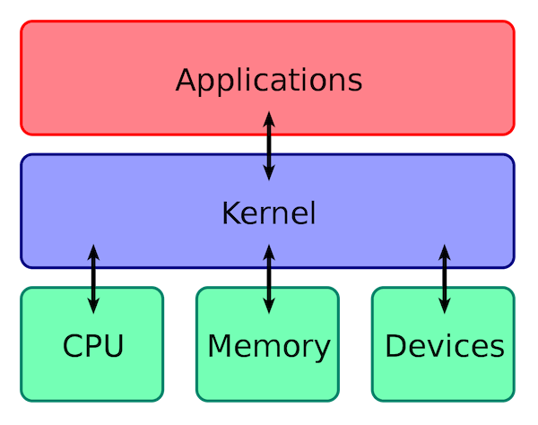

### What Are the Main Functions of an Operating System?

From a resource-management perspective, an operating system has six main responsibilities:

1. **Process and thread management:** Create, terminate, block, and wake processes, and support communication between them.
2. **Memory management:** Allocate and reclaim memory, translate addresses, isolate processes, reclaim pages, and manage secondary storage.
3. **Filesystem management:** Organize storage blocks as files and directories, and handle reads, writes, creation, deletion, permissions, and crash recovery.
4. **Device management:** Manage requests to and releases of input/output and external storage devices, and start device operations.
5. **Network management:** Configure and manage connections, communication, and security to provide reliable network services.
6. **Security management:** Authenticate users and control access to files and other resources.

Memory management and filesystems are common interview follow-ups. They are covered in [Common Operating System Interview Questions (Part 2)](./operating-system-basic-questions-02.md).

### Common Operating Systems

#### Windows

Windows is a widely used personal desktop operating system. It has a straightforward interface and a broad software ecosystem.

_Windows is useful for PC gaming, so I use one Windows machine for games and a Mac for development and study._


#### Unix

Unix was one of the most influential early multiuser, multitasking operating systems. Linux, BSD, and other Unix-like systems were influenced by it. The market share of traditional commercial Unix systems has declined, but Unix standards, certified systems, and design ideas remain in use.


#### Linux

**Linux is a free, open-source Unix-like operating system family.** Many distributions are available, and they all use the **Linux kernel**.

> Strictly speaking, Linux refers to the kernel. In GNU/Linux systems, the rest of the operating system is mainly made up of programs written or provided by the GNU project. The kernel alone is not a complete, usable operating system.
>
> Some people prefer the term “GNU/Linux” for the systems commonly called “Linux.”

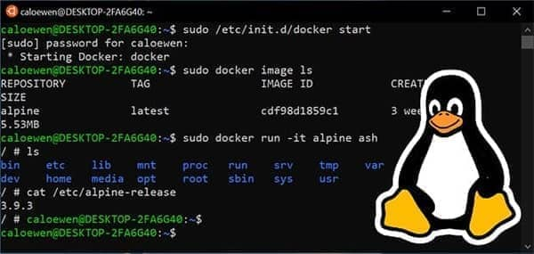

#### macOS

macOS is Apple's operating system. It offers a Unix-like development environment, polished interface, and broad software ecosystem.


### User Mode and Kernel Mode

#### What Are User Mode and Kernel Mode?

User mode and kernel mode describe CPU privilege levels. Application code normally runs in user mode. To access protected resources, the CPU enters kernel mode through a defined entry point, and the kernel performs the operation on the current thread's behalf.

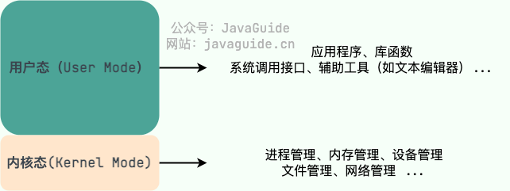

- **User mode:** Has fewer privileges. Code cannot execute privileged instructions, freely access kernel address space, or operate hardware directly. To read a file or send network data, an application requests a kernel service through a system call.
- **Kernel mode:** Has higher privileges and can perform operations such as managing page tables, interrupts, and devices. After a system call, interrupt, or synchronous exception enters the kernel, the CPU executes kernel code; the whole user process does not become a “kernel process.”

A transition between modes uses an architecture-defined entry point, saves necessary state, and checks permissions and arguments, so it costs more than an ordinary function call. It is not the same as a thread context switch: that occurs only when the scheduler switches execution entities.

#### Why Have User and Kernel Modes?

This design primarily provides **security** and **stability**:

- **Restrict privileged operations:** Changes to page tables, interrupt control, and device registers affect the whole system and are restricted to the kernel.
- **Isolate faults and permissions:** If every application ran with kernel privileges, a single out-of-bounds write or malicious program could corrupt other processes or kernel data.

Hardware privilege levels keep ordinary applications in a controlled environment and let the kernel manage shared system resources.

#### How Does the CPU Switch Between Modes?

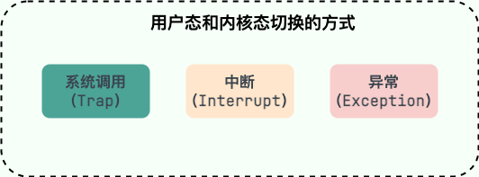

Three main types of events can move the CPU from user mode to kernel mode:

1. **System call (trap):** The application deliberately executes an instruction such as `syscall` or `ecall` to request a kernel operation such as `read()` or `send()`. It is synchronous because the current instruction triggers it.
2. **Hardware interrupt:** An external device such as a timer, network card, or disk raises an interrupt. It is asynchronous and unrelated to the current instruction.
3. **Synchronous exception:** The current instruction causes an event such as division by zero, an illegal instruction, or a Page Fault. An exception does not always mean the program has an error: lazy allocation, COW, and loading a file page can all cause a recoverable Page Fault.

Interrupts, exceptions, and system calls describe why the CPU enters the kernel. A signal is a software mechanism the kernel uses to notify a process or thread. An invalid memory access may first cause a Page Fault; if the kernel cannot fix it, the kernel can deliver `SIGSEGV` to the thread.

Entry details vary by architecture, but each event is routed to an appropriate kernel handler. See [Interrupts, Exceptions, and System Calls: From Kernel Entry to Page Faults](./interrupt-exception-syscall.md) for a full comparison and walkthrough.

### System Calls

#### What Is a System Call?

A system call is a controlled service interface provided by the kernel. Applications cannot directly operate a disk, page table, or network card, so they ask the kernel to perform those operations.

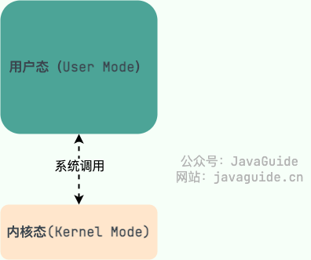

System calls can be grouped by purpose:

- **Device management:** Request, release, and start devices.
- **File management:** Read, write, create, and delete files.
- **Process management:** Create, terminate, block, and wake processes; support IPC.
- **Memory management:** Allocate and reclaim memory and inspect memory regions.
- **Network communication:** Create sockets, establish connections, and send or receive data.

A system call and a library function are not the same thing. An ordinary function call runs in user mode. A runtime wrapper such as glibc's `read()` prepares a system call number and arguments according to the ABI, then executes a special instruction to enter the kernel. Many library functions do not need a system call at all.

#### What Happens During a System Call?

Consider `read(fd, buf, count)` on Linux x86-64:

1. The glibc wrapper places the system call number and arguments in designated registers, then executes `syscall`.
2. The CPU enters kernel privilege level through the architecture's entry point. Kernel entry code saves the registers it needs, then dispatches to the `read` handler based on the system call number.
3. The kernel checks the file descriptor, user buffer, permissions, and file state. It then follows the appropriate VFS, filesystem, network-stack, or device-driver path.
4. If data is ready, the kernel completes the read and returns a result. If data is not ready, the current thread may wait while the scheduler runs another runnable task.
5. On completion, the result is returned in a register. On error, glibc usually converts the kernel error code to `-1` and sets `errno`.

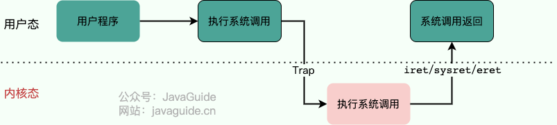

#### Does a System Call Always Cause a Context Switch?

A system call moves the CPU into kernel mode. If the kernel handles it quickly and returns to the same thread, there is a user/kernel mode transition but no thread switch.

If the system call must wait for I/O, a lock, or another resource, the current thread may block. The scheduler then chooses another runnable task, and a thread context switch occurs. Conversely, a clock interrupt enters the kernel but does not cause a thread switch if the scheduler lets the same thread continue.

For the complete `read()` path, signal interruption, and system-call restart behavior, see [Interrupts, Exceptions, and System Calls](./interrupt-exception-syscall.md).

## Processes and Threads

Processes and threads are core operating system topics. These are short answers to common questions; see the guides below for a deeper introduction:

- [Processes and Threads: Differences, States, Context Switching, and Virtual Threads](./process-and-thread.md)
- [Interprocess Communication (IPC): Pipes, Message Queues, Shared Memory, Sockets, and Binder](./ipc.md)
- [CPU Scheduling and System Load](./cpu-scheduling-and-load.md)

### How Do Processes and Threads Differ?

Processes and threads are two core concepts for concurrent execution. One analogy is a **factory and its workers**.

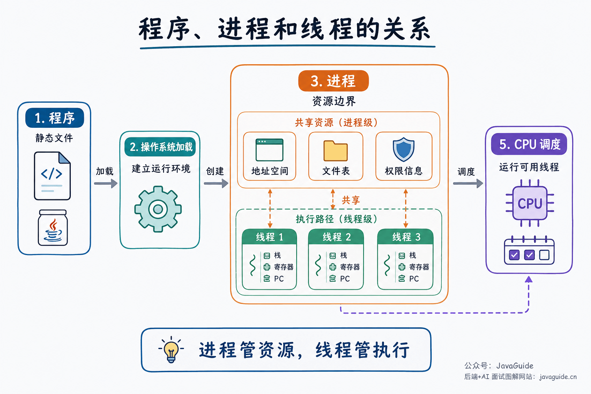

A **process** is like a factory. The operating system allocates resources to a process, such as its own virtual address space and file descriptors. It is isolated from other processes, such as a browser.

A **thread** is like a worker in the factory. Several workers can share the factory's resources while each has its own tools and task list. In a messaging application, for example, one thread might receive messages and another render the interface.

Here is an illustration of the factory analogy:

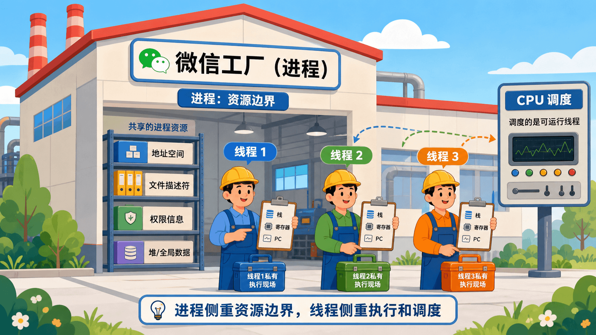

The Java runtime data areas provide another view from the JVM perspective.

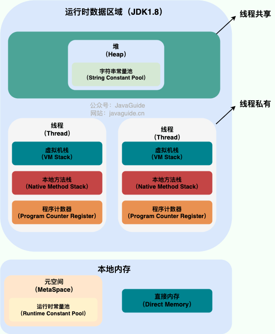

One process can contain multiple threads. Threads share the process's **heap** and **method area (Metaspace since JDK 8)**, while each thread has its own **program counter**, **JVM stack**, and **native method stack**.

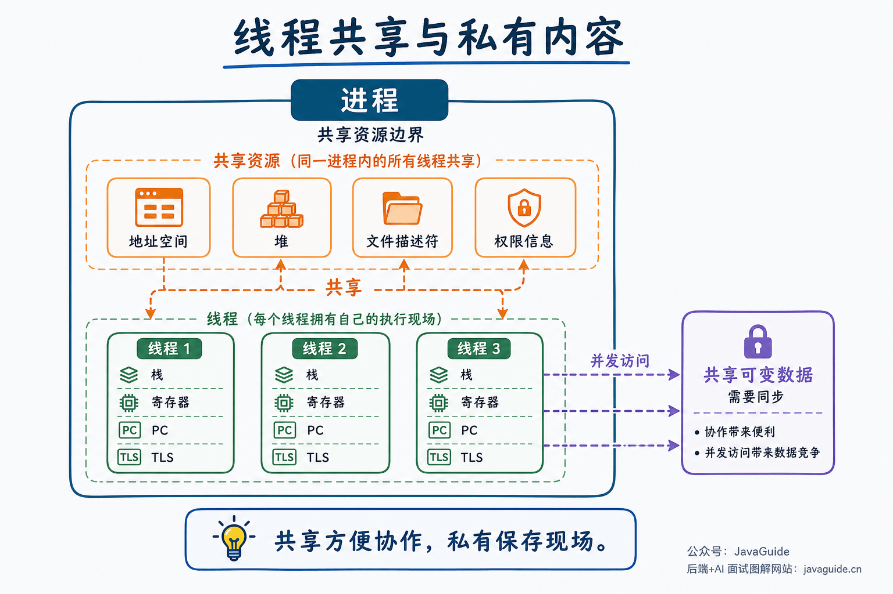

Compare them across five dimensions:

| Dimension            | Process                                                                       | Thread                                                                                             |
| -------------------- | ----------------------------------------------------------------------------- | -------------------------------------------------------------------------------------------------- |
| Main role            | Resource allocation and isolation                                             | CPU scheduling and execution                                                                       |
| Address space        | Usually has its own virtual address space                                     | Threads in one process share its address space                                                     |
| Private state        | PID, address space, open-file table, permissions, and other process resources | Thread ID, stack, registers, program counter, thread-local storage, and execution state            |
| Communication        | IPC such as pipes, message queues, shared memory, or sockets                  | Can access shared memory directly, but must synchronize access                                     |
| Creation/switch cost | Usually higher; switching may involve address-space and TLB costs             | Usually lower; a thread switch within one process does not normally switch the whole address space |
| Failure impact       | Better isolation; one process crash usually does not crash others             | A thread failure can terminate the entire process                                                  |

A complete interview answer can be organized like this:

> A process is a resource container for a running program, with its own virtual address space and resources such as files and permissions. A thread is an execution flow within a process. Threads share process resources but each has its own stack, registers, and program counter. Processes provide stronger isolation but usually cost more to create, switch, and communicate between. Threads make cooperation easier and are usually lighter, but shared memory requires synchronization.

### Why Have Threads If We Already Have Processes?

Threads provide **low-overhead concurrency within an application**.

A server can use multiple processes for network I/O, business computation, and log flushing, but sharing state between processes is harder: they need IPC and use more resources. Threads can share the heap and open connections directly, as long as synchronization is correct.

Threads can improve resource use. On one CPU core, another thread can run while one waits for disk or network I/O. On multiple cores, independent threads may run in parallel. More threads are not always better: they consume stack memory and add scheduling, lock-contention, and cache costs. CPU-bound and I/O-bound tasks also need different thread-pool sizing.

### Do Multiple Threads Always Improve Performance?

It depends on the workload, core count, and contention for shared resources:

- **I/O-bound tasks:** While one thread waits for disk, network, or a lock, other runnable threads can use the CPU and hide some waiting time.
- **CPU-bound tasks:** Independent computations can run on different CPU cores. Actual speedup is limited by serial work, data dependencies, caches, and scheduling overhead.
- **Too many threads:** When runnable threads greatly outnumber cores, queues get longer and context switches, cache misses, and lock contention increase. Throughput and latency can both get worse.

Set thread counts based on task behavior, CPU quotas, blocking rates, and load tests. Do not derive them only from the host's physical core count or the number of concurrent requests.

### What Are Common Ways to Synchronize Threads?

Thread synchronization coordinates concurrent access to shared resources and prevents conflicting updates. Common mechanisms include:

1. **Mutex:** Only the thread holding the mutex can enter the protected critical section. Java `synchronized` and the `Lock` implementations use this general approach.
2. **Read-write lock:** Allows multiple readers at once but only one writer.
3. **Semaphore:** Allows multiple threads to use a resource while limiting the number of simultaneous users.
4. **Barrier:** Makes threads wait at a point until all participants arrive, then lets them continue. Java's `CyclicBarrier` is an example.
5. **Condition variable or event notification:** A thread waits while a condition is false; another thread notifies it after the state changes. It is usually paired with a mutex to avoid lost wakeups. Java `Object.wait()/notify()` and `Condition.await()/signal()` follow this pattern; Windows Event objects are another form of event notification.

### What Is a PCB? What Does It Contain?

A **PCB (Process Control Block)** is an operating system data structure for managing and tracking a process. Each process has a corresponding PCB, which can be thought of as its management record.

When the operating system creates a process, it assigns a process ID and creates a PCB. As the process runs, the information in the PCB changes, and the operating system uses it to manage and schedule the process.

A PCB typically contains:

- **Identification:** PID, parent PID, user ID, and related identifiers.
- **State and scheduling data:** Ready/running/blocked state, priority, time-slice information, and CPU-time statistics.
- **CPU context:** Program counter, stack pointer, general-purpose registers, and program status word (PSW), used to resume execution after a context switch.
- **Memory-management data:** Virtual address space, page tables, and memory mappings.
- **Resources:** Open files and fds, I/O state, working directory, signal handling, and related information.

During a context switch, the operating system saves registers and other state for the current task and restores the next task's state.

### What Is a TCB? How Does It Relate to a PCB?

A **TCB (Thread Control Block)** stores thread-level control information, such as thread ID, state, register context, stack, scheduling priority, and thread-local storage.

Some textbooks and systems separate PCB and TCB: the PCB describes process-level resources, and the TCB describes a thread's execution context. Linux has a different implementation: it represents both processes and threads as tasks using `task_struct`, and their relationship is reflected in which resource structures they share. The key distinction is between resource boundaries (address spaces and file tables) and execution state (stacks, registers, and program counters).

### What States Can a Process Have?

Textbooks often use a five-state model, similar to the model for threads:

- **New:** The process is being created and has not entered the ready state.
- **Ready:** It has the resources it needs except for a processor and can run when scheduled.
- **Running:** It is executing on a processor. On a single-core CPU, only one process can be running at a time.
- **Blocked/Waiting:** It is waiting for an event, such as a resource or I/O completion. It cannot run even if a processor is idle.
- **Terminated:** The process has exited normally or been stopped and the system is cleaning up its resources.

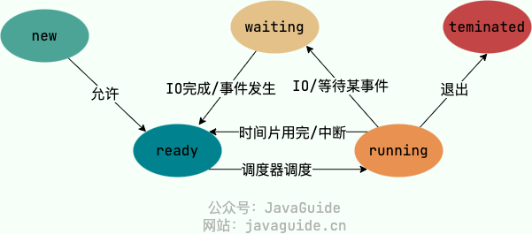

Focus on what causes a transition: a ready task gets CPU time and runs; a running task may return to ready when its time slice expires; a blocking I/O request, lock wait, or event wait moves it to blocked; when the event completes, it usually returns to ready and waits to be scheduled.

Some textbooks add **suspended states**. Suspension means a process is temporarily out of memory or has been paused by a user or system. Blocking means it is waiting for an event. A process can be blocked while still in memory or swapped out while blocked.

### What IPC Mechanisms Are Available?

Processes usually have separate virtual address spaces and cannot access one another's user memory directly, so they use **IPC (Inter-Process Communication)**.

For a quick interview answer, choose by scenario:

- A small byte stream between parent and child: anonymous pipe.
- Local communication between unrelated processes: FIFO or Unix Domain Socket.
- Small structured messages: message queue.
- Large local data exchange: shared memory, paired with synchronization such as semaphores, mutexes, `futex`, or `eventfd`.
- Asynchronous event notification: signal.
- Communication across machines: TCP/UDP socket or a higher-level RPC framework.

For the full classification and tradeoffs, see [Interprocess Communication (IPC)](./ipc.md).

### What Do `fork`, `exec`, and `wait` Do?

Unix/Linux process creation and program replacement often involve `fork()`, `exec()`, and `wait()`. For file descriptor inheritance, copy-on-write, and `fork()` from multithreaded programs, see [Processes and Threads](./process-and-thread.md).

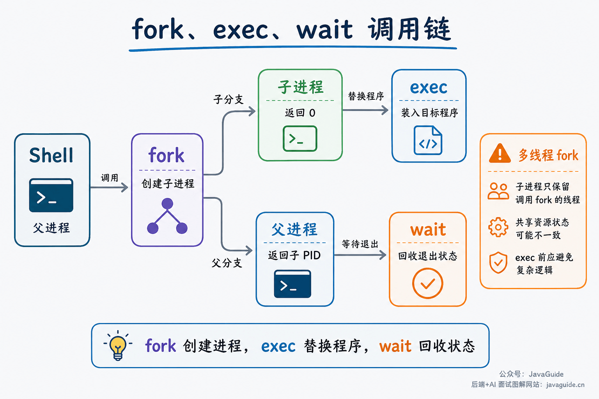

- **`fork()`:** Creates a child process. Parent and child continue from the same point but receive different return values.
- **`exec()`:** Loads another program into the current process. It does not create a process; it replaces the current process's user-space program and data.
- **`wait()`/`waitpid()`:** Waits for a child to change state and collects status left in the kernel after the child exits.

When a Shell starts an external command, it commonly calls `fork()`, the child calls `exec()` to become the target program, and the parent uses `wait()` or `waitpid()` to collect its exit status. If the parent does not collect a child's exit status, the child can remain a zombie.

### What Is a Context Switch?

A context switch occurs when the CPU changes from one execution entity to another. The operating system saves the current entity's registers, program counter, stack pointer, and other state, then restores the next entity's state.

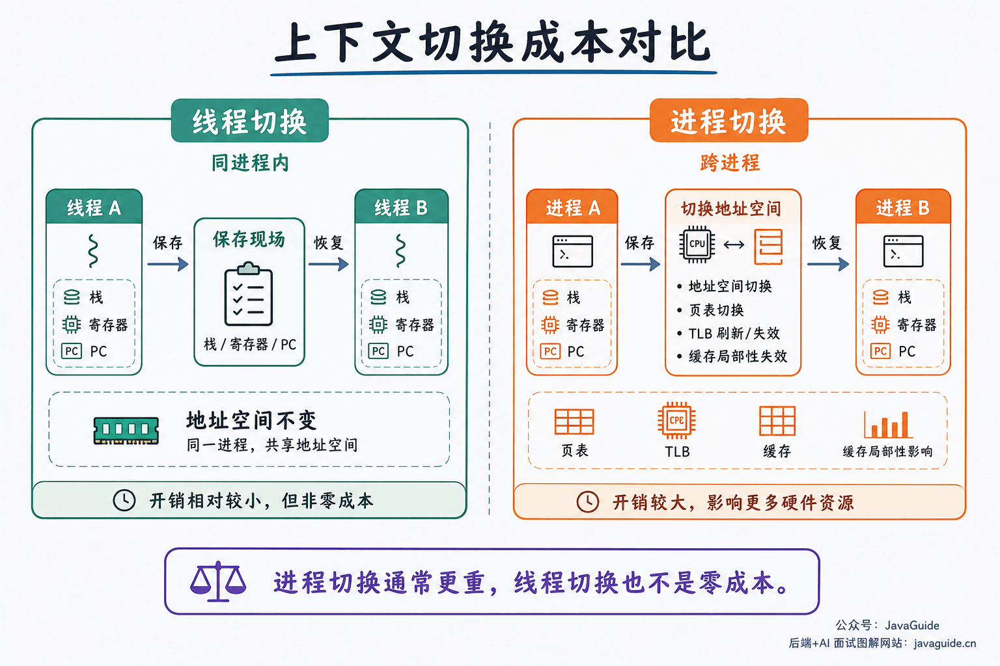

Both thread and process switches have costs, but a process switch is usually heavier. Processes have separate address spaces, so a switch may change page tables, invalidate TLB entries, and reduce cache locality. Threads in one process share an address space, so their switch usually does not require changing the entire memory mapping.

In simplified terms, a thread switch within one process mainly changes its stack, registers, and program counter. A process switch may also change address spaces and affect the TLB and caches. In production, if much of the time goes to scheduling, lock waits, system calls, and context switches, adding more threads without diagnosis can make things worse.

Also distinguish a **context switch** from a **user/kernel mode transition**. System calls, Page Faults, and hardware interrupts enter the kernel, but if the kernel returns to the same thread, no thread context switch occurred.

### What Process-Scheduling Algorithms Are There?

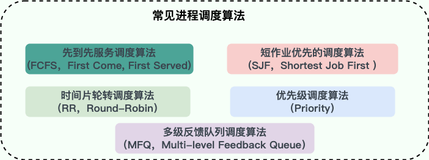

Textbook scheduling algorithms explain how to choose which runnable task should run when there are more runnable tasks than CPU cores. A scheduler balances **throughput, turnaround time, response time, fairness,** and switching costs.

Algorithms can be grouped into **non-preemptive** and **preemptive** scheduling.

**Non-preemptive scheduling:** Once a task gets the CPU, it keeps running until it finishes or yields, for example while waiting for I/O.

1. **First Come, First Served (FCFS):** Run tasks in arrival order. It is simple, but a long task at the front can make short tasks wait (the convoy effect).
2. **Shortest Job First (SJF):** Run the task with the shortest estimated execution time. It can reduce average wait time, but execution time is difficult to predict and long jobs may starve.

**Preemptive scheduling:** The operating system can pause the current task and give the CPU to another runnable task. Modern general-purpose systems support preemption.

- **Round Robin (RR):** Give each task a time slice in turn. A very short slice increases context-switch overhead; a very long one approaches FCFS.
- **Priority scheduling:** Run high-priority tasks first. This represents urgency but requires protection against starvation of lower-priority tasks.

**Multilevel Feedback Queue (MLFQ):** Uses several priority queues and adjusts task placement based on behavior. New tasks commonly start in a high-priority queue. CPU-bound tasks that consume full slices may be demoted, while interactive tasks that yield for I/O may remain at higher priority. Exact promotion, demotion, and starvation rules depend on the implementation.

FCFS, SJF, RR, priority scheduling, and MLFQ are simplified textbook models. Real Linux schedules tasks or scheduling entities. Fair-class tasks have historically used CFS to allocate CPU according to weights and `vruntime`; Linux 6.6 began introducing EEVDF in the fair scheduling class, using lag and virtual deadlines to choose tasks. The actual implementation depends on kernel version and distribution patches.

See [CPU Scheduling and System Load](./cpu-scheduling-and-load.md) for more detail.

### Who Schedules a Process?

The **scheduler** in the operating system kernel selects the next task. Scheduling may happen when a task blocks, yields the CPU, exhausts its time slice or runtime quota, changes priority, or when a more suitable task wakes up.

Textbooks also use the term **dispatcher** for the work that applies the scheduling decision:

- The scheduler selects a task from the runnable queue.
- The dispatcher performs the context switch:
  - Save the current task's registers, program counter, and other state in its process/thread control structures.
  - Load the next task's saved context.
  - Transfer CPU control to the selected task.

Modern Linux does not strictly separate these into two independent components. For interviews, understand the two responsibilities: choosing a task and switching execution to it.

### How Do Load Average and CPU Usage Differ?

Load average represents the number of runnable tasks and uninterruptible-sleep tasks over time. On Linux, these are mainly tasks in R and D states. CPU usage describes where CPU time is spent: user mode, kernel mode, I/O wait, interrupts, idle time, or virtualization steal time.

A high load can mean runnable tasks are competing for CPU, or many tasks are waiting on block devices, network storage, filesystems, or Swap. In the latter case, CPU cores may still be idle. Interpret load against the number of logical CPUs: load 8 means something different on a 1-CPU machine than on a 64-CPU machine.

Use `uptime` to see 1-, 5-, and 15-minute load trends, then check `top`, `vmstat 1`, `pidstat`, and `mpstat` to determine whether tasks are competing for CPU, waiting for I/O, or switching frequently. See [CPU Scheduling and System Load](./cpu-scheduling-and-load.md) for metrics and troubleshooting steps.

## Deadlocks

### What Is a Deadlock?

A **deadlock** occurs when a group of processes or threads waits for one another to release resources or perform actions. The wait relationships form a cycle, so none of the participants can continue on its own.

Deadlock is more than “waiting for a long time.” Ordinary blocking can resolve when a lock is released, I/O returns, or a transaction commits. In a deadlock, the wait chain forms a cycle that will not resolve without outside intervention.

See [Deadlocks: Four Necessary Conditions, Java Diagnosis, and Database Recovery](./dead-lock.md) for how deadlocks form, Java thread diagnosis, and database handling.

A classic example is **cross-locking** with two threads and two locks:

- Thread 1 acquires lock A, then requests lock B.
- At nearly the same time, thread 2 acquires lock B, then requests lock A.

Thread 1 waits for thread 2 to release B, while thread 2 waits for thread 1 to release A. They hold resources the other needs and form a wait cycle.

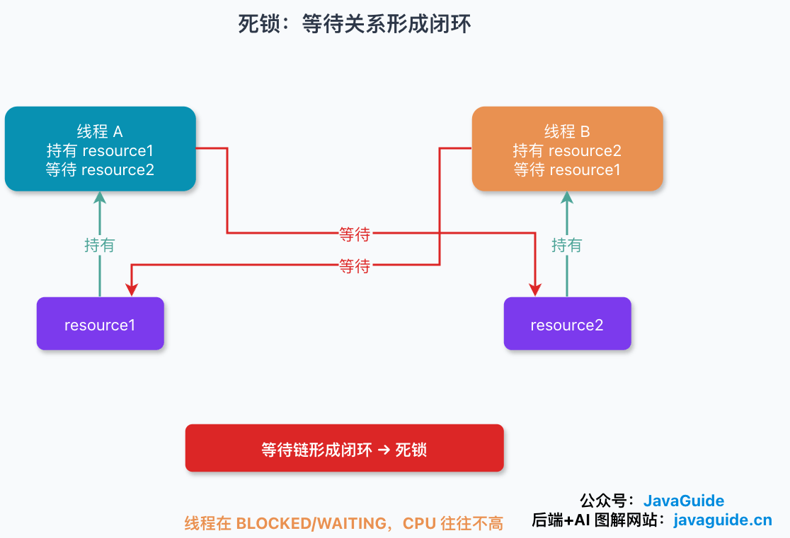

### What Are the Four Necessary Conditions for Deadlock?

All four of the following conditions must hold at the same time:

1. **Mutual exclusion:** A resource is non-shareable; only one process can use it at a time. Another requester must wait until it is released.
2. **Hold and wait:** A process holds at least one resource while waiting for another resource held by another process.
3. **No preemption:** Resources cannot be forcibly taken away; the process holding a resource must release it.
4. **Circular wait:** A set of processes `{P0, P1, ..., Pn}` forms a cycle: P0 waits for a resource held by P1, P1 waits for one held by P2, and so on, until Pn waits for a resource held by P0.

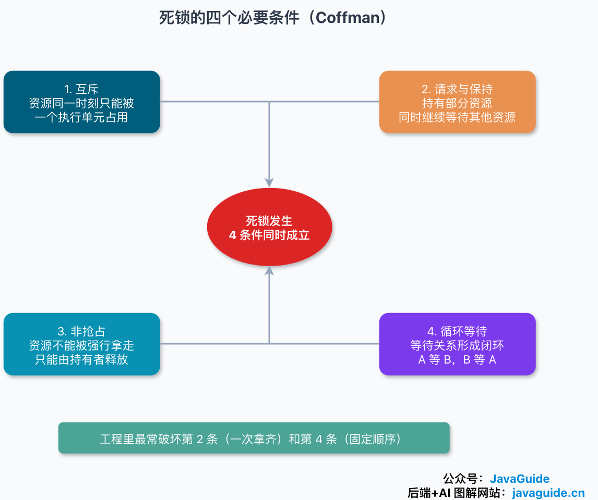

These are necessary conditions, not a claim that any one condition causes deadlock. All four must hold together. Structurally preventing any one of them can prevent deadlock.

### Can You Write Code That Produces a Deadlock?

This example reproduces the cross-locking scenario:

```java
public class DeadLockDemo {
    private static final Object resource1 = new Object(); // Resource 1
    private static final Object resource2 = new Object(); // Resource 2

    public static void main(String[] args) {
        new Thread(() -> {
            synchronized (resource1) {
                System.out.println(Thread.currentThread() + " get resource1");
                try {
                    Thread.sleep(1000);
                } catch (InterruptedException e) {
                    Thread.currentThread().interrupt();
                }
                System.out.println(Thread.currentThread() + " waiting to get resource2");
                synchronized (resource2) {
                    System.out.println(Thread.currentThread() + " get resource2");
                }
            }
        }, "thread-1").start();

        new Thread(() -> {
            synchronized (resource2) {
                System.out.println(Thread.currentThread() + " get resource2");
                try {
                    Thread.sleep(1000);
                } catch (InterruptedException e) {
                    Thread.currentThread().interrupt();
                }
                System.out.println(Thread.currentThread() + " waiting to get resource1");
                synchronized (resource1) {
                    System.out.println(Thread.currentThread() + " get resource1");
                }
            }
        }, "thread-2").start();
    }
}
```

Output:

```text
Thread[thread-1,5,main] get resource1
Thread[thread-2,5,main] get resource2
Thread[thread-1,5,main] waiting to get resource2
Thread[thread-2,5,main] waiting to get resource1
```

Thread 1 acquires the monitor for `resource1`, and thread 2 acquires the monitor for `resource2`. `Thread.sleep(1000)` does not cause the deadlock; it widens the timing window so the threads are more likely to interleave. After sleeping, each requests the resource held by the other and waits.

### How Can Deadlocks Be Handled?

Four general approaches are **prevention, avoidance, detection, and recovery**:

- **Prevention:** Break one of the four necessary conditions in advance. Common engineering techniques include a fixed lock order, a smaller lock scope, and avoiding slow operations while holding a lock.
- **Avoidance:** Check whether a resource allocation keeps the system in a safe state. The Banker's algorithm is the classic example. This is mainly a textbook technique and is uncommon in ordinary applications.
- **Detection:** Allow waits and check for a cycle in a wait-for or resource-allocation graph. In Java, use `jcmd <pid> Thread.print -l`, `jstack -l <pid>`, or `ThreadMXBean.findDeadlockedThreads()` to help diagnose. Databases also detect transaction wait cycles.
- **Recovery:** Break the cycle after detection, for example by terminating a process, rolling back a transaction, preempting a resource, or retrying at the application layer. Database transactions have rollback support, so detection and recovery are natural there.

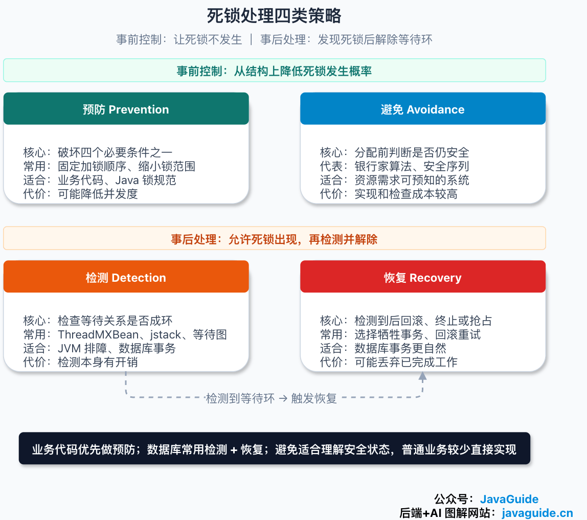

For more on resource-allocation graphs, wait-for graphs, Java thread dumps, and database retries, see [Deadlocks](./dead-lock.md).

## References

- _Computer Operating Systems_, 4th edition, Tang Xiaodan et al.
- _Computer Systems: A Programmer's Perspective_
- _Relearning Operating Systems_
- [Why Do Operating Systems Have User and Kernel Modes?](https://blog.csdn.net/chen134225/article/details/81783980)
- [Understanding User and Kernel Modes](https://juejin.cn/post/6923863670132850701)
- [What Are Zombie and Orphan Processes?](https://blog.csdn.net/a745233700/article/details/120715371)

<!-- @include: @article-footer.snippet.md -->
