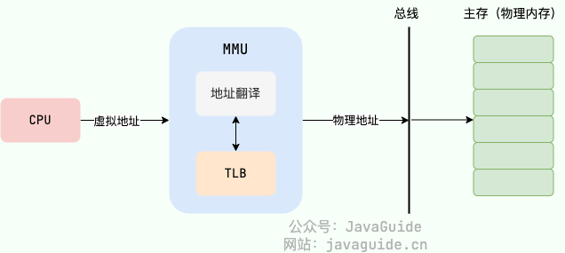

<!-- @include: @article-header.snippet.md -->

This is the second part of the operating system interview guide. It focuses on **memory management, virtual memory, paging and segmentation, TLBs, page faults, page replacement, I/O multiplexing, zero-copy, filesystems, and disk scheduling**.

Part 1 focused on processes, threads, and concurrency. This part looks at how programs use memory, perform I/O, and interact with filesystems. These topics may seem far removed from application code, but they help explain many backend questions: Why can `mmap` avoid a copy? Why can `epoll` handle many connections? Why can the same virtual address refer to different memory in different processes? Why do frequent page faults slow down a system?

Keep this main idea in mind: **the operating system uses virtual memory to manage addresses and isolation, I/O mechanisms to move data, and the filesystem to manage persistent data**. Connecting these ideas makes the individual concepts easier to understand.

## Memory Management

### What Does Memory Management Do?


In an interview, you can describe five main responsibilities of memory management:

- **Allocation and reclamation**: User-space allocators request or release virtual address ranges through interfaces such as `brk()` and `mmap()`. The kernel manages physical pages and kernel objects.
- **Address translation**: Programs use virtual addresses. The CPU's MMU, page tables, and TLB translate them into physical addresses.
- **Process isolation and access protection**: Each process has its own address space. Page-table entries can record permissions such as read, write, execute, user mode, and kernel mode.
- **Page reclamation and swapping**: When physical memory is low, the kernel can reclaim file-backed or anonymous pages and may write anonymous pages to Swap.
- **Sharing and mapping**: Shared libraries, shared-memory IPC, file mappings with `mmap()`, and copy-on-write (COW) all rely on mappings from virtual addresses to physical pages.

The key idea is that memory management separates the addresses a program sees from physical memory, then manages memory through allocation, mapping, protection, and reclamation.

### What Are the Differences Between VSZ, RSS, and PSS?

When inspecting process memory on Linux, VSZ, RSS, and PSS are easy to confuse.

- **VSZ**: The size of the virtual address space mapped by a process. It includes anonymous and file-backed mappings that may not be resident, shared libraries, and reserved address ranges, so it is not a measure of physical memory use.
- **RSS**: The total size of pages currently resident in RAM and mapped by the process. Shared libraries, shared memory, and shared Page Cache pages are included in the RSS of each relevant process.
- **PSS**: Memory use after shared pages are divided proportionally. If four processes share one physical page, one quarter of that page is counted in each process's PSS.

Use RSS to inspect a single process's resident memory. PSS is more useful for estimating memory use across multiple processes. Adding their RSS values directly usually counts shared pages more than once.

Common commands:

```bash
grep -E 'VmSize|VmRSS|RssAnon|RssFile|RssShmem|VmSwap' /proc/<pid>/status
cat /proc/<pid>/smaps_rollup
```

### What Is Memory Fragmentation?

Memory fragmentation can result from allocating and freeing memory. It is usually divided into two types:

- **Internal memory fragmentation**: Memory allocated to a process but left unused. It often occurs when allocation uses fixed sizes, such as powers of two, and the allocated block is larger than the process needs. For example, if a process needs 65 bytes but receives 128 bytes (2^7), the remaining 63 bytes are internal fragmentation.
- **External memory fragmentation**: Free memory is split into small, non-contiguous regions that cannot satisfy a larger allocation request. Segmentation, described below, can cause external fragmentation.


Memory fragmentation reduces memory utilization, so memory management aims to limit it.

### What Are the Common Memory Management Approaches?

Memory management approaches can be divided into two broad categories:

- **Contiguous memory management**: Allocates one contiguous region of memory to a user program. Memory utilization is often low.
- **Non-contiguous memory management**: Allows a program's memory to be spread across separate, non-adjacent regions. This approach is more flexible.

#### Contiguous Memory Management

**Fixed-partition allocation** was an early form of contiguous memory management and caused significant fragmentation. Memory was divided into fixed-size blocks, with one process per block. If a process needed only a small amount of memory, much of its block went unused; this is internal fragmentation. Gaps between blocks could also leave small, unusable regions, causing external fragmentation.

Linux uses the **buddy system** for contiguous physical memory allocation. This classic algorithm helps manage external fragmentation. It divides memory into blocks whose sizes are powers of two (for example, 2^6 = 64 KB) and pairs adjacent blocks as buddies. **Only adjacent blocks are buddies.**

When allocating memory, the buddy system looks for a suitably sized block. If the available block is too large, it splits it into two equal buddy blocks, repeating until the block is the right size.

When two adjacent buddy blocks are freed, the system can merge them into a larger block for future allocations. This helps reduce fragmentation and improve memory utilization.


Although the buddy system helps with external fragmentation, it can still waste memory through internal fragmentation. It allocates blocks sized as powers of two, so a request that does not match one of those sizes wastes space. For example, a 65-byte request requires a 128-byte block (2^7).


To reduce fragmentation and allocation overhead for frequently allocated small objects, Linux also uses allocators such as **SLAB/SLUB**. They cache common kernel objects and reuse initialized memory by object type, reducing repeated allocation, initialization, and freeing. This topic is outside the scope of this guide.

#### Non-Contiguous Memory Management

There are three common forms of non-contiguous memory management:

- **Segmentation**: Manages and allocates physical memory in segments, each occupying a contiguous region. A program's virtual address space is divided into variable-sized segments with logical meaning, such as a main program, subroutines, data, and stack.
- **Paging**: Divides physical memory and a program's virtual address space into equal-sized pages. Modern operating systems widely use paging.
- **Segmented paging**: Combines segmentation and paging. The program's address space is first divided into logical segments, and each segment is then divided into fixed-size pages. Physical memory is still allocated in page frames.

### Virtual Memory

#### What Is Virtual Memory, and What Is It For?

**Virtual memory** is an abstraction provided by the operating system. A program sees a continuous, private virtual address space, while the operating system and hardware determine where its data resides in physical memory.

In simple terms, virtual memory separates the addresses used by a program from the actual addresses in RAM. When a process accesses a virtual address, the CPU's MMU uses mappings such as page tables to translate it into a physical address before accessing memory.


Virtual memory provides several key capabilities:

- **Process isolation**: Each process has its own virtual address space and page tables. The same virtual address in different processes can map to different physical pages, preventing them from overwriting one another's memory directly.
- **Better use of physical memory**: The operating system does not need to load all of a process's code and data at once; it can load only the pages currently needed.
- **Simpler memory management**: A process sees one continuous virtual address space, while physical memory can be split across separate page frames. Page tables and the MMU handle the mapping.
- **Physical memory sharing**: Multiple processes can share the same physical pages for dynamic libraries. They can also map the same physical memory through shared-memory IPC to exchange data efficiently.
- **Safer memory access**: Access controls limit how a process can use memory and isolate the permissions of different processes.
- **A larger apparent address space**: When physical memory is low, the operating system can move inactive pages to disk and bring them back when needed. A program can then use more memory than is physically available, although frequent swapping can slow the system significantly.

#### What Problems Would We Have Without Virtual Memory?

Without virtual memory, programs would access physical memory directly. This removes one layer of indirection but creates several problems.

**What problems would this cause?** Here are some examples, based on the capabilities virtual memory provides:

1. A user program could access any physical memory. It might overwrite memory required by the operating system, causing a crash and compromising system security.
2. Running multiple programs could cause conflicts. For example, if two programs both write to physical address `1xxx`, the second write could overwrite the first program's data and cause it to crash.
3. All data and instructions used by a program would have to be loaded into physical memory. Based on locality, much of that data might never be used, wasting valuable memory.
4. ……

#### What Are Virtual and Physical Addresses?

**A physical address** is an address in physical memory, more specifically the address held by the memory address register. Programs access **virtual addresses**, not physical addresses.

In other words, programmers work with virtual addresses. For example, a pointer in C stores a value that can be understood as a memory address; that address is virtual.

The CPU's **memory management unit (MMU)** translates virtual addresses into physical addresses. This is called **address translation**. Modern systems generally use page tables for translation, while a TLB caches recent results to reduce page-table lookup overhead.


After the MMU translates a virtual address, the CPU accesses the corresponding physical memory location to complete the read or write. This translation lets the same virtual address in different processes map to completely different physical pages.

This is the basis for process isolation and interprocess communication. By default, one process cannot directly read or write another process's user-space address space. Processes that need to exchange data use IPC mechanisms such as pipes, message queues, shared memory, or sockets. See [Interprocess Communication (IPC): Pipes, Message Queues, Shared Memory, Sockets, and Binder](./ipc.md) for an overview.

The main mechanisms for translating virtual addresses into physical addresses are **segmentation** and **paging**.

#### What Are Virtual and Physical Address Spaces?

- A **virtual address space** is the range of addresses available through virtual memory. Each process has its own private virtual address space.
- A **physical address space** is the range of addresses in physical memory.

#### How Are Virtual Addresses Mapped to Physical Addresses?

The MMU can translate virtual addresses to physical addresses using three mechanisms:

1. Segmentation
2. Paging
3. Segmented paging

Modern operating systems widely use paging, so it deserves particular attention.

### Segmentation

**Segmentation** divides an address space according to a program's logical structure, such as code, data, heap, and stack. Segments can have different lengths and have clear meanings; they can also have different access permissions.

#### What Is a Segment Table, and How Does Address Translation Work?

Segmentation uses a **segment table** to map virtual addresses to physical addresses. A segment-table entry usually records the segment's base address, limit (length), and access permissions.

With segmentation, a virtual address has two parts:

- **Segment number**: Identifies which segment in the virtual address space the address belongs to.
- **Segment offset**: The offset from the beginning of that segment.

Address translation works as follows:

1. The MMU extracts the segment number from the virtual address.
2. It uses the segment number to find the corresponding entry in the program's segment table.
3. It checks that the offset is within the segment limit and that the access permissions allow the operation.
4. If the checks pass, it adds the offset to the segment base address to get the physical address.


For example, suppose an address refers to segment 3 with an offset of 500. If segment 3 has a base address of 7000 and the offset is within the segment limit, the physical address is 7000 + 500 = 7500.

If the segment selector is invalid, the offset is outside the segment limit, or the access violates permissions, the CPU raises an architecture-defined exception. Whether a page is resident in physical memory is handled by paging and page-fault mechanisms; it should not be conflated with pure segmentation.

#### Why Can Segmentation Cause External Fragmentation?

Segmentation can cause external fragmentation because **segments have variable lengths and each segment usually needs a contiguous region of physical memory**. As processes create and free segments, scattered gaps form in physical memory. The total free space may be large enough, but no individual gap may be large enough for a new segment.

For example, suppose a system with 5 GB of physical memory uses segmentation and has four processes with these memory ranges:

- Process 1: 0–1 GB (segment 1)
- Process 2: 1–3 GB (segment 2)
- Process 3: 3–4.5 GB (segment 3)
- Process 4: 4.5–5 GB (segment 4)

If processes 1 and 4 are closed, their segments are freed, leaving 1.5 GB of free physical memory. Because this memory is not contiguous, it cannot be allocated to a process that needs one contiguous 1.5 GB region.


Memory compaction can reduce external fragmentation by moving active segments together to create contiguous free space. Moving large segments takes time, and swapping them to and from disk can slow the system significantly.

### Paging

**Paging** divides the virtual address space and physical memory into fixed-size blocks. A block in virtual memory is a virtual page; a block in physical memory is a physical page or page frame. On Linux, a page is usually 4 KB.

**Note:** Pages are contiguous and equal in size, unlike the variable-sized segments used in segmentation.

With paging, any virtual page in an application's address space can map to any physical page frame, so physical memory can be allocated non-contiguously. Fixed-size pages largely eliminate the external fragmentation associated with segmentation, although the last page may not be full, causing some internal fragmentation.

Paging also supports demand paging. A program does not need to load every page into physical memory at startup; the operating system loads a page when it is first accessed.

#### What Is a Page Table, and How Does Address Translation Work?

Paging uses a **page table** to map virtual addresses to physical addresses. A page-table entry maps a virtual page number to a physical page-frame number and can also record status such as access, dirty, permission, and present bits. The diagram below illustrates translation with a single-level page table.


Each process has its own page tables. Because page tables are process-specific, the same virtual page number can map to different physical page frames in different processes, providing address-space isolation.

With paging, a virtual address has two parts:

- **Page number**: The virtual page number is used to look up the corresponding physical page-frame number in the page table.
- **Page offset**: Physical page-frame base address + page offset = physical address.

Address translation works as follows:

1. The MMU extracts the virtual page number from the virtual address.
2. It uses that number to look up the corresponding physical page-frame number in the process's page table.
3. It adds the page offset to the physical page-frame base address to get the physical address.


If a page-table entry is missing, the page is not currently resident in physical memory, or the access violates permissions, the CPU raises a page fault. The kernel then determines whether it can resolve the fault by creating a mapping or loading the page. If it cannot, it typically sends `SIGSEGV` to the current thread.

**Does a virtual page number always map to a physical page-frame number? If the frame number is found and a physical address is calculated, is the physical page guaranteed to be present?**

No. The page-table entry may be missing, the page may not be resident in physical memory, or the access may violate the permissions in the entry. Any of these cases can trigger a page fault, which is covered below.

#### What Are the Problems with Single-Level Page Tables, and Why Use Multilevel Page Tables?

Consider a 32-bit system with a virtual address space of 2^32 (4 GB). If each page is 2^12 (4 KB), the page table needs 4 GB / 4 KB = 2^20 entries. At 4 bytes per entry, a single-level page table takes about 4 MB. In other words, even if a process uses only a small part of its address space, a single-level page table needs entries for the full 4 GB range.

This overhead becomes significant when many processes are running. Most processes use only a small portion of their virtual address space, so many entries in a single-level page table would be unused.

To address this, operating systems use **multilevel page tables**. The top-level table covers the entire virtual address space, while lower-level tables are created as needed. No lower-level table is needed for a range of virtual addresses that is never used.

For example, a two-level page table might have 1024 entries in the first-level table, with each entry pointing to a second-level table that also has 1024 entries. A second-level table is created only when its corresponding address range is used.

If only two second-level tables are needed, the total memory use is 4 KB for the first-level table + 4 KB × 2 for the second-level tables = 12 KB.


Multilevel page tables save memory: they add lookup levels in exchange for a smaller page-table footprint. Real systems use the TLB to cache commonly used translations, so the full cost of the extra lookups is not incurred on every access.

#### What Is the TLB For, and How Does It Change Address Translation?

To speed up virtual-to-physical address translation, the CPU/MMU uses a **Translation Lookaside Buffer (TLB)** to cache recent address translations.



On common AArch64 and x86-64 architectures, the TLB is a hardware cache used by the MMU. You can think of it as a fast cache that maps virtual pages to physical page frames, but its hardware design is not the same as a software hash table. The operating system maintains the page tables and, when a mapping changes, invalidates the relevant TLB entries as required by the architecture so the CPU does not use stale mappings.

With a TLB, address translation works as follows:

1. The CPU looks for a TLB entry using the virtual page number and address-space identifiers.
2. If it finds the physical page frame, it can skip the page-table lookup. This is a **TLB hit**.
3. If there is no matching entry, the CPU looks up the page table in memory and may add the resulting mapping to the TLB. This is a **TLB miss**.
4. When the TLB is full and a new entry is needed, an existing entry is evicted according to a replacement policy.


Page tables are stored in main memory. Without a TLB, the CPU may need to access memory to look up the page table and then access memory again to read or write the data; multilevel tables can require even more lookups. On a TLB hit, the CPU gets the physical page-frame number without looking up the page table, making translation much faster.

The TLB is simple in principle and often has a high hit rate because of locality: a program usually accesses only a small number of pages frequently during a given period.

The TLB may remind you of caches used in application systems, such as Redis. Many operating system ideas and classic algorithms also appear in the tools and frameworks used in everyday development.

#### What Is Swapping For?

When physical memory is low, the operating system can move less-used pages to disk. If a process accesses one of those pages later, the operating system brings it back into physical memory. Swapping uses lower-cost disk storage to extend the amount of memory that appears available.

This explains why processes can keep running even when their total memory demand exceeds the available physical memory, although performance may suffer.

This trades time for space: the system spends time moving pages to and from disk to make more memory available. If major page faults and disk swapping happen frequently, the system slows down. In severe cases, it can thrash, with the CPU spending most of its time swapping pages.

#### What Is a Page Fault?

A **page fault** is a **synchronous exception** raised when the CPU cannot complete address translation or a page-level permission check. It is caused by the current memory-access instruction, not by a hardware interrupt from a peripheral, and does not necessarily mean the program has an error.

The kernel checks whether the address belongs to a valid virtual memory area (VMA) for the process and whether the access type is permitted:

- **Recoverable page fault**: Examples include allocating a physical page on first access to an anonymous page, loading a file-backed or swapped page that is not resident, or copying a COW page before writing. The kernel allocates or loads the page, handles COW if needed, updates the page table, and the CPU retries the instruction that caused the fault.
- **Unrecoverable page fault**: Examples include accessing an address outside any valid VMA, writing to a read-only mapping, or executing a non-executable page. Linux usually sends `SIGSEGV` to the current thread, and the process terminates by default.

For performance statistics, recoverable page faults are often divided into:

- **Major page fault**: Handling it requires reading a page from a file or Swap, which involves I/O and has higher overhead.
- **Minor page fault**: No read from a storage device is needed. Examples include mapping an existing physical page, allocating a zero page, or handling some COW cases. These faults usually have lower overhead.

Out-of-bounds access in C or C++ does not always trigger `SIGSEGV` immediately. If the address is still within a mapped page with suitable permissions, the CPU cannot detect the violation of the language-level array bounds, and the program may simply corrupt adjacent data.


For the relationship between page faults, system calls, and signals, see [Interrupts, Exceptions, and System Calls: From Kernel Entry to Page Faults](./interrupt-exception-syscall.md).

#### What Are the Common Page-Replacement Algorithms?

When a major page fault occurs and no physical page is free, the operating system must evict a page from physical memory to make room for the incoming page.

The rule used to choose which physical page to evict is called a **page-replacement algorithm**.

Frequent page faults can significantly hurt performance, so a good replacement algorithm aims to reduce their number.

Five common page-replacement algorithms are listed below. Many others are variations on these:


1. **Optimal (OPT)**: Evicts the page that will not be used for the longest time. It has the lowest possible fault rate in theory, but requires knowing the future, so it is mainly used as a benchmark.
2. **First In, First Out (FIFO)**: Evicts the page that has been in memory the longest. It is simple to implement but may evict frequently used pages and can exhibit Belady's anomaly.
3. **Least Recently Used (LRU)**: Evicts the page that has not been accessed for the longest time. It uses temporal locality and can perform close to OPT, but an exact implementation requires costly timestamp or list maintenance.
4. **Least Frequently Used (LFU)**: Evicts the page with the fewest accesses over a period. It considers access frequency, but may keep pages that were popular earlier and are no longer used. Implementations often reduce old counts over time.
5. **Clock**: Also called the second-chance algorithm, it approximates LRU at lower cost. Each page has a reference bit and pages form a circular queue. A page with its bit set to 1 gets the bit cleared and another chance; a page with a bit of 0 is evicted.


**Why can FIFO perform poorly?**

There are two main reasons:

1. **Frequently used or long-lived pages may be repeatedly moved in and out**: Pages loaded early may be accessed often or needed for a long time, yet FIFO can evict them simply because they arrived first.
2. **Belady's anomaly can occur**: Increasing the number of allocated frames can sometimes increase the page-fault rate. FIFO considers only when a page entered memory, not how often or how soon it will be used.

**Which page-replacement algorithms are used in practice?**

LRU and its approximations are common because they fit program locality. Real systems rarely use textbook algorithms without modification. For example, the Linux kernel does not simply choose OPT, FIFO, LRU, or Clock; it uses mechanisms such as active/inactive LRU lists, workingset tracking, and refault detection. The InnoDB Buffer Pool also modifies traditional LRU to keep preloaded pages and full-table scans from displacing hot pages.


### What Are Swap, the Working Set, and Thrashing?

**Swap** is backup space on disk. Anonymous pages have no backing file, so when physical memory is low, the kernel may write them to Swap before reclaiming their physical pages. If a process accesses them later, they are read back into memory.

Swap is not a free way to expand memory. Disk is much slower than RAM, so active swapping usually increases application latency.

The **working set** is the collection of pages a process accesses frequently during a given period. If physical memory can hold the main working sets of running processes, page faults are manageable. If it cannot, pages are repeatedly swapped out and back in.

This state is called **thrashing**. During thrashing, the CPU may spend much of its time handling page faults, reclaiming pages, and waiting for disk I/O instead of doing application work.

Useful metrics when troubleshooting include:

```bash
free -h
vmstat 1
grep -E 'pgfault|pgmajfault|pswpin|pswpout|pgscan|pgsteal' /proc/vmstat
cat /proc/pressure/memory
```

### How Are Overcommit and OOM Related?

Linux allows processes to request more virtual memory than the available RAM and Swap. This is called **overcommit** and is useful for programs that reserve a large address space without necessarily using all of it.

Therefore, a successful `malloc()` or `mmap()` usually means the virtual address range was reserved; it does not mean that all physical pages are ready. Many pages are allocated only on first access.

When a process accesses a page and the kernel cannot reclaim, write back, or swap enough memory, the **OOM Killer** may select one or more processes to terminate and free memory.

In containers, check the cgroup limits too. Free memory on the host does not mean a container can use more; reaching `memory.max` can trigger an OOM event within the cgroup.

### How Are `mmap`, COW, and Shared Memory Related?

`mmap()` creates a mapping in a process's virtual address space. It can map a file or create an anonymous mapping. Data is not necessarily read when the mapping is created; accessing a page may trigger a page fault.

When multiple processes map the same file, the kernel can let them share physical pages in the Page Cache. Shared-memory IPC works similarly: virtual addresses in different processes map to the same physical pages, so processes can exchange data without copying it through the kernel each time.

**Copy-on-write (COW)** is commonly used with `fork()`. The parent and child can initially share the same physical pages, with their page-table entries marked read-only. When either process writes, it triggers a page fault and the kernel copies the page for the writer.

For details, see [Operating System Memory Management: Paging, Segmentation, Page Replacement, Swap, and OOM](./memory-management.md).

### How Are Paging and Segmentation Similar and Different?

**Similarities:**

- Both are forms of non-contiguous memory management.
- Both map virtual addresses to physical addresses to manage and protect memory.

**Differences:**

- **What is divided**: Paging splits the address space and physical memory into fixed-size pages, the basic physical unit of memory management. Segmentation divides a program according to its logical structure, such as code, data, heap, and stack.
- **Whether the size is fixed**: Pages have a fixed size, commonly 4 KB. Segment sizes vary with the corresponding logical regions of a program.
- **Fragmentation**: Segmentation can cause external fragmentation because each segment needs contiguous space. Paging largely eliminates external fragmentation but can cause some internal fragmentation in the last page.
- **Address format**: A paged address typically contains a page number and offset and is translated through a page table. A segmented address contains a segment number and offset and is translated through a segment table.
- **Use in modern systems**: General-purpose operating systems primarily use paging. For example, x86 hardware supports both segmentation and paging, but Linux generally sets segment bases to zero, leaving segmentation mainly for permissions and compatibility while paging handles memory management.

### Segmented Paging

Segmented paging combines segmentation and paging. From a program's perspective, memory is divided into logical segments, each of which is further divided into fixed-size pages.

Address translation in segmented paging has two steps:

1. **Segment translation (virtual address -> linear address)**:
   - Virtual address = segment selector (segment number) + segment offset.
   - Look up the segment base in the segment table and add the offset to get the linear address.
2. **Page translation (linear address -> physical address)**:
   - Linear address = page number + page offset.
   - Look up the physical page-frame number in the page table and add the offset to get the physical address.

### The Principle of Locality

To understand virtual memory, it helps to know the well-known **principle of locality**. Locality applies to both program and data structures and is an important concept.

The principle of locality describes how programs access data and instructions in ways that have temporal and spatial locality. **Temporal locality** means that a data item or instruction is likely to be used repeatedly within a short period. **Spatial locality** means that nearby data items or instructions are likely to be used around the same time.

In paging, the page table translates virtual addresses to physical addresses so that memory can be accessed. Locality is useful in two ways:

- **Temporal locality**: Loops and repeated operations often access the same pages again. Caches take advantage of this by keeping recently used translations or pages readily available.
- **Spatial locality**: Programs often access nearby data and instructions. Prefetching can take advantage of this by loading nearby pages into memory before they are requested.

Locality is an important principle in computer architecture and underlies many optimization algorithms. In paging, caching and prefetching can use temporal and spatial locality to improve hit rates and memory access efficiency.

### How Does Virtual Memory Provide Address Translation and Process Isolation?

When asked about virtual memory in an interview, explain more than process isolation. A useful summary is: **virtual memory separates the addresses seen by a process from physical addresses, and the MMU, page tables, and TLB perform the translation**.

Processes access virtual addresses (VAs), which are translated to physical addresses (PAs) in RAM. Each process has its own virtual address space and page tables, so the same virtual address in different processes can map to different physical pages, providing isolation.


Isolation does not prevent processes from sharing data. The operating system can let multiple processes map the same physical pages, as with shared libraries, file mappings through `mmap`, and shared-memory IPC. By default, page-table permissions enforce isolation. Sharing requires the kernel to establish mappings explicitly and control permissions; shared-memory IPC also requires synchronization.

Paging divides virtual address space and physical memory into fixed-size pages. Page tables map virtual page numbers to physical page frames. This largely avoids the external fragmentation associated with segmentation and allows non-contiguous physical allocation. Page tables themselves use memory, so modern systems create lower-level page tables on demand.

The TLB caches page-table entries. The CPU checks it first: on a hit, it gets the physical page-frame number directly; on a miss, it looks up the multilevel page table and may cache the result. If the page-table entry indicates that the page is not in memory, a page fault occurs. The kernel checks whether the access is valid, allocates a frame, evicts an old page if needed, loads the page from a file or Swap, updates the page table, and retries the instruction.

One way to summarize page replacement is: **ideally, evict the page that will be needed again farthest in the future**. OPT is theoretically optimal but impractical; LRU can approach it but is costly to implement; Clock approximates LRU with reference bits; and FIFO is simple but can exhibit Belady's anomaly.

For details, see [Virtual Memory: Address Translation, TLBs, Page Faults, and Page Replacement](./virtual-memory.md).

## I/O

### What Happens During a Blocking `read()`?

Consider `read(fd, buf, count)`. A user program usually calls a glibc wrapper first. The wrapper prepares the system call number and arguments according to the ABI, then executes an instruction such as `syscall` to enter the kernel. The kernel checks the file descriptor, user buffer, and access permissions before following the relevant read path through the VFS, filesystem, socket, or device driver.

If the data is ready, the kernel copies it to the user buffer and returns the number of bytes read. If it is not ready, a blocking file descriptor puts the current thread to sleep, allowing the scheduler to run another task. When disk I/O completes or the network card receives data, the device notifies the kernel with a hardware interrupt. The kernel wakes the waiting thread, which completes `read()` and returns to user space when it next gets CPU time.

This path may involve a system call, a hardware interrupt, and a thread context switch, or only some of them. If the data is already in the Page Cache, `read()` can return without waiting for a device interrupt or switching to another thread.

For details, see [Interrupts, Exceptions, and System Calls: From Kernel Entry to Page Faults](./interrupt-exception-syscall.md).

### What Is I/O Multiplexing?

I/O multiplexing is not about making a single read or write faster. It is about **letting one thread wait for readiness events on multiple file descriptors (fds) at the same time**.

A network read usually has two stages: wait for data to arrive from the network card and enter a kernel buffer, then copy it from the kernel buffer to a user buffer. Blocking I/O can stall at the first stage: after a thread calls `recv`, it must wait if that connection has no data.


I/O multiplexing passes a set of fds to the kernel and lets a thread block in a system call such as `select`, `poll`, or `epoll`. The call returns when any fd is ready, and the application handles the corresponding connection. This lets one thread manage thousands of connections and works especially well when most connections are idle and only a few are active, as in high-performance network software such as Redis, Nginx, and Netty.

Note that I/O multiplexing is still **synchronous I/O**. The kernel only reports that an fd is ready to read or write; the application still calls `read` or `recv`, and the data still has to be copied from the kernel buffer to the user buffer.

For details, see [I/O Multiplexing: How `select`, `poll`, and `epoll` Work](./io-multiplexing.md).

### What Are the Differences Between `select`, `poll`, and `epoll`?

In short, `select` and `poll` pass the full set of monitored fds to the kernel on every wait and scan the set after returning. `epoll` keeps the set in the kernel and `epoll_wait` mainly returns ready events, so it suits workloads with many connections but few active ones.

`select` uses a fixed-size `fd_set` bitmap. With Linux glibc, it is usually limited by `FD_SETSIZE` and can safely handle fds numbered 0–1023. The monitored set must be rebuilt before each call, and the bitmap must be scanned afterward to find ready fds.

`poll` replaces the bitmap with a `pollfd` array, avoiding the `FD_SETSIZE` limit. However, it still passes the full array to the kernel on every call and scans the array for `revents` afterward. Scanning can remain costly when there are many connections but few active ones.

`epoll` uses `epoll_ctl` to maintain the monitored set and `epoll_wait` to get ready events. The kernel maintains an interest list and a ready list; when an fd becomes ready, it enters the ready list, and the application retrieves ready events when it waits. `epoll` supports level-triggered (LT) and edge-triggered (ET) modes. LT repeatedly reports readiness while data remains in the buffer. ET reports a state change once, so it must be used with nonblocking fds and reads must continue until `EAGAIN`.


However, `epoll` is not faster in every situation. With few connections or when all connections are active, the maintenance costs of `epoll_ctl`, callbacks, and ready lists also matter. It is best suited to servers with many long-lived connections that are idle most of the time.

For details, see [I/O Multiplexing: How `select`, `poll`, and `epoll` Work](./io-multiplexing.md).

### What Is Zero-Copy?

Zero-copy does not mean that no copying happens at all. It **avoids, where possible, moving data between kernel and user buffers with the CPU**, reducing CPU copies and user/kernel mode switches.

With traditional `read + write` file transfer, data usually goes through four copies: DMA copies it from disk to a kernel buffer, the CPU copies it to a user buffer, the CPU copies it again to a socket buffer, and DMA copies it to the network card. The two CPU copies are wasteful when the application does not modify the data and merely sends it through user space.


Zero-copy aims to keep data in the kernel path as it is forwarded. For example, `sendfile` can send file data from the Page Cache to a socket. If the network card supports SG-DMA, the socket buffer may contain only descriptors while DMA sends the payload directly from the kernel buffer to the card.

Zero-copy is useful for forwarding files unchanged, transferring large files, and sending message-queue logs. For example, Kafka can use a `sendfile`-based path such as `FileChannel.transferTo` to send log segment files to consumers.

For details, see [Zero-Copy: `mmap`, `sendfile`, and `splice`](./zero-copy.md).

### What Are the Differences Between `mmap`, `sendfile`, and `splice`?

In short: **use `mmap` when you need to modify data, `sendfile` to forward a file unchanged to a socket, and `splice` for more general forwarding between file descriptors**.

`mmap + write` maps a file into the process's address space using virtual memory. When the application accesses the mapping, it accesses the physical pages associated with the Page Cache, avoiding the CPU copy from the kernel buffer to the user buffer that occurs with traditional `read`. A CPU copy to the socket buffer is usually still needed for the later `write`. This approach suits cases where data must be read, modified, or parsed before sending.

`sendfile` is better suited to sending a file unchanged to a socket. The data does not enter user space, and fewer system calls are needed. With a network card that supports SG-DMA, CPU payload copies can be eliminated. Static file servers and Kafka log-segment transfers are typical use cases.

`splice` moves page references within the kernel using a pipe, and supports more general forwarding between descriptors, such as socket to socket or file to pipe to socket. It usually requires a pipe in the path, and forwarding from a file to a socket often takes two `splice` calls, so consider the added complexity and system calls.


Zero-copy is less useful when the application must process the payload, such as for TLS encryption, compression, format conversion, content filtering, or watermarking. In those cases, data cannot remain entirely in the kernel path. For small files or random access, the fixed costs of mapping, page faults, or pipes may also outweigh the benefits.

For details, see [Zero-Copy: `mmap`, `sendfile`, and `splice`](./zero-copy.md).

## Filesystems

### What Does a Filesystem Do?

A filesystem organizes blocks on a storage device into files and directories that applications can use. In an interview, you can describe six main responsibilities:


1. **Naming**: Find a file by its path and name, such as `/var/log/app.log`.
2. **Organization**: Use a directory tree to organize files and directories.
3. **Location**: Map the Nth byte of a file to the underlying data blocks.
4. **Space management**: Allocate, release, and reuse disk blocks, tracking which are free and which are in use.
5. **Access control**: Record metadata such as ownership, permissions, and timestamps, and check permissions when a file is accessed.
6. **Caching and recovery**: Use the Page Cache to improve read and write performance and journaling to reduce filesystem damage after a crash.

Not every filesystem is backed by a local disk. `tmpfs` is backed mainly by memory, `procfs` exposes kernel state, and NFS connects a remote filesystem to the local directory tree. Linux provides a common interface to these filesystems through the VFS.

### How Are Files, Directories, Inodes, and Dentries Related?

In Linux and Unix filesystems, the filename is usually not stored in the inode.


- **Directory entry**: Maps a filename to an inode number.
- **Inode**: Records the file type, permissions, owner, size, timestamps, link count, and mapping information for data blocks or extents.
- **Dentry**: An in-memory directory-entry cache maintained by the VFS to speed up path lookup. It usually points to an inode and can also cache a failed lookup as a negative dentry.
- **Data blocks or extents**: Store the contents of a regular file.

This explains how one file can have multiple names: several directory entries can point to the same inode. When `mv a.txt b.txt` happens within the same filesystem, it often changes only the directory entry; the file contents do not need to move.

Use these commands to inspect inodes and metadata:

```bash
ls -li app.log
stat app.log
df -i
```

### What Happens When You Open a File?

`open()` does not read the entire file into memory. It mainly resolves the path and creates an open-file object.


The process is roughly as follows:

1. Resolve the path from the root or current directory, looking up directory entries and the dentry cache at each level.
2. Find the target inode and check permissions, open flags, and file type.
3. Create a kernel open-file object that records the current file offset, open status, and read/write flags.
4. Allocate the lowest available non-negative integer in the current process's file descriptor table; this is the fd.

An fd is an index in a process's file descriptor table, not an inode. After `dup()` or `fork()`, multiple fds may refer to the same open-file object and share its file offset. Two processes that each call `open()` on the same file usually get separate open-file objects with independent offsets.

### How Are Files Stored on Disk?

The filesystem divides a partition or volume into blocks and uses metadata to record how file contents relate to those blocks. Textbooks commonly describe three allocation methods:


- **Contiguous allocation**: A file occupies a sequence of contiguous blocks, making sequential and random access fast. File growth is difficult, and external fragmentation can occur.
- **Linked allocation**: Each block points to the next, so the blocks need not be contiguous. Random access is slow.
- **Indexed allocation**: Block addresses are stored in an index block, making random access easier but requiring extra space for the index.

Classic ext2/ext3 use direct block pointers and single-, double-, and triple-indirect blocks to locate file data. ext4 usually uses an extent tree. Each extent records the logical start, physical start, and length of a range of contiguous physical blocks, which uses less metadata than recording an address for every block in a large contiguous file.

### What Are the Differences Between Hard and Symbolic Links?

Both hard and symbolic links let a path refer to a file, but they point to different things.


| Comparison                         | Hard link                                                                                        | Symbolic link                                  |
| ---------------------------------- | ------------------------------------------------------------------------------------------------ | ---------------------------------------------- |
| Points to                          | The same inode                                                                                   | Another path                                   |
| Creates an inode?                  | Does not create a new inode for the target; adds a directory entry and increments the link count | The link is a separate file with its own inode |
| After the original path is removed | The data remains as long as a hard link exists                                                   | The link may become dangling                   |
| Can cross filesystems?             | No                                                                                               | Yes                                            |
| Can link to a directory?           | Linux does not allow ordinary users to create hard links to directories                          | Yes                                            |

Try this example:

```bash
echo hello > a.txt
ln a.txt hard.txt
ln -s a.txt soft.txt

ls -li a.txt hard.txt soft.txt
```

`a.txt` and `hard.txt` have the same inode number, while `soft.txt` has a different one. After deleting `a.txt`, `hard.txt` can still access the contents, but `soft.txt` points to a path that no longer exists.

### Why Can't Hard Links Cross Filesystems?

A hard link points to an inode, and an inode number is meaningful only within its filesystem. Each filesystem has its own inode table, so the same inode number in another filesystem does not identify the same file.

A symbolic link stores a path string. The target is looked up by path, so the link can cross filesystems.

### Does a Successful `write()` Mean the Data Is on Disk?

No. With ordinary buffered I/O, a successful `write()` usually means only that the kernel accepted the data. It commonly enters the Page Cache and is marked as a dirty page; this does not mean the data has reached persistent storage.


For stronger durability guarantees, use:

- `fsync()`: Synchronizes file data and associated metadata.
- `fdatasync()`: Synchronizes file data and metadata needed to read it later, such as the file size.
- Synchronous open flags such as `O_SYNC` and `O_DSYNC`.

Also keep two details in mind:

1. `write()` may write only part of the data, so callers must handle partial writes.
2. After creating a file, calling `rename()`, or calling `unlink()`, applications that need the directory entry to survive a crash usually also need to call `fsync()` on the parent directory fd.

### What Problem Does a Journaling Filesystem Solve?

A filesystem operation often updates several pieces of metadata. Creating a file, for example, may allocate an inode and data blocks, update a directory entry, and update a bitmap. If power fails partway through, the filesystem may be left inconsistent.

A journaling filesystem first records planned metadata changes in a journal, then updates their final locations. During recovery, it scans the journal and replays transactions that were fully committed but not yet written to their final locations. Incomplete transactions are discarded.

For ext4, there are three common data modes:

| Mode             | Description                                                                                                           |
| ---------------- | --------------------------------------------------------------------------------------------------------------------- |
| `data=writeback` | Journals metadata only; does not ensure related data blocks are written before metadata.                              |
| `data=ordered`   | The default mode. Related data blocks are written to the main filesystem before metadata is committed to the journal. |
| `data=journal`   | Journals both data and metadata before writing them to their final locations, causing more write amplification.       |

A journaling filesystem mainly protects filesystem structural consistency; it does not guarantee that an application will never lose business data. Transaction-level durability still depends on the application using `fsync()`, write ordering, and recovery logic correctly.

### How Can Filesystem Performance Be Improved?

Consider access patterns, caching, metadata, and hardware:

- **Prefer sequential reads and writes**: Sequential I/O benefits from read-ahead, write coalescing, and contiguous mappings such as extents.
- **Use the Page Cache**: Ordinary file I/O passes through the Page Cache, and cache hits can reduce disk access. More cache is not always better; consider memory pressure and writeback load.
- **Reduce small files and metadata operations**: Large numbers of small files increase the cost of inodes, directory entries, permission checks, creation, and deletion.
- **Control flush frequency**: Frequent `fsync()` calls reduce throughput, but never flushing increases the amount of data at risk during a power failure. Balance this against the application's durability requirements.
- **Choose a suitable filesystem and mount options**: ext4, XFS, and Btrfs differ, and options related to journaling, `atime`, and barriers can affect performance and reliability.
- **Use suitable hardware**: SSDs, NVMe, RAID, and disk-cache policies all affect latency and throughput.

Useful commands for troubleshooting include:

```bash
df -h
df -i
lsof +L1
iostat -x 1
```

If `df` reports a full filesystem but `du` cannot find large files, check for deleted files that are still open by a process. If there are many small files, `df -i` may reveal the problem before `df -h` does.

For details, see [Operating System Filesystems: Inodes, VFS, Page Cache, and Journaling](./file-system.md).

### What Are the Common Disk-Scheduling Algorithms?

The SCAN, SSTF, and LOOK algorithms described below are mainly for hard disk drives. An HDD operation involves seek time, rotational latency, and transfer time. A scheduler can reorder requests to reduce head movement and waiting time.

Six common disk-scheduling algorithms are listed below. Many others are variations on these:


1. **First-Come, First-Served (FCFS)**: Processes requests in the order they arrive. It is simple but ignores the head's path and direction, so average seek time may be high. It does not indefinitely skip a request, so algorithmic starvation is generally not an issue, though requests behind a long queue may wait a while.
2. **Shortest Seek Time First (SSTF)**: Selects the request closest to the current head position. It can reduce seek time but may starve requests far from the head if nearby requests keep arriving. Practical implementations need to guard against starvation.
3. **SCAN**: Also called the elevator algorithm. The head moves in one direction, servicing requests along the way until it reaches the end of the disk, then reverses direction. It prevents starvation, but a request that arrives just after the head passes may wait until the next sweep.
4. **Circular SCAN (C-SCAN)**: A variant of SCAN that services requests in only one direction. At the disk boundary, the head returns to the beginning and starts another sweep.
5. **LOOK**: SCAN reverses direction at the disk boundary, which can waste movement if there are no requests that far out. LOOK reverses as soon as there are no more requests in the current direction.
6. **Circular LOOK (C-LOOK)**: C-SCAN travels to the disk boundary before returning to the beginning. C-LOOK instead reverses as soon as there are no more requests in the current direction and returns only as far as the next pending request.

For example, suppose the head is currently at track 50 and the request sequence is 82, 170, 43, 140, and 24. FCFS serves requests in arrival order, which may require a long head movement. SSTF first serves 43, the closest request, and then repeatedly selects the nearest one; this usually shortens average seek distance but may keep delaying distant requests. SCAN and LOOK follow a fixed direction and service requests along the way, much like an elevator, providing better fairness.

SSDs and NVMe devices have no mechanical seek time, so the head-scheduling models above do not directly apply. However, the modern Linux block layer may still merge and reorder requests and use blk-mq and I/O schedulers to manage throughput, fairness, and latency. The exact behavior depends on the device, kernel version, and selected scheduler.

## References

- _Operating System Concepts_, 4th edition, by Tang Xiaodan
- _Computer Systems: A Programmer's Perspective_
- _Relearning Operating Systems_
- _Principles and Implementation of Modern Operating Systems_
- Wangdao operating systems study notes: <https://wizardforcel.gitbooks.io/wangdaokaoyan-os/content/13.html>
- Buddy system and SLAB memory management: <https://blog.csdn.net/qq_44272681/article/details/124199068>
- Why Linux needs virtual memory: <https://draveness.me/whys-the-design-os-virtual-memory/>
- A Programmer's Self-Cultivation, Part 7: Page faults: <https://liam.page/2017/09/01/page-fault/>
- Notes on virtual memory: <https://juejin.cn/post/6844903507594575886>

<!-- @include: @article-footer.snippet.md -->
