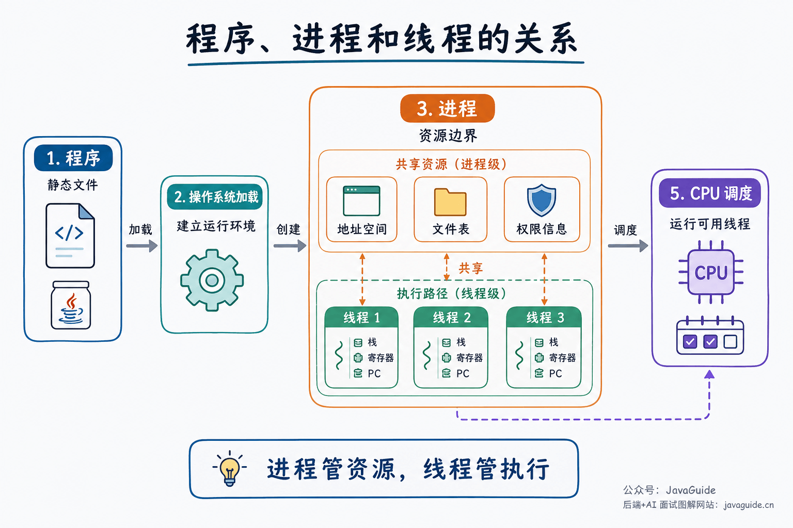
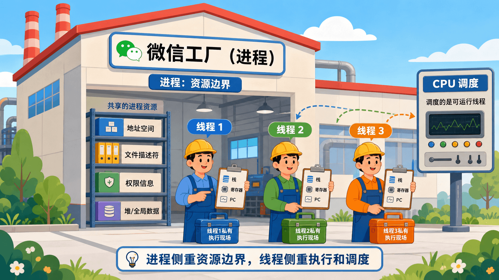
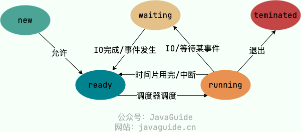
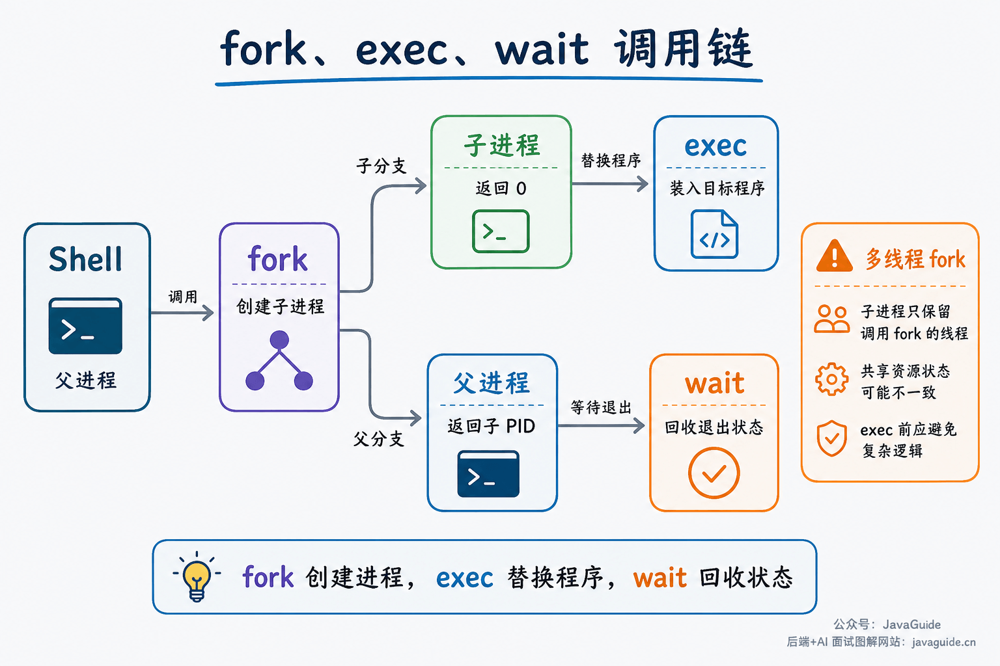
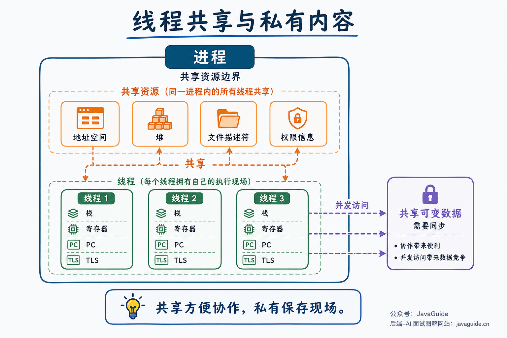
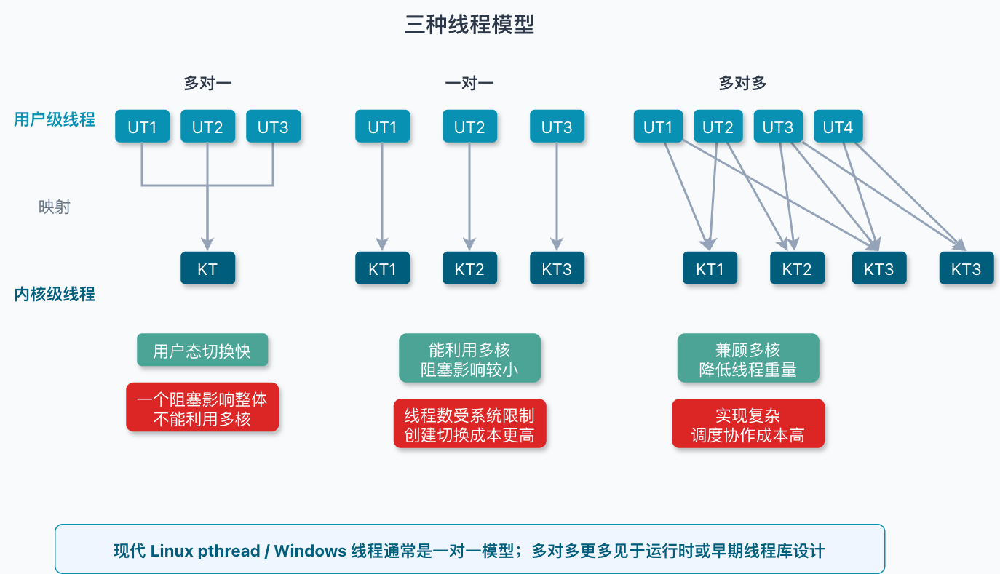
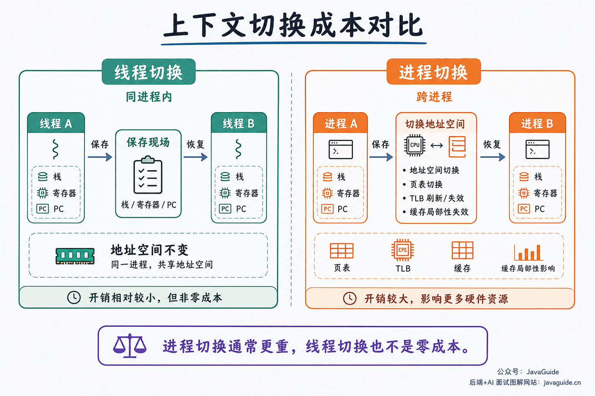
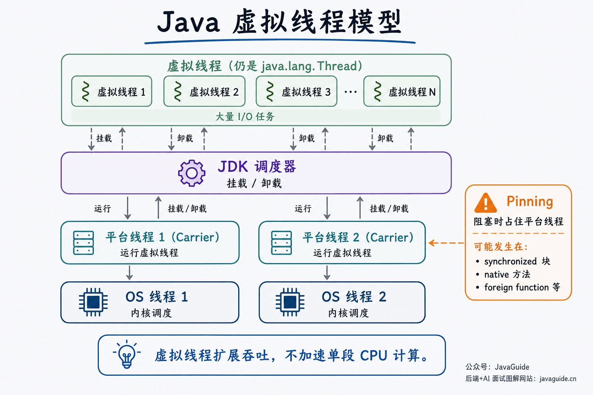

Processes and threads are two of the most fundamental operating system concepts, and they are often confused.

When asked about the difference in an interview, many people stop at “a process is the basic unit of resource allocation, and a thread is the basic unit of CPU scheduling.” This is a useful starting point, but it is not the whole story.

Follow-up questions get more specific: Why are processes isolated by default? What exactly do threads share? After `fork()`, what do parent and child processes share, and what is separate? Why can calling `fork()` from a multithreaded program cause problems? Are Java virtual threads operating system threads?

This article works through these questions. It first clarifies the boundaries between programs, processes, and threads, then covers Linux `fork`, `exec`, `wait`, and `clone`, and finally returns to context switching, thread models, and Java virtual threads. Keep one idea in mind: processes are primarily resource and isolation boundaries, while threads are schedulable paths of execution.

## What Are Programs, Processes, and Threads?

A program is a set of instructions and data stored on disk, such as an executable or a JAR file. It has not started running; it is a static file.

When the operating system loads the program into memory, creates process-level resources such as a virtual address space and file descriptor table, and creates an initial thread with a stack and register context, that run of the program becomes a **process**. The same program can be started multiple times, creating multiple processes. For example, two terminal windows are usually two separate process instances.

A thread is a path of execution within a process. A process has at least one thread. Its threads share process resources, but each has its own execution context. Modern operating systems typically schedule threads: the scheduler may give CPU time to any thread that is runnable.

As a first approximation, remember: **processes define resource boundaries; threads define execution and scheduling.**

To decide whether a concept belongs more to a process or a thread, ask whether it describes a resource boundary or an execution path. Address spaces, open-file tables, and permissions are process-level; stacks, registers, and program counters are thread-level.

This is a learning aid, not a description of every system's implementation. For example, the Linux kernel uses `task_struct` for scheduling entities; processes and threads are more like tasks that share different amounts of resources. Windows documentation explicitly describes a thread as the basic unit to which the operating system allocates processor time. Names vary across systems, but the high-level relationship is similar.

## What Resources Does a Process Have?

A process contains more than the code it is currently executing. It typically includes:

- **Virtual address space:** A process sees a contiguous virtual memory space containing code, data, heap, stack, and memory-mapped regions.
- **Open files and handles:** Such as file descriptors, sockets, pipes, and device handles.
- **Security and identity information:** Such as user IDs, permissions, credentials, and security context.
- **Scheduling information:** Such as priority, CPU-time statistics, affinity, and state.
- **Run-time context:** Such as signals, environment variables, and working directory.

Processes are isolated by default. One process cannot freely read or write another process's virtual address space, which is how the operating system protects programs from one another. Processes exchange data through IPC mechanisms such as pipes, message queues, shared memory, sockets, files, and signals.

Isolation improves security but has a cost. Processes have separate address spaces and resource tables, so switching, communication, creation, and teardown are usually more expensive than for threads.

## What Are Common Process States?

The five-state model commonly used in textbooks is enough for most interviews:

- **New:** The process is being created and has not yet entered the ready queue.
- **Ready:** It can run but is waiting for CPU time.
- **Running:** It is executing on a CPU.
- **Blocked/Waiting:** It is waiting for an event such as I/O completion, a released lock, or a timer.
- **Terminated/Exit:** The process has ended, and the operating system is reclaiming its resources.

The important part of state transitions is what triggers them. A ready process becomes running when it gets CPU time. When its time slice expires, it may return to ready. A blocking I/O request moves it to blocked. Once the event completes, it returns to ready and waits to be scheduled again.

Some textbooks also include **suspended states**. Suspension means a process is temporarily out of memory or has been paused by a user or the system; blocked means it is waiting for an event. They are different: a process can be blocked while still in memory, or be swapped out while blocked.

## What Is a PCB?

The PCB (Process Control Block) is the data structure the operating system uses to manage a process. The kernel stores much of a process's run-time information in a structure like a PCB.

A PCB typically records:

- Process identifiers: PID, parent process ID, user ID, and so on.
- Process state and scheduling information: ready, running, blocked, priority, and time statistics.
- CPU context: Program counter, stack pointer, and general-purpose registers, so execution can resume after a switch.
- Memory-management information: Page tables, virtual address space, and memory mappings.
- Resource information: Open files, signal handling, working directory, and I/O state.

During a context switch, the operating system saves the current execution entity's registers and other state, then restores the next entity's state. Structures such as PCB and TCB provide the information needed to resume execution.

Linux has a distinctive implementation: it treats both processes and threads as tasks. `task_struct` does not contain every resource directly; it points to structures for memory descriptors, file tables, signal handling, and other resources. Threads in the same process point to the same resource structures, while separate processes point to different ones. This is why understanding `clone()` is useful on Linux.

## What Do `fork`, `exec`, and `wait` Do on Linux?

In Unix and Linux programming, process creation often involves `fork()`, `exec()`, and `wait()`.

`fork()` creates a child process. After a successful call, the parent and child continue from the same point, but receive different return values: the parent gets the child's PID, and the child gets 0. They have separate virtual address spaces that initially look the same. Modern systems usually use copy-on-write, copying a page only when one process writes to it.

Note that file descriptors behave differently. After `fork()`, the parent and child have separate copies of the descriptor table, but corresponding descriptors refer to the same open file description. They therefore share the file offset and status flags. Applications often use `FD_CLOEXEC` or `O_CLOEXEC` to prevent descriptors from being inherited by a new program after `exec()`.

The `exec()` family loads another program into the current process. It does not create a process; it replaces the process's user-space code, data, heap, and stack with those of the new program. A common command-line flow is for the shell to `fork()` a child process, which then calls `exec()` to become the target program.

`wait()` and `waitpid()` wait for a child process to change state and reclaim status information left in the kernel after it exits. If a child has exited but its parent has not called `wait`, it becomes a zombie. A zombie no longer runs code, but retains a PID and exit-status record.

When a shell starts an external command, it commonly calls `fork()` to create a child. The child calls `exec()` to become the target program, while the parent calls `wait()` or `waitpid()` to collect its exit status.

One subtle detail: when a multithreaded process calls `fork()`, the child retains only the thread that called `fork()`. The states of locks, condition variables, `malloc`, and stdio from other parent threads may be copied, even though those threads no longer exist. More precisely, between `fork()` and `exec()`, the child of a multithreaded program should call only async-signal-safe functions. Complex work in this window can cause problems.

## What Do Threads Share, and What Is Private?

From the operating system's perspective, threads in the same process share most process resources, such as:

- Memory regions in the process address space, such as code, data, and heap.
- Open file descriptors, sockets, and working directory.
- Process ID, address space, and some signal-handling configuration.
- Global variables and heap objects.

In the Java/JVM context, Java threads also share the heap and run-time data areas such as the method area/metaspace within the same JVM process. The method area/metaspace is a JVM concept, not a general operating system concept.

In Linux user space, threads in one process usually get the same thread-group ID from `getpid()`, commonly called the process ID. Each thread still has its own task/TID in the kernel, which can be retrieved with `gettid()`.

Each thread also has private state:

- Stack: Stores function calls, local variables, return addresses, and more.
- Registers and program counter: Record the thread's current execution position.
- Thread ID, scheduling priority, and thread-local storage (TLS).
- Thread state and kernel context needed to resume execution.

Sharing makes communication between threads convenient: when one thread writes to a heap object, another may see the change immediately. But sharing also creates data races. If multiple threads access the same mutable data without locks, atomic variables, condition variables, or other synchronization, the result may be unexpected.

This is an important practical difference between threads and processes: a process crash usually does not directly damage another process, while an out-of-bounds write or illegal access by one thread can bring down the whole process.

## What Is a TCB?

The TCB (Thread Control Block) stores thread-level control information. It typically records the thread ID and state, register context, stack, priority, thread-local storage, and more.

Some textbooks and system implementations separate PCB and TCB: the PCB holds process-level resources, while the TCB holds thread-level execution state. Linux's `task_struct` represents scheduling entities as tasks and distinguishes processes from threads by whether resource structures are shared. The names matter less than understanding which information belongs to the resource boundary and which belongs to the execution context.

## Why Are Threads Needed If We Already Have Processes?

Threads provide a lower-cost way to run concurrent work within one application.

A server can use multiple processes to handle network I/O, business logic, and log flushing, but sharing state between processes is more difficult, communication requires IPC, and resource use is higher. With threads, they can share heap memory and open connections directly, reducing coordination costs when synchronization is handled correctly.

Threads can also improve resource utilization. On a single-core CPU, other threads can run while one waits for disk or network I/O. On a multicore CPU, multiple threads may run on different cores at the same time. CPU-bound and I/O-bound tasks need different thread counts; more threads do not automatically mean better performance.

Threads are not free. With Linux NPTL, if the process's `RLIMIT_STACK` soft limit at startup is not `unlimited`, it determines the default stack size for new threads. A common `ulimit -s` value is 8192 KB, so the common default thread stack is 8 MB. If `RLIMIT_STACK` is `unlimited`, an architecture-dependent default is used, such as 2 MB on many architectures. You can set a thread's stack size with `pthread_attr_setstacksize()`, but it cannot be below `PTHREAD_STACK_MIN`, which Linux man-pages lists as 16,384 bytes. Threads are also limited by PID counts, `threads-max`, memory, and other resources. Creating large numbers of platform threads without a plan can increase memory pressure, scheduling overhead, and context switches.

## User Threads, Kernel Threads, and Thread Models

Based on who schedules them, threads can be classified as user-level or kernel-level.

**User-level threads** are managed by a user-space runtime or thread library and are usually invisible to the kernel. Creation and switching may not require system calls. However, if all user threads map to a single kernel scheduling entity, one blocking system call may stall the whole process, and it is difficult to use multiple cores.

**Kernel-level threads** are created and scheduled by the operating system. If one thread blocks, the kernel can schedule other threads in the same process; multiple threads can also run in parallel on multiple cores. The cost is that the kernel participates in their creation, teardown, blocking, wakeup, and switching.

There are three common thread models:

| Model        | Mapping                                               | Advantage                                             | Main issue                                                                     |
| ------------ | ----------------------------------------------------- | ----------------------------------------------------- | ------------------------------------------------------------------------------ |
| Many-to-one  | Multiple user threads map to one kernel thread.       | Fast user-space switches and low implementation cost. | One blocking call can stall all threads; limited multicore use.                |
| One-to-one   | Each user thread maps to one kernel thread.           | Uses multiple cores; blocking has less impact.        | Thread count is limited by system resources; creation and switching cost more. |
| Many-to-many | Multiple user threads map to multiple kernel threads. | Balances flexibility and parallelism.                 | Runtime and scheduling are more complex.                                       |

Linux POSIX threads and Windows threads generally use the one-to-one model. Under the hood, Linux `pthread_create()` uses `clone()`, with flags such as `CLONE_VM`, `CLONE_FILES`, `CLONE_FS`, and `CLONE_THREAD` determining which resources are shared. Linux does not have completely separate creation mechanisms for processes and threads; they differ in the resources shared through `clone()` flags.

## How Do Thread and Process Context Switches Differ?

A context switch is when the CPU moves from one execution entity to another. The operating system saves the current entity's registers, program counter, stack pointer, and other state, then restores the next entity's state.

Both thread and process switches have costs, but process switches are usually more expensive. Processes have separate address spaces, so a switch may involve page-table changes, TLB invalidation, and reduced cache locality. Threads in one process share an address space, so switching between them usually does not require replacing the entire memory mapping.

In short: switching between threads in one process mainly changes thread-specific state such as stacks, registers, and program counters. Switching between processes changes that state and may also change the address space, affecting the TLB and cache locality.

However, a thread switch is not just “saving a few registers.” Cross-core migration, lock contention, cache-line invalidation, and thread counts far above the number of CPU cores can make thread scheduling expensive too. If profiling shows significant time spent on scheduling, lock waits, system calls, and context switches, adding more threads often makes things worse.

## Are Fibers, Coroutines, and Virtual Threads Threads?

Fibers and coroutines usually run in user space and are scheduled by an application or runtime. The operating system schedules the kernel threads that host them, not each fiber or coroutine. Switching these lightweight execution units therefore usually does not enter the kernel and can cost less.

But they are not “free threads.” If the runtime does not turn blocking I/O into a suspendable and resumable operation, a user-space task can block its host thread and affect other tasks on that thread. Switching costs also depend on the language, runtime, CPU architecture, and call-stack depth, so nanosecond figures from one benchmark are not universal.

Virtual threads, introduced in Java 21, are a typical example. They are still `java.lang.Thread` instances, but do not permanently occupy an operating system thread. The runtime mounts a virtual thread on a platform thread, which corresponds to an underlying kernel thread. When a virtual thread performs a JDK-supported blocking I/O operation that can be suspended, the JDK can unmount it and let the platform thread run another virtual thread.

Virtual threads are suited to many tasks that wait for I/O, such as concurrent requests, database access, and remote calls. They improve concurrency capacity and throughput scalability; they do not make CPU-bound code run faster. Long CPU-bound tasks still depend on CPU count, workload, and scheduling overhead, so do not create unlimited virtual threads for them.

Relationship between virtual threads, platform threads, and kernel threads:

Also consider pinning. In Java 21, a virtual thread performing a blocking operation inside a `synchronized` block or method, native method, or foreign function may not be unmounted from its platform thread. The platform thread is then occupied and cannot run other virtual threads. Occasional, brief pinning does not break a program, but frequent or long pinning can limit scalability. Later JDKs improved pinning related to `synchronized`; check the behavior of the JDK version you use. Native and foreign calls still need attention.

## How to Summarize the Difference Between Processes and Threads

In an interview, compare them across five dimensions: resources, scheduling, communication, cost, and reliability.

| Dimension               | Process                                                                      | Thread                                                           |
| ----------------------- | ---------------------------------------------------------------------------- | ---------------------------------------------------------------- |
| Basic role              | Basic unit of resource allocation and isolation.                             | Basic unit of CPU scheduling and execution.                      |
| Address space           | Separate by default.                                                         | Shared within the same process.                                  |
| Private state           | PID, address space, resource tables, and more.                               | Stack, registers, program counter, TLS, and more.                |
| Communication           | Uses IPC such as pipes, sockets, and shared memory.                          | Can access shared memory directly, but requires synchronization. |
| Creation/switching cost | Usually higher.                                                              | Usually lower.                                                   |
| Failure impact          | Better isolation; one process crash usually does not affect other processes. | A thread failure may terminate the whole process.                |

A complete answer could be organized like this:

A process is a resource container for a running program, with its own virtual address space, files, permissions, and other resources. A thread is an execution path within a process. Threads share process resources but each has its own stack, registers, program counter, and other execution state. Processes provide stronger isolation but have higher communication and switching costs. Threads are easier to coordinate and usually cheaper to create and switch, but shared memory introduces thread-safety issues, and one thread's failure can affect the whole process.

## Common Misconceptions

**Misconception 1: Processes run in parallel, while threads run concurrently.**

Concurrency and parallelism describe execution, not fixed properties of processes or threads. On a single core, multiple processes or threads can only run concurrently; on multiple cores, either can run in parallel.

**Misconception 2: More threads always mean better performance.**

Threads can overlap I/O waits and use multiple cores, but too many threads increase stack memory use, scheduling overhead, lock contention, and cache misses. CPU-bound workloads often need a thread count near the number of cores, while I/O-bound workloads may benefit from more concurrent execution units.

**Misconception 3: Processes cannot share memory.**

Default isolation does not prevent sharing. Shared memory is an IPC mechanism that lets multiple processes map the same physical memory; the application must handle synchronization and lifecycle management.

**Misconception 4: Java virtual threads are operating system threads.**

Platform threads are usually thin wrappers around OS threads. Virtual threads are scheduled by the Java runtime and mounted on platform threads to execute. Both are represented as `Thread`, but their resource models and scheduling differ.
